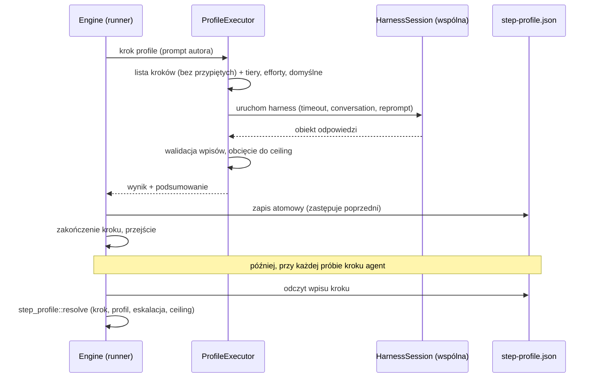
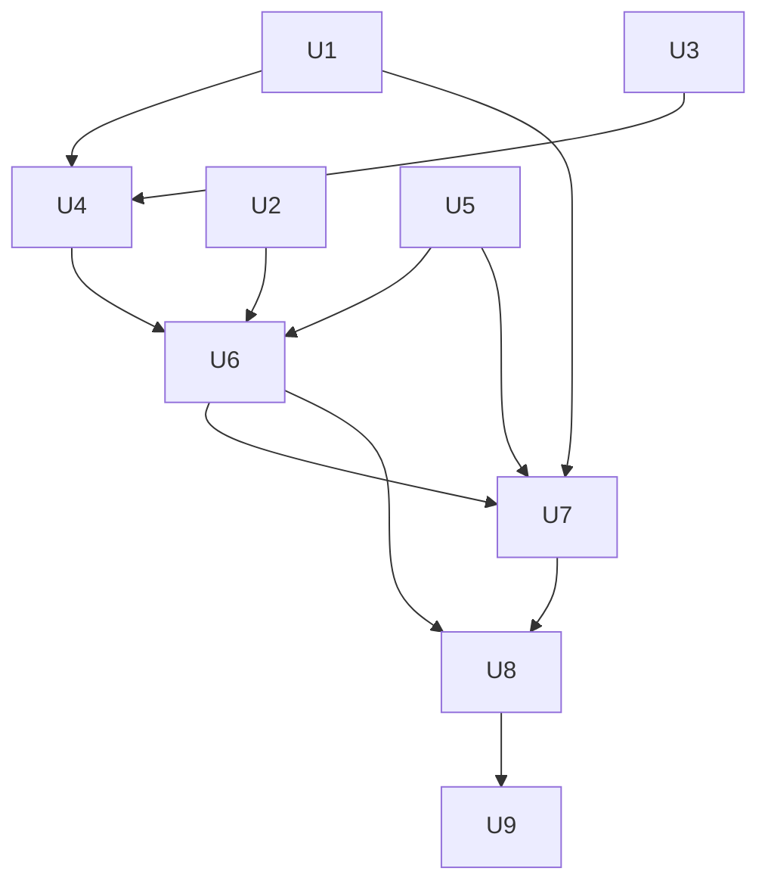

# feat: Krok profile zamiast profilowania przez dyrygenta

## Summary

Workflow dostaje nową akcję `type: profile`. Agent profilujący proponuje model i effort dla kroków. Silnik waliduje wpisy, obcina je do `ceiling` i zapisuje wynik w pliku wykonania. Runner czyta ten plik przy starcie każdej próby kroku. Każde uruchomienie kroku `profile` zastępuje poprzedni wynik. Dzięki temu workflow może profilować kilka razy, z różnych źródeł złożoności. Plan ma dwa etapy. Etap 1 to refaktoryzacja bez zmiany zachowania: wspólny kod akcji z harnessem trafia do osobnych modułów. Etap 2 dodaje akcję `profile` i usuwa profilowanie przez dyrygenta z #92.

---

## Problem Frame

Dziś profil kroków powstaje po udanym kroku z `plan: true`. Silnik wysyła żądanie `ProfileSteps` do dyrygenta. Mechanizm jest ukryty, działa raz i zależy od dyrygenta (see origin: `docs/brainstorms/2026-11-11-krok-profile-zamiast-profilowania-przez-dyrygenta-requirements.md`). Plan realizuje R1–R16 i AE1–AE8 z origin. Wyjątek to AE6: patrz Decyzje operatora.

---

## Requirements

Wymagania R1–R16, aktorzy A1–A4, przepływy F1–F3 i przykłady AE1–AE8 pochodzą z origin.

| Wymaganie | Jednostka |
|---|---|
| R1, R2 | U4, U6 |
| R3, AE1, AE2 | U4 (oznaczenie własnych wartości), U6 (lista) |
| R4, AE8 | U6 |
| R5 | U6, U8 |
| R6, AE3 | U6 |
| R7, R11, AE4 | U6, U9 (widok) |
| R8 | U5, U6 |
| R9, AE5 | U5, U7 |
| R10 | U7 (bez zmian w `step_profile::resolve`) |
| R12, AE6 | U7 (licznik bez zmian, patrz Decyzje operatora) |
| R13, AE7 | U1, U2, U4, U6 |
| R14, R15 | U1, U2, U3 |
| R16 | U8, U9 |

**Odstępstwo od origin (decyzja operatora):** licznik eskalacji działa jak w #92. Liczy kolejne nieudane próby w jednym wejściu w krok. AE6 obowiązuje w tej postaci: krok `fix` w jednym wejściu zawodzi 3 razy i dostaje eskalację. Przy następnym wejściu krok startuje z wartością z nowego profilu, a licznik liczy od zera. R12 jest spełnione, bo zapis profilu nie zmienia licznika.

---

## Scope Boundaries

Z origin, bez zmian:

- Profil na jednostkę planu (`unit`).
- Reguła „awaria kroku `profile` nie zatrzymuje zadania”.
- Zerowanie licznika awarii po nowym profilu.
- Wybór modelu przez dyrygenta dla pojedynczych kroków w trakcie zadania.
- Zmiana tierów, skali effortów i mapowania tierów na modele harnessów.

Dodane w planie:

- Sumowanie licznika awarii ze wszystkich wejść w krok. Operator wybrał licznik na jedno wejście w krok, jak w #92 (patrz Decyzje operatora).
- Rozgałęzianie workflow przez krok `profile` (`choice`). Krok ma jedno wyjście.
- Migracja profilu zapisanego przez dyrygenta w zadaniach w toku. Silnik go ignoruje.
- Ratunek odpowiedzi przez dyrygenta (`runner/rescue.rs`) dla kroku `profile`. Ratunek wybiera etykietę `choice`, której krok `profile` nie ma.
- Ustawienie `conductor_model` i `conductor_effort` dyrygenta zostaje. Nie dotyczy profilowania kroków.

### Deferred to Follow-Up Work

- Nagranie odpowiedzi prawdziwego `claude` dla schematu odpowiedzi `profile` w `tests/fixtures/claude-code/`. Plan dodaje test ręczny `#[ignore]`. Nagranie powstaje po pierwszym uruchomieniu na prawdziwym CLI.
- Wyróżnienie wpisu profilu w „Rozmowie” osobnym kolorem. Plan używa zwykłego wpisu (R11).

---

## Context & Research

### Relevant Code and Patterns

- `crates/narsor-engine/src/domain/workflow_definition.rs`: `ActionConfig` (`#[serde(tag = "type")]`), `AgentActionConfig`, `StepCeiling`, `inherit_global_defaults`. `inherit_global_defaults` kopiuje `globals.default_*` i `globals.ceiling` do kroku. Po tej operacji nie wiadomo, które wartości są własne (problem dla R3).
- `crates/narsor-engine/src/workflow/schema.rs` (`ActionSchema`, `AgentActionSchema` z `deny_unknown_fields`), `loader.rs` (`compile_action`, `compile_state`), `validator.rs` (`validate_action`, `validate_step_contract`, `validate_step_profile`, `action_type_name`, `validate_state_templates`).
- `crates/narsor-engine/src/engine/runner.rs`: `ActionKind` z `of` i `name`. `run_action` (pętla retry, `failures: attempt - 1`), `attempt_action` (blok tylko dla agenta: historia, `pin_harness`, `apply_step_profile`, `take_agent_input`), `execute_rendered`, `reprompt`, `reprompt_attempt`, `timeout_for` (`match` wyczerpujący z założenia), `apply_step_profile`, `profiled_template`, `note_step_profile`, `profile_after_plan`, `note_step_profile_failure`, `started_states`, `first_entry_at`.
- `crates/narsor-engine/src/engine/actions/agent.rs` (`AgentExecutor::run`) i `agent/{contract,conversation,denials,process,response}.rs`. `agent/response.rs` ma ograniczone skanery JSON (`MAX_BRACE_CANDIDATES`, `top_level_objects`) i łańcuch `structured_output` → tekst → reprompt.
- `crates/narsor-engine/src/engine/actions/process_group.rs`: `GroupGuard`, jedno miejsce zabijania grupy procesów.
- `crates/narsor-engine/src/engine/step_profile.rs`: `resolve`, `ProfileInput`, `ProfileSource`, `EffectiveProfile`, `Setting`, `MODEL_TIERS`, `EFFORT_SCALE`. Zostaje.
- `crates/narsor-engine/src/conductor/profile.rs`: `entries_of` waliduje model i effort osobno i obcina do `ceiling`. Logika przechodzi do nowego modułu, a plik znika.
- `crates/narsor-engine/src/persistence/paths.rs` i `execution_store.rs`: pliki wykonania `{state}/executions/{id}/`. Wzorzec: `step_reply_file`, `write_step_reply` z `write_atomic`.
- `crates/narsor-engine/src/persistence/recovery.rs`: krok z `ActionCompleted` bez przejścia wznawia się z `metadata.engine.pending_step`.
- Inne miejsca z `match` na akcję: `engine/runner/failure.rs` (`attempt_left_no_trace`), `engine/runner/rescue.rs`, `engine/runner/gate_context.rs`, `workflow/template.rs`, `environment/resolver.rs` (`harness`), `controller_protocol/service.rs` (`workflow_steps`), `controller_protocol/service/actions.rs`, `src/tui/task_app/actions.rs`, `crates/narsor-runner/src/runner/session_tests.rs`.
- Testy integracyjne: jedna crate `tests/integration/main.rs`. `tests/integration/step_profile_flow.rs`, `tests/integration/actions_agent.rs` (`FakeHarness` z `tests/fixtures/harness/fake_harness.sh`), `tests/integration/engine_support/mod.rs` (`ScriptedAgentExecutor`, `AgentCall` z `model` i `effort`).

### Institutional Learnings

- `docs/solutions/architecture-patterns/step-profile-tiers-decide-once-validate-at-load-2026-11-11.md`: jedna funkcja reguły (`resolve`), walidacja przy ładowaniu workflow, tiery zamiast nazw modeli. Zasada „decide once” przestaje obowiązywać (F3). Dokument wymaga aktualizacji.
- `docs/solutions/integration-issues/claude-code-json-schema-rejects-top-level-anyof-2026-10-17.md`: schemat odpowiedzi musi być płaskim obiektem bez `anyOf` na najwyższym poziomie. Łańcuch odczytu `structured_output` → tekst → reprompt.
- `docs/solutions/runtime-errors/agent-step-hangs-on-orphaned-background-process-2026-10-26.md`: jedno miejsce uruchamiania harnessu i jedna reguła „final answer”. Refaktoryzacja nie może jej powielić.
- `docs/solutions/security-issues/untrusted-agent-text-unclosed-brace-scan-quadratic-2026-10-18.md`: tekst agenta jest niezaufany. Parser odpowiedzi `profile` używa tych samych ograniczonych skanerów. `rationale` jest czyszczone przed wyświetleniem.
- `docs/solutions/design-patterns/agent-step-allowlist-per-step-least-privilege-2026-10-21.md`: minimalne uprawnienia kroku. Podstawa dla domyślnego dostępu tylko do odczytu.
- `docs/solutions/conventions/single-integration-test-crate-and-lean-target-2026-11-01.md`: nowy plik testów potrzebuje `mod` w `tests/integration/main.rs`.

### Zweryfikowane założenie z origin

- Silnik nie używa pola `unit` przy starcie kroku. `apply_step_profile` woła `lookup(&state.id, None)`. Usunięcie `unit` jest bezpieczne.

---

## Key Technical Decisions

- **`ActionKind::Profile` z własnym executorem.** Akcja ma osobny typ w domenie, schemacie i silniku. Executor `profile` używa tej samej sesji harnessu co `agent` (U2). Osobne są tylko budowanie promptu i odczyt odpowiedzi (R14).
- **Zdolności akcji zamiast rozproszonych `match`.** Etap 1 dodaje do `ActionKind` metody, które mówią, co akcja robi. Przykłady: „uruchamia harness”, „czyta `choice`”, „ma ratunek odpowiedzi”. Miejsca w runnerze pytają o zdolność, a nie o konkretny typ. Wyczerpujące `match` zostają tam, gdzie autor kodu celowo wymusza decyzję (np. `timeout_for`). Tabela decyzji jest w U1.
- **Wspólna konfiguracja kroku z harnessem.** Pola `harness`, `model`, `effort`, `ceiling`, `workspace_access`, `workspace`, `parameters`, dodatkowe ścieżki i `extra_args` przechodzą do jednego typu domeny. `AgentActionConfig` i `ProfileActionConfig` go zawierają. Zapisane definicje wykonań wczytują się bez zmian (U3).
- **Własne wartości kroku są oznaczane przed dziedziczeniem z `globals`.** Loader zapisuje, czy `model` i `effort` pochodzą z samego kroku. Pole ma `serde(default)`. Stara definicja bez pola oznacza „nie przypięty”, więc krok trafia na listę.
- **Reguła przypięcia (R3).** Krok wypada z listy, gdy ma własny `model` i własny `effort` oraz nie ma `ceiling` po dziedziczeniu. `ceiling` z `globals` liczy się jako `ceiling`, bo autor dał miejsce na podniesienie. Na liście są tylko kroki `agent`. Kroki `profile` nie są na liście.
- **Plik wyniku w katalogu wykonania.** Ścieżka robocza: `executions/{id}/step-profile.json`. Plik ma wersję i listę wpisów. Wpis: krok, `model`, `effort`, `rationale`, wartości żądane przed obcięciem, krok profilujący, czas decyzji. Zapis jest atomowy i zastępuje cały plik (R8). Plik należy do silnika, nie do dyrygenta, i przeżywa restart runnera.
- **Zapis przed zakończeniem kroku.** Executor zwraca zwalidowany wynik w rezultacie akcji. Silnik zapisuje plik przed zdarzeniem zakończenia kroku. Ponowione zakończenie po restarcie zapisuje ten sam plik jeszcze raz, więc operacja jest idempotentna.
- **Odpowiedź agenta to płaski obiekt bez `choice`.** Obiekt ma listę wpisów `{step, model, effort, rationale, confident}`. Krok ma jedno wyjście. Brak lub uszkodzenie całego obiektu to odrzucenie odpowiedzi: reprompt, potem `retry_policy`, potem operator (R13). Zły pojedynczy wpis nie jest błędem kroku (R6).
- **Walidacja wpisu.** Kolejność dla każdego wpisu: krok nieznany lub spoza listy → pomiń z notatką. `confident: false` → pomiń (R4). Model i effort osobno: wartość spoza tierów lub skali → wartość domyślna kroku, druga wartość działa (R6). Wartość powyżej `ceiling` → obcięta, żądanie zapisane (R7). Bez `ceiling` wartość wyższa niż domyślna jest obcinana do wartości domyślnej (reguła z #92). Wynik równy wartościom domyślnym → pomiń (R6). Logika pochodzi z `conductor/profile.rs` (`entries_of`) i zostaje jedna.
- **Runner czyta plik przy każdej próbie.** `apply_step_profile` czyta nowy plik zamiast magazynu dyrygenta. Filtr „profil ustalony przed pierwszym wejściem” znika. `step_profile::resolve` zostaje bez zmian. Pole i wariant `conductor` dostają nazwę „profil”. Uszkodzony plik oznacza brak profilu i ostrzeżenie (jak w #92).
- **Domyślny dostęp tylko do odczytu.** Krok `profile` bez `workspace_access` dostaje odczyt. Autor może ustawić inny dostęp.
- **„Rozmowa” i „Przebieg”.** Agent profilujący ma zwykłą rozmowę. Po walidacji silnik dopisuje jeden wpis Narsora z wynikiem dla każdego kroku: wartość żądana, wartość zapisana, obcięcie, `rationale` (R7, R11). Powód zakończenia kroku w „Przebiegu” zawiera krótkie podsumowanie, np. liczbę zapisanych i pominiętych wpisów. Tekst agenta jest czyszczony przed zapisem do widoku.

### Szkic przepływu (kierunek, nie implementacja)

Ilustruje zamierzone podejście. To wskazówka do przeglądu, nie kod do skopiowania.

---

## Implementation Units

Etap 1 (U1–U3) to refaktoryzacja bez zmiany zachowania. Osobny commit lub PR. Testy z #92 przechodzą bez zmian (R15). Etap 2 (U4–U9) to funkcja.

### U1. Zdolności akcji w runnerze i wydzielenie przygotowania próby z harnessem

**Goal:** Runner pyta o zdolność akcji, a nie o typ `Agent`. Przygotowanie próby z harnessem jest w osobnym module.

**Requirements:** R14, R15

**Dependencies:** brak

**Files:**
- Modify: `crates/narsor-engine/src/engine/runner.rs`
- Create: `crates/narsor-engine/src/engine/runner/harness_attempt.rs` (nazwa robocza; blok `impl Engine`)
- Modify: `crates/narsor-engine/src/engine/runner/failure.rs`, `rescue.rs`, `gate_context.rs`
- Test: istniejące testy w `tests/integration/` (bez zmian), testy metod `ActionKind` w `runner.rs`

**Approach:**
- Dodaj do `ActionKind` metody zdolności. Każda ma wyczerpujący `match`, więc nowy typ wymusza decyzję.
- Przenieś blok tylko dla agenta z `attempt_action` (historia, `pin_harness`, `apply_step_profile`, `take_agent_input`, notatka odzyskania) do `harness_attempt.rs`.
- Zamień warunki `kind == Agent` na zdolności. Decyzje dla etapu 2:

| Miejsce | Zdolność | `Profile` w etapie 2 |
|---|---|---|
| `timeout_for` | limit czasu agenta | jak `Agent` |
| `attempt_action` (blok harnessu) | uruchamia harness | jak `Agent` |
| `attempt_action` (`OutputRejection::from_result`), `reprompt`, `reprompt_attempt`, `continue_rejected_output` | odrzucenie odpowiedzi i reprompt | jak `Agent` |
| `rescue.rs` (`continue_output_rescue`, `rescue_output`) | ratunek etykiety przez dyrygenta | nie |
| `raise_output_problem`, `output_problem_instruction` | problem z odpowiedzią | jak `Agent` |
| `apply_decision`, `decision_by`, `suspend_for_input` | czyta `choice` / pytanie agenta | nie dla `choice`; pytanie agenta: jak `Agent` |
| `execute_rendered` (`workspace_access`) | dostęp do workspace | tak, domyślnie odczyt |
| `is_agent`, `step_templates` | szablony kroku z harnessem | jak `Agent` |
| `failure.rs` `attempt_left_no_trace` | ślad próby | jak `Agent` |
| `gate_context.rs` `has_step_contract`, `holds_variables_to_declarations` | kontrakt zmiennych | nie (krok bez zmiennych) |
| `profile_after_plan` | — | znika w U8 |

**Patterns to follow:** istniejące pliki `runner/*.rs` z blokami `impl Engine`. Komentarz w `timeout_for` o wyczerpującym `match`.

**Test scenarios:**
- Happy path: każda metoda zdolności zwraca dla `Agent`, `Script`, `Human`, `Wait`, `Decision` tę samą wartość co dzisiejsze warunki.
- Integration: cały zestaw `tests/integration` przechodzi bez zmian, w tym `step_profile_flow.rs` i `actions_agent.rs`.

**Verification:** Brak zmian w testach. `runner.rs` nie ma porównań `== ActionKind::Agent` poza metodami zdolności.

---

### U2. Wspólna sesja harnessu

**Goal:** Uruchomienie harnessu, limit czasu, rozmowa i odczyt odpowiedzi są w jednym folderze funkcjonalnym. `AgentExecutor` zawiera tylko prompt i odczyt `choice`.

**Requirements:** R13, R14, R15

**Dependencies:** brak (równolegle z U1)

**Files:**
- Create: `crates/narsor-engine/src/engine/actions/session.rs` i `session/` (nazwa robocza)
- Move: `agent/process.rs`, `agent/conversation.rs`, `agent/denials.rs` i ogólna część `agent/response.rs` (skanery JSON, `structured_output` → tekst) do `session/`
- Modify: `crates/narsor-engine/src/engine/actions/agent.rs`, `agent/contract.rs`, `agent/response.rs`
- Modify: `crates/narsor-engine/src/engine/actions/mod.rs`
- Modify: `crates/narsor-engine/src/conductor/response.rs` (import skanerów z nowego miejsca)
- Test: przeniesione testy w modułach `session/`, `tests/integration/actions_agent.rs` (bez zmian)

**Approach:**
- Sesja przyjmuje gotowy prompt i kontrakt wyjścia, a zwraca surową odpowiedź, sesję harnessu, odmowy i wynik procesu. Executor buduje prompt przed sesją i czyta odpowiedź po sesji.
- `spawn_and_wait`, `GroupGuard` i reguła „final answer” zostają w jednym miejscu. Brak drugiej ścieżki uruchamiania.
- Ostrzeżenie o harnessie bez effortu i zdarzenie `AgentSessionStarted` (model, effort) są w sesji, bo dotyczą obu akcji.
- Odczyt `choice` (`actions/answer.rs`, `read_choice_answer`) zostaje w `agent`.

**Patterns to follow:** układ `agent.rs` + `agent/` (plik modułu i folder podmodułów).

**Test scenarios:**
- Integration: wszystkie testy `actions_agent.rs`, w tym argumenty effortu i `AgentSessionStarted`, przechodzą bez zmian.
- Edge case: przeniesiony test skanera z patologicznym wejściem (wiele niezamkniętych nawiasów) kończy się w limicie czasu.
- Error path: limit czasu sesji daje `ActionOutcome::TimedOut` tak jak przed zmianą.

**Verification:** `agent.rs` nie uruchamia procesu sam. Testy przechodzą bez zmian.

---

### U3. Wspólna konfiguracja kroku z harnessem w domenie i schemacie

**Goal:** Pola sesji harnessu są w jednym typie. Loader, walidator i dziedziczenie z `globals` działają na tym typie.

**Requirements:** R14, R15

**Dependencies:** brak (równolegle z U1, U2)

**Files:**
- Modify: `crates/narsor-engine/src/domain/workflow_definition.rs`
- Modify: `crates/narsor-engine/src/workflow/schema.rs`, `loader.rs`, `validator.rs`, `template.rs`
- Modify: `crates/narsor-engine/src/engine/step_profile.rs` (`Setting::default_of`, `ceiling_of`)
- Test: testy loadera i walidatora w tych plikach, `tests/integration/schema_loading.rs`

**Approach:**
- Wydziel typ z polami sesji harnessu (nazwa robocza `HarnessStepConfig`). `AgentActionConfig` go zawiera.
- Kształt zapisu w `definition.yaml` się nie zmienia. Zapisane definicje wczytują się bez zmian.
- `inherit_global_defaults` i `validate_step_profile` działają na nowym typie.
- `plan: bool` zostaje w `AgentActionConfig` do U8.

**Patterns to follow:** `serde(default)` i `skip_serializing_if` w `AgentActionConfig`.

**Test scenarios:**
- Integration: definicja wykonania zapisana przed zmianą (fixture) wczytuje się i daje ten sam `AgentActionConfig`.
- Happy path: istniejące testy loadera i walidatora przechodzą bez zmian.
- Edge case: zapis i odczyt nowego typu dają ten sam YAML co przed zmianą (test porównawczy).

**Verification:** Testy przechodzą bez zmian. Koniec etapu 1.

---

### U4. Akcja `profile` w schemacie, domenie, loaderze i walidatorze

**Goal:** Workflow może zawierać krok `type: profile`. Loader oznacza własne wartości kroków.

**Requirements:** R1, R2, R3, R13, AE1, AE2

**Dependencies:** U1, U3

**Files:**
- Modify: `crates/narsor-engine/src/domain/workflow_definition.rs` (`ActionConfig::Profile`, `ProfileActionConfig`, oznaczenie własnych wartości)
- Modify: `crates/narsor-engine/src/workflow/schema.rs` (`ActionSchema::Profile`)
- Modify: `crates/narsor-engine/src/workflow/loader.rs`, `validator.rs`, `template.rs`
- Modify: `crates/narsor-engine/src/engine/runner.rs` (`ActionKind::Profile`, decyzje z tabeli U1)
- Modify: `crates/narsor-engine/src/environment/resolver.rs` (`harness`)
- Modify: `docs/dev/workflow-schema.md` (nowa sekcja akcji `profile`)
- Test: testy w `loader.rs` i `validator.rs`, `tests/integration/schema_loading.rs`, fixture `tests/fixtures/v2/engine_profile_step.yaml`

**Approach:**
- `ProfileActionConfig`: konfiguracja sesji harnessu (U3) i prompt autora.
- `inherit_global_defaults` działa także dla kroku `profile`. Krok `profile` może mieć własny `ceiling` i eskalację.
- Loader zapisuje znacznik „własny model i effort” przed dziedziczeniem.
- Walidator: krok `profile` ma `exit` i nie ma `choices`. Krok nie deklaruje zmiennych ani artefaktów. Pole `effort` nie jest szablonem (jak w agencie). Brak `workspace_access` daje odczyt.
- `action_type_name`, `validate_state_templates` i `template.rs` traktują prompt `profile` jak prompt agenta.

**Patterns to follow:** `AgentActionSchema` z `deny_unknown_fields`. `validate_step_profile`.

**Test scenarios:**
- Happy path: workflow z krokiem `type: profile` i `exit` wczytuje się. Krok ma dostęp tylko do odczytu.
- Happy path: krok `build` z własnym `model: small` i `effort: low` bez `ceiling` jest oznaczony jako przypięty. Covers AE1.
- Edge case: krok `build` z własnym modelem, effortem i `ceiling` nie jest przypięty. Covers AE2.
- Edge case: krok z modelem i effortem tylko z `globals.default_*` nie jest przypięty.
- Edge case: krok z własnym modelem i effortem i `ceiling` tylko z `globals` nie jest przypięty.
- Edge case: stara definicja bez znacznika wczytuje się, krok nie jest przypięty.
- Error path: krok `profile` z `choices` jest odrzucony z czytelnym błędem.
- Error path: krok `profile` ze zmiennymi lub artefaktami jest odrzucony.
- Error path: nieznane pole w akcji `profile` jest odrzucone (`deny_unknown_fields`).

**Verification:** Walidator odrzuca złe kroki przy ładowaniu workflow, nie w czasie wykonania.

---

### U5. Plik wyniku profilowania w katalogu wykonania

**Goal:** Silnik zapisuje i czyta wynik profilowania bez dyrygenta.

**Requirements:** R8, R9

**Dependencies:** brak (równolegle z etapem 1)

**Files:**
- Modify: `crates/narsor-engine/src/persistence/paths.rs` (ścieżka pliku)
- Modify: `crates/narsor-engine/src/persistence/execution_store.rs` (odczyt i zapis)
- Create: `crates/narsor-engine/src/engine/profile/store.rs` lub typy wyniku w `persistence/` (wybór przy implementacji; typy wyniku niezależne od dyrygenta)
- Test: testy w module magazynu

**Approach:**
- Plik ma wersję i listę wpisów (Key Technical Decisions). Bez `unit`.
- Zapis zastępuje cały plik (`write_atomic`).
- Brak pliku to pusty wynik. Uszkodzony plik to błąd, który wywołujący traktuje jak brak wyniku.
- Odczyt ogranicza rozmiar pliku.

**Patterns to follow:** `step_reply_file`, `write_step_reply`, `read_step_reply`. Wersjonowanie z dawnego `PROFILE_VERSION` w `conductor/store.rs`.

**Test scenarios:**
- Happy path: zapis i odczyt zwracają te same wpisy z `rationale` i wartościami żądanymi.
- Happy path: drugi zapis zastępuje pierwszy. Wpis z pierwszego zapisu, którego nie ma w drugim, znika. Covers R8.
- Edge case: brak pliku daje pusty wynik.
- Error path: uszkodzony plik daje błąd odczytu.
- Error path: plik większy niż limit daje błąd odczytu.

**Verification:** Plik przeżywa restart runnera (ten sam `--task-storage`).

---

### U6. Executor akcji `profile`

**Goal:** Krok `profile` buduje prompt, uruchamia agenta, waliduje wpisy i zwraca wynik. Silnik zapisuje wynik w pliku.

**Requirements:** R2, R3, R4, R5, R6, R7, R8, R11, R13, F1, AE1, AE2, AE3, AE4, AE7, AE8

**Dependencies:** U2, U4, U5

**Files:**
- Create: `crates/narsor-engine/src/engine/actions/profile.rs` i `profile/` (np. `candidates.rs`, `contract.rs`, `answer.rs`, `entries.rs`; nazwy robocze)
- Modify: `crates/narsor-engine/src/engine/actions/mod.rs`
- Modify: `crates/narsor-engine/src/engine/runner.rs` (rejestracja executora w `Engine::new`, `rebuild_agent_executor`; zapis pliku przed zakończeniem kroku)
- Test: testy w modułach `profile/`, `tests/integration/profile_step_flow.rs` (nowy, `mod` w `tests/integration/main.rs`), test ręczny `#[ignore]` ze schematem na prawdziwym `claude`

**Approach:**
- Lista kroków: kroki `agent` bez przypiętych (U4). Każdy krok ma id, `description`, wartości domyślne po dziedziczeniu i `ceiling`. Do promptu trafiają też `MODEL_TIERS` i `EFFORT_SCALE` z kodu.
- Prompt: prompt autora, blok danych silnika, kontrakt odpowiedzi. Autor nie wpisuje danych (R2).
- Kontrakt odpowiedzi: płaski schemat obiektu z listą wpisów. Bez `anyOf` na najwyższym poziomie i bez `choice`.
- Odczyt: łańcuch z sesji (U2) i ograniczone skanery. Brak obiektu → odrzucenie odpowiedzi i reprompt (R13).
- Walidacja wpisów według reguły z Key Technical Decisions. Logika z `conductor/profile.rs` (`entries_of`) przechodzi tutaj i korzysta z `step_profile` (tiery, skala, obcięcie).
- Rezultat akcji: lista wpisów do zapisu i podsumowanie. Silnik zapisuje plik (U5) przed zdarzeniem zakończenia kroku. Pusta lista też zastępuje plik.
- Rozmowa: silnik dopisuje jeden wpis Narsora z wynikiem dla każdego kroku. Tekst `rationale` jest czyszczony (`without_unsafe_chars_multiline`).
- Profil samego kroku `profile` (model, effort, eskalacja) idzie przez `apply_step_profile` tak jak dla agenta.

**Execution note:** Najpierw testy walidacji wpisów (czyste funkcje), potem przepływ integracyjny.

**Patterns to follow:** `AgentExecutor` po U2, `agent/contract.rs` (`output_contract`, `reprompt_config`), `conductor/profile.rs` (`entries_of`) i jego testy.

**Test scenarios:**
- Happy path: krok `build` z własnym modelem i effortem bez `ceiling` nie występuje w prompcie. Covers AE1.
- Happy path: krok `build` z `ceiling` występuje w prompcie. Covers AE2.
- Happy path: prompt zawiera prompt autora, opisy kroków, tiery, efforty i wartości domyślne.
- Happy path: wpis `large` / `extreme` daje model `large` i effort domyślny. Covers AE3.
- Edge case: `ceiling` `effort: high`, wpis `max` daje `high`. Wpis Rozmowy pokazuje żądanie `max` i obcięcie do `high`. Covers AE4.
- Edge case: wpis z `confident: false` nie trafia do pliku. Covers AE8.
- Edge case: wpis równy wartościom domyślnym nie trafia do pliku.
- Edge case: wpis dla nieznanego kroku lub kroku przypiętego jest pominięty z notatką.
- Edge case: dwa wpisy dla tego samego kroku: obowiązuje jedna jawna reguła (np. pierwszy wygrywa), opisana w teście.
- Edge case: odpowiedź z pustą listą zastępuje plik pustym wynikiem.
- Error path: odpowiedź bez obiektu daje reprompt. Po nieudanym reprompcie działa `retry_policy`.
- Error path: limit czasu przy wyczerpanej `retry_policy` kończy krok błędem jak krok agenta. Covers AE7.
- Error path: `rationale` ze znakami sterującymi jest oczyszczone w Rozmowie.
- Integration: przebieg z `FakeHarness`: krok `profile` zapisuje plik przed przejściem do następnego kroku.

**Verification:** Plik powstaje przed przejściem kroku. Testy przepływu „plik → argumenty następnego kroku” są w U7.

---

### U7. Odczyt wyniku przy starcie kroku

**Goal:** Runner bierze wpis kroku z pliku przy każdej próbie. Brak wpisu oznacza wartości z kroku lub z `globals`.

**Requirements:** R9, R10, R12, F2, F3, AE5, AE6

**Dependencies:** U1, U5, U6

**Files:**
- Modify: `crates/narsor-engine/src/engine/runner/harness_attempt.rs` (`apply_step_profile`, `note_step_profile`)
- Modify: `crates/narsor-engine/src/engine/runner.rs` (usuń `first_entry_at` i filtr „profil przed pierwszym wejściem”)
- Modify: `crates/narsor-engine/src/engine/step_profile.rs` (nazwy: `conductor` → profil; brak zmian reguły)
- Test: `crates/narsor-engine/src/engine/step_profile.rs` (`tests`), `tests/integration/profile_step_flow.rs`

**Approach:**
- `apply_step_profile` czyta plik z U5 zamiast `ConductorStore::load_profile`.
- Profil zapisany po pierwszym wejściu w krok też obowiązuje (F3).
- Licznik eskalacji bez zmian: `failures` z pętli `run_action`.
- Komunikaty `note_step_profile` mówią o kroku profilującym, nie o dyrygencie.

**Test scenarios:**
- Happy path: plik bez wpisu dla `review`: krok używa wartości z kroku, a gdy ich brak, z `globals`. Covers AE5.
- Happy path: wpis dla `work` daje model i effort z wpisu.
- Edge case: wpis zapisany po pierwszym wejściu w krok obowiązuje przy następnym wejściu.
- Edge case: w jednym wejściu krok `fix` zawodzi 3 razy i dostaje effort o stopień wyższy od wartości z pliku. Covers AE6 (w wersji z decyzji operatora).
- Edge case: zapis nowego wyniku nie zmienia licznika prób w trwającym wejściu. Covers R12.
- Error path: uszkodzony plik: wartości domyślne i jedno ostrzeżenie.
- Integration: stary plik `conductor/profile.json` w katalogu wykonania jest ignorowany.
- Integration: przebieg z `FakeHarness`: krok `profile` zapisuje plik, następny krok `agent` startuje z modelem i effortem z pliku (argumenty harnessu).
- Integration: krok `profile` uruchomiony drugi raz w pętli zastępuje wynik. Krok po nim startuje z nową wartością. Covers F3.

**Verification:** Testy `step_profile.rs` przechodzą bez zmian reguły (tylko nazwy).

---

### U8. Usunięcie profilowania przez dyrygenta, `plan: true` i `complexity`

**Goal:** Stary mechanizm znika z silnika, protokołu i testów.

**Requirements:** R5, R16

**Dependencies:** U6, U7

**Files:**
- Delete: `crates/narsor-engine/src/conductor/profile.rs`, `crates/narsor-engine/src/domain/complexity.rs`
- Modify: `crates/narsor-engine/src/conductor/mod.rs`, `actor.rs` (gałąź `ConductorTrigger::Profile`), `prompt.rs` (`profile_steps_instruction`, gałęzie `DecisionKind::Profile`), `response.rs` (`DecisionKind::Profile`, `Decision::Profile`, `ProfiledStep`), `store.rs` (`PROFILE_FILE`, `ProfileEntry`, `StepProfile`, `load_profile`, `add_profile_entries`), `view.rs` (`profile`, `profile_of`), `invoke.rs` (`plan: false`)
- Modify: `crates/narsor-engine/src/domain/mod.rs`, `domain/workflow_definition.rs` (`plan`), `workflow/schema.rs` (`plan`), `workflow/loader.rs`
- Modify: `crates/narsor-engine/src/engine/runner.rs` (`profile_after_plan`, `note_step_profile_failure`, `profile_wait`, `with_profile_wait`, `started_states`, importy)
- Modify: `crates/narsor-protocol/src/event.rs` (`ConductorTrigger::Profile`, `ConductorPurpose::ProfileSteps`), `api.rs` (`ConductorTriggerDto::Profile`, `ConductorPurposeDto::ProfileSteps`), `controller.rs` (`ConductorView.profile`, `StepProfileView`)
- Modify: `crates/narsor-runner/src/runner/session_tests.rs`
- Delete/Modify: `tests/integration/step_profile_flow.rs` (testy dyrygenta usunięte, testy eskalacji i `ceiling` zostają lub przechodzą do `profile_step_flow.rs`), `tests/integration/actions_agent.rs`, `tests/fixtures/v2/engine_step_profile.yaml`, `engine_step_profile_alone.yaml`
- Test: testy w `conductor/actor.rs` i protokole dla nieznanego wariantu

**Approach:**
- Najpierw przenieś logikę `entries_of` (U6), potem usuń plik.
- `#[serde(other)] Unrecognized` czyta stare zdarzenia z usuniętymi wariantami. Sprawdź, że aktor dyrygenta pomija zapisany wyzwalacz `Unrecognized` bez błędu.
- Stary YAML z `plan: true` jest odrzucony przez `deny_unknown_fields` z czytelnym błędem. Zapisana definicja wykonania z `plan` w `definition.yaml` musi się wczytać (domena bez `deny_unknown_fields` ignoruje pole; potwierdź testem).
- Pole `unit` znika razem z `ProfiledStep`, `ProfileEntry` i `StepProfileView` (R5).

**Test scenarios:**
- Error path: workflow z `plan: true` jest odrzucony przy ładowaniu z błędem nieznanego pola.
- Integration: zapisana definicja wykonania z `plan: true` wczytuje się.
- Integration: dziennik zdarzeń z `ConductorPurpose::ProfileSteps` i `ConductorTrigger::Profile` wczytuje się jako `Unrecognized`. Aktor dyrygenta nie zawodzi.
- Integration: zadanie z kolejką dyrygenta, w której jest stary wyzwalacz profilu, kończy się poprawnie.

**Verification:** `grep` na `ProfileSteps`, `COMPLEXITY_VARIABLE`, `plan: true`, `ProfiledStep` w kodzie i testach nic nie zwraca (poza dokumentami historycznymi).

---

### U9. Widoki, protokół kontrolera i dokumentacja

**Goal:** TUI i kontroler znają krok `profile`. Widok profilu w zakładce dyrygenta znika. Dokumentacja opisuje nowy krok.

**Requirements:** R7, R11, R16, A1, A4

**Dependencies:** U8

**Files:**
- Modify: `crates/narsor-protocol/src/controller.rs` (`StepKind::Profile`)
- Modify: `crates/narsor-engine/src/controller_protocol/service.rs` (`workflow_steps`), `controller_protocol/service/actions.rs` (`stopped_in_script_step`, `step_kind_name`)
- Modify: `src/tui/task_app/actions.rs` (`step_list`, `chosen_step`)
- Modify: `src/tui/task_app/tabs/conductor.rs` (usuń `PROFILE_ROWS`, `profile_texts`, pętlę profilu, `profile_tests`, mapę celu `ProfileSteps`)
- Modify: `docs/dev/workflow-schema.md` (usuń `plan` i `complexity`; zmień opis `ceiling` z dyrygenta na krok `profile`)
- Modify: `workflows/template.yaml` (przykład kroku `profile` w komentarzu)
- Modify: `docs/user/configuration.md`, `docs/user/agents.md` (jeśli opisują profil dyrygenta)
- Modify: `docs/solutions/architecture-patterns/step-profile-tiers-decide-once-validate-at-load-2026-11-11.md` (zasada „decide once” zastąpiona)
- Modify: `docs/follow-ups/2026-10-28-dobor-modelu-i-effortu-per-krok-workflow.md` (odnośnik do planu)
- Test: testy renderowania w `src/tui/task_app/`, testy `workflow_steps`

**Approach:**
- Krok `profile` w akcjach zadania działa jak krok agenta (np. ponowienie kroku).
- Wpis Rozmowy kroku `profile` używa istniejącego renderera. Nie ma nowego widoku (R7).
- Starszy klient czyta `StepKind::Profile` jako `Unrecognized`.

**Test scenarios:**
- Happy path: lista kroków zadania pokazuje krok `profile` z typem `profile`.
- Happy path: zakładka dyrygenta renderuje się bez sekcji profilu.
- Edge case: Rozmowa kroku `profile` pokazuje wpis z żądaniem, obcięciem i `rationale`. Covers AE4 (widok).
- Edge case: starszy klient z `StepKind::Unrecognized` nie zawodzi.

**Verification:** Operator widzi propozycję, uzasadnienie i obcięcie w Rozmowie kroku `profile`.

---

## System-Wide Impact

- **Interakcje:** Silnik zapisuje i czyta plik wyniku. Dyrygent nie bierze w tym udziału. Kroki wykonania są sekwencyjne, więc zapis i odczyt się nie nakładają. Zapis atomowy chroni przed częściowym plikiem.
- **Propagacja błędów:** Awaria kroku `profile` działa jak awaria kroku agenta (R13). Zły wpis nie zatrzymuje kroku (R6).
- **Zmiana stanu:** Nowy plik `step-profile.json` w katalogu wykonania. Stary `conductor/profile.json` zostaje na dysku, ale silnik go nie czyta.
- **Zgodność wstecz:** Usunięte warianty protokołu czytane jako `Unrecognized`. Zapisane definicje wykonań wczytują się. Workflow z `plan: true` przestaje się ładować (zmiana kontraktu schematu, opisana w `docs/dev/workflow-schema.md`). W repo żaden wbudowany workflow nie używa `plan: true`.
- **Niezmienniki:** Workflow bez kroku `profile` daje te same argumenty harnessu co dziś. Etap 1 nie zmienia zachowania.
- **Bez zmian:** reguła `step_profile::resolve`, tiery, skala effortu, mapowanie tierów w adapterach, próg eskalacji, ustawienia modelu dyrygenta.

---

## Risks & Dependencies

| Ryzyko | Skutek | Środek |
|---|---|---|
| Refaktoryzacja U1–U3 zmienia zachowanie | Regresje w kroku agenta | Etap 1 osobno. Testy bez zmian. Testy porównawcze YAML w U3. |
| Druga ścieżka uruchamiania harnessu | Zawieszone procesy | U2 przenosi `spawn_and_wait` i `GroupGuard` bez kopii. |
| Schemat odpowiedzi odrzucony przez `claude --json-schema` | Krok `profile` zawodzi na prawdziwym CLI | Płaski obiekt. Test ręczny `#[ignore]`. |
| Autorzy workflow z `plan: true` | Workflow się nie ładuje | Czytelny błąd i opis w dokumentacji schematu. |
| Utrata znacznika „własne wartości” w starych definicjach | Krok przypięty trafia na listę | Domyślna wartość oznacza „nie przypięty”. Agent może tylko zaproponować wartości w `ceiling`. |
| Tekst agenta w Rozmowie (prompt injection, znaki sterujące) | Uszkodzony widok TUI | Czyszczenie tekstu i ograniczone skanery. |

---

## Documentation Plan

- `docs/dev/workflow-schema.md`: nowa sekcja akcji `profile`, usunięcie `plan` i `complexity`, opis `ceiling` bez dyrygenta.
- `workflows/template.yaml`: przykład kroku `profile`.
- `docs/solutions/architecture-patterns/step-profile-tiers-decide-once-validate-at-load-2026-11-11.md`: aktualizacja zasady „decide once”.
- `docs/user/configuration.md` i `docs/user/agents.md`: usunięcie opisu profilu dyrygenta, jeśli jest.

---

## Deferred to Implementation

- Dokładne nazwy modułów i typów (`session`, `HarnessStepConfig`, `harness_attempt`, `profile/*`, nazwa pliku wyniku).
- Czy typy wyniku żyją w `persistence/` czy w `engine/profile/`.
- Dokładny element Rozmowy dla wpisu Narsora (istniejący `ChatElement` czy nowy wariant z `Unrecognized`).
- Reguła dla dwóch wpisów tego samego kroku w jednej odpowiedzi.
- Limit rozmiaru pliku wyniku.
- Czy zarejestrowany w testach `ScriptedAgentExecutor` wymaga odpowiednika dla `ActionKind::Profile`, czy testy przepływu używają `FakeHarness`.

---

## Decyzje operatora

1. **Licznik eskalacji bez zmian.** Licznik liczy kolejne nieudane próby w jednym wejściu w krok, jak w #92. AE6 obowiązuje w tej postaci (patrz Requirements).
2. **Każde uruchomienie kroku `profile` zastępuje poprzedni wynik.** Workflow może profilować kilka razy, z różnych źródeł złożoności.
3. **Krok `profile` ma jedno wyjście.** Odpowiedź agenta nie ma `choice`.
4. **Stary profil dyrygenta jest ignorowany.** Nie ma migracji.
5. **Domyślny dostęp kroku `profile` to tylko odczyt.** Autor może go zmienić.
