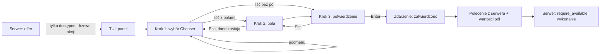

# feat: Panel akcji z menu z serwera i formularz wielokrokowy

## Summary

Serwer opisuje akcje taska w całości: nazwa, opis skutku, ryzyko, kolejność, rodzaj („wykonaj" albo „podmenu"), pola i polecenie do wysłania. Serwer zwraca tylko akcje dostępne. TUI rysuje ten opis w nowej, wspólnej kontrolce formularza wielokrokowego (wybór → pola → potwierdzenie). Panel pokazuje się w miejscu formularza dodawania treści. Rozmiar: Deep (kontrakt, silnik, nowa kontrolka TUI, przebudowa panelu, 6 jednostek).

---

## Problem Frame

Serwer zwraca dziś wszystkie akcje z flagą `available` i powodem. TUI ma własną listę (`TaskAction::ALL`), własne nazwy i opisy (`menu_text`) oraz własną wiedzę o podmenu. Akcje używają osobnych okien (`Overlay::Menu`, `Transitions`, `Steps`, `Comment`, `Confirm`) z różnymi ścieżkami zatwierdzania. Plan realizuje R1–R17 i AE1–AE8 z origin (see origin: `docs/brainstorms/2026-11-12-tui-panel-akcji-menu-z-serwera-i-formularz-wielokrokowy-requirements.md`).

---

## Requirements

- R1, R2, R3, R4, R5, R6. Kontrakt serwera: tylko dostępne akcje, opis, ryzyko, kolejność, rodzaj, pola, odmowa przy wysłaniu, „brak danych". (U1, U2)
- R7, R8, R9, R10. Panel na `Chooser`, podmenu w tym samym panelu, pola na osobnym kroku, potwierdzenie dla wszystkich akcji. (U3, U4)
- R11, R17. Wspólna kontrolka wielokrokowa na silniku `src/tui/form/` i `Chooser`, gotowa dla pytań agenta i nowego taska. (U3)
- R12, R13, R14. Miejsce panelu, focus, odświeżanie bez utraty danych. (U5)
- R15, R16. Brak `match` po id akcji w TUI, nieznana akcja działa. (U2, U4)
- AE1–AE8 pokryte w testach jednostek (patrz „Covers" w scenariuszach).

---

## Scope Boundaries

- Bez przenoszenia odpowiedzi na pytania agenta i formularza nowego taska na kontrolkę. Tylko kontrolka i panel akcji.
- Bez nowych akcji i bez zmian reguł dostępności (`unavailable_reason` zostaje źródłem prawdy).
- Bez zmiany skrótów `Ctrl+.`, `.`, `Ctrl+↑`, `Ctrl+↓`, modelu uprawnień i akcji grupowych.
- Bez zmian w panelu rozmowy poza miejscem, w którym panel akcji się pokazuje.

### Deferred to Follow-Up Work

- Przeniesienie odpowiedzi na pytania agenta na kontrolkę wielokrokową (osobny PR).
- Przeniesienie formularza nowego taska na kontrolkę wielokrokową (osobny PR).
- Usunięcie pól `available` i `reason` z kontraktu, gdy znikną starsze klienty.

---

## Context & Research

Zbadane w kodzie (bez agentów zewnętrznych; wzorce lokalne są mocne):

- Kontrakt: `crates/narsor-protocol/src/controller/task/actions.rs` (`TaskActionOffer`, `TaskActionOption`, `TaskActionId` z `#[serde(other)] Unrecognized`). Rozszerzenia idą jako nowe pola z `#[serde(default)]`.
- Serwer: `crates/narsor-engine/src/controller_protocol/service/tasks/actions.rs` (`OFFERED`, `offer`, `unavailable_reason`, `options`, `require_available`, `require_owner_command_available`). Serwer sprawdza akcję także przy wysłaniu.
- TUI: `src/tui/task_app/actions.rs` (`TaskAction`, `availability`, `menu_text`, `menu_items`, `Overlay`, `ActionSend`, `ActionRequest`, `act`). `NO_OFFER` to dzisiejszy „brak danych z serwera".
- Kontrolki: `src/tui/chooser.rs` (`Chooser`, `ChooserItem`, `ChooserField`, `confirming_submit`, `irreversible`), `src/tui/form/` (`FormEngine`, `FormEvent`).
- Układ: `src/tui/task_app/layout.rs` (`overlay_area`), `src/tui/task_app/panel/` (panel rozmowy), `src/tui/task_app/mod.rs` (`overlay`, `sync_overlay`, focus).
- Testy: `tests/integration/tui_state.rs`, `tests/integration/task_app_support/mod.rs`; testy serwera w module `tests` pliku `actions.rs` silnika.
- Wnioski z `docs/solutions/`: `design-patterns/tui-form-engine-events-and-cursor-style.md`, `design-patterns/tui-modal-confirmation-keyboard-contract.md`, `design-patterns/tui-focus-stays-in-details-after-confirmed-action-2026-10-20.md`, `design-patterns/tui-step-icon-mapping-lives-in-the-tui-not-the-protocol-2026-11-12.md`. Plan ich nie łamie: kontrolka używa zdarzeń silnika formularza, potwierdzenie trzyma kontrakt klawiszy, focus wraca tam, gdzie był.
- Brak `STRATEGY.md`. Pominięto badania zewnętrzne.

---

## Key Technical Decisions

- **Kontrakt dodatkowy, nie zastępujący.** `TaskActionOffer` dostaje nowe pola z wartościami domyślnymi: nazwa, opis skutku, ryzyko, kolejność, rodzaj, pola, dzieci (podmenu), polecenie do wysłania. `available` zostaje i jest zawsze `true` dla zwracanych pozycji. Powód: zgodność ze starszymi klientami (origin, założenia).
- **Serwer podaje polecenie do wysłania.** Liść niesie opis polecenia z istniejącego zbioru: polecenie właściciela (`OwnerCommand`), polecenie dla runnera (`OperatorCommand`) albo komentarz. Pola z formularza wchodzą do polecenia przez nazwany znacznik. Powód: R16 wymaga wysłania akcji o nieznanym id. TUI nie może wtedy wybierać polecenia po id. Granica: akcja z zupełnie nowym rodzajem polecenia nadal wymaga nowego klienta. Dokumentacja mówi to wprost.
- **Brak listy a pusta lista.** `actions == None` to „brak danych z serwera" (R6, AE6). `actions == Some(pusta)` to osobny komunikat „brak dostępnych akcji". Powód: starszy klient czyta pustą listę jako `NO_OFFER`. To znane i akceptowane pogorszenie dla starych klientów. Nowy klient je rozróżnia.
- **Akcje spoza panelu zostają w ofercie.** Komentarz, odpowiedź, zatwierdzenie i uprawnienia obsługuje rozmowa przez `availability`. Serwer oznacza je jako należące do rozmowy. Panel ich nie rysuje. Powód: R-zakres „bez zmian w panelu rozmowy". Nowy klient liczy brak pozycji jako „niedostępne".
- **Akcje lokalne klienta.** `Move` zostaje poza panelem (skróty). `OpenLink` zostaje pozycją lokalną panelu, dopisaną na końcu, bez kroku potwierdzenia (wyjątek z R10 i R15). Powód: minimalna zmiana zachowania i serwer nie zna przeglądarki operatora.
- **Jedna kontrolka, jeden silnik.** Kontrolka wielokrokowa składa `Chooser` (kroki wyboru, pola, potwierdzenie) i `FormEngine`. Nie ma drugiego silnika edycji. Kroki to dane (lista kroków), a nie kod panelu (R11, R17).
- **Panel w miejscu formularza dodawania treści.** Panel akcji zastępuje formularz rozmowy w układzie szczegółów. `Overlay::Menu`, `Transitions`, `Steps`, `Comment` znikają dla akcji panelu. `Links`, `Harness`, `Limit`, `Confirm` zostają (inne funkcje).

### Alternatywy rozważone

- **Klient wybiera polecenie po id (jak dziś).** Odrzucone: łamie R15 i R16.
- **Nowy punkt wejścia „wykonaj akcję X" na serwerze.** Odrzucone w tym zakresie: duża zmiana API i autoryzacji (poza zakresem). Wraca, jeśli pojawią się akcje z nowym rodzajem polecenia.

---

## High-Level Technical Design

> To ilustruje zamierzone podejście i jest wskazówką do przeglądu, nie specyfikacją implementacji.

---

## Implementation Units

### U1. Kontrakt: opis akcji, rodzaj, pola, polecenie

**Goal:** `TaskActionOffer` opisuje akcję w całości i zachowuje zgodność ze starszymi klientami.

**Requirements:** R2, R3, R4; AE8 (część kontraktu).

**Dependencies:** brak.

**Files:**
- Modify: `crates/narsor-protocol/src/controller/task/actions.rs`
- Modify: `crates/narsor-protocol/src/controller/task/summary.rs` (jeśli opis wchodzi w podsumowanie)
- Test: moduł `tests` w `crates/narsor-protocol/src/controller/task/actions.rs`

**Approach:**
- Nowe pola z `#[serde(default)]`: nazwa, opis skutku, ryzyko (nieodwracalna), kolejność, rodzaj (`execute` / `submenu`), pola (nazwa, rodzaj: tekst / wieloliniowy / lista, wymagane, podpowiedź), dzieci (ten sam kształt co akcja), polecenie do wysłania z miejscami na wartości pól, znacznik „należy do rozmowy".
- Rodzaj i rodzaj pola mają wariant `Unrecognized` (`#[serde(other)]`), jak `TaskActionId`.
- Dokładne nazwy pól i typów ustala implementacja.

**Patterns to follow:** `StepKind` i `TaskActionId` (`#[serde(other)]`); `PanelForm` jako opis pól dla klienta.

**Test scenarios:**
- Happy path: oferta z podmenu i liściem z polem serializuje się i odczytuje bez straty.
- Edge: stary JSON (bez nowych pól) odczytuje się z wartościami domyślnymi.
- Edge: nieznany rodzaj akcji i nieznany rodzaj pola odczytują się jako `Unrecognized`, bez błędu.
- Edge: nowy JSON czyta stary typ (test zgodności wstecz z kopią starego kształtu).

**Verification:** Stare i nowe JSON-y przechodzą w obie strony. Serwer i klient kompilują się z nowym typem.

---

### U2. Serwer: tylko dostępne akcje, opisy po polsku, drzewo

**Goal:** `offer()` zwraca tylko dostępne akcje z pełnym opisem, a podmenu (przejścia, kroki) jako dzieci. Zachowanie sprawdzane przy wysłaniu zostaje.

**Requirements:** R1, R2, R3, R4, R5, R15; AE1, AE2, AE5.

**Dependencies:** U1.

**Files:**
- Modify: `crates/narsor-engine/src/controller_protocol/service/tasks/actions.rs`
- Modify: `crates/narsor-engine/src/controller_protocol/service/tasks/summary.rs`
- Modify: `crates/narsor-engine/src/controller_protocol/wire.rs` (jeśli kształt oferty przechodzi przez opis przewodowy)
- Test: moduł `tests` w `crates/narsor-engine/src/controller_protocol/service/tasks/actions.rs`

**Approach:**
- `offer()` odfiltrowuje pozycje z `unavailable_reason`. `available` jest `true` w zwracanych pozycjach.
- Nazwy i opisy skutku (dziś w `menu_text` w TUI) przechodzą na serwer, po polsku, w stylu ASD-STE100 (krótkie zdania).
- `options()` staje się dziećmi: przejścia i kroki z własnym opisem, rodzajem i poleceniem. Pole „komentarz dla agenta" jest opisane jako pole liścia „wybierz krok" (R4, AE3).
- `unavailable_reason`, `require_available` i `require_owner_command_available` bez zmian: nadal odrzucają z powodem przy wysłaniu (R5).
- Akcje rozmowy (komentarz, odpowiedź, zatwierdzenie, uprawnienia) zostają w ofercie ze znacznikiem „rozmowa".

**Patterns to follow:** istniejące testy `offered(...)` w module `tests` pliku; `comment_effect` jako wzór opisu zależnego od stanu.

**Test scenarios:**
- Covers AE1. Task w toku: oferta panelu to dokładnie pauza, stop, archiwizuj. Brak „zwolnij slot" i „uruchom od nowa".
- Covers AE2. Task zatrzymany: „Wybierz krok" ma rodzaj „podmenu" i dzieci to kroki workflow.
- Covers AE3. Krok agentowy w podmenu ma pole „komentarz" (opcjonalne). Krok skryptowy nie ma pola.
- Covers AE5. Wysłanie akcji, która przestała być dozwolona, kończy się `action_unavailable` z powodem.
- Edge: task w kolejce nie ma pauzy, stopu ani wyboru kroku w ofercie.
- Edge: pusta oferta panelu zwraca `Some(pusta)`, nie `None`.
- Integration: każda zwrócona pozycja ma niepuste: nazwę, opis, polecenie (liść) albo dzieci (podmenu).

**Verification:** Istniejące testy reguł dostępności przechodzą po dostosowaniu do filtra. Stary podsumowujący JSON nadal się odczytuje.

---

### U3. Kontrolka formularza wielokrokowego

**Goal:** Wspólna kontrolka z listy kroków: wybór, pola, potwierdzenie.

**Requirements:** R9, R10, R11, R17; AE3, AE4.

**Dependencies:** brak (niezależna od kontraktu; używa tylko własnych typów).

**Files:**
- Create: `src/tui/stepped.rs` (kontrolka)
- Modify: `src/tui/mod.rs` (eksport)
- Modify: `src/tui/chooser.rs` (tylko jeśli potrzebny mały punkt wejścia; bez nowych reguł edycji)
- Test: `tests/integration/tui_stepped.rs` (nowy plik w istniejącym jednym crate testów) lub moduł `tests` w `src/tui/stepped.rs`

**Approach:**
- Kontrolka przyjmuje listę kroków (dane): krok wyboru (`Chooser`), krok pól (`ChooserField`), krok potwierdzenia (nagłówek, opis, ryzyko, podsumowanie pól).
- Daje: wskaźnik kroku („krok 2 z 3"), `Enter` dalej, `Esc` wstecz z zachowaniem wpisanych danych, pomijanie kroków, których nie ma, jedno zdarzenie „zatwierdzono" z wartościami.
- Używa zdarzeń `FormEvent` i potwierdzenia wg kontraktu klawiszy z `docs/solutions/design-patterns/tui-modal-confirmation-keyboard-contract.md`. Nie kopiuje reguł edycji.
- Interfejs nie zna pojęcia „akcja". Pytania agenta i nowy task użyją go bez zmiany (R17).

**Execution note:** Zacznij od testów kroków i powrotu z danymi (test-first).

**Patterns to follow:** `Chooser::confirming_submit`, `FormEngine`, `ChooserItem::irreversible`.

**Test scenarios:**
- Happy path: trzy kroki; `Enter` przechodzi dalej; na końcu jedno zdarzenie „zatwierdzono" z wartościami pól.
- Covers AE3. `Esc` z kroku 3 do kroku 2 zachowuje wpisany komentarz.
- Covers AE4. `Esc` w kroku potwierdzenia nic nie zatwierdza; dopiero `Enter` w tym kroku zatwierdza.
- Edge: brak kroku pól → krok 1 prowadzi do potwierdzenia, wskaźnik pokazuje „krok 2 z 2".
- Edge: wymagane pole puste → `Enter` nie przechodzi dalej i pokazuje błąd pola.
- Edge: `Esc` na kroku 1 zwraca zdarzenie „anulowano".
- Edge: ryzyko ustawione → krok potwierdzenia pokazuje znak ryzyka.
- Integration: wklejanie wieloliniowe do pola działa jak w silniku formularza.

**Verification:** Kontrolka działa na danych testowych bez użycia typów akcji.

---

### U4. Panel akcji rysuje akcje serwera

**Goal:** Panel buduje kroki kontrolki z oferty serwera. Nie ma listy ani nazw po stronie TUI.

**Requirements:** R6, R7, R8, R9, R10, R15, R16; AE2, AE3, AE4, AE6, AE8.

**Dependencies:** U1, U2, U3.

**Files:**
- Modify: `src/tui/task_app/actions.rs` (usunąć `TaskAction::ALL`, `menu_text`, `menu_items`, `Overlay::Menu/Transitions/Steps/Comment` dla panelu; dodać stan panelu, budowę kroków z oferty, mapowanie wyniku na `ActionSend`)
- Modify: `src/tui/task_app/mod.rs`
- Modify: `src/tui/keymap.rs` (kontekst panelu, jeśli trzeba)
- Test: `tests/integration/tui_state.rs`, `tests/integration/task_app_support/mod.rs`

**Approach:**
- Poziomy podmenu w tym samym panelu, `Esc` o jeden poziom wyżej, nagłówek ze ścieżką „Akcje › Wybierz krok" (R8).
- `ActionSend` powstaje z polecenia opisanego przez serwer i wartości pól. TUI nie ma `match` po id (R15, R16).
- `None` → „brak danych z serwera". `Some(pusta)` → „brak dostępnych akcji" (R6).
- `OpenLink` dopisane lokalnie na końcu, bez potwierdzenia. `availability()` zostaje dla skrótów i powiadomień, czytając ofertę (akcje rozmowy) i ofertę panelu.
- Po odmowie serwera: powód na pasku, odświeżenie listy (zachowanie `act`).

**Patterns to follow:** `act()` (refuzy, odświeżenie), `chosen_step`, `chosen_transition` jako wzór obecnego mapowania do zastąpienia.

**Test scenarios:**
- Covers AE1. Panel pokazuje dokładnie pozycje oferty, bez wyszarzonych.
- Covers AE2. Wybór podmenu pokazuje poziom z nagłówkiem „Akcje › Wybierz krok"; `Esc` wraca.
- Covers AE3. Krok agentowy: krok 2 z polem, krok 3 z podsumowaniem; `Esc` zachowuje komentarz.
- Covers AE4. „Pauza": potwierdzenie z opisem skutku; `Esc` nic nie wysyła; `Enter` wysyła.
- Covers AE6. Brak listy: komunikat „brak danych z serwera", brak pozycji.
- Covers AE8. Akcja z nieznanym id i poprawnym opisem: widoczna, potwierdzana i wysyłana z poleceniem z serwera.
- Error: serwer odrzuca wysłanie (`action_unavailable`): powód widoczny, lista odświeżona.
- Edge: pusta lista → „brak dostępnych akcji".
- Edge: pozycja lokalna „otwórz link" otwiera link bez kroku potwierdzenia.

**Verification:** W kodzie TUI nie zostaje `match` po `TaskActionId`, który ustala nazwę, opis, rodzaj lub dostępność akcji panelu. Skróty `Ctrl+↑`/`Ctrl+↓` działają jak dotąd.

---

### U5. Miejsce panelu, focus i odświeżanie

**Goal:** Panel pokazuje się w miejscu formularza dodawania treści i przeżywa odświeżenia.

**Requirements:** R12, R13, R14; AE7.

**Dependencies:** U4.

**Files:**
- Modify: `src/tui/task_app/layout.rs` (miejsce panelu, `overlay_area`)
- Modify: `src/tui/task_app/panel/app.rs`, `src/tui/task_app/panel/state.rs` (zajęcie miejsca formularza)
- Modify: `src/tui/task_app/mod.rs` (focus przed otwarciem, `sync_overlay`)
- Test: `tests/integration/tui_state.rs`

**Approach:**
- Panel akcji zajmuje miejsce formularza rozmowy. Poza zakładką rozmowy zajmuje to samo miejsce w układzie szczegółów (R12).
- Zapamiętany focus wraca po wykonaniu, odmowie i `Esc` (R13).
- `sync_overlay` nie odtwarza panelu przy każdym odświeżeniu. Aktualizuje ofertę i zachowuje krok, pola i focus, dopóki wybrana akcja jest dostępna. Gdy znika: komunikat z powodem i powrót o poziom (R14).
- Mały terminal (niezweryfikowane w origin): sprawdź wysokość przy 80×24. Gdy lista z opisem i krokiem nie mieści się, `Chooser` przewija (R7). Minimalna wysokość to nazwana stała.

**Patterns to follow:** `docs/solutions/design-patterns/tui-focus-stays-in-details-after-confirmed-action-2026-10-20.md`; `Chooser::selecting` przy odświeżeniu.

**Test scenarios:**
- Covers AE7. Pole w kroku 2, wpisany tekst, przychodzi zdarzenie strumienia: tekst i focus zostają.
- Happy path: po wykonaniu akcji focus wraca na element sprzed otwarcia.
- Happy path: `Esc` na pierwszym poziomie zamyka panel i przywraca focus.
- Edge: wybrana akcja znika po odświeżeniu: komunikat z powodem, powrót na poprzedni poziom, dane innych pól nietknięte.
- Edge: inna zakładka niż rozmowa: panel zajmuje to samo miejsce.
- Edge: terminal 80×24: lista z opisem przewija się, nic nie wychodzi poza ekran.
- Integration: `Ctrl+.` i zapasowe `.` otwierają panel w nowym miejscu.

**Verification:** Operator nie traci wpisanych danych przy odświeżeniu. Układ nie nakłada się na pasek stanu.

---

### U6. Dokumentacja i porządki

**Goal:** Dokumentacja użytkownika i wnioski zgodne z nowym działaniem. Usunięty martwy kod.

**Requirements:** wszystkie (spójność).

**Dependencies:** U1–U5.

**Files:**
- Modify: `docs/user/tui.md` (opis panelu akcji, kroki, potwierdzenie, brak danych)
- Create: `docs/solutions/design-patterns/tui-panel-actions-from-server-offer-2026-11-13.md` (wniosek: serwer opisuje, TUI rysuje; granica nowego rodzaju polecenia)
- Test: `tests/integration/docs_links.rs` (istniejący test linków dokumentacji)

**Approach:**
- Opisz w `docs/user/tui.md` wskaźnik kroku, `Esc` o krok, potwierdzenie dla każdej akcji.
- Usuń nieużywane typy po przebudowie (`CommentForm`, `TransitionList`, `StepList`, jeśli bez użycia).

**Test expectation:** none -- zmiana dokumentacji; test linków pilnuje odnośników.

**Verification:** `docs_links` przechodzi. Brak ostrzeżeń o martwym kodzie.

---

## System-Wide Impact

- **Starsze klienty:** widzą krótszą listę. Gdy lista jest pusta, czytają to jako „brak danych" (`NO_OFFER`). Znane, akceptowane pogorszenie.
- **Starsze serwery:** nowy klient dostaje ofertę bez nowych pól. Panel pokazuje „brak danych z serwera" (R6), zamiast podstawiać własną listę.
- **Autoryzacja:** bez zmian. Serwer nadal sprawdza akcję przy wysłaniu.
- **Pozostałe okna:** `Links`, `Harness`, `Limit`, `Confirm` bez zmian.

---

## Risks & Dependencies

| Ryzyko | Skutek | Środek |
|---|---|---|
| Polecenie z serwera w złym kształcie | Akcja wysłana źle | Test integracyjny każdej akcji oferty: polecenie przechodzi `require_available` |
| Dwa silniki formularza | Rozjazd reguł edycji | Kontrolka tylko składa `Chooser` i `FormEngine`; przegląd pod kątem kopii reguł |
| Mały terminal | Panel nie mieści się | Test 80×24 w U5; przewijanie `Chooser` |
| Nowa akcja z nowym rodzajem polecenia | Wymaga nowego klienta | Opisane w dokumentacji i we wniosku (U6) |

Zależności: U1 → U2 → U4 → U5 → U6. U3 niezależna, przed U4.

---

## Open Questions

### Deferred to Implementation

- Dokładne nazwy pól i typów kontraktu (U1) oraz kształt znacznika miejsca na wartość pola w poleceniu.
- Minimalna wysokość panelu w małym terminalu (stała ustalana po próbie 80×24).
- Czy `CommentForm` zostaje dla skrótu `c` (komentarz). Zależy od tego, czy skrót nadal używa osobnego okna.

### Resolved During Planning

- Gdzie panel (Q1) i które akcje potwierdza (Q2): zgodnie z origin.
- Granica kontrolki i `Chooser`/`FormEngine`: kontrolka składa je, nie powiela.
- Zgodność: kontrakt dodatkowy, `available` zostaje.
- `OpenLink`: pozycja lokalna bez potwierdzenia. `Move`: poza panelem.

### Deferred to Follow-Up Work

- Plan przeniesienia pytań agenta i nowego taska na kontrolkę wielokrokową (R17): dwa osobne PR-y po tym.
