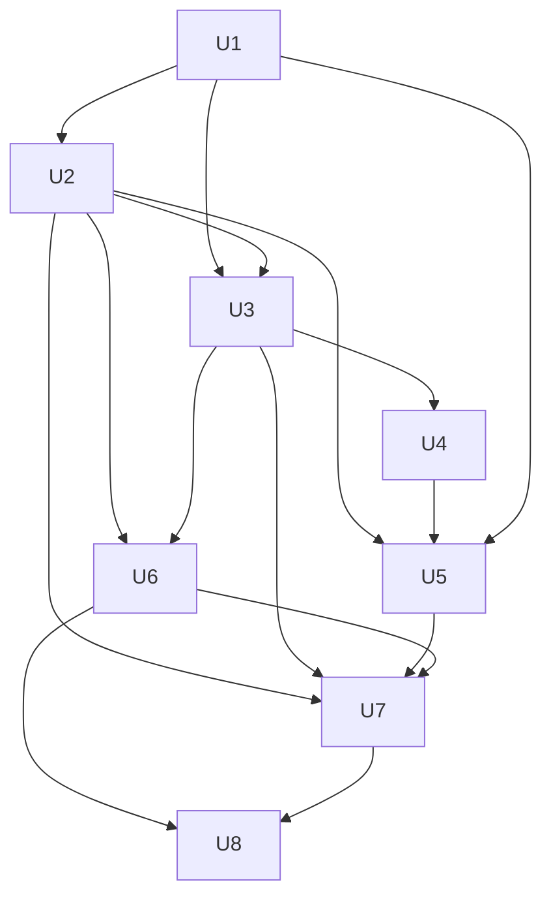

# feat: Obserwatory źródeł zewnętrznych

## Summary

Control plane (`narsor-server`) dostaje rejestr obserwatorów, harmonogram w istniejącym przebiegu periodycznym i jednorazowe tokeny uruchomień. Osobny proces `narsor-cli observer worker` (etap 1) pobiera należne uruchomienia, wykonuje zatwierdzony skrypt shellowy w czystym środowisku i zwraca wynik. Skrypt wykonuje skutki przez `narsor-cli` na nowych, wąskich trasach obserwatora. Te trasy egzekwują klucz skutku, limit tasków, ślad pochodzenia i przebieg próbny. Krok `wait` dostaje wykonawcę: zawiesza task jak bramka `human`, a pasujące zdarzenie zewnętrzne wznawia task. Rozmiar: Deep (nowa granica zaufania, nowy token, nowy wykonawca kroku, 8 jednostek).

---

## Problem Frame

Narsor reaguje dziś tylko na polecenia operatora. Operator ręcznie tworzy taski z zadań Jira i ręcznie przenosi informację o końcu review. Pełny opis problemu, aktorów i przepływów jest w origin (see origin: `docs/brainstorms/2026-11-13-obserwatory-zrodel-zewnetrznych-requirements.md`). Plan dodatkowo zamyka pytania z sekcji „Deferred to Planning" origin: format wyniku skryptu, wykonawca `WaitAction`, miejsce harmonogramu, workflow tworzenia skryptu z agentem i zakres sekretów.

---

## Assumptions

*Plan powstał bez potwierdzenia przez użytkownika w trakcie pracy. Poniższe punkty to założenia agenta. Sprawdź je przed implementacją. Punkty, które zmieniają zachowanie widoczne dla użytkownika, są także w sekcji „Pytania otwarte dla użytkownika".*

- Zapis obserwatorów używa plików JSON w katalogu stanu (decyzja D3 w `docs/dev/architecture.md`). Plan nie wprowadza SQLite.
- Harmonogram żyje w control plane jako nowy przebieg w `run_periodic_pass`. Proces wykonujący skrypty (worker) nie decyduje o terminach. Worker tylko pobiera należne uruchomienia.
- Worker uwierzytelnia się własnym poświadczeniem workera (skrót SHA-256, plik 0600). Worker nie używa tokenu właściciela.
- Wartości sekretów obserwatora pochodzą z katalogu sekretów workera (jeden plik na nazwę referencji, wzorzec `MountedSecrets` z `crates/narsor-runner/src/runner/secrets.rs`). Control plane trzyma tylko referencje. Odpowiedź na pytanie origin „[Affects R20]": osobny zakres sekretów obserwatorów, nie rejestr sekretów backendu.
- Zdarzenia zewnętrzne dostarcza nowe polecenie `narsor-cli task event`, a nie `narsor-cli task input`. Powód: `task input` odpowiada na istniejące pytanie (`pending_input_id`). Patrz pytanie PO1.
- Wpis obserwacji PR/MR z kroku workflow powstaje w chwili, gdy krok `wait` się zawiesza. Dzięki temu skrypt obserwuje obiekt dopiero wtedy, gdy task już czeka.
- Filtr kroku `wait` to obiekt JSON. Każdy klucz filtra musi być równy wartości pod tym samym kluczem w danych zdarzenia (porównanie płaskie, bez wyrażeń). Wartości skalarne (tekst, liczba, wartość logiczna) są porównywane po zamianie na tekst po obu stronach, bo szablon filtra zawsze daje tekst (`render_value` w `crates/narsor-engine/src/workflow/template.rs`).
- Duplikat klucza skutku daje kod wyjścia 0 i komunikat „pominięto: duplikat". Przekroczenie limitu daje kod wyjścia różny od 0. Patrz pytanie PO3.
- Workflow tworzenia skryptu z agentem przygotowuje skrypt i opis. Zapis szkicu, przebieg próbny i zatwierdzenie wykonuje operator przez CLI. Patrz pytanie PO2.
- Krok `wait` po upływie limitu czasu (pole YAML `timeout`, w domenie `timeout_secs`) kończy się etykietą `timeout`, gdy krok ją deklaruje. Gdy krok jej nie deklaruje, krok kończy się błędem. Patrz pytanie PO4.
- Przebieg próbny wersji niezatwierdzonej działa bez wartości sekretów, chyba że operator poda `--with-secrets`. Patrz pytanie PO6.
- Skrypt działa jako osobny użytkownik systemowy (inny niż użytkownik workera). Ten użytkownik nie może czytać poświadczenia workera ani katalogu sekretów.
- Taski z obserwatora mają właściciela obserwatora (`OwnerRef` zapisany przy utworzeniu obserwatora).
- Skutek `deliver_event` zawsze trafia do taska z wpisu obserwacji tego obserwatora. Skutek `deliver_event` wymaga rodzaju obserwacji `watch_list`.

---

## Requirements

- R1, R2, R3, R18. Model obserwatora, stany, skrypt shellowy, skutek „utwórz task" z mapowaniem, widoczność w CLI. (U1, U7)
- R4. Zdarzenie w historii taska; `wait` widzi tylko zdarzenia z czasu czekania; zdarzenie dla taska, który nie czeka, nie zmienia stanu. (U3, U4)
- R5, R6, R7, R8. Lista wpisów PR/MR, brak uruchomienia przy pustej liście, koniec wpisu, dodanie wpisu przez YAML lub CLI. (U2, U5, U7)
- R9, R10, R11. Skrypt z agentem, przebieg próbny bez skutków, zatwierdzenie przez człowieka przed harmonogramem. (U1, U2, U3, U8)
- R12, R13, R14, R15, R16, R17. Kontrakt skryptu, deduplikacja po kluczu, limit czasu i stan bez zmian po błędzie, limit tasków, backoff i stan „w błędzie", dolna granica odstępu. (U2, U3, U6)
- R19, R20, R21. Ślad pochodzenia, sekrety poza skryptem, token ograniczony do obserwatora i czasu uruchomienia, tylko właściciel zarządza. (U3, U6, U7)
- Success criteria z origin: task w czasie jednego odstępu, brak duplikatów, błędny skrypt widoczny i bez skutków. (U2, U3, testy integracyjne)

**Origin actors:** A1 (twórca automatyzacji), A2 (agent), A3 (silnik obserwatorów = przebieg w control plane + worker), A4 (control plane), A5 (task), A6 (źródło zewnętrzne)
**Origin flows:** F1 (utworzenie obserwatora z agentem), F2 (Jira → nowy task), F3 (koniec review → zdarzenie w tasku)
**Origin acceptance examples:** AE1 (R5, R6), AE2 (R12, R13), AE3 (R13, R14), AE4 (R15), AE5 (R4, R7), AE6 (R11), AE7 (R4)

---

## Scope Boundaries

- Brak wbudowanych klientów API Jira, GitHub, GitLab. Tylko skrypty przykładowe (origin).
- Brak webhooków przychodzących. Tylko odpytywanie według harmonogramu (origin).
- Brak zapisu z Narsora do źródeł (origin).
- Brak edytora i widoku obserwatorów w TUI (origin).
- Brak źródeł innych niż Jira, GitHub, GitLab w przykładach; silnik nie ogranicza źródeł (origin).
- Brak uruchamiania skryptów z niezaufanych źródeł w etapie 1 (origin, Z2).
- Brak automatycznego wykrywania PR/MR przez Narsor; wpis zawsze jawny (origin, R8).

### Deferred to Follow-Up Work

- Etap 2: worker jako Kubernetes CronJob z tym samym kontraktem skryptu i tym samym API workera (osobny plan).
- Widok obserwatorów w TUI (stan, ostatnie uruchomienie, błąd).
- Bogatszy język filtrów kroku `wait` (wyrażenia, listy wartości).
- Przegląd bezpieczeństwa przez specjalistę przed wydaniem (token uruchomienia, poświadczenie workera, środowisko skryptu, maskowanie sekretów). To jest warunek wydania, nie część implementacji.

---

## Context & Research

### Relevant Code and Patterns

- Przebieg periodyczny: `crates/narsor-server/src/runtime.rs` (`spawn_periodic_admission`, `run_periodic_pass`, `ADMISSION_INTERVAL` = 5 s, `spawn_blocking`).
- Polityka jako zwykły aktor poleceń z zarezerwowanym prefiksem kluczy: `crates/narsor-engine/src/orchestration/resume.rs` (`AUTO_RESUME_KEY_PREFIX`, `SLOT_RELEASE_KEY_PREFIX`), `crates/narsor-engine/src/controller_protocol/service/scheduling/auto_resume.rs`.
- Trwały zapis i blokady: `crates/narsor-engine/src/orchestration/store.rs` (protokół commit, `lock_task`), `crates/narsor-engine/src/persistence/atomic.rs` (`write_json_atomic`, `write_json_atomic_exclusive`).
- Tworzenie taska z idempotencją po `task_id` + `request_digest`: `crates/narsor-engine/src/controller_protocol/service/tasks/create.rs`.
- Wejście do taska: `crates/narsor-engine/src/controller_protocol/service/operator/input.rs` (`submit_input`, `require_input_available`, `resume_for_work`), dostarczenie w runnerze `crates/narsor-runner/src/runner/mod.rs`.
- Bramka `human` i wznowienie: `crates/narsor-engine/src/engine/actions/human.rs`, `crates/narsor-engine/src/engine/runner/human_input/suspension.rs`, `delivery.rs`, `operations.rs`.
- Wykonawcy kroków: trait `ActionExecutor` w `crates/narsor-engine/src/engine/actions/mod.rs`, rejestracja w `crates/narsor-engine/src/engine/runner/setup/builders.rs`, macierz zdolności w `crates/narsor-engine/src/engine/runner/step/action_kind.rs`, obsługa zawieszenia w `crates/narsor-engine/src/engine/runner/step/attempt.rs` i `output/reprompt.rs`.
- YAML kroku `wait`: `crates/narsor-engine/src/workflow/schema.rs` (`WaitActionSchema`), `loader.rs`, `validator.rs`, `template.rs`; domena `crates/narsor-engine/src/domain/workflow_definition.rs` (`WaitActionConfig`); spec `docs/dev/workflow-schema.md` §3.3.D.
- Zdarzenia: `crates/narsor-protocol/src/event.rs` (`ExternalEventReceived`, już renderowane w `engine/timeline.rs` i `src/tui/event_text.rs`), `crates/narsor-protocol/src/controller/task/events.rs` (`TaskEventKind`).
- Uwierzytelnianie: `crates/narsor-server/src/auth_gate.rs` (`Principal`, `require_owner`), poświadczenia ze skrótem i porównaniem w stałym czasie `crates/narsor-engine/src/controller_protocol/credentials.rs`.
- Sekrety: `crates/narsor-engine/src/domain/environment.rs` (`SecretReference`, `SecretDelivery`, `SecretValue`), `crates/narsor-runner/src/runner/secrets.rs` (`MountedSecrets`), lista zmiennych w `crates/narsor-controller/src/local/untrusted.rs`.
- Proces potomny z grupą procesów i limitem czasu: `crates/narsor-engine/src/engine/actions/process_group.rs`, `script.rs`.
- CLI: `src/cli/mod.rs` (`Command`, globalne `--server`, `NARSOR_TOKEN`), `src/cli/remote.rs` (`TaskCommand::Create`, `TaskCommand::Input`, wzorzec `BackendCommand`), klient `crates/narsor-api-client/src/api/client.rs`.
- Trasy: `crates/narsor-server/src/controller_protocol/http.rs` (trasy właściciela, kontrolera i runnera), `crates/narsor-server/src/api/routes/control.rs`. Plik `crates/narsor-engine/src/controller_protocol/http.rs` jest osierocony; nie używać.
- Testy: jeden crate `tests/integration/main.rs` (moduł musi mieć `mod`), testy serwisu `crates/narsor-engine/src/controller_protocol/service/tests.rs`, testy tras przez `tower::ServiceExt::oneshot` w `crates/narsor-server/src/controller_protocol/http.rs`.

### Institutional Learnings

- `docs/solutions/architecture-patterns/auto-resume-policy-for-lost-workloads-2026-10-11.md`: automat idzie zwykłą ścieżką poleceń z zarezerwowanym prefiksem kluczy; przebieg jako funkcja publiczna testowana bez demona; terminy i liczniki w rekordzie; brak lawiny zaległych uruchomień po restarcie; nowe warianty enumów na wire z `#[serde(other)] Unrecognized`.
- `docs/solutions/design-patterns/stop-ends-stopped-interrupt-ends-interrupted-2026-11-11.md`: dla każdego nowego enuma jawna decyzja: fallback albo wspólna aktualizacja; czekający task i sloty.
- `docs/solutions/security-issues/untrusted-control-plane-reaches-user-git-and-harness-logins-2026-10-25.md`: proces nie dziedziczy poświadczeń operatora (`USER_CREDENTIAL_ENVS`).
- `docs/residual-review-findings/feat-remote-backends-review-needed.md`: test „sentinel-leak" ma objąć logi i komunikaty błędów; poświadczenia jako SHA-256, porównanie w stałym czasie, pliki 0600; przebieg periodyczny musi być tani.
- `docs/residual-review-findings/feat-daemon-lokalny-2654853.md`: wyścig TOCTOU przy zapisie bez blokady taska; dwa serwery na jednym katalogu stanu (klucz skutku jako druga linia obrony).
- `docs/solutions/runtime-errors/agent-step-hangs-on-orphaned-background-process-2026-10-26.md`: własna grupa procesów, SIGTERM/SIGKILL na `-pgid`, limit odczytu stdout.
- `docs/solutions/security-issues/untrusted-agent-text-unclosed-brace-scan-quadratic-2026-10-18.md`: wyjście skryptu i dane zdarzeń są nieufne; parsowanie z limitem; usuwanie znaków sterujących przed wydrukiem.
- `docs/solutions/conventions/test-network-features-through-trait-seams-not-tcp-servers-2026-10-31.md`, `docs/solutions/conventions/single-integration-test-crate-and-lean-target-2026-11-01.md`: wąski trait seam, `ManualClock`, czas jako parametr, bez TCP i `set_var`; testy z prawdziwymi procesami oznaczone `#[ignore]`.

### External References

- Brak. Wzorce lokalne pokrywają każdy element (przebieg periodyczny, poświadczenia, proces potomny, bramka zawieszenia). Klienci API źródeł są poza zakresem.

---

## Key Technical Decisions

- **Harmonogram w control plane, wykonanie w workerze (odpowiedź na „[Affects R17]"):** przebieg `observer_pass` w `run_periodic_pass` czyta `next_run_at`, stan wpisów obserwacji i terminy uruchomień. Przebieg oznacza obserwator jako mający należne uruchomienie (flaga w rekordzie obserwatora, bez rekordu w `runs/`), usuwa wpisy zakończonych lub zarchiwizowanych tasków i wygasza uruchomienia po terminie. Worker pobiera należne uruchomienie (claim; dopiero claim tworzy rekord uruchomienia) i oddaje wynik. Worker odpytuje co 10 s. Terminy, licznik błędów i stan są w rekordzie obserwatora, więc restart serwera nie powtarza uruchomień i nie robi lawiny zaległych uruchomień: po restarcie należne jest najwyżej jedno uruchomienie na obserwator. Etap 2 (CronJob) używa tego samego API workera.
- **Jedno aktywne uruchomienie na obserwator:** claim działa pod blokadą obserwatora. Uruchomienie ma termin (limit czasu skryptu + margines). Uruchomienie bez wyniku po terminie dostaje powód „utracone przez workera", jego token przestaje działać, a stan skryptu zostaje bez zmian. Utracone uruchomienie nie zwiększa licznika błędów skryptu (przyczyna jest w infrastrukturze), ale `observer show` je pokazuje.
- **Widoczny brak workera:** rekord obserwatora zapisuje czas ostatniego claimu. Gdy należne uruchomienie czeka na claim dłużej niż jeden odstęp, `observer list` i `observer show` pokazują ostrzeżenie „brak workera". `observer dry-run` ma limit czasu oczekiwania i kończy się komunikatem o braku workera.
- **Token uruchomienia:** control plane tworzy losowy token przy claimie, zapisuje skrót SHA-256 w rekordzie uruchomienia, porównuje w stałym czasie i unieważnia go po wyniku lub po terminie. Nowy wariant `Principal::ObserverRun`. Token działa tylko na trasach skutków obserwatora (`/observer/v1/runs/{run}/...`). Brama właściciela go odrzuca. Poświadczenie workera to osobny wariant `Principal::ObserverWorker`; daje tylko claim i wynik.
- **Deduplikacja przez wyłączne utworzenie pliku i deterministyczne id taska (R13, AE2, AE3):** klucz skutku daje plik `effects/{sha256(klucz)}.json` tworzony wyłącznie (exclusive create) w stanie `pending`. Plik zawiera pełne żądanie utworzenia taska (bez id uruchomienia w części objętej `request_digest`). Task dostaje deterministyczne id wyprowadzone z id obserwatora (losowe, nigdy nie używane ponownie, także po usunięciu obserwatora o tej samej nazwie) i klucza. Plik dostaje stan `created` z id taska dopiero po sukcesie `create_task`. Przy istniejącym pliku `pending` trasa ponawia `create_task` z żądaniem zapisanym w pliku, a nie z nowymi danymi od skryptu; dzięki temu `request_digest` się nie zmienia. Trwała odmowa `create_task` (walidacja, backend) usuwa plik `pending` i zwraca błąd. Odpowiedź „duplikat" jest tylko dla pliku `created`. Klucze polityki obserwatora używają zarezerwowanego prefiksu `observer:`; klucz klienta z tym prefiksem dostaje odmowę.
- **Limit tasków liczony na serwerze (R15, AE4):** licznik tasków uruchomienia jest w rekordzie uruchomienia pod blokadą obserwatora. Wywołanie ponad limit dostaje odmowę, a obserwator przechodzi w stan `needs_attention`. Wznowienie wykonuje operator.
- **Przebieg próbny egzekwowany na serwerze (R10):** uruchomienie ma flagę `dry_run`. Trasy skutków przy tej fladze sprawdzają klucz i limit, zapisują „co by zrobił" w rekordzie uruchomienia i nie tworzą tasków ani zdarzeń. Przebieg próbny nie zapisuje nowego stanu obserwatora.
- **Wersje skryptu i zatwierdzenie (R11, AE6):** każdy zapis skryptu tworzy nową, niezmienną wersję. Rekord ma `approved_version`. Harmonogram uruchamia tylko `approved_version`. Przebieg próbny może użyć wersji niezatwierdzonej; wtedy worker nie przekazuje wartości sekretów, chyba że operator poda `--with-secrets` (PO6). `docs/user/observers.md` mówi, że `dry_run` blokuje tylko skutki w Narsorze, a nie zapisy, które skrypt sam wykona w źródle. Zatwierdzenie to trasa właściciela (R21). Zatwierdzenie zmienia stan na `active` tylko dla obserwatora w stanie `draft`; w innych stanach stan zostaje bez zmian (wstrzymany obserwator zostaje wstrzymany).
- **Kontrakt skryptu (odpowiedź na „[Affects R12]"):** wejście na stdin jako jeden dokument JSON (obserwator, warunek, zapamiętany stan, lista wpisów, `dry_run`, `first_run`, `import_backlog`). Wyjście na stdout: jeden dokument JSON z polami `state` i opcjonalnym `closed_watches`. Limit rozmiaru stdout i stderr. Kod 0 + poprawny dokument → nowy stan zapisany. Każdy inny wynik → stan bez zmian (R14).
- **Wykonawca `wait` jak bramka `human` (odpowiedź na „[Affects R4]"):** wykonawca zwraca nowy wariant `SuspendedAction::AwaitingExternalEvent`. Engine zapisuje oczekiwanie trwale (id epizodu oczekiwania, typ zdarzenia, filtr po renderowaniu szablonów, chwila startu, termin) i raportuje istniejący status `ExecutionStatus::WaitingForEvent`. Dziś `SlotReleaseClass::of` (`crates/narsor-engine/src/orchestration/model.rs`) zwraca dla niego `None`, a `derive_task_state` mapuje go na `Running`; plan zmienia `SlotReleaseClass::of` na `Transient` (slot zwalniany jak przy czekaniu na właściciela) i mapuje status na stan taska inny niż `HumanNeeded`, aby operator nie dostał fałszywego sygnału. **Jeden zapis historii na zdarzenie:** control plane zapisuje zdarzenie zawsze, raz, jako nowy `TaskEventKind` w historii taska przy przyjęciu. Do runnera zdarzenie trafia tylko wtedy, gdy task czeka na pasujące zdarzenie; wtedy engine dopisuje `ExternalEventReceived` do logu wykonania (to jest wynik kroku, nie drugi wpis historii taska) i kończy krok z danymi zdarzenia jako wynikiem.
- **Termin kroku `wait`:** termin oczekiwania jest w rekordzie taska. Przebieg periodyczny dostarcza zdarzenie końca czasu. Krok kończy się etykietą `timeout`, gdy ją deklaruje, w innym razie błędem kroku (patrz PO4). Walidator dziś dopuszcza etykietę `timeout` tylko dla `agent` i `script` (`validate_exit_and_timeout` w `crates/narsor-engine/src/workflow/validator.rs`); plan dodaje `wait` do akcji, które mogą przekroczyć czas, i używa istniejącego `TimedOutAction::resolve`.
- **Epizod oczekiwania w wejściu skryptu:** dla każdego wpisu obserwacji wejście skryptu zawiera id bieżącego epizodu `wait` taska-adresata (albo brak, gdy task nie czeka). Kontrakt i przykłady zalecają klucz zdarzenia z tym id (na przykład `MR!17:approved:<epizod>`). Dzięki temu pętla review z dwoma epizodami `wait` dostaje zdarzenie w obu epizodach, a deduplikacja nadal działa w jednym epizodzie.
- **Skutek „utwórz task" związany z rekordem (R3, R11):** w trybie obserwatora `task create` przyjmuje tylko `--effect-key` i `--data` (dane skutku jako JSON). Serwer bierze workflow, repozytoria, backend i profil z rekordu obserwatora i stosuje mapowanie. Pola spoza mapowania są odrzucane. Skrypt nie może wybrać innego workflow ani backendu.
- **Właściciel tasków z obserwatora:** rekord obserwatora zapisuje `OwnerRef` twórcy. Trasy skutków tworzą taski z tym właścicielem i sprawdzają taski zdarzeń względem niego.
- **Dane ze źródeł są nieufne:** dane z Jira i PR/MR trafiają do tasków jako wejścia oznaczone pochodzeniem. `docs/user/observers.md` ostrzega przed wstrzyknięciem poleceń do kroków `agent` i zaleca wąskie uprawnienia agenta w workflow uruchamianych przez obserwatory.
- **Wpis obserwacji z YAML (R8):** krok `wait` dostaje opcjonalny blok `watch` (obserwator, obiekt, typy zdarzeń). Rekord obserwatora ma wzorzec dozwolonych obiektów (na przykład prefiks URL) i limit długości obiektu; control plane odrzuca wpis spoza wzorca. To chroni token źródła przed wysłaniem na obcy host. Wpis powstaje w chwili zawieszenia kroku, idempotentnie po (task, krok, obiekt). Wpis znika, gdy skrypt zgłosi obiekt jako zamknięty (`closed_watches`), gdy task jest zakończony lub zarchiwizowany (sprawdza `observer_pass`), albo gdy operator go usunie.
- **Nowe warianty enumów na wire:** `TaskEventKind` (zdarzenie zewnętrzne, utworzenie przez obserwator), `SuspendedAction`, `Principal`, typ wejścia runnera. Dla wariantów czytanych przez starsze klienty (TUI, CLI): `#[serde(other)] Unrecognized`. Dla wejścia runnera: wspólna aktualizacja runnera i serwera (runner jest wdrażany razem z control plane), zapisana jawnie w docs.
- **Ślad pochodzenia (R19):** `TaskRecord` dostaje opcjonalne pole pochodzenia (nazwa obserwatora, klucz skutku, id uruchomienia) z `#[serde(default)]`. Zdarzenie zewnętrzne w historii ma te same pola.
- **Izolacja skryptu (R20, Z2):** worker uruchamia skrypt jako osobny użytkownik systemowy (`--script-user`). Ten użytkownik nie ma prawa odczytu poświadczenia workera ani katalogu sekretów. Worker kopiuje do katalogu uruchomienia (0700, właściciel: użytkownik skryptu) tylko sekrety z referencji tego obserwatora. Maskowanie w logach jest drugą linią obrony, nie główną kontrolą.
- **Środowisko skryptu (R20):** worker uruchamia `sh` z pustym środowiskiem plus jawna lista: `PATH`, `HOME` (katalog roboczy uruchomienia), `NARSOR_SERVER`, `NARSOR_TOKEN` (token uruchomienia), `NARSOR_OBSERVER_RUN`, sekrety obserwatora jako zmienne. Własna grupa procesów, limit czasu, SIGTERM i SIGKILL na grupę. Worker maskuje wartości sekretów i tokenu w stdout/stderr przed wysłaniem do serwera i usuwa znaki sterujące.

---

## Open Questions

### Resolved During Planning

- [Affects R12] Format wyniku i stanu: JSON na stdin i stdout, patrz Key Technical Decisions.
- [Affects R4] Wykonawca `WaitAction`: zawieszenie jak `human`, filtr płaski, termin w rekordzie taska.
- [Affects R17] Miejsce harmonogramu: przebieg w control plane, wykonanie w workerze; restart nie robi lawiny.
- [Affects R9] Workflow tworzenia skryptu: wbudowany workflow `agent` → decyzja `human`, bez praw do zapisu obserwatora (patrz PO2).
- [Affects R20] Zakres sekretów: osobny katalog sekretów workera; control plane trzyma referencje.
- Z1 (origin): `narsor-cli task create` dostaje `--effect-key`; Narsor pilnuje limitu R15 na trasie skutku.
- Konflikt z SQLite: brak; plan używa zapisu plikowego (D3).
- Jak worker dowiaduje się o należnych uruchomieniach: odpytuje claim co 10 s (dużo mniej niż minimum 60 s odstępu).
- Właściciel tasków z obserwatora: `OwnerRef` twórcy obserwatora.
- Adresat `deliver_event`: zawsze task z wpisu obserwacji.

### Deferred to Implementation

- Dokładne nazwy tras, typów i pól JSON kontraktu: ustalane przy kodzie; kontrakt opisuje `docs/user/observers.md`.
- Wartości domyślne limitów rozmiaru stdout/stderr i marginesu terminu uruchomienia: ustalić przy teście workera.
- Dokładny wzór backoff (podstawa, maksimum) i liczba błędów do stanu „w błędzie": proponowane podwajanie odstępu do 1 h i 5 błędów; potwierdzić w testach.
- Czy osobny prefiks klucza idempotencji jest potrzebny dla `task event`, czy wystarczy plik skutku: zależy od kształtu `queue_input`.

---

## Pytania otwarte dla użytkownika

Plan przyjmuje opcję rekomendowaną (pierwszą) w każdym pytaniu. Zmiana odpowiedzi zmienia wskazane jednostki.

- **PO1. [Key Technical Decisions / U3, U7] Którym poleceniem skrypt dostarcza zdarzenie do taska?** Origin wymienia `narsor-cli task input`, ale `task input` dziś odpowiada na istniejące pytanie taska (wymaga `pending_input_id`).
  - (a) **Rekomendowane:** nowe polecenie `narsor-cli task event` (typ, źródło, klucz, dane). `task input` zostaje bez zmian.
  - (b) Tryb zdarzenia w `narsor-cli task input` (na przykład `--event TYPE`), jedno polecenie z dwoma znaczeniami.
- **PO2. [R9, F1 / U8] Czy workflow tworzenia skryptu z agentem może sam zapisać szkic i wykonać przebieg próbny?**
  - (a) **Rekomendowane:** nie. Workflow daje skrypt i opis. Operator wykonuje `observer script set`, `observer dry-run` i `observer approve` przez CLI. Runner taska nie dostaje praw do obserwatorów.
  - (b) Tak. Runner taska dostaje wąskie prawo: zapis szkicu i przebieg próbny dla obserwatora wskazanego we wejściu taska. Zatwierdzenie zostaje tylko dla właściciela.
- **PO3. [R13, AE2, AE3 / U3, U7] Co skrypt widzi przy duplikacie klucza skutku?**
  - (a) **Rekomendowane:** kod wyjścia 0 i komunikat „pominięto: duplikat" (skrypt nie musi rozróżniać ponowienia).
  - (b) Osobny kod wyjścia różny od 0 (skrypt musi go obsłużyć, łatwo o fałszywy błąd uruchomienia).
- **PO4. [R4, Deferred „Affects R4" / U4] Co robi krok `wait` po upływie `timeout_secs`?**
  - (a) **Rekomendowane:** etykieta `timeout`, gdy krok ją deklaruje; w innym razie błąd kroku (zwykła ścieżka błędu z bramką człowieka).
  - (b) Zawsze błąd kroku.
  - (c) Zawsze etykieta `timeout`; walidator wymaga jej deklaracji, gdy jest `timeout_secs`.
- **PO5. [Z2, Key Decisions Q2 / U6] Jak worker etapu 1 uwierzytelnia się w control plane?**
  - (a) **Rekomendowane:** własne poświadczenie workera tworzone przez właściciela (`observer worker-token create`), skrót SHA-256 na serwerze, plik 0600 u workera; poświadczenie daje tylko claim i wynik uruchomień.
  - (b) Token właściciela (prościej, ale worker ma pełne prawa właściciela).
- **PO6. [R10, R11, R20 / U2, U6, U7] Czy przebieg próbny wersji niezatwierdzonej dostaje wartości sekretów?** Skrypt w przebiegu próbnym może sam wysłać sekrety na zewnątrz albo zapisać dane w źródle; `dry_run` blokuje tylko skutki w Narsorze.
  - (a) **Rekomendowane:** nie, chyba że operator poda `observer dry-run --with-secrets` (jawna zgoda w poleceniu).
  - (b) Tak, zawsze (prościej; przebieg próbny pokazuje prawdziwe dane bez dodatkowej flagi).
  - (c) Nigdy (przebieg próbny tylko na danych testowych z pliku; skrypt musi to obsłużyć).

---

## Output Structure

    crates/narsor-engine/src/observers/            # nowy moduł: model, store, kontrakt
        mod.rs
        model.rs
        store.rs
        contract.rs
    crates/narsor-engine/src/controller_protocol/service/observers/
        mod.rs                                      # CRUD, wersje, zatwierdzenie, wpisy
        schedule.rs                                 # observer_pass, claim, wynik, backoff
        effects.rs                                  # task create / task event z kluczem i limitem
    crates/narsor-engine/src/engine/actions/wait.rs # wykonawca kroku wait
    crates/narsor-server/src/controller_protocol/observer_http.rs
    src/cli/observer.rs                              # narsor-cli observer ...
    src/cli/observer_worker.rs                       # narsor-cli observer worker
    workflows/observer-author.yaml
    workflows/observers/examples/{jira-new-issues,github-pr-review,gitlab-mr-review}.sh
    deploy/observer-worker/narsor-observer-worker.service
    docs/user/observers.md
    tests/integration/observers_*.rs

---

## High-Level Technical Design

> *To pokazuje zamierzone podejście i jest wskazówką kierunkową do przeglądu, nie specyfikacją implementacji. Agent implementujący traktuje to jako kontekst, nie jako kod do odtworzenia.*

```mermaid
sequenceDiagram
    participant P as observer_pass (control plane)
    participant W as worker (narsor-cli observer worker)
    participant S as skrypt
    participant E as trasy skutków /observer/v1
    participant T as task (runner + engine)
    P->>P: next_run_at <= now, lista wpisów niepusta (PR) → due
    W->>P: claim (poświadczenie workera)
    P-->>W: run id, token uruchomienia, wersja skryptu, wejście, referencje sekretów
    W->>S: sh skrypt, stdin = wejście, env = token + sekrety
    S->>E: narsor-cli task create --effect-key K (token uruchomienia)
    E->>E: klucz nowy? limit? dry_run? → utwórz task z pochodzeniem
    S->>E: narsor-cli task event TASK --type T --key K
    E->>T: historia taska; jeśli wait pasuje → wejście do runnera
    T->>T: ExternalEventReceived, krok wait kończy się
    S-->>W: stdout {state, closed_watches}, kod wyjścia
    W->>P: wynik (zamaskowane logi)
    P->>P: kod 0 i poprawny stan → zapisz stan; inaczej backoff
```

Stany obserwatora (kierunkowo): `draft` (brak zatwierdzonej wersji) → `active` ⇄ `paused`; `active` → `needs_attention` (limit tasków, wymaga operatora); `active` → `error` (N kolejnych błędów, wymaga operatora). Wznowienie z `needs_attention` lub `error` zeruje licznik błędów.

---

## Implementation Units



### U1. Model i trwały zapis obserwatorów

**Goal:** Domena obserwatora i jego zapis plikowy: rekord, wersje skryptu, uruchomienia, skutki, wpisy obserwacji.

**Requirements:** R1, R2, R3, R5, R11, R12, R17, R19, R21

**Dependencies:** brak

**Files:**
- Create: `crates/narsor-engine/src/observers/mod.rs`, `crates/narsor-engine/src/observers/model.rs`, `crates/narsor-engine/src/observers/store.rs`, `crates/narsor-engine/src/observers/contract.rs`
- Modify: `crates/narsor-engine/src/lib.rs`, `crates/narsor-engine/src/persistence/paths.rs`
- Test: `tests/integration/observers_store.rs`, `tests/integration/main.rs`

**Approach:**
- Układ: `{state}/observers/{id}/observer.json` (rekord z wersją, atomowa zamiana), `observer.lock`, `scripts/{n}.sh` (wyłączne utworzenie, niezmienne), `runs/{seq}.json`, `effects/{sha256}.json` (wyłączne utworzenie), `watches/{entry}.json`.
- Rekord: nazwa (unikalna), źródło (tekst), warunek (obiekt JSON przekazany skryptowi), harmonogram (odstęp w sekundach, domyślnie 300, minimum 60), skutek (`create_task` z workflow i mapowaniem albo `deliver_event`), rodzaj obserwacji (`all` albo `watch_list`), referencje sekretów (nazwa + zmienna), limit tasków na uruchomienie (domyślnie 10), stan, `approved_version`, zapamiętany stan skryptu, `next_run_at`, flaga należnego uruchomienia, czas ostatniego claimu, `last_run`, licznik kolejnych błędów, `import_backlog`, `first_run_done`, `OwnerRef` twórcy, wzorzec dozwolonych obiektów wpisów i limit ich długości.
- Skutek `create_task` ma workflow, repozytoria, backend, profil i mapowanie. Skutek `deliver_event` nie ma własnego adresata; wymaga rodzaju `watch_list`.
- Plik skutku ma stan `pending` (z pełnym żądaniem) albo `created` (z id taska).
- Mapowanie skutku „utwórz task" (R3): mapa nazwa wejścia workflow → nazwa pola w danych skutku; walidacja przy zapisie, że workflow istnieje i ma te wejścia.
- `contract.rs`: typy wejścia i wyjścia skryptu z limitem rozmiaru i parserem odrzucającym nadmiarowe dane.
- Nowe pola i enumy z `#[serde(default)]`; wersja rekordu od 1.

**Patterns to follow:** `crates/narsor-engine/src/orchestration/store.rs` (blokady, commit), `crates/narsor-engine/src/persistence/atomic.rs`.

**Test scenarios:**
- Happy path: utworzenie obserwatora z odstępem 300 s → rekord w stanie `draft`, `approved_version` puste.
- Happy path: dwa zapisy skryptu → wersje 1 i 2, wersja 1 bez zmian.
- Edge case: odstęp 30 s → odmowa z komunikatem o minimum 60 s (R17).
- Edge case: druga nazwa identyczna → odmowa.
- Error path: zapis skutku z tym samym kluczem dwa razy → drugi zapis zwraca „już istnieje" z obecnym stanem (`pending` albo `created`), plik bez zmian.
- Error path: skutek `deliver_event` z rodzajem `all` → odmowa przy zapisie.
- Error path: wyjście skryptu powyżej limitu rozmiaru albo nie-JSON → błąd kontraktu.
- Edge case: rekord z brakującym nowym polem (starszy zapis) → wartość domyślna.

**Verification:** Rekord, wersje, skutki i wpisy przeżywają restart procesu i są czytane bez utraty danych.

---

### U2. Harmonogram, claim i wynik uruchomienia

**Goal:** Przebieg `observer_pass`, claim uruchomienia przez workera, przyjęcie wyniku, backoff, stany `error` i `needs_attention`, zatwierdzanie wersji.

**Requirements:** R6, R7, R11, R14, R16, R17, R18; AE1, AE3, AE6

**Dependencies:** U1

**Files:**
- Create: `crates/narsor-engine/src/controller_protocol/service/observers/mod.rs`, `crates/narsor-engine/src/controller_protocol/service/observers/schedule.rs`
- Modify: `crates/narsor-server/src/runtime.rs` (`run_periodic_pass`), `crates/narsor-engine/src/controller_protocol/service.rs`
- Test: `crates/narsor-engine/src/controller_protocol/service/tests.rs`, `tests/integration/observers_schedule.rs`

**Approach:**
- `observer_pass(now)`: dla obserwatorów `active` z `next_run_at <= now` i bez aktywnego uruchomienia ustawia flagę należnego uruchomienia w rekordzie obserwatora (bez rekordu w `runs/`). Dla rodzaju `watch_list` przy pustej liście nie tworzy uruchomienia i przesuwa `next_run_at` (R6, AE1). Usuwa wpisy, których task jest zakończony lub zarchiwizowany (R7). Wygasza uruchomienia po terminie (błąd).
- Claim: pod `observer.lock` wybiera najstarsze należne uruchomienie, tworzy rekord uruchomienia (wersja skryptu, wejście z id epizodów `wait` dla wpisów, termin, skrót tokenu), zapisuje czas claimu i zwraca token jeden raz. Przebieg próbny ma pierwszeństwo i używa wskazanej wersji; dla wersji niezatwierdzonej bez `--with-secrets` claim nie zwraca referencji sekretów.
- Uruchomienie po terminie bez wyniku: powód „utracone przez workera", stan i licznik błędów bez zmian.
- Wynik: kod 0 + poprawne wyjście → zapis stanu, `first_run_done`, zerowanie licznika błędów, usunięcie `closed_watches`. Inaczej stan bez zmian, licznik +1, `next_run_at` = odstęp × 2^n (maksimum 1 h); po N błędach stan `error` (R16). Wynik przebiegu próbnego nie zmienia stanu obserwatora.
- Zatwierdzenie wersji ustawia `approved_version`; stan `active` ustawia tylko dla obserwatora w stanie `draft`. Zmiana skryptu nie zmienia `approved_version` (AE6).
- Restart: `next_run_at` w przeszłości daje jedno należne uruchomienie, nie wiele.
- Czas jako parametr przebiegu (`ManualClock` w testach).

**Execution note:** Najpierw testy przebiegu na serwisie bez demona, potem podłączenie do `run_periodic_pass` z testem, że przebieg jest wywoływany.

**Patterns to follow:** `crates/narsor-engine/src/controller_protocol/service/scheduling/auto_resume.rs`, `slot_release.rs`.

**Test scenarios:**
- Covers AE1. Obserwator `watch_list` bez wpisów, termin minął → brak uruchomienia, brak rekordu uruchomienia, `next_run_at` przesunięty.
- Covers AE6. Aktywny obserwator z wersją 1, zapis wersji 2 bez zatwierdzenia → claim zwraca wersję 1.
- Happy path: termin minął → claim zwraca token i wejście ze stanem z poprzedniego uruchomienia.
- Edge case: drugi claim w czasie trwania uruchomienia → brak uruchomienia (jedno na obserwator).
- Edge case: serwer stał 2 h przy odstępie 5 min → jedno należne uruchomienie.
- Covers AE3 (część stanu). Wynik z kodem 1 → stan skryptu bez zmian, licznik błędów 1, `next_run_at` = 2 × odstęp.
- Error path: 5 kolejnych błędów → stan `error`, brak dalszych uruchomień do wznowienia.
- Error path: uruchomienie bez wyniku po terminie → powód „utracone przez workera", token nieważny, licznik błędów bez zmian.
- Edge case: należne uruchomienie bez claimu dłużej niż jeden odstęp → `observer show` pokazuje „brak workera".
- Edge case: zatwierdzenie wersji 2 dla obserwatora `paused` → obserwator zostaje `paused`.
- Happy path: wejście claimu zawiera id bieżącego epizodu `wait` taska-adresata wpisu.
- Error path: poprawny kod, ale wyjście nie jest JSON → stan bez zmian (R14).
- Happy path: `closed_watches` w wyniku → wpisy usunięte (R7).
- Integration: task-adresat wpisu zarchiwizowany → przebieg usuwa wpis.
- Happy path: przebieg próbny → zapis „co by zrobił", stan obserwatora bez zmian.

**Verification:** Przebieg jest tani, gdy nic nie jest należne (tylko odczyt terminów), i nie dubluje uruchomień po restarcie.

---

### U3. Token uruchomienia i trasy skutków

**Goal:** Trasy dla skryptu: utworzenie taska z kluczem skutku i zdarzenie dla taska. Egzekwowanie deduplikacji, limitu, przebiegu próbnego i śladu pochodzenia.

**Requirements:** R4, R10, R12, R13, R15, R19, R20, R21; AE2, AE3, AE4, AE7

**Dependencies:** U1, U2 (rekord uruchomienia i token)

**Files:**
- Create: `crates/narsor-engine/src/controller_protocol/service/observers/effects.rs`, `crates/narsor-server/src/controller_protocol/observer_http.rs`
- Modify: `crates/narsor-server/src/auth_gate.rs` (`Principal::ObserverRun`, osobna brama), `crates/narsor-server/src/controller_protocol/http.rs` (scalenie tras poza bramą właściciela), `crates/narsor-engine/src/orchestration/model.rs` (pochodzenie w `TaskRecord`, nowe `TaskEventKind`), `crates/narsor-protocol/src/controller/task/events.rs`, `crates/narsor-engine/src/orchestration/resume.rs` (prefiks `observer:` zarezerwowany)
- Test: `crates/narsor-server/src/controller_protocol/observer_http.rs` (testy `oneshot`), `tests/integration/observers_effects.rs`

**Approach:**
- Brama obserwatora: token → rekord uruchomienia (porównanie skrótu w stałym czasie), uruchomienie aktywne i przed terminem. Odmowa bez treści (401), jak w `auth_gate.rs`.
- Utworzenie taska: żądanie ma tylko klucz i dane skutku. Pod `observer.lock` trasa sprawdza limit uruchomienia, buduje żądanie z workflow, repozytoriów, backendu i mapowania z rekordu (pola spoza mapowania → odmowa), tworzy wyłącznie plik skutku `pending` z tym żądaniem, wywołuje `create_task` przez `ProtocolService` z deterministycznym id, właścicielem obserwatora i pochodzeniem, potem zmienia plik na `created`. Plik `pending` z wcześniejszej próby → ponowienie z zapisanym żądaniem. Plik `created` → „duplikat" z id taska. Trwała odmowa `create_task` → usunięcie pliku `pending` i błąd. Ponad limit → odmowa i stan `needs_attention` (w przebiegu próbnym bez zmiany stanu obserwatora).
- `ControlPlane` dostaje metodę, która zapisuje zdarzenie pod blokadą taska (`lock_task` jest dziś wewnętrzne dla store).
- Zdarzenie dla taska: pod blokadą taska (`lock_task`, ochrona przed TOCTOU) zapis `TaskEventKind` zdarzenia zewnętrznego w historii z pochodzeniem; deduplikacja po kluczu skutku; jeśli task czeka w `wait` na ten typ i filtr pasuje → kolejka wejścia do runnera i `resume_for_work`. Inaczej tylko historia (R4, AE7). Task musi być taskiem z wpisu tego obserwatora i mieć właściciela obserwatora; inny task → odmowa. W tej jednostce stan „task czeka" pochodzi z rekordu taska (oczekiwanie zapisane przez test); pełne przejście z prawdziwym krokiem `wait` testuje U4.
- Przebieg próbny: te same sprawdzenia, zapis „co by zrobił" w rekordzie uruchomienia, brak plików skutków i brak zmian w taskach.
- Dane zdarzenia: limit rozmiaru, JSON; znaki sterujące usuwane przy wydruku (CLI), nie przy zapisie.
- Nowe warianty `TaskEventKind` z `#[serde(other)] Unrecognized` po stronie klientów.

**Execution note:** Testy deduplikacji i limitu przed kodem tras (test-first).

**Patterns to follow:** `crates/narsor-engine/src/controller_protocol/service/tasks/create.rs`, `service/operator/input.rs`, `crates/narsor-engine/src/controller_protocol/credentials.rs`.

**Test scenarios:**
- Covers AE2. Klucz `ABC-123` dał task; drugie wywołanie z `ABC-123` → odpowiedź „duplikat", liczba tasków bez zmian.
- Covers AE3. Uruchomienie 1 tworzy 3 z 5 tasków i kończy się błędem; uruchomienie 2 wysyła 5 kluczy → 3 duplikaty, 2 nowe taski.
- Covers AE4. Limit 10, 250 wywołań → 10 tasków, 240 odmów, obserwator `needs_attention`.
- Covers AE7 (część historii). Task nie czeka → zdarzenie w historii (jeden wpis `TaskEventKind`), stan taska bez zmian, brak wejścia w kolejce.
- Happy path: rekord taska z oczekiwaniem na `review.approved` z filtrem `{mr: "17"}`, zdarzenie `{mr: 17}` → wejście w kolejce (porównanie po zamianie na tekst).
- Edge case: zdarzenie innego typu lub z filtrem niepasującym → tylko historia.
- Error path: token po terminie → 401. Token na trasie właściciela (lista tasków) → 401/403.
- Error path: token uruchomienia obserwatora A na task spoza jego wpisów → odmowa.
- Error path: klucz z prefiksem `observer:` od właściciela przez zwykłe API → 400.
- Happy path: przebieg próbny → odpowiedź „wykonałbym", brak taska, brak pliku skutku.
- Integration: task utworzony przez obserwator ma pochodzenie (nazwa, klucz, uruchomienie) w rekordzie i w zdarzeniu `Created` (R19).
- Integration: awaria po zapisie pliku `pending`, a przed `create_task`; skrypt ponawia z innymi danymi (zmienione pole w Jirze) → powstaje jeden task z danymi z pliku `pending`.
- Error path: `create_task` odmawia trwale (brak wejścia workflow) → plik `pending` usunięty, kolejne wywołanie może spróbować ponownie.
- Error path: `task create` w trybie obserwatora z WORKFLOW albo `--backend` → odmowa; dane z polem spoza mapowania → odmowa.
- Integration: task z obserwatora ma właściciela obserwatora i jest widoczny w `task list` właściciela.
- Edge case: dwa równoległe zdarzenia z tym samym kluczem → jedno w historii.

**Verification:** Żadna kombinacja ponowień, awarii i równoległych wywołań nie daje dwóch tasków ani dwóch zdarzeń z jednym kluczem.

---

### U4. Wykonawca kroku `wait`

**Goal:** Krok `wait` zawiesza task do pasującego zdarzenia zewnętrznego albo do terminu i kończy się danymi zdarzenia.

**Requirements:** R4; F3; AE5, AE7

**Dependencies:** U3 (kolejka wejścia ze zdarzeniem)

**Files:**
- Create: `crates/narsor-engine/src/engine/actions/wait.rs`
- Modify: `crates/narsor-engine/src/engine/actions/mod.rs` (`SuspendedAction::AwaitingExternalEvent`), `crates/narsor-engine/src/engine/runner/setup/builders.rs`, `crates/narsor-engine/src/engine/runner/step/action_kind.rs`, `crates/narsor-engine/src/engine/runner/step/attempt.rs`, `crates/narsor-engine/src/engine/runner/output/reprompt.rs`, `crates/narsor-engine/src/engine/runner/human_input/` (zawieszenie i dostarczenie zdarzenia), `crates/narsor-runner/src/runner/mod.rs` (nowy rodzaj wejścia), `crates/narsor-protocol/src/controller/runner/poll.rs`, `crates/narsor-engine/src/controller_protocol/service/runner_channel/runner_poll.rs` (raport oczekiwania, wejście zdarzenia), `crates/narsor-engine/src/orchestration/model.rs` (oczekiwanie i termin w rekordzie taska), `crates/narsor-engine/src/controller_protocol/service/scheduling/` (termin `wait` w przebiegu periodycznym), `crates/narsor-engine/src/workflow/validator.rs`
- Test: `tests/integration/actions_wait.rs`, `tests/integration/main.rs`, `crates/narsor-engine/src/engine/runner/tests.rs`, `crates/narsor-engine/src/orchestration/model.rs` (test klas slotu)

**Approach:**
- Wykonawca jest czysty jak `HumanExecutor`: zwraca zawieszenie z typem, filtrem po renderowaniu i terminem.
- Engine zapisuje oczekiwanie trwale przed zmianą statusu (jak `pending_input.json`), ustawia `ExecutionStatus::WaitingForEvent` i raportuje oczekiwanie do control plane (id epizodu, typ, filtr, chwila startu, termin) przez raport runnera.
- Dostarczenie: engine sprawdza, że oczekiwanie jest to samo (klucz epizodu jak w `try_begin_deliver_human_input`), zapisuje `ExternalEventReceived` i kończy krok z danymi zdarzenia jako wynikiem (dostępne dla kolejnych kroków).
- Termin: przebieg periodyczny dostarcza zdarzenie końca czasu; krok kończy się etykietą `timeout` albo błędem (PO4). Walidator dopuszcza etykietę `timeout` dla `wait` (`validate_exit_and_timeout`); wybór etykiety przez `TimedOutAction::resolve`. Walidator nie ma kanału ostrzeżeń, więc zachowanie bez etykiety opisuje `docs/dev/workflow-schema.md`.
- Slot i stan: `SlotReleaseClass::of` dla `WaitingForEvent` → `Transient`; `derive_task_state` mapuje `WaitingForEvent` na stan inny niż `HumanNeeded`; aktualizacja testu `only_completed_and_cancelled_free_a_slot_at_once`. Auto-resume nie traktuje czekającego taska jako utraconego.
- Filtr: porównanie skalarów po zamianie na tekst po obu stronach.
- Wersja runnera: protokół runnera dostaje nowy rodzaj wejścia i raport oczekiwania; runner i control plane są aktualizowane razem (zapis w docs).

**Patterns to follow:** `crates/narsor-engine/src/engine/actions/human.rs`, `crates/narsor-engine/src/engine/runner/human_input/suspension.rs`, `delivery.rs`.

**Test scenarios:**
- Covers AE5 (część zdarzenia). Task w `wait` na `approved` dla MR 17, zdarzenie `approved` MR 17 → krok kończy się, kolejny krok widzi dane zdarzenia, w historii jest `ExternalEventReceived`.
- Edge case: dostarczenie zdarzenia dla starego epizodu `wait` (task przeszedł dalej) → odmowa, brak zmiany stanu.
- Edge case: restart runnera w czasie oczekiwania → oczekiwanie odtworzone, zdarzenie po restarcie kończy krok.
- Error path: termin minął, krok ma etykietę `timeout` → przejście tą etykietą; bez etykiety → błąd kroku.
- Edge case: filtr z szablonem `{{mr_id}}` (tekst „17") i zdarzenie z liczbą `mr: 17` → dopasowanie.
- Covers AE7 (część `wait`). Zdarzenie przed wejściem w `wait` → w historii; krok `wait` startuje później → nie widzi tego zdarzenia i czeka.
- Happy path: task czeka w `wait` na `review.approved` z filtrem `{mr: 17}`, obserwator wysyła zdarzenie → task wznowiony, w logu wykonania jest `ExternalEventReceived`, w historii taska jeden wpis zdarzenia.
- Integration: pętla review z dwoma epizodami `wait` i tym samym stanem MR; skrypt używa klucza z id epizodu → zdarzenie dostarczone w obu epizodach.
- Error path: workflow z `wait` i etykietą `timeout` → ładuje się (walidator).
- Integration: task w `WaitingForEvent` zwalnia slot (klasa `Transient`), nie jest pokazany jako `HumanNeeded`, auto-resume go nie wznawia.

**Verification:** Krok `wait` działa w workflow od początku do końca z prawdziwym control plane w teście integracyjnym (bez sieci).

---

### U5. Wpisy obserwacji PR/MR z YAML

**Goal:** Blok `watch` w kroku `wait` rejestruje wpis obserwacji; zakończenie wpisu.

**Requirements:** R5, R7, R8; AE5

**Dependencies:** U1, U2, U4

**Files:**
- Modify: `crates/narsor-engine/src/workflow/schema.rs` (`WaitActionSchema`), `loader.rs`, `validator.rs`, `template.rs`, `crates/narsor-engine/src/domain/workflow_definition.rs` (`WaitActionConfig`), `crates/narsor-engine/src/controller_protocol/service/observers/mod.rs`, `docs/dev/workflow-schema.md`
- Test: `tests/integration/observers_watch.rs`, `tests/fixtures/wait-watch.yaml`

**Approach:**
- `watch`: nazwa obserwatora, obiekt (tekst z szablonem, na przykład URL MR), typy zdarzeń. Walidator: obserwator nazwany jawnie; typy zdarzeń zawierają typ `wait.event_type`. Control plane sprawdza obiekt po renderowaniu względem wzorca dozwolonych obiektów i limitu długości obserwatora.
- Raport oczekiwania z U4 niesie wpis; control plane tworzy wpis idempotentnie po (task, krok, obiekt). Nieistniejący obserwator → ostrzeżenie w historii taska, krok dalej czeka (operator może dodać wpis ręcznie).
- Zakończenie wpisu: U2 (task zakończony, `closed_watches`), U7 (operator).

**Test scenarios:**
- Happy path: krok `wait` z `watch` zawiesza się → jeden wpis z task id, obiektem i typami.
- Covers AE5 (część końca). Skrypt zwraca `closed_watches` dla MR 17 po scaleniu → wpis usunięty.
- Edge case: krok `wait` wykonany drugi raz (pętla review) → nadal jeden wpis.
- Error path: YAML z `watch` bez nazwy obserwatora → błąd walidacji.
- Error path: obserwator z `watch` nie istnieje → ostrzeżenie w historii, task czeka.
- Error path: obiekt spoza wzorca (inny host) albo za długi → wpis odrzucony, ostrzeżenie w historii.

**Verification:** Workflow z PR opisany w `docs/dev/workflow-schema.md` ładuje się i rejestruje wpis.

---

### U6. Worker etapu 1 i wykonanie skryptu

**Goal:** Proces `narsor-cli observer worker`: claim, wykonanie skryptu w czystym środowisku, wynik z zamaskowanymi logami.

**Requirements:** R2, R12, R14, R20; Z2

**Dependencies:** U2, U3

**Files:**
- Create: `src/cli/observer_worker.rs`, `deploy/observer-worker/narsor-observer-worker.service`
- Modify: `src/cli/mod.rs`, `crates/narsor-api-client/src/api/client.rs` (claim, wynik), `crates/narsor-server/src/controller_protocol/observer_http.rs` (trasy workera i poświadczenie workera), `crates/narsor-server/src/auth_gate.rs` (`Principal::ObserverWorker`), `docs/operations/installation.md`
- Test: `tests/integration/observers_worker.rs`

**Approach:**
- Pętla: claim → katalog roboczy uruchomienia (tymczasowy, usuwany) → `sh` z pustym środowiskiem plus lista z Key Technical Decisions → stdin z wejściem → odczyt stdout/stderr z limitem → wynik. Seam trait dla wykonania procesu (test bez prawdziwego `sh`).
- Limit czasu: SIGTERM, potem SIGKILL na grupę procesów.
- Sekrety: `--secrets-dir`; brak pliku dla referencji → uruchomienie kończy się błędem bez startu skryptu.
- Maskowanie: każde wystąpienie wartości sekretu i tokenu w stdout/stderr zastąpione znacznikiem; znaki sterujące usunięte.
- Poświadczenie workera (PO5a): właściciel tworzy je i unieważnia (`observer worker-token create|revoke`, trasa właściciela w tej jednostce); serwer trzyma skrót, `Principal::ObserverWorker` daje tylko claim i wynik; worker czyta je z pliku 0600.
- Izolacja: skrypt działa jako `--script-user`, bez odczytu poświadczenia workera i `--secrets-dir`; katalog uruchomienia 0700 tylko z sekretami tego obserwatora. Przebieg próbny bez `--with-secrets` nie dostaje sekretów.
- Jednostka systemd dla osobnego użytkownika systemowego (etap 1) z `MemoryMax` i `TasksMax`; opis w `docs/operations/installation.md`.

**Patterns to follow:** `crates/narsor-engine/src/engine/actions/process_group.rs`, `script.rs`, `crates/narsor-runner/src/runner/secrets.rs`.

**Test scenarios:**
- Happy path: skrypt czyta stdin i drukuje `{state: {cursor: 5}}` → wynik z kodem 0 i stanem.
- Error path: skrypt śpi dłużej niż limit → proces i jego potomkowie zabici, wynik „przekroczenie czasu".
- Error path: skrypt startuje proces w tle, który trzyma stdout → worker kończy po limicie, bez zawieszenia.
- Error path: stdout ponad limit → wynik „błąd formatu", stan bez zmian.
- Edge case: skrypt drukuje wartość sekretu i token na stdout i stderr → wynik u serwera nie zawiera wartości (test sentinel).
- Edge case: zmienna `GH_TOKEN` w środowisku workera → skrypt jej nie widzi, chyba że jest referencją obserwatora.
- Error path: brak pliku sekretu → skrypt nie startuje, wynik z błędem.
- Error path: skrypt próbuje czytać plik poświadczenia workera i `--secrets-dir` → brak dostępu (test `#[ignore]`, wymaga dwóch użytkowników).
- Happy path: przebieg próbny wersji niezatwierdzonej bez `--with-secrets` → skrypt nie ma zmiennych sekretów.
- Error path: poświadczenie workera na trasie właściciela → 401/403; po `worker-token revoke` → 401 na claim.
- Integration (`#[ignore]`, prawdziwy `sh`): przykładowy skrypt z fałszywym źródłem tworzy task przez `narsor-cli` z tokenem uruchomienia.

**Verification:** Worker nie przekazuje skryptowi niczego poza listą jawną i nie wysyła sekretów do serwera.

---

### U7. CLI: obserwatory, `task create --effect-key`, `task event`

**Goal:** Polecenia operatora i polecenia dla skryptu.

**Requirements:** R5, R8, R10, R11, R12, R13, R18, R21

**Dependencies:** U2, U3, U5, U6

**Files:**
- Create: `src/cli/observer.rs`
- Modify: `src/cli/mod.rs`, `src/cli/remote.rs` (`TaskCommand::Create` z `--effect-key`, nowe `TaskCommand::Event`), `crates/narsor-api-client/src/api/client.rs`, `crates/narsor-server/src/controller_protocol/http.rs` (trasy właściciela dla obserwatorów)
- Test: `tests/integration/cli_observer.rs`, `tests/integration/cli_task_create.rs`

**Approach:**
- `narsor-cli observer`: `create`, `list`, `show`, `script set --file`, `dry-run [--version]` (czeka na wynik i pokazuje „co by zrobił"), `approve --version`, `pause`, `resume`, `delete`, `watch add|list|remove`. Wszystko na trasach właściciela (R21). (`worker-token` jest w U6.)
- `list`/`show`: stan, ostatnie uruchomienie, wynik, błąd, następny termin, ostrzeżenie „brak workera" (R18). Wydruk przez czystą funkcję `*_output`.
- `dry-run`: limit czasu oczekiwania na wynik; `--with-secrets` jako jawna zgoda (PO6a).
- `task create --effect-key --data JSON` i `task event`: gdy jest `NARSOR_OBSERVER_RUN`, polecenia idą na trasy skutków z tokenem uruchomienia; `--effect-key` jest wtedy wymagany, a `task create` odrzuca WORKFLOW, `--input`, `--backend`, `--repository`. Bez `NARSOR_OBSERVER_RUN` `--effect-key` → błąd użycia, a `task event` → błąd użycia (polecenie tylko dla skryptu obserwatora).
- Kody wyjścia: duplikat → 0 z komunikatem (PO3a); limit → kod różny od 0; przebieg próbny → 0 z komunikatem „wykonałbym".

**Patterns to follow:** `BackendCommand` i `TaskCommand` w `src/cli/remote.rs`; `docs/solutions/conventions/test-network-features-through-trait-seams-not-tcp-servers-2026-10-31.md`.

**Test scenarios:**
- Happy path: `observer list` → tabela ze stanem, ostatnim uruchomieniem i błędem.
- Happy path: `observer dry-run` → lista „wykonałbym" bez tasków.
- Covers AE6. `script set` na aktywnym obserwatorze → `show` pokazuje wersję zatwierdzoną 1 i szkic 2.
- Error path: `task create --effect-key` albo `task event` bez `NARSOR_OBSERVER_RUN` → błąd użycia.
- Error path: `observer dry-run` bez działającego workera → po limicie czasu komunikat „brak workera".
- Error path: w trybie sieciowym użytkownik inny niż właściciel → 403 na `observer create`.
- Happy path: `watch add --task T --object URL --events approved` → wpis widoczny w `watch list`.
- Edge case: dane zdarzenia ze znakami sterującymi → wydruk bez znaków sterujących.

**Verification:** Operator wykonuje cały przepływ F1 i F3 tylko przez CLI.

---

### U8. Przykładowe skrypty, workflow autorski i dokumentacja

**Goal:** Punkt startowy dla twórcy automatyzacji i agenta.

**Requirements:** R2, R9, R12; F1; Z8, Z10

**Dependencies:** U6, U7

**Files:**
- Create: `workflows/observers/examples/jira-new-issues.sh`, `workflows/observers/examples/github-pr-review.sh`, `workflows/observers/examples/gitlab-mr-review.sh`, `workflows/observer-author.yaml`, `docs/user/observers.md`
- Modify: `workflows/README.md`, `docs/user/cli.md`, `docs/operations/installation.md`, `docs/operations/remote-backends.md` (sekcja sekretów: zakres obserwatorów)
- Test: `tests/integration/builtin_workflows.rs`

**Approach:**
- Przykłady używają `curl` i `jq`, kontraktu z U1 i `narsor-cli`. Przykład Jira przy `first_run` bez `import_backlog` zapisuje tylko punkt startowy (Z10) i przenosi tylko pola z mapowania; komentarz o danych osobowych (Z8).
- `observer-author.yaml`: krok `agent` (dostaje kontrakt i przykłady, pisze skrypt jako artefakt) → decyzja `human` (przyjmij szkic do przebiegu próbnego / popraw z komentarzem). Ta decyzja nie zatwierdza skryptu. Opis kroków CLI dla operatora: `observer script set`, `observer dry-run`, `observer approve` (zatwierdzenie tylko przez właściciela, PO2a).
- Przykłady cytują zmienne, sprawdzają host obiektu przed użyciem tokenu źródła i budują klucz zdarzenia z id epizodu `wait`.
- `docs/user/observers.md`: kontrakt skryptu, stany, limity, przebieg próbny, zatwierdzenie, wpisy, sekrety, worker etapu 1, ograniczenie do zaufanych skryptów.

**Test scenarios:**
- Happy path: `observer-author.yaml` ładuje się i przechodzi walidację.
- Integration (`#[ignore]`): każdy przykład z fałszywym źródłem (lokalny plik odpowiedzi) daje poprawny wynik kontraktu.

**Verification:** Twórca automatyzacji tworzy obserwator Jira z przykładu bez czytania kodu Narsora.

---

## System-Wide Impact

- **Interaction graph:** `run_periodic_pass` dostaje dwa nowe przebiegi (obserwatory, terminy `wait`). Raport runnera niesie oczekiwanie `wait`. Kolejka wejścia runnera dostaje nowy rodzaj wejścia.
- **Error propagation:** błąd skryptu zostaje w rekordzie uruchomienia i obserwatora; nie zmienia tasków. Odmowa trasy skutku wraca do skryptu jako kod wyjścia `narsor-cli`.
- **State lifecycle risks:** zapis skutku przed `create_task` (bezpieczny dzięki deterministycznemu id); oczekiwanie `wait` zapisane przed zmianą statusu; uruchomienie po terminie wygasa.
- **API surface parity:** TUI dostaje nowe warianty zdarzeń (fallback `Unrecognized` — TUI pokazuje je jako nieznane do czasu widoku obserwatorów).
- **Integration coverage:** AE1–AE7 jako testy integracyjne z prawdziwym `ControlPlane` i engine, bez sieci.
- **Unchanged invariants:** `task input` i bramki `human` działają jak dziś. Zmienia się klasa slotu i stan taska tylko dla istniejącego `ExecutionStatus::WaitingForEvent`, który dziś nie jest używany przez żaden krok. Brama właściciela nie zmienia zasad. Runner taska nie dostaje praw do obserwatorów.

---

## Risks & Dependencies

| Risk | Mitigation |
|------|------------|
| Słabsza izolacja etapu 1 (proces na tej samej maszynie) | Worker i skrypt jako dwaj różni użytkownicy systemowi, katalog uruchomienia tylko z sekretami obserwatora, czyste środowisko, `MemoryMax`/`TasksMax`, token na czas uruchomienia, tylko zaufane skrypty; etap 2 w osobnym planie; przegląd bezpieczeństwa przed wydaniem |
| Skrypt w przebiegu próbnym wycieka sekrety albo zapisuje w źródle | Brak sekretów bez `--with-secrets` (PO6); docs mówią, że `dry_run` nie blokuje zapisów skryptu w źródle |
| Wstrzyknięcie poleceń z treści Jira/PR do kroków agenta | Dane oznaczone pochodzeniem, ostrzeżenie w docs, wąskie uprawnienia agenta w workflow obserwatorów |
| Obiekt wpisu kieruje token źródła na obcy host | Wzorzec dozwolonych obiektów i limit długości w rekordzie obserwatora; przykłady sprawdzają host |
| Task w `wait` przez dni działa z nowszym runnerem po aktualizacji | Wspólna aktualizacja runnera i control plane zapisana w docs; fallback `Unrecognized` dla klientów; do sprawdzenia polityka obrazów backendów zdalnych |
| Wyciek sekretu przez logi skryptu | Maskowanie w workerze, test sentinel na stdout/stderr i komunikatach błędów |
| Lawina tasków przez błędny warunek | Limit na uruchomienie, stan `needs_attention`, przebieg próbny przed zatwierdzeniem |
| Zdarzenie przed wejściem taska w `wait` ginie dla kroku | Wpis z YAML powstaje przy zawieszeniu `wait`; zdarzenie zawsze w historii; opis w docs |
| Dwa serwery na jednym katalogu stanu | Jedno uruchomienie pod blokadą pliku; klucz skutku jako druga linia obrony |
| Zmiany w protokole runnera | Wspólna aktualizacja runnera i serwera zapisana jawnie; fallback `Unrecognized` dla klientów |
| Dane klientów z Jiry w taskach | Tylko pola z mapowania; zalecenie w docs i w przykładzie, aby nie przenosić danych osobowych (Z8) |

---

## Documentation / Operational Notes

- Nowy `docs/user/observers.md`; aktualizacja `docs/dev/workflow-schema.md` (krok `wait`, `watch`), `docs/operations/installation.md` (worker etapu 1, jednostka systemd), `docs/operations/remote-backends.md` (zakres sekretów obserwatorów).
- Po wdrożeniu: zapis wniosków przez `/ce-compound` (token uruchomienia, wykonawca `wait`).
- Wydanie wymaga przeglądu bezpieczeństwa przez specjalistę.

---

## Sources & References

- **Origin document:** [docs/brainstorms/2026-11-13-obserwatory-zrodel-zewnetrznych-requirements.md](../brainstorms/2026-11-13-obserwatory-zrodel-zewnetrznych-requirements.md)
- Related code: `crates/narsor-server/src/runtime.rs`, `crates/narsor-engine/src/orchestration/store.rs`, `crates/narsor-engine/src/engine/actions/human.rs`, `crates/narsor-server/src/auth_gate.rs`
- Architektura: `docs/dev/architecture.md` (D3, zapis plikowy)
