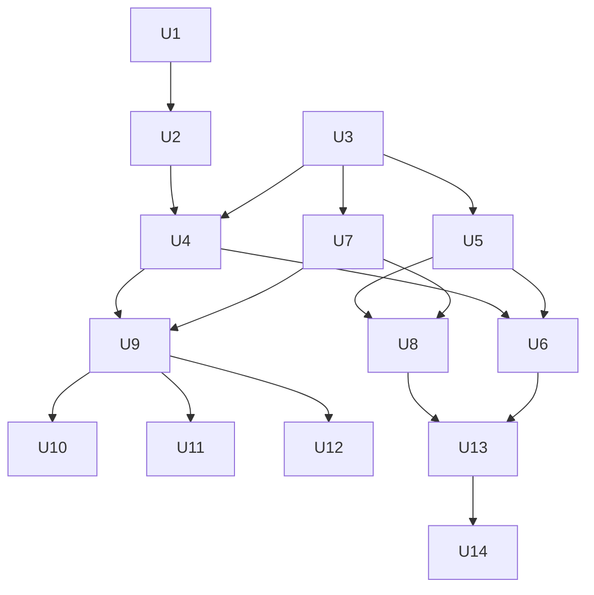

# feat: Observer queues at decision gates

## Summary

A `decision` gate (`by: human`) gets a `watch` block with a queue name. The control plane keeps one entry per wait episode. Observers of that queue run a script for the entry and answer the gate with `narsor-cli task decide`. The first answer wins; every exit from the gate removes the entry. The `wait` step, event types and `context.event` go away. Observers get a run mode (`on_episodes` / `always`), a cron or interval schedule, and an owner view in the TUI, the WebUI and the CLI. (see origin: `docs/brainstorms/2026-11-17-observer-queues-at-decision-gates-requirements.md`)

---

## Problem Frame

The person at a review gate only clicks `check_feedback` after working on the merge request. The `wait` step cannot replace the click, and its event types put decision logic into YAML. The origin document sets the product behavior (R1–R35). This plan decides how to build it in the existing crates. All product questions are closed (Q1: schedule stays on the observer). No blocking question remains.

---

## Requirements

All requirements R1–R35 and AE1–AE11 of the origin document apply. Grouping used by the units:

- Schema and validator: R1–R5 (U1, U2)
- Queue entries and lifecycle: R6–R9, R16–R19 (U3, U4)
- Script contract and answer: R10–R15 (U5, U6)
- Run mode and schedule: R25–R30 (U7, U8)
- Owner routes, CLI, TUI, WebUI: R21–R24, R31–R35 (U9–U12)
- Migration, protocol cleanup, docs: Deferred-to-Planning items (U13, U14)

---

## Scope Boundaries

Carried from the origin: no queue object, no queue schedule, no time zones other than UTC, no cron aliases, no "run now", no dry run or script diff, no view of secrets/limits/workflow mapping, no change to who approves a script.

### Deferred to Follow-Up Work

- A queue object with its own schedule, if the owner asks again (origin Key Decisions).
- Artifacts in a script answer (R12 excludes them in this version).

---

## Context and Research

Verified in the repository (paths are repo-relative):

- The observer model lives in `crates/narsor-engine/src/observers/model.rs` (`ScheduleConfig` with `interval_secs`, `WatchMode::{All, WatchList}`, `WatchEntry` keyed by `watch_entry_id(task, step, object)`, `WatchObjectPolicy`, `ObserverConfig`). Storage is in `observers/store.rs`; the script input contract is `observers/contract.rs`.
- The service side is in `crates/narsor-engine/src/controller_protocol/service/observers/` (`mod.rs` has `register_wait_watch`; `schedule.rs` has the tick, the round rule and `prune_watches`; `owner.rs` has the owner operations; `effects.rs` has the script effect routes `task create` / `task event`).
- The runner snapshot carries `event_wait` (`crates/narsor-model/src/domain/runner_snapshot.rs`, `crates/narsor-protocol/src/controller/runner/snapshot.rs`). `orchestration/runner_state.rs` reads `began_wait` from the snapshot, and `runner_channel/runner_poll.rs` calls `register_wait_watch`. This is the place for R16 (remove the old entry, then add the next).
- A human answer is queued in `orchestration/runner_state.rs` (`queue_input`, `delivery.episode = pending_input_id`). The runner refuses an older request. "First wins" already holds per episode.
- The wait action is `crates/narsor-exec/src/engine/actions/wait.rs`; its wire types are in `crates/narsor-protocol/src/controller/runner/event_wait.rs` and `.../poll.rs`.
- Owner HTTP routes: `crates/narsor-server/src/controller_protocol/observer_http.rs` (create, list, show, script, approve, pause, resume, delete, watches). Wire types: `crates/narsor-protocol/src/controller/observer.rs`. CLI: `src/cli/observer.rs`, `src/cli/observer_effect.rs`, `src/cli/observer_text.rs`. The CLI has `task input` today; `task decide` is new (an observer-token route, like `task event`).
- No observer view exists in `src/tui` or `crates/narsor-web/ui/js`. No cron crate is in `Cargo.lock`.
- Tests: single integration crate `tests/integration/` (`observers_*.rs`, `actions_wait.rs`, `cli_observer.rs`, `orchestration.rs`). See `docs/solutions/conventions/single-integration-test-crate-and-lean-target-2026-11-01.md` and `docs/solutions/conventions/test-network-features-through-trait-seams-not-tcp-servers-2026-10-31.md`.
- Relevant learnings: `docs/solutions/design-patterns/human-review-at-pr-gate-not-inside-agent-steps-2026-10-21.md`, `docs/solutions/design-patterns/tui-panel-actions-from-server-offer-2026-11-13.md`, `docs/solutions/design-patterns/tui-reads-as-keyed-background-jobs-with-loading-marker-2026-10-22.md`, `docs/solutions/design-patterns/tui-modal-confirmation-keyboard-contract.md`.
- Workflows to migrate: `workflows/` (`wruw-change`, `compound-engineering-change.yaml`) and the example scripts `workflows/observers/examples/gitlab-mr-review.sh`, `github-pr-review.sh`.

External research is skipped: the codebase has strong local patterns for observers, owner routes and TUI/WebUI reads. The one new dependency (cron) is decided in KTD-1.

---

## Key Technical Decisions

- **KTD-1. Cron parser: a small crate for five-field expressions, wrapped in one module.** Use a maintained crate that parses standard five-field cron and computes the next fire time in UTC (the implementer picks it at U7 after a check of license, maintenance and `--locked` CI; `croner` is the first candidate). A wrapper in `observers/schedule_expr.rs` refuses a seconds field and an expression that can fire more often than `MIN_INTERVAL_SECS` (R28). The rest of the code sees only `next_after(now)` and the validation. Rejected: own parser (more bugs for no gain).
- **KTD-2. Schedule shape.** `ScheduleConfig` becomes an enum-like pair, `interval_secs` or `cron`, exactly one set (R28). Old records with only `interval_secs` read as before: no migration of the schedule. Serde keeps the old field name.
- **KTD-3. Next tick, backoff and a running run (R29).** The scheduler computes the next due time from the last tick, not from the end of the last run. A tick that finds an active run or a backoff window is skipped, not queued. Backoff and the `error` state keep today's code.
- **KTD-4. Entry key.** An entry is keyed by `(task, episode)`, with `queue`, `step`, `params`, the choices and variables snapshot, and `created_at`. The entry id derives from task and episode (replaces `watch_entry_id` over `step` + `object`). One episode, one entry, per queue.
- **KTD-5. R16 order.** One function in the runner-snapshot handler removes the entry of the ended episode and then adds the entry of the new one. Both use the same store lock. R18 (guard before a run) stays as a second line of defence.
- **KTD-6. Answer route.** `task decide` goes to a new observer-run route that calls the same validation as the person's answer (`SubmitInput` path) and records the author as `observer` + run id (R13, R15). The route refuses an episode that is not current (AE2).
- **KTD-7. Mode per observer, check per queue (R26).** The check runs inside the observer store's existing write lock (create and update of an observer), so concurrent creates cannot mix modes.
- **KTD-8. Migration.** On store load, an observer without `queue` gets a queue named after it; `WatchMode::All` becomes `always`, `WatchMode::WatchList` becomes `on_episodes`. `effect: deliver_event` observers and old watch lists are refused with a clear message at the start of the update (hard cutover, as D64). The release notes say that tasks with an active `wait` step must finish first.
- **KTD-9. Hard cutover of the runner protocol.** `events` in the poll answer, `/runner/v1/events/{id}/ack` and `event_wait` in the snapshot are removed in one change. The runner and the control plane update together; the update order goes to the operations doc (U14).
- **KTD-10. TUI script editing.** Use an external editor (`$EDITOR`) through the terminal suspend/restore path the TUI already has, with a plain-text fallback paste field when no editor is set. WebUI uses a text area, and shows approved against newest version as two labelled rows (R32).

---

## Implementation Units

### U1. Workflow schema: `watch` on a human decision; remove `wait`

**Goal:** Add `watch: {queue, params}` to `decision` and remove the `wait` type and its fields.

**Requirements:** R1, R2, R3, R5.

**Dependencies:** none.

**Files:**
- Modify: `crates/narsor-model/src/workflow/schema.rs`, `crates/narsor-model/src/workflow/validator.rs`, `crates/narsor-model/src/workflow/loader.rs`, `crates/narsor-model/src/workflow/template.rs`, `crates/narsor-model/src/domain/action.rs`, `crates/narsor-model/src/domain/workflow_definition.rs`
- Test: `tests/integration/schema_loading.rs`, `tests/integration/validation.rs`

**Approach:** `params` is a flat string map, rendered when the step starts. The validator refuses a templated queue, a missing queue, a non-flat `params`, and `watch` on `by: conductor`. `event_type`, `filter`, `watch.object`, `watch.event_types` and `context.event` are removed from the schema and the template context.

**Patterns to follow:** the way `step-profile` fields are decided once and validated at load (`docs/solutions/architecture-patterns/step-profile-tiers-decide-once-validate-at-load-2026-11-11.md`).

**Test scenarios:**
- Happy path: a human gate with `watch.queue` and two params loads.
- Error: `queue: "{{ x }}"` is refused; `watch` without `queue` is refused; `watch` on `by: conductor` is refused with the R3 reason.
- Error: a workflow with `type: wait` or `context.event` fails to load with a message that names the removed feature.
- Edge: `watch` with no `params` loads.

**Verification:** every bundled workflow either loads or is migrated (U13); the schema docs no longer mention `wait`.

### U2. Render `watch` at gate start and report it in the snapshot

**Goal:** The runner renders `params` when the gate starts and reports the watch block with the wait episode.

**Requirements:** R1, R2, R4, Key Flow 1.

**Dependencies:** U1.

**Files:**
- Modify: `crates/narsor-exec/src/engine/actions/human.rs` (or the human gate action module), `crates/narsor-model/src/domain/runner_snapshot.rs`, `crates/narsor-protocol/src/controller/runner/snapshot.rs`, `crates/narsor-runner/src/runner/snapshot.rs`
- Test: `tests/integration/actions_human.rs`, `tests/integration/engine_decision_human.rs`

**Approach:** The snapshot gets a `gate_watch` object next to the pending input request (queue, rendered params, choices with `requires_variables`, variables). The existing `pending_input_id` is the episode id. Choices and variables of the gate are unchanged (R4).

**Test scenarios:**
- Happy path: entering `review_work` with a watch block yields a snapshot with the rendered `mr_url` and `label`.
- Edge: a gate without `watch` yields no `gate_watch`.
- Error: a template that fails to render fails the step with the same error path as other step templates.
- Integration: a manual answer still works with every choice on a gate that has `watch` (R4).

**Verification:** snapshot round trip test in the runner session tests.

### U3. Queue entry model and store

**Goal:** Replace the watch-entry model with queue entries and add queue and mode fields to the observer record.

**Requirements:** R6, R7, R8, R10, R25, R26.

**Dependencies:** none (parallel to U1/U2).

**Files:**
- Modify: `crates/narsor-engine/src/observers/model.rs`, `crates/narsor-engine/src/observers/store.rs`, `crates/narsor-engine/src/observers/mod.rs`
- Test: `tests/integration/observers_store.rs`

**Approach:** Add `queue: String` and `mode: ObserverMode {OnEpisodes, Always}` to `ObserverConfig`; remove `WatchObjectPolicy`, `WatchMode`, and the event-type list. `WatchEntry` becomes `QueueEntry` (KTD-4). Queue lookup is by owner namespace (R7). The mode-mixing check (KTD-7) runs in the store's write path. Keep the per-entry newest error (R23) in the same record.

**Test scenarios:**
- Happy path: create two observers on one queue with the same mode.
- Error: a second observer with another mode in the queue is refused and the message names the queue's mode (covers AE8).
- Edge: observers of two owners with the same queue name do not see each other's entries (R7).
- Edge: two concurrent creates with different modes: exactly one succeeds.
- Edge: an entry id is stable for the same task and episode, and differs for a new episode (AE3).

**Verification:** the store loads old records (U13 covers the data migration).

### U4. Entry lifecycle in the control plane

**Goal:** Add the entry when the gate begins; remove it at every exit; warn when no active observer can answer.

**Requirements:** R9, R16, R17, R18, R19, R27, R21 (icon source).

**Dependencies:** U2, U3.

**Files:**
- Modify: `crates/narsor-engine/src/orchestration/runner_state.rs`, `crates/narsor-engine/src/controller_protocol/service/runner_channel/runner_poll.rs`, `crates/narsor-engine/src/controller_protocol/service/observers/mod.rs`, `crates/narsor-engine/src/controller_protocol/service/observers/schedule.rs`
- Test: `tests/integration/observers_watch.rs`, `tests/integration/orchestration.rs`

**Approach:** One handler diffs the previous and the new episode in the snapshot (KTD-5): exit of an episode removes its entry; a new episode adds one. Pause, `Interrupted`, auto-resume and runner restart do not change the episode, so nothing happens (R17). A queue with no active `on_episodes` observer writes one warning to the task history (R9, R27). Before a run, the guard re-reads the task and drops the entry if the episode is gone (R18). `prune_watches` keeps the ended/archived/missing rule (R19).

**Test scenarios:**
- Covers AE2. Manual choice removes the entry; a later answer for the old episode is refused.
- Covers AE3. A review loop: the old entry is gone before the new one is added.
- Covers AE5. Pause while waiting: the entry stays; a script answer resumes the task.
- Covers AE11. A queue with only `always` observers writes a warning and the gate waits.
- Edge: a queue with no observers writes the R9 warning once per episode, not per snapshot.
- Edge: a runner restart with the same episode does not add a second entry.
- Error: the guard drops an entry whose task is archived.

**Verification:** no code path leaves an entry for an ended episode.

### U5. Script input contract version 2

**Goal:** The script receives the queue entry and the gate shape; `contract_version: 2`.

**Requirements:** R11, R14, R25 (`always` has no entry).

**Dependencies:** U3.

**Files:**
- Modify: `crates/narsor-engine/src/observers/contract.rs`, `crates/narsor-engine/src/controller_protocol/service/observers/schedule.rs`
- Test: `tests/integration/observers_worker.rs`, `tests/integration/observers_schedule.rs`

**Approach:** Input for `on_episodes`: task id, episode id and start time, step, `params`, choices (name, description, `requires_variables`), variables (name, type, description). Input for `always`: no entry. Exit code `0` ends the run quietly; another code records an error per entry and does not move the observer to `error` (R14).

**Test scenarios:**
- Happy path: the worker gets the full input for an entry.
- Edge: an `always` run has no entry field.
- Error: exit code 2 records the error on that entry and the observer state stays `active`.

**Verification:** the example scripts read the new input (U13).

### U6. `task decide` and the answer route

**Goal:** Let a script answer a gate with the person's validation.

**Requirements:** R12, R13, R15, R22, R20.

**Dependencies:** U4, U5.

**Files:**
- Modify: `crates/narsor-server/src/controller_protocol/observer_http.rs`, `crates/narsor-engine/src/controller_protocol/service/observers/effects.rs`, `crates/narsor-protocol/src/controller/observer.rs`, `crates/narsor-api-client/src/api/client.rs`, `src/cli/observer_effect.rs`, `src/cli/remote.rs`, `crates/narsor-model/src/domain/human_input.rs`
- Test: `tests/integration/observers_effects.rs`, `tests/integration/cli_observer.rs`

**Approach:** New effect route under `/observer/v1/runs/{run}/decide`. It maps to the existing submit-input path (episode check, choice exists, required variables present, variables declared), then records the author (`observer`, run id) in the answer event. The CLI takes `--choice/--reason/--var/--var-file` or `--data JSON`, and works only with `NARSOR_OBSERVER_RUN` set (as `task event` does). A refusal is a non-zero exit. The reason the script gives shows in the history (R22).

**Test scenarios:**
- Covers AE1. Script answers `check_feedback` with a reason; the gate exits and the history shows `observer … ` with the reason.
- Error: a stale episode is refused (AE2); an unknown choice is refused; a missing required variable is refused; an undeclared variable is refused.
- Edge: `--data` and `--choice` together are a usage error.
- Edge: two scripts answer the same episode: one `delivered`, the other refused.
- Integration: answer for a paused task resumes it through `resume_for_work` (AE5).

**Verification:** CLI text for each outcome is covered in `tests/integration/cli_observer.rs`.

### U7. Cron and interval schedule

**Goal:** Add the cron schedule next to the interval.

**Requirements:** R28, R29.

**Dependencies:** U3.

**Files:**
- Create: `crates/narsor-engine/src/observers/schedule_expr.rs`
- Modify: `crates/narsor-engine/src/observers/model.rs`, `Cargo.toml` (workspace and engine crate), `Cargo.lock`
- Test: `tests/integration/observers_schedule.rs`

**Approach:** KTD-1 and KTD-2. The validator rejects six-field expressions, `@aliases`, and any expression whose minimum gap is below 60 s. Evaluation is in UTC.

**Test scenarios:**
- Covers AE9. `* * * * * *` and `*/30 * * * * *` are refused with a reason; `* * * * *` is accepted.
- Happy path: `*/10 * * * *` gives :00, :10, :20 from a fixed clock.
- Edge: both `cron` and `interval_secs` set is refused; neither set is refused for a new observer.
- Edge: an old record with only `interval_secs` loads and runs unchanged.
- Edge: `0 8 * * 1-5` skips the weekend (fixed clock on a Friday).

**Verification:** `cargo test --workspace --locked` passes with the new lock entries.

### U8. Scheduler: run modes and rounds

**Goal:** Run `always` observers on every tick; run `on_episodes` observers only with entries.

**Requirements:** R25, R29, R30.

**Dependencies:** U3, U5, U7.

**Files:**
- Modify: `crates/narsor-engine/src/controller_protocol/service/observers/schedule.rs`
- Test: `tests/integration/observers_schedule.rs`

**Approach:** KTD-3. At a tick: skip when a run is active or backoff holds; for `always`, start one run with no entry; for `on_episodes`, take the entries present now and run one entry per run, in rounds as today; no entries means no run and no error.

**Test scenarios:**
- Covers AE6. An `always` observer runs at each cron tick with no task present.
- Covers AE7. `on_episodes` at 10:00 with no entry: no run; at 10:05 with one entry: one run.
- Edge: a tick while the previous run is active starts nothing.
- Edge: a tick during failure backoff starts nothing, and the backoff is not changed.
- Edge: three entries and one tick: one run per entry over the round, not three at once.

**Verification:** time-driven tests use the existing fake clock seam.

### U9. Owner operations: update, queue list and show

**Goal:** Owner service and routes to edit queue, mode and schedule, and to read queues.

**Requirements:** R23, R24, R26, R31, R32, R33, R34, R35.

**Dependencies:** U3, U4, U7.

**Files:**
- Modify: `crates/narsor-engine/src/controller_protocol/service/observers/owner.rs`, `crates/narsor-server/src/controller_protocol/observer_http.rs`, `crates/narsor-protocol/src/controller/observer.rs`, `crates/narsor-api-client/src/api/client.rs`
- Test: `tests/integration/observers_store.rs`, `tests/integration/cli_observer.rs`

**Approach:** New routes: `PATCH /control/v1/observers/{observer}` (queue, mode, schedule); `GET /control/v1/observer-queues` and `GET /control/v1/observer-queues/{queue}`. Views carry: observers (name, approved version, newest version, state, schedule, last run), entries (task, step, episode, start, params), and per entry and observer the last run time and the newest error. `ObserverView` also exposes read-only secrets references, limits and workflow mapping (R34). The owner only sees their own observers (R7). The old watch routes (`/watches`) are removed.

**Test scenarios:**
- Happy path: the queue list shows the entry count; the queue show lists observers and entries.
- Error: an update that mixes modes is refused (AE8); an invalid cron is refused (AE9).
- Edge: another owner's queue name returns not found, not a leak.
- Covers AE10. A saved version 3 with approved version 2: the view reports both.
- Edge: delete removes scripts, run errors and entries.

**Verification:** wire types round trip in the protocol crate tests.

### U10. CLI

**Goal:** CLI parity.

**Requirements:** R24, R35.

**Dependencies:** U9.

**Files:**
- Modify: `src/cli/observer.rs`, `src/cli/observer_text.rs`
- Test: `tests/integration/cli_observer.rs`, `tests/integration/cli_control_text.rs`

**Approach:** `observer create` takes `--queue`, `--mode`, `--cron` and keeps `--interval`. `--allow-prefix` and `--max-object-len` are removed. New: `observer update NAME`, `observer queue list`, `observer queue show QUEUE`. The text output follows the style of `observer_text.rs`.

**Test scenarios:**
- Happy path: create with `--cron`, update the queue, list and show queues.
- Error: `--cron` with `--interval` is a usage error; a removed flag fails with a hint.
- Edge: output marks "version N not approved" (R32).

**Verification:** help text tests stay in sync.

### U11. Queues view in the WebUI

**Goal:** A queues page that reads and manages observers.

**Requirements:** R21 (icon), R23, R31–R34.

**Dependencies:** U9.

**Files:**
- Modify: `crates/narsor-web/ui/js/api.js`, `crates/narsor-web/ui/js/store.js`, `crates/narsor-web/ui/js/model.js`, `crates/narsor-web/ui/js/main.js`, `crates/narsor-web/ui/js/text.js`, `crates/narsor-web/ui/index.html`, `crates/narsor-web/ui/styles.css`
- Create: `crates/narsor-web/ui/js/ui/queues.js` (a file beside the other view modules in `ui/`)
- Test: `tests/integration/web_ui.rs`

**Approach:** List of queues, a queue page with observers and entries, create/edit forms, script editor (text area, save makes a new version), an approve dialog that shows the script text, and a delete dialog that names the observer (R33). The task view shows one icon while the current episode has an entry.

**Test scenarios:**
- Happy path: the served UI includes the queues route and the strings.
- Edge: the unapproved-version marker shows when versions differ (AE10).
- Error: a refused edit shows the server's reason in the form.

**Verification:** the existing `web_ui.rs` asset checks pass; manual run with the `run` skill for the visual check.

### U12. Queues view in the TUI

**Goal:** The same view in the TUI.

**Requirements:** R21, R22, R23, R31–R34.

**Dependencies:** U9.

**Files:**
- Create: `src/tui/queues/` (list, detail, forms, script edit)
- Modify: `src/tui/mod.rs`, `src/tui/keymap.rs`, `src/tui/refresh.rs`, `src/tui/task_app/` (the entry icon), `src/tui/event_text.rs` (history line for the observer answer)
- Test: `tests/integration/tui_state.rs`, `tests/integration/tui_render.rs`, `tests/integration/tui_form.rs`

**Approach:** KTD-10. Reads as keyed background jobs with a loading marker; modal confirmations follow the keyboard contract of the existing TUI (see the solutions noted above). Forms use the existing form engine. The task icon comes from the control plane's own entries.

**Test scenarios:**
- Happy path: the queue list renders counts; a queue detail renders observers and entries.
- Edge: no queues shows an empty state with the CLI hint for the rare settings (R34).
- Error: refused create shows the reason and keeps the form values.
- Integration: delete asks a confirmation that names the observer; `Esc` cancels.

**Verification:** render tests at the two width breakpoints the TUI already uses.

### U13. Migration and bundled workflows and scripts

**Goal:** Existing data and bundled files work under the new model.

**Requirements:** R5, R10; Deferred-to-Planning migration items; AE1, AE4.

**Dependencies:** U1–U8.

**Files:**
- Modify: `workflows/` (the `wruw-change` workflow and `workflows/compound-engineering-change.yaml`: gates `review_requirements`, `review_plan`, `review_work`, `review_code` get `watch`; the `wait` steps go), `workflows/observers/examples/gitlab-mr-review.sh`, `workflows/observers/examples/github-pr-review.sh`, `crates/narsor-engine/src/observers/store.rs` (load-time migration, KTD-8)
- Test: `tests/integration/observers_examples.rs`, `tests/integration/builtin_workflows.rs`, `tests/integration/observers_store.rs`

**Approach:** The example scripts use `task decide` and return `0` with no answer when the URL is not theirs (AE4). Store migration follows KTD-8; an observer with `effect: deliver_event` is set to `paused` with a clear note in its record, not deleted.

**Test scenarios:**
- Happy path: an old record loads with queue = name and the right mode.
- Covers AE4. Two example observers on one queue: only the matching script answers.
- Error: an old `deliver_event` observer is paused with a reason and is not run.
- Integration: every bundled workflow loads with the new validator.

**Verification:** `cargo test --workspace --locked` passes.

### U14. Remove the `wait` runner protocol; docs and decision record

**Goal:** Remove dead protocol parts and document the change.

**Requirements:** R5; Deferred-to-Planning items on protocol and docs.

**Dependencies:** U1–U13.

**Files:**
- Delete: `crates/narsor-exec/src/engine/actions/wait.rs`, `crates/narsor-protocol/src/controller/runner/event_wait.rs`, `tests/integration/actions_wait.rs`
- Modify: `crates/narsor-protocol/src/controller/runner.rs`, `crates/narsor-protocol/src/controller/runner/poll.rs`, `crates/narsor-runner/src/runner/mod.rs`, `crates/narsor-runner/src/runner/session_tests.rs`, `crates/narsor-controller-client/src/wire.rs`, `crates/narsor-engine/src/orchestration/control_plane.rs`, `crates/narsor-engine/src/orchestration/model.rs`, `crates/narsor-engine/src/orchestration/runner_state.rs`
- Modify (docs): `docs/dev/workflow-schema.md` (§3.3.D `wait`, the `watch` of `decision`), `docs/dev/architecture.md` (new decision record that supersedes the `wait` part of the observers design), `docs/dev/components.md`, `docs/dev/domain-model.md`, `docs/user/observers.md`, `docs/operations/` (update order of runner and control plane, no active `wait` tasks)
- Test: `tests/integration/orchestration.rs`, `tests/integration/docs_links.rs`

**Approach:** KTD-9. Delete the `wait` action, the poll `events`, the ack route and `event_wait`. After this unit `grep` for `event_wait`, `deliver_event`, `WatchMode` finds nothing outside history documents.

**Test scenarios:**
- Test expectation: none for the deletions themselves; the existing suites prove that nothing else used them.
- Integration: the docs link test passes with the new and changed documents.

**Verification:** `cargo build --workspace --bins` and `cargo test --workspace --locked` pass; docs describe the update order.

---

## Dependency Graph

---

## System-Wide Impact

- **Runner and control plane** change together (protocol cutover, KTD-9). A mixed version pair cannot run a gate with `watch`.
- **Operators**: tasks with an active `wait` step must finish before the update (R5); observers with `deliver_event` are paused by the migration.
- **Workflow authors**: the `wait` step is gone; gates get `watch`.
- **Security**: a script answer uses the run token and the same validation as a person's answer. A script cannot answer for another owner's task, because queue lookup and the route are bound to the run's owner (R7). The owner approves the script (unchanged), so the owner is responsible for its choices.

---

## Risks and Mitigations

| Risk | Mitigation |
|---|---|
| A stale script answer reaches a new episode | Episode key (KTD-4), R16 order (KTD-5), R18 guard, refusal in U6; tests for AE2 and AE3 |
| Cron crate adds a dependency | One wrapper module (KTD-1); `--locked` CI check in U7 |
| Hard cutover breaks running tasks | Operations doc with update order; migration pauses old observers instead of deleting |
| Large UI scope in two clients | U9 holds all logic server-side; U11 and U12 only render and call routes |
| Concurrent creates mix modes | Check inside the store write lock (KTD-7) with a concurrency test |

---

## Deferred to Implementation

- The exact cron crate and version (KTD-1).
- Exact route and field names of the wire types (U6, U9).
- The layout of the TUI queues view inside `src/tui`.

---

## Sources and References

- Origin: `docs/brainstorms/2026-11-17-observer-queues-at-decision-gates-requirements.md`
- Prior design: `docs/plans/2026-11-13-002-feat-obserwatory-zrodel-zewnetrznych-plan.md`, `docs/brainstorms/2026-11-13-obserwatory-zrodel-zewnetrznych-requirements.md`
- Schema docs: `docs/dev/workflow-schema.md` §3.3.D; user docs: `docs/user/observers.md`
