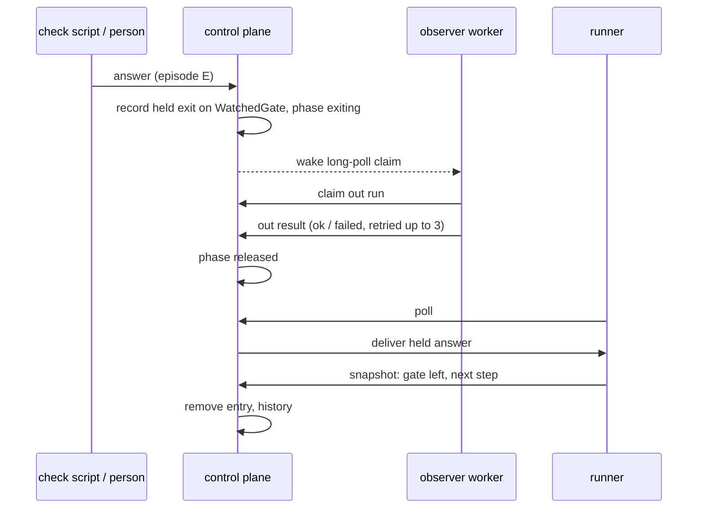

# feat: Catalog automations and queue entry/exit scripts

## Summary

Queues and automations become catalog files, read on every pass with no
cache, as the environment catalog is. The scheduling unit becomes the pair
(queue, automation); its runtime state stays in `{state}`. The observer
worker runs two new script phases, `in` and `out`, claimed before `check`
and delivered through a long-poll claim. The control plane keeps the
entry/exit state of a watched gate on the task: it withholds `check` until
`in` succeeds, and it holds an exit (an answer or an operator transition)
until `out` ends. The runner changes in one place: "restart step" also
works on a waiting gate. Owner management of observers (CLI, TUI, WebUI,
routes) is removed; the queue views become read-only.
(see origin: `docs/brainstorms/2026-11-18-catalog-automations-and-queue-entry-exit-scripts-requirements.md`)

---

## Problem Frame

Source handling is split between the workflow (it adds the label) and the
observer (it waits for its removal), and observer configuration lives in
the state of one installation, so a team cannot review or share it. The
origin document sets the behavior (R1–R22, AE1–AE8). This plan decides how
to build it on top of the queues of
`docs/plans/2026-11-17-001-feat-observer-queues-at-decision-gates-plan.md`.

---

## Requirements

All requirements R1–R22 and AE1–AE8 of the origin apply. Grouping used by
the units:

- Catalog files, validation, secrets: R1–R7 (U1, U3)
- Runtime state, cutover: R2, R22 (U2)
- `in` and `check` gating, `in` failure: R8, R9, R12, R13, R14, R17, R19 (U4)
- Exit hold and `out`: R10, R11, R13, R14, R15, R18 (U5)
- "At once": R8, R10 (U6)
- Restart of a waiting gate: R16 (U7)
- Task view: R20 (U8)
- Read-only views, removed management: R21, R22 (U9)
- Examples, deployment, docs: success criteria (U10)

**Origin actors:** A1 catalog author, A2 workflow author, A3 person at the
gate, A4 Narsor process user.
**Origin flows:** F1 review with a label, F2 failing entry script.
**Origin acceptance examples:** AE1 (R8–R10, R13), AE2 (R12, R14), AE3
(R14), AE4 (R10, R16), AE5 (R15), AE6 (R18), AE7 (R17), AE8 (R2, R7).

---

## Scope Boundaries

Carried from the origin: no plugin mechanism (catalog from a separate
repository), no per-owner queues, no enable step, no script approval, no
editing in the TUI or WebUI, no hooks other than `in` and `out`, no
migration of observers stored in the state.

Plan-level non-goals:

- No removal of the owner keying in the store and entries. The installation
  has one owner (A4); entries keep their `owner` field.
- No change to the `wait`-free gate contract of D77 beyond `in`/`out`.
- No `validate` command for catalog automations and queues; invalid files
  are shown in the queue views (U9).

### Deferred to Follow-Up Work

- Server-to-runner push (long-poll for runner inputs and commands): a held
  exit reaches the runner on its next poll. This is a general latency
  change for every answer, not only for queues.
- `read_dir_or_empty` helper for the 14 copies of the NotFound-as-empty
  pattern (`docs/follow-ups/2026-11-15-narsor-engine-split-follow-ups.md`);
  use it in the new catalog code if it exists by then.
- Moving the catalog modules lower in the crate tree (same follow-up file).

---

## Context & Research

### Relevant Code and Patterns

- Catalog roots: `crates/narsor-store/src/paths.rs` (`CatalogPaths`,
  `StatePaths`). Environment catalog as the file-per-entry, no-cache model:
  `crates/narsor-engine/src/environment/catalog.rs` (`EnvironmentCatalog`,
  `CatalogError`). Control-plane seam for catalog access:
  `crates/narsor-engine/src/environment/resolver.rs` (`LaunchResolver`),
  `crates/narsor-engine/src/launch.rs` (`CatalogLaunchResolver`).
- Observer model, store, schedule, contract:
  `crates/narsor-engine/src/observers/{model,store,schedule_expr,contract,migrate}.rs`.
  Types to reuse: `ScheduleConfig`, `ObserverMode`, `CreateTaskEffect`,
  `SecretRef`, `QueueEntry`, `queue_entry_id`.
- Scheduler and runs:
  `crates/narsor-engine/src/controller_protocol/service/observers/schedule.rs`
  (`observer_pass`, `claim_observer_run`, `finish_observer_run`,
  `retry_delay_secs`), called from `crates/narsor-server/src/runtime.rs`
  (`run_periodic_pass`). Effects: `service/observers/effects.rs`
  (`observer_create_task`, `observer_decide`).
- Entry lifecycle: `service/observers/entries.rs`
  (`follow_gate_episode`, `swap_queue_entries`, `restore_queue_entry`,
  `queue_unserved`, `drop_queue_entry_of`, `task_ended`);
  `crates/narsor-engine/src/orchestration/runner_state.rs`
  (`follow_watched_gate`, `queue_input`, `queue_input_from`);
  `crates/narsor-engine/src/orchestration/model.rs` (`WatchedGate`,
  `TaskRecord`); `runner_channel/runner_poll.rs` (`deliver_inputs`,
  `deliver_operator_commands`, snapshot handling).
- Worker: `crates/narsor-observer-worker/src/worker.rs` (`WorkerApi`,
  `ScriptRunner`, 10 s poll), server side
  `crates/narsor-server/src/observer_worker.rs`, protocol
  `crates/narsor-protocol/src/controller/observer.rs` (`ObserverWorkerRun`).
- Restart: `OperatorCommand::RestartStep`
  (`crates/narsor-protocol/src/controller/task/input.rs`), runner
  `crates/narsor-runner/src/runner/commands.rs`, offer
  `service/tasks/actions.rs`; gate suspension
  `crates/narsor-exec/src/engine/actions/human.rs`.
- Timeline: `crates/narsor-protocol/src/api/timeline.rs`
  (`PositionStatus`) is built by the runner; the control plane has the task
  event log (`TaskEventKind`, e.g. `GateQueueWarning`).
- ConfigMap init copy: `deploy/kind/server.yaml` (`backend-*`, `profile-*`,
  `workflow-*` key prefixes); operator docs
  `docs/operations/remote-backends.md` §3.
- Test helpers: `tests/integration/gate_support.rs` (snapshot without a
  server), `service/observers/tests.rs` (`ManualClock`, `NoLaunches`,
  `Fixture`), router `oneshot` tests in
  `crates/narsor-server/src/controller_protocol/observer_http.rs`.

### Institutional Learnings

- `docs/solutions/logic-errors/gate-queue-entries-outlive-runner-problems-and-bad-files-2026-11-18.md`:
  only a snapshot with an execution id and no problem shows a real gate
  exit; a problem snapshot must not trigger `out`; a restored entry must not
  run `in` again; skip one unreadable file and keep the rest working.
- `docs/solutions/logic-errors/observer-round-next-entry-claim-timestamp-reset-2026-11-15.md`:
  every end of a run (result, failure, lost run) resets the claim
  timestamp; a lost `in`/`out` run is a failed attempt.
- `docs/solutions/conventions/removing-a-field-from-serde-wire-and-persisted-types-2026-11-18.md`:
  classify each removed type (request, view, persisted record, script
  contract); run the WebUI Node tests (`crates/narsor-web/ui-tests`) — CI
  does not.
- `docs/solutions/architecture-patterns/step-profile-tiers-decide-once-validate-at-load-2026-11-11.md`:
  read configuration files at each use, validate completeness at load.
- `docs/solutions/design-patterns/tui-panel-actions-from-server-offer-2026-11-13.md`:
  the server offers the task actions; new view fields get serde defaults.
- `docs/solutions/security-issues/untrusted-control-plane-reaches-user-git-and-harness-logins-2026-10-25.md`:
  a script gets only the secrets it declares.

### External References

None. Local patterns cover every layer (file catalog, worker, long-lived
HTTP in axum).

---

## Key Technical Decisions

- **Catalog read on every pass, no cache.** Same rule as
  `EnvironmentCatalog`: a change applies to the next run. The `check`,
  `in` and `out` script text is read when the run is claimed; the run
  records the script digest for the history.
- **Bad file skipped, not fatal.** The loader returns valid queues and a
  list of per-file problems. Problems show in the queue views and in the
  server log once per change (not every pass).
- **Scheduling unit is (queue, automation).** Each automation listed in a
  queue gets its own runtime record (next tick, round, active run, backoff,
  per-entry last run, errors). The queue file gives schedule and mode, so
  every automation of a queue ticks on the same schedule but runs
  independently (keeps R8 of 2026-11-17).
- **Old observer records are ignored.** At startup the server logs one
  warning when `{state}/observers/` holds records, and does not read them.
  Queue entries in `{state}/observer-queues/entries/` keep their shape.
- **Secrets from a flat directory.** An automation declares
  `secrets: [{name, env}]`; the worker reads `{observer secrets dir}/{name}`.
  The owner subdirectory goes away (single owner, R5). On Kubernetes the
  directory is a mounted Secret, as for workflows.
- **Script contract version 3.** The input gets a `phase` (`in`, `check`,
  `out`) and, for `out`, the exit (choice, author, or task end). No
  approval exists any more, so the bump costs no re-approval. `task decide`
  is accepted only from a `check` run.
- **Gate automation state lives on `WatchedGate`.** Per episode: phase
  (`entering`, `ready`, `entry_failed`, `exiting`, `released`), per automation the hook status and
  attempt count, and the held exit. The entry file stays a derived index
  for the scheduler. This follows the learning that hook state must survive
  entry restores.
- **`check` waits for `ready`.** The R18 guard of 2026-11-17 (the task
  still waits in this episode) also requires phase `ready`.
- **Exit hold in the control plane, runner unchanged.** When a watched gate
  with at least one `out` script gets an exit (a queued input from the
  person or `check`, or an operator `Transition`/`SelectStep`), the control
  plane records it as the held exit, starts `out`, and does not deliver it
  to the runner until every `out` has ended (success, or failure after the
  last attempt). A second exit for the same episode is refused (first
  wins). Rejected alternative: a new runner step phase that waits for an
  ack — it changes the runner protocol and needs runner and control plane
  to update together.
- **Retries.** `in` and `out`: 3 attempts, delays 10 s and 30 s, timeout
  120 s per attempt; a lost run is a failed attempt. After the last failed
  `in` the gate shows `failure` and stays there until a manual exit or a
  restart; no further automatic attempts. After the last failed `out` the
  history records the problem and the held exit is delivered (R15).
- **Order per task.** Hook runs of one task run one at a time in arrival
  order; `in` of a new episode never starts before `out` of the previous
  one ended. With the exit hold this matters only for restart (U7) and for
  exits the control plane did not hold (a runner-side exit without a
  queued input), where `out` runs after the fact.
- **Long-poll claim for the worker.** The claim request waits up to 25 s
  and returns as soon as a run is due; queueing a hook run, an entry, or a
  tick wakes waiting claims. Hook runs are claimed before `check` runs.
  The worker loop drops the 10 s sleep while the server holds the request.
  No new transport: plain HTTP, the same locally and on Kubernetes.
- **Restart on a waiting gate.** `RestartStep` is accepted for a human
  gate in `InputNeeded` and gives a new episode; the snapshot then shows
  the old episode ended and a new one began, and U5/U4 run `out` then `in`.
- **Failure visibility as a control-plane overlay.** The task view gets an
  optional gate automation status (failed phase, attempts, last error)
  that the TUI and WebUI apply to the gate position of the timeline. The
  attempts are task events in Przebieg. The runner timeline is unchanged.
- **Read-only queue routes.** `GET /control/v1/observer-queues[/{q}]`
  stays, rebuilt from catalog plus state, and adds the invalid files. All
  other owner observer routes are removed (requests get 404, per the
  removal convention). The CLI command becomes `narsor-cli queue
  list|show`.

---

## Open Questions

### Resolved During Planning

- Where `in`/`out` run: on the observer worker, with the `check` sandbox and
  secrets handling.
- How "at once" is reached: long-poll worker claim (decided with the person
  in planning); runner push deferred.
- How the next step waits for `out`: exit hold in the control plane.
- How a catalog change is seen: read on every pass; an episode records
  which automations ran `in`, and `out` runs for those automations. If one
  was removed from the catalog meanwhile, its `out` is skipped and the
  history says so.
- A queue removed while it has entries: the entries become unserved (the
  existing `GateQueueWarning` path); the gate waits for the person.
- Secret naming across local and Kubernetes: flat secrets directory by
  name (above).

### Deferred to Implementation

- Exact field and event names, and whether the hold extends the existing
  queued-input record or uses a separate held-exit record.
- Whether the long-poll wake uses a `tokio::sync::Notify` in
  `ProtocolService` or a watch channel; depends on how the service is
  shared in `crates/narsor-server/src/runtime.rs`.
- The ConfigMap key scheme for automation directories (proposed:
  `automation-{name}--{file}`, `queue-{name}.yaml`); confirm against the
  init script's parsing.

---

## Output Structure

    {catalog}/
      automations/{name}/automation.yaml    # description, params, secrets, scripts
      automations/{name}/check.sh           # required
      automations/{name}/in.sh              # optional
      automations/{name}/out.sh             # optional
      queues/{name}.yaml                    # automations, mode, schedule, task effect
    {state}/
      automations/{queue}/{automation}/state.json   # runtime record
      automations/{queue}/{automation}/errors/{seq}.json
      observer-queues/entries/{entry}.json          # unchanged

    examples/catalog/                       # in the repo, replaces workflows/observers/examples
      automations/gitlab-mr-label/  automations/github-pr-label/  automations/jira-new-issues/
      queues/mr-review.yaml  queues/jira-intake.yaml

---

## High-Level Technical Design

> *This illustrates the intended approach and is directional guidance for review, not implementation specification. The implementing agent should treat it as context, not code to reproduce.*

Gate automation phase of one episode (kept on `WatchedGate`):

```mermaid
stateDiagram-v2
    [*] --> entering: snapshot shows new episode<br/>(queue has in scripts)
    [*] --> ready: no in scripts
    entering --> ready: every in succeeded
    entering --> entry_failed: last in attempt failed
    entry_failed --> exiting: manual exit (held)
    ready --> exiting: exit from check / person / transition (held)
    entering --> exiting: manual exit (held)
    exiting --> released: every out ended (ok or logged failure)
    released --> [*]: held exit delivered to runner;<br/>snapshot shows gate left
    ready --> released: no out scripts
```

Exit hold sequence:

---

## Implementation Units

### U1. Catalog model and loader for automations and queues

**Goal:** Read and validate `{catalog}/automations/*/` and
`{catalog}/queues/*.yaml`, with per-file problems.

**Requirements:** R1–R5, R7

**Dependencies:** None

**Files:**
- Modify: `crates/narsor-store/src/paths.rs` (`automations_dir`, `queues_dir`)
- Create: `crates/narsor-engine/src/automations/mod.rs`, `crates/narsor-engine/src/automations/catalog.rs`
- Modify: `crates/narsor-engine/src/observers/model.rs` (move or re-export `ScheduleConfig`, `ObserverMode`, `CreateTaskEffect`, `SecretRef`)
- Modify: `crates/narsor-engine/src/environment/resolver.rs`, `crates/narsor-engine/src/launch.rs` (seam to read the automation catalog, faked in tests)
- Test: `crates/narsor-engine/src/automations/catalog.rs` (unit), `tests/integration/automations_catalog.rs`

**Approach:**
- An automation definition: description, params it reads, secrets
  (`name`, `env`), and the presence of `check`, `in`, `out` script files.
- A queue definition: name (file name), automations (names), mode,
  schedule (cron or interval), and for `always` queues the existing
  task-creation settings (workflow mapping, condition, task limit, import
  backlog).
- The loader returns `{queues, automations, problems}`; each problem names
  the file and the reason. A queue that names a missing or invalid
  automation is a problem and is not active. Refuse: missing `check`, bad
  schedule (2026-11-17 rules), an `always` queue whose workflow is not in
  the catalog, a secret entry that carries a value instead of a name.
- No cache: each call reads the directories.

**Patterns to follow:** `EnvironmentCatalog` (file name is the id,
`CatalogError` kinds), `ScheduleConfig::validate`,
`CreateTaskEffect::validate_against`.

**Test scenarios:**
- Happy path: a catalog with `gitlab-mr-label` (in, check, out) and queue
  `mr-review` loads one active queue with one automation and no problems.
- Covers AE8. Error path: queue `x` names `missing-automation` → `x` is not
  active, one problem names the file; queue `mr-review` still loads.
- Error path: an automation without `check.sh`; a cron with a seconds
  field; a YAML parse error → each is one problem, the others load.
- Edge case: an empty or absent `automations/` directory → no queues, no
  problems.

**Verification:** the loader gives the same result as the files on disk
after each change, with no restart.

---

### U2. Runtime state per (queue, automation) and cutover

**Goal:** Replace the observer record with a runtime-only record keyed by
(queue, automation), and ignore the old records.

**Requirements:** R2, R22

**Dependencies:** U1

**Files:**
- Modify: `crates/narsor-engine/src/observers/store.rs` (runtime records, errors, entries unchanged)
- Modify: `crates/narsor-engine/src/observers/model.rs` (drop config, scripts, approval, state `paused`; keep run, round, backoff, entry last runs)
- Modify: `crates/narsor-engine/src/observers/migrate.rs` (remove v1→v2; add the startup warning for `{state}/observers/`)
- Modify: `crates/narsor-store/src/paths.rs` (`{state}/automations/{queue}/{automation}/`)
- Test: `tests/integration/observers_store.rs`

**Approach:**
- The record is created on first need and deleted when the pair is no
  longer in the catalog and has no active run (on the next pass).
- States: `active`, `needs_attention` (task limit), `error` (5 failures).
  `paused` is removed; the catalog author removes the queue instead.
- Lock order stays: record lock → `entries.lock`.

**Patterns to follow:** current `ObserverStore` (flock, atomic write,
exclusive create); the field-removal convention for persisted records.

**Test scenarios:**
- Happy path: first pass for (`mr-review`, `gitlab-mr-label`) creates the
  record; a second pass reuses it.
- Edge case: the pair leaves the catalog → its record is removed on the
  next pass when no run is active; kept while a run is active.
- Integration: a `{state}/observers/` directory with an old record → the
  server starts, logs one warning, and schedules nothing from it.

**Verification:** no code path reads `observer.json` any more except the
startup warning.

---

### U3. Scheduler and worker run on the catalog (`check`, contract v3)

**Goal:** Drive `check` runs from catalog queues, with catalog scripts,
flat secrets and contract version 3.

**Requirements:** R2, R4, R5, R6

**Dependencies:** U1, U2

**Files:**
- Modify: `crates/narsor-engine/src/controller_protocol/service/observers/schedule.rs`
- Modify: `crates/narsor-engine/src/controller_protocol/service/observers/effects.rs` (`observer_decide` only from `check` runs; tasks created by `always` belong to the installation owner)
- Modify: `crates/narsor-engine/src/observers/contract.rs` (`SCRIPT_CONTRACT_VERSION = 3`, `phase`, `exit`)
- Modify: `crates/narsor-protocol/src/controller/observer.rs` (`ObserverWorkerRun`: phase, automation, queue, script digest)
- Modify: `crates/narsor-observer-worker/src/worker.rs` (flat secrets directory)
- Modify: `crates/narsor-server/src/observer_worker.rs`, `crates/narsor-shared/src/config/settings.rs` (secrets dir doc and layout)
- Test: `tests/integration/observers_schedule.rs`, `tests/integration/observers_worker.rs`, `tests/integration/observers_decide.rs`

**Approach:**
- `observer_pass` iterates active queues × automations, ticks each pair on
  the queue schedule; `on_episodes` keeps the one-entry-per-run round,
  `always` runs every tick.
- At claim, the script text is read from the catalog; a missing file at
  claim time is a failed run with a clear error.
- Mode mixing (R26 of 2026-11-17) is now impossible, so its check goes.

**Patterns to follow:** the current pass, claim and finish functions; the
claim-timestamp reset learning.

**Test scenarios:**
- Happy path: queue `mr-review` (`*/5 * * * *`, `on_episodes`) with one
  entry → one `check` run at the tick, input has contract 3 and
  `phase: check`.
- Happy path: queue `jira-intake` (`always`) with no tasks → one run per
  tick; a created task belongs to the installation owner.
- Error path: `task decide` from a run whose phase is not `check` →
  refused, non-zero exit of the CLI.
- Edge case: the script file changes between two ticks → the second run
  uses the new text and records a new digest.
- Integration: a secret `GITLAB_TOKEN` declared by the automation is read
  from `{secrets dir}/gitlab-token` and is masked in the output.

**Verification:** the 2026-11-17 queue acceptance examples AE1–AE11 that
still apply pass with catalog-defined queues.

---

### U4. Entry scripts and `check` gating

**Goal:** Run `in` when an episode enters a queue, keep `check` away until
every `in` succeeded, and show a failed entry.

**Requirements:** R8, R9, R12, R13, R14, R17, R19

**Dependencies:** U3

**Files:**
- Modify: `crates/narsor-engine/src/orchestration/model.rs` (`WatchedGate`: phase, per-automation hook status, attempts)
- Modify: `crates/narsor-engine/src/controller_protocol/service/observers/entries.rs` (`follow_gate_episode`: start `in`; restore does not rerun `in`)
- Modify: `crates/narsor-engine/src/controller_protocol/service/observers/schedule.rs` (hook runs: claim first, result, retries, lost run; `check` guard requires `ready`)
- Modify: task event kinds (hook attempt, hook failed, entry ready)
- Test: `tests/integration/observers_queue_entries.rs`, `tests/integration/queue_hooks.rs` (new)

**Approach:**
- On `began` (with the clean-snapshot rule of the learning), record phase
  `entering` and one pending `in` per automation that has one; no `in`
  scripts → `ready` at once (R17).
- A hook run is a run of the (queue, automation) pair with phase `in`; it
  does not count toward the pair's `check` backoff.
- Retries per Key Technical Decisions; after the last failure the phase is
  `entry_failed`, a history event says so, no more automatic attempts.
- Pause, `Interrupted`, auto-resume, runner restart: no change of phase
  (R19).

**Patterns to follow:** `follow_gate_episode` and `swap_queue_entries`
ordering; per-entry error files.

**Test scenarios:**
- Covers AE1 (entry part). Happy path: entry with one `in` → `in` runs, the
  phase becomes `ready`, then the first `check` run starts.
- Covers AE2. Error path: `in` fails twice, succeeds on the third attempt →
  two attempt events, phase `ready`.
- Error path: `in` fails three times → phase `entry_failed`, `check` never
  runs for the entry, history has the failure.
- Covers AE7. Edge case: automation with `check` only → `ready` at once.
- Edge case: two automations, one `in` ok and one failing → phase stays
  `entering` until the failing one ends, then `entry_failed`.
- Integration: a problem snapshot (runner problem) while `entering` → no
  phase change and no second `in`; a restored entry does not run `in`
  again.

**Verification:** no `check` run is ever claimed for an entry whose gate is
not `ready`.

---

### U5. Exit hold and exit scripts

**Goal:** Hold every exit of a watched gate until `out` ended, run `out`
in the background on task end, and log a failed `out`.

**Requirements:** R10, R11, R13, R14, R15, R18

**Dependencies:** U4

**Files:**
- Modify: `crates/narsor-engine/src/orchestration/runner_state.rs` (`queue_input`, `queue_input_from`: held exit; first wins)
- Modify: `crates/narsor-engine/src/runner_channel/runner_poll.rs` (`deliver_inputs`, `deliver_operator_commands`: skip held items until released)
- Modify: `crates/narsor-engine/src/controller_protocol/service/observers/entries.rs` (`task_ended`, `drop_queue_entry_of`: background `out`)
- Modify: `crates/narsor-engine/src/controller_protocol/service/observers/schedule.rs` (out runs, release)
- Modify: `crates/narsor-engine/src/controller_protocol/service/tasks/commands.rs` (Transition/SelectStep on a watched gate)
- Test: `tests/integration/queue_hooks.rs`, `tests/integration/observers_decide.rs`

**Approach:**
- An exit arrives for episode E of a watched gate whose queue has `out`
  scripts for automations that ran (or tried) `in`: store it as the held
  exit, phase `exiting`, start `out` runs with the exit in their input
  (choice, author: person / automation run / operator).
- A second exit for E → refused as stale (same verdict a person gets for
  an answered episode).
- Every `out` ended → phase `released`, the held item becomes deliverable
  on the next runner poll. A failed last attempt → history event, still
  released (R15).
- No `out` scripts → no hold; current behavior.
- A runner-side exit with no held item (not expected for `by: human`
  gates; defensive) → run `out` after the fact, ordered before any `in` of
  the next episode.
- Task end (cancel, archive, delete) while at the gate → one `out` attempt
  in the background, no hold, failure in the history (R18).

**Patterns to follow:** queued-input verdicts (`settle_input`), the
first-wins episode check, entry removal order of 2026-11-17 R16.

**Test scenarios:**
- Covers AE1 (exit part). Happy path: `check` answers `check_feedback` →
  `out` runs with that choice and author; the runner gets the answer only
  after `out` succeeded; next step starts.
- Covers AE5. Error path: `out` fails three times → history records the
  problem, the answer is delivered, the next step starts.
- Covers AE3. Integration: `in` failed, the person chooses `revise_plan` →
  `out` runs, then the answer is delivered.
- Edge case: the person answers while `out` for a `check` answer is
  running → refused as stale.
- Edge case: operator `Transition` on a watched gate → held like an answer.
- Covers AE6. Integration: task cancelled at the gate → task ends at once,
  one `out` run follows.
- Covers AE4. Integration: loop `review_work` → … → `review_work` → `out`
  of the first episode ends before the second episode can begin.

**Verification:** with `out` scripts present, no answer or transition is
delivered to the runner before every `out` of the episode ended.

---

### U6. Long-poll worker claim

**Goal:** Make hook and `check` runs start at once instead of after the
next 10 s poll.

**Requirements:** R8, R10 ("at once")

**Dependencies:** U3 (U4/U5 use the wake)

**Files:**
- Modify: `crates/narsor-server/src/controller_protocol/observer_http.rs` (claim waits up to 25 s)
- Modify: `crates/narsor-engine/src/controller_protocol/service/observers/schedule.rs` (wake on hook queued, entry added, tick due)
- Modify: `crates/narsor-observer-worker/src/worker.rs` (no sleep after a held claim; keep a short sleep after an error)
- Modify: `crates/narsor-api-client` / worker HTTP client timeout (above 25 s)
- Test: `crates/narsor-server/src/controller_protocol/observer_http.rs` (router tests), `tests/integration/observers_worker.rs`

**Approach:**
- The claim handler checks for a due run; if none, it waits on a wake
  signal or the 25 s limit, then checks once more and returns "nothing".
- Hook runs are offered before `check` runs.
- Server shutdown releases waiting claims.

**Patterns to follow:** existing claim auth (`authenticate_observer_run`),
graceful shutdown in `crates/narsor-server/src/runtime.rs`.

**Test scenarios:**
- Happy path: a claim waits; an `in` run is queued → the claim returns it
  within a short bound (not 10 s).
- Edge case: nothing becomes due → the claim returns empty after the
  limit; the worker claims again at once.
- Edge case: a `check` run and an `in` run are both due → `in` first.
- Error path: shutdown while a claim waits → the claim returns and the
  server stops without waiting 25 s.

**Verification:** the time from gate entry to `in` start is bounded by the
claim round trip, not by a poll interval.

---

### U7. Restart of a waiting gate

**Goal:** Let the person restart a gate step that waits, which gives a new
episode (`out` then `in`).

**Requirements:** R16

**Dependencies:** U5

**Files:**
- Modify: `crates/narsor-runner/src/runner/commands.rs` (accept `RestartStep` for a human gate in `InputNeeded`)
- Modify: `crates/narsor-exec/src/engine/actions/human.rs` (new pending input id on restart)
- Modify: `crates/narsor-engine/src/controller_protocol/service/tasks/actions.rs` (offer Restart on a waiting gate)
- Test: `tests/integration/actions_human.rs`, `tests/integration/queue_hooks.rs`

**Approach:**
- The restart of a waiting gate is an exit for the hold of U5 when `out`
  scripts exist: hold the command until `out` ended, then deliver it. The
  new episode then starts `in` (U4).
- Without a watch block the restart just renews the episode.

**Patterns to follow:** existing `RestartStep` handling for failed steps.

**Test scenarios:**
- Happy path: gate waits, the person restarts → new episode id, old entry
  removed, new entry added.
- Integration: with `in` and `out` → `out` of the old episode, then `in` of
  the new one; `check` runs only after the new `in` succeeded.
- Error path: restart while a held exit for the same episode exists →
  refused (first wins).

**Verification:** a gate in `entry_failed` can be recovered with restart
and no new task.

---

### U8. Gate automation status in the task view

**Goal:** Show `failure` on a gate whose `in` failed, and the attempts of
`in` and `out` in Przebieg.

**Requirements:** R20

**Dependencies:** U4, U5

**Files:**
- Modify: `crates/narsor-protocol/src/api/` task view type (optional gate automation status, serde default)
- Modify: `crates/narsor-engine/src/controller_protocol/service/tasks/` (fill the status from `WatchedGate`)
- Modify: `src/tui/` task timeline and history rendering (`task_app/`)
- Modify: `crates/narsor-web/ui/js/ui/` task view and timeline, `text.js`
- Test: `tests/integration/task_app_support.rs` users, `tests/integration/web_ui.rs`, `crates/narsor-web/ui-tests/*.mjs`

**Approach:**
- The gate position shows `failure` while the phase is `entry_failed`, and
  "in progress" again after a successful retry.
- History events: hook attempt (phase, automation, attempt, error
  excerpt), entry ready, exit held, `out` failed after last attempt.
- The existing "queue entry" icon stays.

**Patterns to follow:** server-offered actions and serde-default fields
(learning), existing `GateQueueWarning` rendering.

**Test scenarios:**
- Happy path: `entry_failed` → TUI and WebUI show the gate as failed with
  the attempt count.
- Edge case: an old server with no status field → views show the runner
  status unchanged.
- Integration: Przebieg lists three `in` attempts as events under one step,
  not three steps.

**Verification:** the WebUI Node tests and TUI tests pass.

---

### U9. Read-only queue views; remove observer management

**Goal:** Remove owner create/update/script/approve/pause/resume/delete and
rebuild the queue views from catalog plus state.

**Requirements:** R21, R22

**Dependencies:** U1, U2

**Files:**
- Modify: `crates/narsor-server/src/controller_protocol/observer_http.rs` (keep queue list/show and worker/effect routes; remove owner observer routes)
- Modify/Delete: `crates/narsor-engine/src/controller_protocol/service/observers/owner.rs`, `.../observers/mod.rs`
- Modify: `crates/narsor-protocol/src/controller/observer.rs` (remove request types; queue view adds automations, problems, hook state per entry)
- Modify: `crates/narsor-api-client/src/api/client.rs`
- Modify/Delete: `src/cli/observer.rs`, `src/cli/observer_text.rs`, `src/cli/mod.rs` (new `queue list|show`)
- Delete: `src/tui/queues/forms.rs`, `src/tui/queues/script.rs`; modify `src/tui/queues/{mod,list,detail}.rs`, `src/tui/mod.rs` (`$EDITOR` wiring), `src/tui/keymap.rs`
- Modify: `crates/narsor-web/ui/js/ui/queues.js`, `api.js`, `store.js`, `model.js`, `text.js`
- Test: `tests/integration/cli_observer.rs` (rename to `cli_queue.rs`), `tests/integration/tui_queues.rs`, `tests/integration/web_ui.rs`, `crates/narsor-web/ui-tests/*.mjs`

**Approach:**
- Queue list: name, mode, schedule, automations, entries count, problem
  marker. Queue detail: automations (which scripts exist, state, last run,
  backoff), entries with phase and hook state, catalog problems for this
  queue. A separate list shows files that failed to load.
- No write action in any view.

**Patterns to follow:** field-removal convention (classify each removed
type); current `observer_queues_of`/`observer_queue`.

**Test scenarios:**
- Happy path: `narsor-cli queue list` shows `mr-review` with its
  automation and entry count; `queue show mr-review` shows an entry in
  phase `entering`.
- Covers AE8. Edge case: a bad queue file → listed with its problem; the
  other queues are listed normally.
- Error path: `POST /control/v1/observers` → 404.
- Integration: TUI and WebUI queue views have no create/edit/approve keys
  or buttons.

**Verification:** no route, CLI command or view can change automation or
queue configuration.

---

### U10. Examples, deployment and documentation

**Goal:** Ship an example catalog, update the example workflow and the
ConfigMap mapping, and document the change.

**Requirements:** success criteria of the origin; R1, R5, R22

**Dependencies:** U1–U9

**Files:**
- Create: `examples/catalog/automations/{gitlab-mr-label,github-pr-label,jira-new-issues}/`, `examples/catalog/queues/{mr-review,jira-intake}.yaml`
- Delete: `workflows/observers/examples/*.sh`
- Modify: `workflows/compound-engineering-change.yaml`, `workflows/compound-engineering-change.md` (remove the `narsor-review` label instructions; keep `watch` with `mr_url`)
- Modify: `deploy/kind/server.yaml` and `deploy/kubernetes/*.yaml` (automation/queue ConfigMap keys, secrets mount for the worker)
- Modify: `docs/user/observers.md` (rewrite), `docs/user/cli.md`, `docs/user/tui.md`, `docs/user/web.md`, `docs/user/configuration.md`, `docs/dev/workflow-schema.md`, `docs/dev/architecture.md` (new decision D78 superseding parts of D77), `docs/dev/components.md`, `docs/dev/domain-model.md`, `docs/operations/remote-backends.md`, `docs/operations/updates.md` (cutover order), `workflows/README.md`, `README.md`
- Test: `tests/integration/observers_examples.rs`, `tests/integration/builtin_workflows.rs`, `tests/integration/docs_links.rs`

**Approach:**
- `gitlab-mr-label`: `in` adds the label, `check` answers when it is gone,
  `out` removes it if present (idempotent).
- `updates.md`: finish or archive tasks waiting at watched gates is not
  required (entries keep their shape); write the catalog files before the
  update; old observer records can be deleted after.

**Test scenarios:**
- Happy path: the example catalog loads with no problems (U1 loader).
- Integration: `compound-engineering-change.yaml` validates and its gates
  name `mr-review`.
- Edge case: the docs link test passes after the rewrite.

**Verification:** a new installation can copy `examples/catalog/` into its
catalog and run the review flow with no CLI step.

---

## System-Wide Impact

- **Interaction graph:** runner snapshot handling → gate phase → hook runs
  → worker claim → results → input/command delivery. Every exit path of a
  watched gate passes the hold (queued input, `task decide`, operator
  Transition/SelectStep, restart).
- **Error propagation:** hook failures stay in the control plane (task
  events, gate status); they never fail the runner or the task.
- **State lifecycle risks:** a held exit must survive a server restart
  (stored on the task record, not in memory); a lost hook run is a failed
  attempt; entry restore must not rerun `in`.
- **API surface parity:** CLI, TUI and WebUI lose management at the same
  time; the read-only queue route serves all three.
- **Integration coverage:** the full F1 loop (enter, `in`, `check`, exit,
  `out`, next step) through `gate_support.rs` and a fake worker.
- **Unchanged invariants:** gates without `watch`, and queues whose
  automations have no `in`/`out`, behave as today; the runner protocol is
  unchanged except for accepting `RestartStep` on a waiting gate.

---

## Risks & Dependencies

| Risk | Mitigation |
|------|------------|
| An exit path bypasses the hold and the next step starts before `out` | U5 lists every path; a test per path; defensive after-the-fact `out` |
| A held exit is lost on server restart | Store it on the task record; test restart while `exiting` |
| Long-poll holds server resources | One worker, one request; 25 s limit; release on shutdown |
| Hard cutover surprises an operator | Startup warning, `updates.md` order, example catalog |
| Runner and control plane versions differ for U7 | An old runner refuses `RestartStep` on a waiting gate; the action is offered only when the runner reports support, or the refusal is shown |

---

## Documentation / Operational Notes

- New architecture decision D78: catalog automations and queues, the
  (queue, automation) scheduling unit, `in`/`out` with exit hold, long-poll
  claim. D77 keeps the gate contract.
- Run `node --test crates/narsor-web/ui-tests/*.mjs` for the WebUI changes;
  CI does not run it.
- After the work: capture the exit-hold pattern and the catalog loader with
  `/ce-compound`.

---

## Sources & References

- **Origin document:** [docs/brainstorms/2026-11-18-catalog-automations-and-queue-entry-exit-scripts-requirements.md](../brainstorms/2026-11-18-catalog-automations-and-queue-entry-exit-scripts-requirements.md)
- Previous plan: `docs/plans/2026-11-17-001-feat-observer-queues-at-decision-gates-plan.md`
- Previous requirements: `docs/brainstorms/2026-11-17-observer-queues-at-decision-gates-requirements.md`
