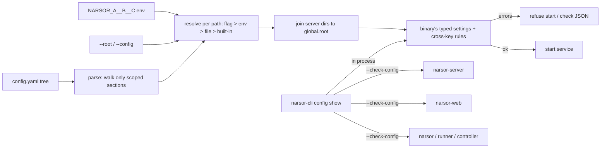

# refactor: Hierarchical configuration file, one section per service

## Summary

The settings registry in `narsor-shared` stays the single source of truth,
but every setting gets a path in the tree and an owning section. The parser
walks only the sections a binary asks for, resolution layers flag, env, file
and built-in per path, and env variable names come from the path with `__`
between levels. The cross-key rules that today run late in the server and in
`narsor-web` run in each binary's configuration step, before any work starts.
Each binary gets a hidden check mode with JSON output, and `config show`
merges the results of every binary installed next to `narsor-cli`.

---

## Problem Frame

The flat 35-key file hides which keys belong to which service and which keys
must be set together; the server finds a missing OIDC or observer key only
when it starts (see origin:
`docs/brainstorms/2026-11-20-hierarchical-configuration-file-requirements.md`).
Planning research added two facts the origin did not have:
`narsor-controller local` also reads the file (the `local_*` HOME settings),
and `agent_timeout` and `escalation_threshold` have no production reader.

---

## Requirements

Carried from origin (R-IDs match the origin document):

- R1–R5. Tree shape: service roots plus `global`; one place per key, no
  inheritance; grouped features under an explicit switch; unknown roots
  ignored.
- R6–R8. Every setting keeps a built-in value; the config step knows the
  conditional rules and reports every violation with its full path at once.
- R9–R11. `global.root`; `server.catalog`, `server.state`, `server.work` are
  relative to root or absolute; `cli`, `tui` and `web` read `server.state`.
- R12–R15. Each binary validates `global` and its own sections only, refuses
  to start only on its own errors, has a check mode, and `config show`
  merges the checks of the local binaries.
- R16–R17. `NARSOR_` + path segments joined by `__`; precedence flag, env,
  file, built-in.
- R18–R20. No flat keys, no transition; `init` comments name the old key;
  deploy, dist and docs updated.

Added during planning (confirmed by the user):

- R21. A new root `controller` owns the local HOME settings; the controller
  reads its own section, and the server stops resolving them.
- R22. `agent_timeout` and `escalation_threshold` are removed, not moved.
- R23. Built-in directory defaults keep today's layout: `global.root` is
  `./.narsor` and the three server directories default to `.` (the root
  itself).
- R24. In `config show`, a binary that is not installed next to
  `narsor-cli` shows its sections as "not installed"; this is not an error
  and does not change the exit code.
- R25. `narsor-cli` also reads the whole `tui` section, because it hosts the
  `tui` command. This is a second, named exception to R11/R12 (origin R11
  says `server.state` is the only one).
- R26. An un-migrated configuration does not fail silently: the server and
  `narsor-web` log a startup warning (not an error) when the file has a
  top-level key or the environment has a variable that matches an old flat
  setting name. AE4/AE7 stay true: such roots are ignored and cause no
  refusal.

**Origin acceptance examples:** AE1 (R4, R7), AE2 (R7), AE3 (R12, R13), AE4
(R5), AE5 (R10, R11), AE6 (R15), AE7 (R18).

---

## Scope Boundaries

- Carried from origin: no per-service files, no inheritance, no migration
  tool, no remote diagnosis of a server's configuration from a local CLI.
- `narsor-observer-worker` keeps receiving its settings as flags from the
  server; it does not read the file.
- The non-setting `NARSOR_*` variables (`NARSOR_SERVER`, `NARSOR_TOKEN*`,
  `NARSOR_CONTROL_PLANE`, `NARSOR_ENROLLMENT_CODE`, `NARSOR_KUBERNETES_*`,
  `NARSOR_TEST_*` …) keep their names.
- The cascade (`--config`, user dir, `/etc/narsor/`) and the "files are not
  merged" rule are unchanged.

### Deferred to Follow-Up Work

- Applying a step time limit and escalation from configuration again, if
  wanted: a new brainstorm, since nothing reads the removed keys today.
- The open P2 finding about `ensure_daemon_running` deleting `daemon.json` on
  any read error (`docs/residual-review-findings/feat-daemon-lokalny-2654853.md`):
  unrelated to the tree.

---

## Context & Research

### Relevant Code and Patterns

- `crates/narsor-shared/src/config/settings.rs`: `SettingKey` enum with
  `ALL`, `key()`, `env_var()`, `built_in()`, `is_list()`, `is_duration()`,
  `RETIRED_KEYS`. The enum-as-registry pattern ("the compiler refuses a match
  that forgets a setting") is kept.
- `crates/narsor-shared/src/config/file.rs`: two-phase parse (untyped
  `serde_yaml::Mapping`, then a walk against the registry collecting every
  error, sorted). `MAX_FILE_BYTES`, BOM handling, `FileError` with `key()`.
- `crates/narsor-shared/src/config/resolve.rs`: `resolve`, `resolve_with`
  (test seam with `ConfigCascade::with_dirs`), `Flags { root, config }`,
  `Environment`, `environment_from_process` (keeps `RUST_LOG` and `NARSOR_*`,
  drops empty values), `Resolved` with typed accessors, `ConfigError`.
- Cross-key rules today:
  `crates/narsor-engine/src/auth/settings.rs` (`SecuritySettings::validate`
  -> `SecurityPlan`), `crates/narsor-server/src/runtime.rs`
  (`observer_worker_settings`, called after the API starts; network mode
  needs `observer_worker_server`), `crates/narsor-web/src/settings.rs`
  (`WebSettings::from_config`).
- Readers per key (research table): server reads catalog/state/work,
  `agent_harness`, `max_concurrent_tasks`, `default_backend`,
  `default_profile`, `local_workspace_roots`, all security and observer keys,
  and today also `local_*`; runner reads `agent_args`, `conductor_*`; TUI
  reads `tui_refresh_interval`; web reads `web_*`; CLI, TUI and server read
  `log_level`; CLI, TUI and web read `state_dir` for daemon discovery;
  `narsor-controller local` reads `local_*` (`crates/narsor-controller/src/local.rs`,
  `resolve_home`, uses `Source::BuiltIn` of `local_home`).
- Children: `crates/narsor-server/src/child_process.rs` (`prepare` strips
  every `NARSOR_*` variable; `sibling_program`), `local_controller.rs`
  (spawns the controller with `--no-config` and HOME flags from
  `local_harness_home().runner_args()`), `observer_worker.rs`.
  `crates/narsor-controller/src/local/backend.rs` `is_controller_setting`
  passes only `NARSOR_AGENT_ARGS` to runners. Kubernetes:
  `crates/narsor-controller/src/kubernetes/manifest.rs`
  (`RUNNER_ARGS_CONFIG_KEY`), `deploy/kubernetes/admission-policy.yaml`,
  `deploy/kubernetes/controller.yaml`.
- Sibling lookup for clients: `crates/narsor-api-client/src/api/launch.rs`
  `resolve_exe` (hardcoded to `narsor-server`, debug fallback to the profile
  dir, `NARSOR_TEST_DAEMON_EXE` override).
- `config show`: `src/cli/commands/config.rs` (table and JSON `version: 1`),
  `Command::runs_on_broken_config` in `src/cli/mod.rs`,
  `refuse_broken_configuration` in `src/main.rs`.
- `narsor-cli init`: `src/cli/init.rs` (`OPTIONAL_SETTINGS`, `render_config`,
  `set_root_paths`, `configure_server`, `validate_config`, tests
  `every_setting_is_written_or_listed_as_a_commented_default` and friends).
- Tests: `tests/integration/config_resolve.rs` (`TempRoot`, `environment`,
  `cascade` helpers), `tests/integration/config_file.rs`,
  `tests/integration/config_cascade.rs`; unit tests in `settings.rs` and
  `file.rs`.

### Institutional Learnings

- `docs/plans/2026-09-24-001-feat-konfiguracja-aplikacji-plan.md`: keep the
  two-phase parse (D-E), `config show` running on a broken file (D-D), stop
  on an unreadable cascade candidate (D-G), empty env means unset (D-J),
  `RUST_LOG` beats the log level (D-K), versioned `config show` JSON (D-O).
  The `NARSOR_` names were declared a contract; this plan breaks it on
  purpose (origin decision) and records it in `docs/operations/updates.md`.
- `docs/solutions/conventions/removing-a-field-from-serde-wire-and-persisted-types-2026-11-18.md`:
  hunt old names in docs, manifests and fixtures by hand; the compiler does
  not find them.
- `docs/solutions/security-issues/untrusted-control-plane-reaches-user-git-and-harness-logins-2026-10-25.md`
  and `docs/solutions/integration-issues/runner-private-home-hides-harness-login-2026-10-10.md`:
  children get configuration explicitly; keep the env allowlists and the HOME
  tests in `tests/integration/config_resolve.rs` passing.
- `docs/solutions/architecture-patterns/step-profile-tiers-decide-once-validate-at-load-2026-11-11.md`:
  validate combinations at load time, once.
- `docs/solutions/conventions/test-network-features-through-trait-seams-not-tcp-servers-2026-10-31.md`
  and `single-integration-test-crate-and-lean-target-2026-11-01.md`: test
  through seams, keep integration tests in `tests/integration/`.

---

## Key Technical Decisions

- **Path and section are attributes of `SettingKey`, not a second registry.**
  Each variant gets its path segments (e.g. `["server", "oidc", "issuer"]`)
  and its section is the first segment. `env_var()`, the file walk, `config
  show` rows and error messages all derive from the path. Rationale: keeps
  the exhaustive-match guarantee and one place to add a setting.
- **The tree and its mapping from the flat keys** (also the source for the
  `init` comments, R19):

  | New path | Old flat key | Read by |
  |---|---|---|
  | `global.root` | (new; `--root`) | all |
  | `global.log_level` | `log_level` | cli, tui, server |
  | `server.catalog` | `catalog_dir` | server |
  | `server.state` | `state_dir` | server; cli, tui, web (R11) |
  | `server.work` | `work_dir` | server |
  | `server.agent_harness` | `agent_harness` | server |
  | `server.max_concurrent_tasks` | `max_concurrent_tasks` | server |
  | `server.defaults.backend` | `default_backend` | server |
  | `server.defaults.profile` | `default_profile` | server |
  | `server.local_workspace_roots` | `local_workspace_roots` | server |
  | `server.mode` | `server_mode` | server |
  | `server.bind` | `server_bind` | server |
  | `server.oidc.issuer` | `oidc_issuer` | server |
  | `server.oidc.audience` | `oidc_audience` | server |
  | `server.owner_subject` | `owner_subject` | server |
  | `server.tls.termination` | `tls_termination` | server |
  | `server.tls.trusted_proxies` | `trusted_proxies` | server |
  | `server.cors_allowed_origins` | `cors_allowed_origins` | server |
  | `server.observer.enabled` | `observer_worker` (`on`/`off`) | server |
  | `server.observer.server_url` | `observer_worker_server` | server |
  | `server.observer.secrets_dir` | `observer_secrets_dir` | server |
  | `server.observer.script_user` | `observer_script_user` | server |
  | `server.observer.insecure_same_user` | `observer_insecure_same_user` | server |
  | `controller.local.home` | `local_home` | controller |
  | `controller.local.codex_home` | `local_codex_home` | controller |
  | `controller.local.claude_config_dir` | `local_claude_config_dir` | controller |
  | `controller.local.claude_profile_source` | `local_claude_profile_source` | controller |
  | `runner.agent_args` | `agent_args` | runner |
  | `runner.conductor.model` | `conductor_model` | runner |
  | `runner.conductor.effort` | `conductor_effort` | runner |
  | `tui.refresh_interval` | `tui_refresh_interval` | tui |
  | `web.bind` | `web_bind` | web |
  | `web.upstream` | `web_upstream` | web |
  | `web.token` | `web_token` | web |
  | (removed, R22) | `agent_timeout`, `escalation_threshold` | nobody |

  `server.observer.enabled` becomes a boolean like `insecure_same_user`, so
  the switch reads the same way in every group. There is no `cli` key today;
  the `cli` root exists only as a name for the future.
- **Scope of a binary = a list of sections plus named extra keys.**
  `narsor-server`: `global`, `server`. `narsor-web`: `global`, `web`, plus
  `server.state`. `narsor` (TUI): `global`, `tui`, plus `server.state`.
  `narsor-cli`: `global`, `cli`, `tui` (it hosts the `tui` command), plus
  `server.state`. `narsor-runner`: `global`, `runner`. `narsor-controller
  local`: `global`, `controller`. The parser does not visit other sections
  at all, except the single extra key, which it validates as a path and
  nothing more. Rationale: R12 and R11 in one mechanism; the extra key is a
  named, reviewable exception.
- **Directories (R9, R10, R23).** `--root` sets `global.root` only. Each
  server directory is resolved after the per-path precedence: a relative
  value is joined to the resolved root, an absolute value is used as is. The
  `Source` of a directory stays the source of its own key; `config show`
  shows the joined path. Built-ins (`./.narsor` and `.`) reproduce today's
  layout, so existing `--root` users and default installations see no move.
- **Cross-key rules run in each binary's configuration step (R7, R8).**
  `narsor-shared` cannot depend on `narsor-engine` or `narsor-web`, so the
  rules stay next to their typed settings (`SecuritySettings::validate`,
  `WebSettings::from_config`), but each binary calls them right after
  resolution, collects their problems together with the resolution errors,
  and the check mode calls the same function. The observer rules
  (`script_user` xor `insecure_same_user`; network mode needs `server_url`)
  move out of the post-API-start path into a pure function the server calls
  with the other rules. Messages name the new paths.
- **Check mode is a hidden `--check-config` flag with JSON on stdout.** Each
  binary that reads the file accepts it (with `--config`/`--root` where the
  binary has them), resolves its scope, runs its rules, prints one JSON
  document and exits 0 (no errors) or 1 (errors), without starting anything.
  JSON shape: `{version: 2, binary, file, shadowed, settings: {path: {value,
  source, error, sensitive}}, errors: [{path, message}]}`.
  The flag is a hidden top-level flag on each binary's clap parser. For
  `narsor-controller` it sits at the top level and checks the `local` scope.
  Required arguments and required subcommands of `narsor-runner` and
  `narsor-controller` become conditional on the flag not being present
  (`required_unless_present`, subcommand not required when it is set).
  `config show` passes `--config` to every sibling and `--root` only to
  `narsor-server`, `narsor-web` and `narsor`.
  **Redaction happens in the producer:** the shared report type replaces the
  `value` of every sensitive setting (e.g. `web.token`) with a fixed
  placeholder when it is built, so the raw value never crosses the process
  boundary. Error messages never echo the value of a sensitive setting.
- **`config show` merges the checks.** `narsor-cli` checks its own scope in
  process, finds siblings through a generalised sibling lookup (the
  `resolve_exe` logic in `crates/narsor-api-client/src/api/launch.rs`, with
  the binary name as a parameter), runs `--check-config` on each with the
  same `--config`/`--root`, and prints one table grouped by section (each
  path once, with the binaries that read it). A missing sibling gives "not
  installed" (R24); a sibling that crashes or prints invalid JSON is an
  error row for that binary. The JSON output becomes `version: 2` with a
  `binaries` list. The merge logic sits behind a small trait so tests feed
  canned check results.
- **Server -> controller handoff (R21).** The server starts the controller
  with `--config <winning file>` when a file won, and with `--no-config` when
  no file won (so the child cannot find a file that appeared later). It
  stops passing the HOME flags, and forwards its own `NARSOR_GLOBAL__*` and
  `NARSOR_CONTROLLER__*` variables explicitly through `child_process`
  (allowlisted by prefix, every other `NARSOR_*` still stripped). The
  controller's remote-control-plane logic (`mode_set` via
  `Source::BuiltIn`) is unchanged.
  **Controller errors before start:** before it binds the API, the server
  runs the controller's check (`narsor-controller --check-config` with the
  same file flag and the forwarded env) when a local controller is
  configured, and refuses to start on its errors, reporting them with their
  paths. `narsor-server --check-config` includes that result. This is a named
  dependency, not a scope exception: the server still does not parse the
  `controller` section itself.
  **Restarts reread the file:** a supervised controller restart reads the
  winning file again. This reverses the "child reads no file" design of
  `docs/plans/2026-10-25-004-refactor-lokalny-controller-osobny-proces-plan.md`
  on purpose; a file edit that breaks the `controller` section shows up as
  the controller's configuration error in the daemon log.
- **Runner contract variable.** `AGENT_ARGS_ENV` becomes the derived name of
  `runner.agent_args` (`NARSOR_RUNNER__AGENT_ARGS`); `is_controller_setting`,
  the Kubernetes manifest and the admission policy follow it. The value
  format (YAML mapping text) is unchanged. `is_controller_setting` stays an
  exact match on `AGENT_ARGS_ENV`; the admission policy keeps an exact-name
  allowlist and is not widened to a prefix.
- **Env encoding of lists and mappings is unchanged**: lists as
  comma-separated text, `agent_args` as YAML text.
- **`RETIRED_KEYS` is removed** together with `ConfigError::RetiredEnv` and
  `FileError::RetiredKey` (origin: no flat key left to protect). A flat key
  at the top level is an unknown root and is ignored (AE7).

---

## Open Questions

### Resolved During Planning

- Section of each setting: the table above.
- How a binary exposes its check: hidden `--check-config` flag, JSON on
  stdout.
- Env format of lists and mappings: unchanged.
- Flag names: `--root` and `--config` keep their names; `--root` now means
  `global.root`.
- Controller placement: new `controller` root (user decision).

### Deferred to Implementation

- Exact JSON field names beyond the shape above, and the table layout of
  `config show` (grouping columns): settle while writing the command.
- Whether `SettingValue` needs a `Bool` variant for `observer.enabled` and
  `insecure_same_user`, or stays `Text` with validation: depends on how the
  accessors read.
- Whether `ConfigCascade` errors (D-G) are reported once per binary or
  de-duplicated in the merged `config show` output.

---

## High-Level Technical Design

> *This illustrates the intended approach and is directional guidance for
> review, not implementation specification. The implementing agent should
> treat it as context, not code to reproduce.*

---

## Implementation Units

### U1. Hierarchical settings registry

**Goal:** Every setting has a path and an owning section; env names derive
from the path with `__`.

**Requirements:** R1, R2, R3, R16, R22

**Dependencies:** none

**Files:**
- Modify: `crates/narsor-shared/src/config/settings.rs`,
  `crates/narsor-shared/src/config/mod.rs`,
  `crates/narsor-exec/src/engine/runner.rs`,
  `crates/narsor-exec/src/engine/runner/setup/builders.rs`
- Test: unit tests in `crates/narsor-shared/src/config/settings.rs`

**Approach:**
- Replace the flat `key()` with path segments; add `GlobalRoot`; rename
  variants to match the table; remove `AgentTimeout`,
  `EscalationThreshold`, `MAX_ESCALATION_THRESHOLD`, `RETIRED_KEYS` and the
  `file.rs` validation branch for the threshold.
- `DEFAULT_ESCALATION_THRESHOLD` (value 3) is still the engine's step
  escalation default: move it into `narsor-exec` next to the runner builder
  instead of deleting it.
- A `Section` enum (`Global`, `Server`, `Controller`, `Runner`, `Tui`, `Web`,
  `Cli`) and a lookup "setting at this path".
- `env_var()` = `NARSOR_` + upper-cased segments joined by `__`.
- Built-ins per R23.

**Patterns to follow:** existing exhaustive `match` per attribute in
`settings.rs`.

**Test scenarios:**
- Every setting's env var is distinct, starts with `NARSOR_`, and contains
  `__` between each path segment (e.g. `server.oidc.issuer` ->
  `NARSOR_SERVER__OIDC__ISSUER`).
- Every path's first segment is its section, and no two settings share a
  path or a path is a prefix of another setting's path (a group cannot also
  be a leaf).
- Built-ins: `global.root` is `./.narsor`, the three server directories are
  `.`.

**Verification:** the registry compiles with no reference to the removed
keys; unit tests pass.

---

### U2. Tree parser with section scope

**Goal:** Parse the file as a tree, visit only the requested sections and
extra keys, and report every problem with its full path.

**Requirements:** R1, R5, R8, R12, R18; AE4, AE7

**Dependencies:** U1

**Files:**
- Modify: `crates/narsor-shared/src/config/file.rs`
- Test: `tests/integration/config_file.rs`, unit tests in `file.rs`

**Approach:**
- Keep phase one (untyped document, size/UTF-8/BOM/syntax checks).
- Phase two takes a scope; for each scoped section walks its mapping
  recursively against the registry. The walk stops at the first path that
  names a registry leaf and hands the raw YAML value to `value_of`; a
  mapping is an error only for leaves that do not accept one
  (`runner.agent_args` accepts a mapping). Unknown key inside a scoped section ->
  `UnknownKey` with the dotted path and the known paths of that section. A
  group written as a scalar, or a leaf written as a mapping -> `BadValue`. A
  section that is not a mapping -> error for that section. Unscoped roots
  and unknown roots are skipped.
- For an extra key (e.g. `server.state` for clients) read only that leaf;
  sibling keys of that section are not checked.
- Remove `FileError::RetiredKey`.

**Patterns to follow:** existing error collection and deterministic sort by
key; `FileError::key()` returns the dotted path.

**Test scenarios:**
- Happy path: a file with `global`, `server` and `web` sections parsed with
  the server scope yields the `global` and `server` values only.
- Unknown key `server.oidc.isuer` under the server scope -> one error naming
  `server.oidc.isuer`; the same file under the web scope -> no error.
- Covers AE4 / AE7. A root `sever:` and a top-level `server_mode: network`
  produce no error under any scope and no values.
- `server: 5` (scalar section) and `server.oidc: x` (scalar group) -> errors
  naming `server` and `server.oidc`.
- Client scope with extra key `server.state`: a broken `server.mode` value
  produces no error; a non-path `server.state` produces one.
- Several errors in one section are all reported, sorted by path.
- `runner.agent_args: {claude: [--x]}` parses under the runner scope without
  error.

**Verification:** old flat-file tests are rewritten to the tree; no test
still uses a flat key except the AE7 test.

---

### U3. Resolution per path and scope

**Goal:** Layer flag, env, file and built-in per path for a binary's scope,
and resolve the server directories against `global.root`.

**Requirements:** R6, R9, R10, R11, R16, R17, R23; AE5

**Dependencies:** U2

**Files:**
- Modify: `crates/narsor-shared/src/config/resolve.rs`,
  `crates/narsor-shared/src/config/harness_home.rs` (accessor names),
  `crates/narsor-shared/src/config/client_paths.rs` if it reads `state_dir`,
  `crates/narsor-exec/src/engine/mod.rs` (re-export),
  `crates/narsor-exec/src/engine/runner/setup/builders.rs`,
  `crates/narsor-server/src/runtime.rs` (`agent_defaults` call)
- Test: `tests/integration/config_resolve.rs`

**Approach:**
- `resolve` / `resolve_with` take a scope (sections plus extra keys). Only
  scoped settings are looked up in env and file; `Resolved` holds only them,
  and an accessor for an unscoped setting is a programming error caught by
  tests, not a runtime fallback.
- `--root` maps to `global.root`. Directory accessors join relative values
  to the resolved root.
- `RUST_LOG` still wins over `global.log_level`; empty env values are still
  unset.
- Remove the retired-env sweep and `ConfigError::RetiredEnv`.
- Accessors renamed to the new structure (`observer_worker` reads
  `server.observer.*`).
- `agent_defaults` would read runner keys under the server scope: remove
  `Resolved::agent_defaults` and `AgentDefaults` (and their re-exports), the
  unused `with_agent_defaults` builder, and make the server call
  `agent_harness()` instead.

**Test scenarios:**
- Precedence per path: flag beats env beats file beats built-in for
  `global.root`; env `NARSOR_SERVER__BIND` beats `server.bind` in the file,
  with `Source::Env("NARSOR_SERVER__BIND")`.
- Covers AE5. `global.root: /srv/narsor` + `server.state:
  /var/lib/narsor-state` -> state `/var/lib/narsor-state`; with `server.state`
  unset -> `/srv/narsor`; with `server.state: state` -> `/srv/narsor/state`.
  Same results for the client scope.
- `--root /x` with nothing else -> catalog, state, work all `/x` (today's
  behaviour).
- Old variable `NARSOR_SERVER_MODE=network` is ignored: server mode stays
  `trusted`.
- An env variable of an unscoped section (e.g. `NARSOR_WEB__BIND=bad` under
  the server scope) produces no error.
- Existing HOME cases in `config_resolve.rs` keep passing under the
  controller scope with the new names.

**Verification:** `tests/integration/config_resolve.rs` passes with tree
files and new env names.

---

### U4. Cross-key rules in the configuration step

**Goal:** Every binary checks its conditional rules right after resolution,
together with resolution errors, using new paths in messages.

**Requirements:** R4, R7, R8, R13; AE1, AE2, AE3

**Dependencies:** U3

**Files:**
- Modify: `crates/narsor-engine/src/auth/settings.rs`,
  `crates/narsor-server/src/runtime.rs`, `crates/narsor-server/src/main.rs`,
  `crates/narsor-web/src/settings.rs`
- Test: unit tests in `crates/narsor-engine/src/auth/settings.rs`,
  `crates/narsor-web/src/settings.rs`; `tests/integration/config_resolve.rs`
  or a new server-config test in `tests/integration/`

**Approach:**
- One function per binary that turns `Resolved` into that binary's typed
  settings or a list of problems (server: security plan + observer settings
  + owner defaults; web: `WebSettings`).
- Extract the observer checks from `observer_worker_settings` into a pure
  function that needs only `Resolved` and the security mode; the part that
  needs the API handle (the actual address) stays where it is.
- Error messages use the new paths (`server.oidc.issuer`, not
  `oidc_issuer`).

**Patterns to follow:** `SecuritySettings::validate` returning all problems.

**Test scenarios:**
- Covers AE1. `server.mode: network` without `server.oidc.issuer` -> the
  problem list names `server.oidc.issuer`; with `mode: trusted` and no
  `oidc` group -> no problem.
- Covers AE2. `server.observer.enabled: true` with both `script_user` and
  `insecure_same_user: true` -> contradiction reported; with neither ->
  "one of them is required".
- `server.mode: network` + `observer.enabled: true` without `server_url` ->
  reported before anything starts.
- Network mode missing issuer, audience and proxies -> all three in one
  report.
- Web: `web.token: passthrough` with `web.upstream: local` -> refused with
  the new paths.

**Verification:** no cross-key rule runs only after the API has started.

---

### U5. Binaries use their scope; server-controller-runner handoff

**Goal:** Each binary resolves its own scope and refuses to start only on
its own errors; the controller reads its own section.

**Requirements:** R11, R12, R13, R21, R25, R26; AE3

**Dependencies:** U4

**Files:**
- Modify: `src/main.rs`, `src/bin/narsor.rs`, `src/cli/mod.rs`,
  `src/cli/commands/tui.rs`, `src/client/config.rs`,
  `crates/narsor-server/src/main.rs`, `crates/narsor-server/src/runtime.rs`,
  `crates/narsor-server/src/local_controller.rs`,
  `crates/narsor-server/src/child_process.rs`,
  `crates/narsor-web/src/main.rs`,
  `crates/narsor-runner/src/runner/cli.rs`,
  `crates/narsor-controller/src/local.rs`,
  `crates/narsor-controller/src/local/backend.rs`,
  `crates/narsor-controller/src/kubernetes/manifest.rs`,
  `deploy/kubernetes/admission-policy.yaml`,
  `deploy/kubernetes/controller.yaml`,
  `crates/narsor-observer-worker/src/cli.rs` (messages naming flat keys),
  `src/tui/task_app/usage.rs` (comments)
- Test: `tests/integration/` (controller HOME cases, runner args),
  `tests/integration/tui_background.rs` (comments),
  `tests/integration/kubernetes_adapter.rs` (ignored cluster test using
  `NARSOR_AGENT_ARGS`), `crates/narsor-controller/src/kubernetes/` tests
  that reference `NARSOR_AGENT_ARGS`; a new non-ignored test in
  `tests/integration/` that reads the two Kubernetes manifests

**Approach:**
- Each `main` passes its scope to `resolve`.
- Server: stop computing HOME runner args; spawn the controller with
  `--config <winning file>` when one won and `--no-config` otherwise; run
  the controller check before binding the API; `child_process::prepare` gets an
  allowlist of prefixes to keep for this child (`NARSOR_GLOBAL__`,
  `NARSOR_CONTROLLER__`).
- Controller: resolves `global` + `controller`; drops `--no-config` usage by
  the server (the flag itself stays for manual use).
- Runner: `runner.agent_args` and `runner.conductor.*`; `AGENT_ARGS_ENV` is
  the derived name; the Kubernetes ConfigMap key constant, the admission
  policy and the controller manifest change in this unit, together.
- Server and web: log the R26 warning for old flat top-level keys and old
  `NARSOR_<FLAT_KEY>` variables (the old names come from the mapping table).
- Update comments in `src/tui/task_app/usage.rs` and
  `tests/integration/tui_background.rs` that name flat keys.

**Execution note:** Start with a failing integration test for "an error in
`web` does not stop `narsor-runner`/`narsor-server`".

**Test scenarios:**
- Covers AE3. A file with an invalid `server.mode` value: CLI scope
  resolves without errors; server scope reports it.
- A server started with `NARSOR_CONTROLLER__LOCAL__HOME=private` hands it to
  the controller child; `NARSOR_WEB__BIND` and `NARSOR_TOKEN` are not
  forwarded (test the env-preparation function, not a real spawn).
- Controller started with a file containing `controller.local.home:
  private` and a remote control plane: mode is `private` and counts as set;
  without the key it is `private` as built-in fallback (existing KTD15
  behaviour).
- Runner reads `NARSOR_RUNNER__AGENT_ARGS='{claude: [--x]}'` and removes it
  from its env.
- `deploy/kubernetes/admission-policy.yaml` and
  `deploy/kubernetes/controller.yaml` contain the exact value of
  `AGENT_ARGS_ENV` and no `NARSOR_*` wildcard or prefix match.
- A `controller.local.home` value that is invalid makes the server refuse to
  start before it binds, with an error naming `controller.local.home`.
- Covers R26. A file with a top-level `server_mode: network` and env
  `NARSOR_OIDC_ISSUER=x` starts in trusted mode and emits one warning naming
  both old names.

**Verification:** `cargo test --workspace` passes; no production code reads
a setting outside its binary's scope.

---

### U6. Check mode and merged `config show`

**Goal:** Every binary can check its part of the file; `config show` merges
the results.

**Requirements:** R14, R15, R24; AE6

**Dependencies:** U5

**Files:**
- Modify: `crates/narsor-shared/src/config/` (shared check-report type and
  JSON rendering), `crates/narsor-api-client/src/api/launch.rs` (sibling
  lookup by name), `src/cli/commands/config.rs`, `src/cli/mod.rs`,
  `src/bin/narsor.rs`, `crates/narsor-server/src/main.rs`,
  `crates/narsor-web/src/main.rs`, `crates/narsor-runner/src/runner/cli.rs`,
  `crates/narsor-controller/src/local.rs`
- Test: `tests/integration/config_show.rs` (new) or the existing config
  show tests; one `#[ignore]` end-to-end test spawning built binaries

**Approach:**
- A shared report type built from `Resolved` plus the binary's rule
  problems; each binary's `--check-config` prints it and exits 0/1 without
  starting.
- `config show` runs its own check in process, then each sibling through a
  `ConfigChecker` seam; the production checker runs the sibling with the
  same `--config`/`--root`. Merge by path; an extra key read by several
  binaries appears once.
- The production checker resolves siblings only from the directory of
  `current_exe()` (no `PATH` search); the debug fallback and the test
  override stay behind `cfg(debug_assertions)` or the test seam. Each
  sibling run has a timeout and a maximum stdout size; a timeout or
  over-limit output gives "failed to run".
- Table: grouped by section, each row path / value / source, error rows
  marked; a footer per binary with status (ok, errors, not installed,
  failed to run). JSON `version: 2`.
- `config show` keeps running on a broken file (D-D) and exits 1 when any
  checked binary reported errors.

**Test scenarios:**
- Covers AE6. Canned reports with errors in `server` and `web` -> both
  sections marked, valid rows shown, exit code 1.
- A sibling reported as missing -> "not installed", exit code 0 when the
  others are clean (R24).
- A sibling that returns invalid JSON or a non-0/1 exit -> a "failed to
  run" status naming the binary, exit code 1.
- `server.state` reported by CLI and web with the same value -> one row.
- `web.token` set through the file and through env never appears in the
  check JSON or in the `config show` table and JSON.
- `--check-config` of the server with `server.mode: network` and no issuer
  prints JSON with an error at `server.oidc.issuer` and exits 1 without
  binding a port.

**Verification:** `narsor-cli config show` in a dev build lists every
section of an example tree file.

---

### U7. `narsor-cli init` writes the tree

**Goal:** The generated file is a tree, and each setting's comment names
the flat key it replaces.

**Requirements:** R19

**Dependencies:** U3, U6 (its verification runs `config show`)

**Files:**
- Modify: `src/cli/init.rs`
- Test: unit tests in `src/cli/init.rs`

**Approach:**
- Build the document as a nested mapping; `set_root_paths` writes
  `global.root` plus `server.catalog/state/work` as `catalog`, `state`,
  `work` (relative), keeping today's on-disk layout of an init-ed install.
- `OPTIONAL_SETTINGS` gets the new paths; the commented defaults are
  rendered inside their sections, each with "formerly `<flat key>`".
- Header text: env variables are `NARSOR_<SECTION>__<KEY>`.
- `validate_config` parses with every section in scope.

**Test scenarios:**
- Every setting is either written or present as a commented default
  (existing test, adapted to paths).
- Uncommenting every default yields a file that parses without errors under
  every binary scope.
- The comment of `server.oidc.issuer` contains `oidc_issuer`.
- Network-mode init writes `server.mode`, `server.oidc.*`, `server.tls.*`
  uncommented.

**Verification:** `narsor-cli init` in a temp dir produces a file that
`config show` reports with no errors.

---

### U8. Deploy, packaging and documentation

**Goal:** No manifest, script or document uses a flat key or an old env
name; the upgrade is described.

**Requirements:** R20; success criterion on `deploy/kind/server.yaml`

**Dependencies:** U5, U6, U7

**Files:**
- Modify: `deploy/kind/server.yaml`, `dist/install.sh`,
  `docs/user/configuration.md`, `docs/user/web.md`, `docs/user/agents.md`,
  `docs/user/tui.md`, `docs/user/observers.md`, `docs/user/cli.md`,
  `docs/user/conductor.md`, `docs/user/remote.md`,
  `docs/operations/installation.md`, `docs/operations/remote-backends.md`,
  `docs/operations/updates.md`, `docs/dev/architecture.md`,
  `docs/dev/building-and-testing.md`, `docs/dev/components.md`,
  `docs/dev/workflow-schema.md`

**Approach:**
- `docs/user/configuration.md`: the tree, the section ownership rule, the
  env convention, directories relative to root, the table of old -> new
  names (same as Key Technical Decisions), the "unknown root is ignored"
  warning.
- `docs/operations/updates.md`: an upgrade section: flat files and old env
  vars are ignored at the top level, so an un-migrated installation runs on
  built-in values (trusted mode, observer off); rewrite before upgrading.
- `deploy/kind/server.yaml` rewritten as a tree with `server.oidc`,
  `server.tls`, `server.observer` groups.
- Search all files for each flat key and old `NARSOR_*` setting name
  before calling the unit done.

**Test expectation:** none -- documentation and manifests; the Kubernetes
manifests that carry the runner variable change and are tested in U5.

**Verification:** a search for every old flat key and old setting env var
in `deploy/`, `dist/`, `docs/user/`, `docs/operations/`, `docs/dev/` finds
only the old -> new mapping table and the upgrade note.

---

## System-Wide Impact

- **Interaction graph:** server -> controller (config file path + forwarded
  env instead of HOME flags), controller -> runner (`--config`, renamed
  `NARSOR_RUNNER__AGENT_ARGS`), Kubernetes controller -> runner pod
  (ConfigMap key and admission policy), clients -> daemon discovery via
  `server.state`.
- **Error propagation:** a binary no longer fails on another section's
  errors; `config show` is the only place that sees all of them.
- **API surface parity:** CLI, TUI, web and server all use the same
  `--root`/`--config` flags and the same scoped resolution.
- **Unchanged invariants:** cascade order and no merging; empty env = unset;
  `RUST_LOG` precedence; `daemon.json` permission checks; env stripping for
  every non-allowlisted `NARSOR_*` variable.

---

## Risks & Dependencies

| Risk | Mitigation |
|------|------------|
| An un-migrated file runs on built-in values (trusted mode, observer off), because flat keys are unknown roots | Startup warning for old names (R26, U5); upgrade note in `docs/operations/updates.md`; `config show` shows every value as `built-in`; accepted in origin (AE4, AE7) |
| Kubernetes runners stop receiving `agent_args` when the controller and the admission policy disagree on the variable name | Change the constant, the manifest builder and `admission-policy.yaml` and `controller.yaml` in the same unit (U5); a non-ignored test asserts the exact name in both manifests |
| Server-started controller loses HOME settings set only through env | Explicit prefix allowlist in `child_process::prepare` with a test (U5) |
| `config show` slow or hanging on a misbehaving sibling | Check mode reads the file and may resolve bind host names; run siblings with a timeout and a stdout limit and report "failed to run" (U6) |

---

## Documentation / Operational Notes

- The upgrade breaks every existing configuration file and every
  `NARSOR_<FLAT_KEY>` variable; release notes must say so explicitly.
- After the work lands, record the scope-per-binary pattern with
  `/ce-compound`.

---

## Sources & References

- **Origin document:** `docs/brainstorms/2026-11-20-hierarchical-configuration-file-requirements.md`
- Earlier configuration plan: `docs/plans/2026-09-24-001-feat-konfiguracja-aplikacji-plan.md`
- Local controller as a process: `docs/plans/2026-10-25-004-refactor-lokalny-controller-osobny-proces-plan.md`
