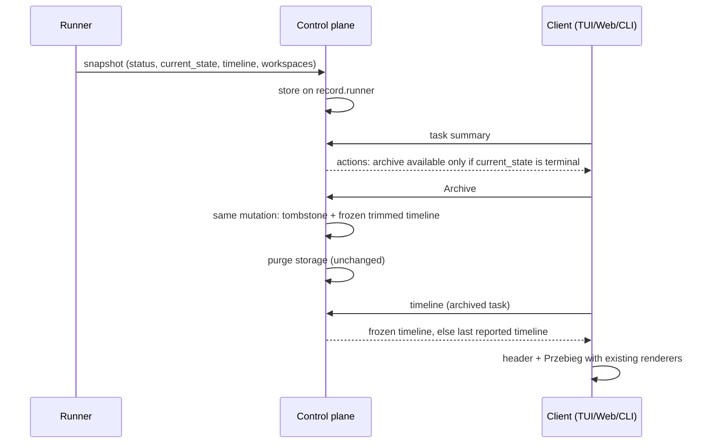

# feat: Archive a finished task with its header and run snapshot

## Summary

The control plane already keeps the runner's last timeline and workspace headers on the task record, and archiving does not delete them. The plan therefore adds no runner payload. It (1) offers and accepts *Archiwizuj* only when the execution sits in a state the sealed workflow marks `terminal`, (2) freezes a trimmed copy of the timeline (step header rows only) and the workspace headers on the record when the archive is accepted, (3) serves that copy through the existing timeline read and task summary for archived tasks, with the trimmed last reported timeline as the fallback for tasks archived before this change, and (4) lets the TUI history, the Web UI history and `narsor-cli task show` read it; the TUI and Web UI render it with the existing *Przebieg* renderers, and the CLI prints step lines with a new formatter that includes harness, model, effort, tokens and cost.

---

## Problem Frame

Archiving is offered in every state (D66, "archive wins") and the history shows only the summary: *Przebieg* says the storage was deleted, so step costs, models and harnesses are lost to the owner (see origin). The step data the clients need is already on the control plane (`TaskRecord.runner.snapshot.timeline`), but the clients do not read it for archived tasks, and a runner may still overwrite it while the task is `Archiving`.

---

## Requirements

- R1. Archive is available only when the execution reached a workflow terminal state (origin R1).
- R2. Elsewhere archive is unavailable with a reason, decided by the backend for the TUI, Web and CLI (origin R2).
- R3 (changed during planning). A stuck task reaches a terminal state by a manual transition first; no delete action (origin R3). The one-step forced transition for a task without a live runner is deferred (see Deferred to Follow-Up Work). The multi-step path for interrupted or `Unknown` tasks (restart, then transition) is unchanged and tracked outside this plan.
- R4. The snapshot keeps the full task header (origin R4).
- R5. The snapshot keeps one header row per step with harness, model, effort, tokens, subagents, cost and conductor cost (origin R5).
- R6. No step detail, conversation, events or conductor history (origin R6).
- R7. The run data comes from what the runner already reported with the terminal state; archive reads no storage (origin R7).
- R8. The snapshot is frozen at archive and never changes after (origin R8).
- R9–R11. TUI history, Web UI history and `narsor-cli task show` show the header and step rows (origin R9–R11).
- R12 (changed by the user during planning). A task archived before this change shows the last timeline its runner reported, which the record still holds. Only a record without any reported timeline shows the "storage deleted" text.

**Origin acceptance examples:** AE1 (archive unavailable while waiting for a human), AE2 (forced transition to cancelled, then archive), AE3 (header and three steps with cost after archive), AE4 (changed: an old archived task now shows its last reported timeline).

---

## Scope Boundaries

- No new runner report or runner field; the existing snapshot is the source.
- No change to the manual transition or restart path for interrupted, `Unknown` or resume-exhausted tasks.
- No conversation, events, conductor or step detail after archive.
- No cost aggregation or export across archived tasks.

### Deferred to Follow-Up Work

- Keeping the control plane's run data current before the terminal state (origin scope boundary, separate task).
- A one-step forced transition for a task without a runner (user: separate thread).
- A visible marker that a pre-change archived task shows the last runner report, which can be partial (design review; the fallback is rare and only affects tasks archived before this change).
- The `RunnerSnapshot` ↔ `RunnerSnapshotRequest` field duplication noted in `docs/follow-ups/2026-11-15-narsor-engine-split-follow-ups.md` — not touched, since no snapshot field is added.

---

## Context & Research

### Relevant Code and Patterns

- Archive offer and dispatch check: `unavailable_reason` and `require_owner_command_available` in `crates/narsor-engine/src/controller_protocol/service/tasks/actions.rs` (the latter skips `Archive` today).
- Archive lifecycle: `command_effect` in `crates/narsor-engine/src/orchestration/lifecycle.rs`; tombstone set by `archive()` in `crates/narsor-engine/src/orchestration/control_plane.rs`.
- Report fencing: `fence_runner` in `crates/narsor-engine/src/orchestration/runner_state.rs` accepts reports until `Archived`, so a report during `Archiving` can replace `record.runner.snapshot`.
- Terminal state of the sealed workflow: `record.launch_spec.definition()` (used by `manual_transitions` and `workflow_steps` in `crates/narsor-engine/src/controller_protocol/service/tasks/view.rs`); `terminal: bool` on states in `crates/narsor-model/src/domain/workflow_definition.rs`. `ExecutionStatusDto::is_terminal()` alone is not enough: a failed step also sets `Failed` while `current_state` stays non-terminal.
- Timeline read: `ProtocolService::timeline` in `crates/narsor-engine/src/controller_protocol/service/tasks/history.rs`.
- Record persistence and compat: `crates/narsor-engine/src/orchestration/store.rs`, `TaskRecord` in `crates/narsor-engine/src/orchestration/model.rs` (`#[serde(default)]` fields, old-shape load tests).
- TUI: `src/tui/task_app/history.rs`, `readiness()` / `unstarted_message` / `start_detail_reads` (returns early for `View::History`) and header cost via `task_usage_text::sum` in `src/tui/task_app/detail.rs`; *Przebieg* in `src/tui/task_app/tabs/progress.rs`.
- Web: `History` / `ArchivedTask` in `crates/narsor-web/ui/js/ui/settings.js`; timeline read gate (`readiness === 'started'`) and `sumUsage` in `crates/narsor-web/ui/js/ui/details.js`; `crates/narsor-web/ui/js/ui/tabs/progress.js`.
- CLI: `TaskCommand::Show` in `src/cli/remote.rs`, `detail_lines` in `src/cli/task_text.rs`, `print_position` in `src/cli/commands/task_read.rs`.

### Institutional Learnings

- `docs/solutions/design-patterns/tui-panel-actions-from-server-offer-2026-11-13.md` — availability lives only in the server offer; clients carry no rule.
- `docs/solutions/conventions/removing-a-field-from-serde-wire-and-persisted-types-2026-11-18.md` — `#[serde(default)]` on new persisted fields, an old-shape record load test, Web Node tests are not run by CI.
- `docs/solutions/design-patterns/show-only-what-harness-reports-count-without-tokens-record-fixture-2026-11-13.md` — copy usage and cost as reported; "no data" is not zero.
- `docs/solutions/design-patterns/tui-step-icon-mapping-lives-in-the-tui-not-the-protocol-2026-11-12.md` — the protocol carries raw step data; reuse the *Przebieg* renderers.
- `docs/solutions/logic-errors/gate-queue-entries-outlive-runner-problems-and-bad-files-2026-11-18.md` — persist derived data on the record so later reports cannot overwrite it.

---

## Key Technical Decisions

- **Reuse the existing timeline, do not add a runner payload:** the runner already reports the full `Timeline` and workspace headers with every snapshot, including the terminal one; R7 holds without protocol work on the runner side.
- **Terminal = `current_state` is `terminal` in the sealed definition, and the execution status is terminal:** distinguishes a workflow that ended in a failure state from a failed step waiting for a decision. Decided on the control plane from the record (the `terminal` flag is not on `TaskSummary`), so the helper takes `&TaskRecord` and the wire shape stays unchanged.
- **Freeze inside the archive mutation:** the copy is taken in the same record mutation that sets the tombstone, so no later report during `Archiving` can change it (R8). The copy holds the trimmed timeline and the workspace headers (the header fields that come from the runner); title, ticket and workflow come from the immutable launch spec. The timeline keeps the `Timeline` shape with per-position attempts, `action_execution_id`, session ids and event links cleared and conversation marked not available (R6), so every client renders it with its current code and starts no conversation read.
- **Serve through the existing timeline read:** archived tasks answer `timeline` from the frozen copy, else from the last reported timeline (R12 as changed). No new endpoint, no growth of `TaskSummary`, so the history list stays cheap.
- **Archive goes through the normal offer check, a repeat converges:** `require_owner_command_available` stops skipping `Archive`; a retry of an accepted key still returns its receipt, and archiving an archival task still converges.
- **Architecture decision D80:** records that D66's "archive wherever the control plane accepts it" no longer holds.

---

## Open Questions

### Resolved During Planning

- Where the run data comes from: the existing snapshot on the record.
- Old archived tasks: show their last reported timeline (user).
- Forced transition without a runner: out of scope (user).
- Freshness of an archived timeline: `Stale`, as `runner_freshness` already reports for archival states.
- Test posture: unit tests per unit; whole-flow coverage only in single integration tests (AGENTS.md testing rules, user).

### Deferred to Implementation

- Exact name and placement of the frozen field on `TaskRecord` and the trimming helper.
- Which existing integration tests that archive queued or running tasks are rewritten to reach a terminal state first versus replaced by a refusal unit test — decided per test while touching them.

---

## High-Level Technical Design

> *This illustrates the intended approach and is directional guidance for review, not implementation specification. The implementing agent should treat it as context, not code to reproduce.*

---

## Implementation Units

### U1. Archive only at a workflow terminal state

**Goal:** The server offers and accepts archive only when the execution reached a terminal state of its workflow.

**Requirements:** R1, R2; AE1, AE2.

**Dependencies:** None.

**Files:**
- Modify: `crates/narsor-engine/src/controller_protocol/service/tasks/actions.rs`
- Modify: `crates/narsor-engine/src/controller_protocol/service/tasks/view.rs` (terminal check helper on `&TaskRecord` next to `manual_transitions`; offer post-filter in `summarize_with`)
- Test: `crates/narsor-engine/src/controller_protocol/service/tasks/actions.rs` (unit tests)

**Approach:**
- One helper answers "the execution sits in a terminal state of its sealed workflow": runner snapshot present, execution status terminal, `current_state` marked `terminal` in `launch_spec.definition()`.
- The helper reads the record, since `TaskSummary` does not carry the `terminal` flag. `summarize_with` marks `Archive` unavailable with a Polish reason when the helper says no (wording in line with existing reasons), following the record-based `resume_message`/`Comment` post-filter pattern. The `Archive` arm of `unavailable_reason` keeps only the archival-state reason.
- `require_owner_command_available` stops skipping `Archive` and calls the same helper, so dispatch refuses with `action_unavailable` and the same reason. A retry with an accepted key keeps bypassing the check (existing `is_retry` path in `commands.rs`); a second archive on an archival task keeps converging.

**Patterns to follow:** existing `unavailable_reason` arms and their unit tests.

**Test scenarios:**
- Covers AE1. Happy/edge table: a task whose snapshot is completed in a terminal state → archive offered; waiting for input, running, queued, stopped mid-workflow, failed step in a non-terminal state → unavailable with the reason. One table-driven test.
- Covers AE2. A task whose runner snapshot is present, whose execution status is terminal and whose `current_state` is a terminal `cancelled` state reached by a manual transition → archive offered.
- Error path: dispatching archive on a running task returns `action_unavailable` with the offer's reason.
- Edge: a replayed archive key on an already archiving task returns the stored receipt, not a refusal.

**Verification:** The offer and the dispatch agree for every case in the table; the TUI and Web need no change for availability.

---

### U2. Freeze the trimmed run snapshot at archive

**Goal:** The archive mutation stores an immutable, trimmed copy of the last reported timeline on the record.

**Requirements:** R4, R5, R6, R7, R8.

**Dependencies:** None (independent of U1).

**Files:**
- Modify: `crates/narsor-engine/src/orchestration/model.rs` (new optional, `#[serde(default)]` field on `TaskRecord`)
- Modify: `crates/narsor-engine/src/orchestration/control_plane.rs` (`archive()` copies and trims)
- Modify: `crates/narsor-engine/src/controller_protocol/service/tasks/view.rs` (`task_workspaces` prefers the frozen workspace headers)
- Test: `crates/narsor-engine/src/orchestration/control_plane.rs` or the existing unit test module for `archive`; `crates/narsor-engine/src/orchestration/store.rs` (old-shape record load)

**Approach:**
- In the same mutation that sets the tombstone, copy `record.runner.snapshot.timeline` and `workspaces` when present. One trim helper clears per-position attempts, `action_execution_id` (`Position::attempt_ids()` falls back to it), resumed harness session id and conversation detail, and drops event links; it keeps labels, status, times, error, harness, model, effort, usage and decision fields exactly as reported.
- The copy is set once; a repeated archive does not overwrite it, and runner reports during `Archiving` only touch `record.runner`.

**Patterns to follow:** `ArchiveTombstone` set-once semantics; `#[serde(default)]` record fields.

**Test scenarios:**
- Happy path: archiving a record whose snapshot has three positions with usage stores three positions with the same usage and cost and without attempts or session ids.
- Edge: a runner report accepted while `Archiving` changes `record.runner` but not the frozen timeline or workspace headers.
- Edge: archiving a record without a runner snapshot stores no copy and still archives.
- Compat: a stored archived record without the new field loads.

**Verification:** The frozen copy survives later reports and a daemon restart.

---

### U3. Serve the archived timeline

**Goal:** The timeline read answers archived tasks from the frozen copy, else from the last reported timeline.

**Requirements:** R4, R7, R12 (changed).

**Dependencies:** U2.

**Files:**
- Modify: `crates/narsor-engine/src/controller_protocol/service/tasks/history.rs`
- Test: `crates/narsor-engine/src/controller_protocol/service/tasks/history.rs` (unit tests)

**Approach:** For an archival task, `timeline` returns the frozen copy when present, else the record's last reported timeline passed through the U2 trim helper (so old archived tasks also start no conversation read); the reader lease and reader start path is not involved (no storage read). Title, ticket and workflow come from the launch spec; workspaces come from the frozen copy (U2); total cost stays a client sum over positions.

**Test scenarios:**
- Happy path: an archived task with a frozen copy returns the copy, not a newer `record.runner` timeline.
- Covers AE4 (changed). An archived record without a frozen copy but with a reported timeline returns that timeline, trimmed (no attempts, no `action_execution_id`).
- Edge: an archived record with neither returns no timeline.

**Verification:** Reading an archived task never starts a reader.

---

### U4. TUI history shows header and Przebieg

**Goal:** The TUI history reads the timeline for the selected archived task and renders the header cost and *Przebieg* step rows; steps cannot be opened.

**Requirements:** R4, R9, R12; AE3.

**Dependencies:** U3.

**Files:**
- Modify: `src/tui/task_app/history.rs`
- Modify: `src/tui/task_app/detail.rs` (`start_detail_reads`, `readiness`, `unstarted_message` for archived tasks)
- Modify: `src/tui/task_app/tabs/progress.rs` (no step drill-down in history, if not already enforced by the history key map)
- Docs: `docs/user/tui.md`
- Test: `tests/integration/tui_render.rs`, `tests/integration/tui_state.rs`, fixture `archived()` in `tests/integration/task_app_support/mod.rs`

**Approach:** `history.rs` starts its own one-time `control_timeline` read when an archived entry is selected and stores the result in that entry's `TaskDetail` (not through `start_detail_reads`/`on_detail_reads`, which write the active detail); a result for an entry that is no longer selected still lands in its own entry. *Przebieg* states: pending → a loading line; read error → an error line with the reason (never the "storage deleted" text), and the next selection of the entry retries; no timeline → "storage usunięty przy archiwizacji". Step rows render without a selection cursor, the footer does not list the open-step key and `Enter` does nothing. The header reuses the active header renderer (ticket, title, workflow, workspaces, final status, total cost). The run is over, so there is no follow; *Przebieg* renders with the existing row builders; *Rozmowa*, *Zdarzenia*, *Dyrygent* keep the "storage deleted" text; *Przebieg* keeps it only when no timeline came back. Update `docs/user/tui.md` history paragraph.

**Patterns to follow:** existing `render_view` reuse in `history.rs`; *Przebieg* rendering in `tabs/progress.rs`.

**Test scenarios:**
- Covers AE3. Render: an archived task with three steps shows the header cost and three step rows with harness, model and cost.
- Edge: an archived task with no timeline shows "storage usunięty przy archiwizacji" on *Przebieg*.
- Edge: `Enter` on a step in history does not open the step view.
- Error path: a failed timeline read shows the error line, not the "storage deleted" text.
- Update or replace both `an_archived_task_says_its_storage_went_with_the_archiving` tests (`tests/integration/tui_state.rs`, two modules) and `archive_is_offered_wherever_the_control_plane_takes_it` to the new behavior.

**Verification:** History matches the active header for the same task, and no step opens.

---

### U5. Web UI history shows header and Przebieg

**Goal:** Web parity with U4.

**Requirements:** R4, R10, R12.

**Dependencies:** U3.

**Files:**
- Modify: `crates/narsor-web/ui/js/ui/settings.js` (`ArchivedTask` shows header and *Przebieg* tab)
- Modify: `crates/narsor-web/ui/js/ui/details.js` (timeline read for archived readiness)
- Modify: `crates/narsor-web/ui/js/ui/tabs/progress.js` (read-only, no step drill-down, if needed)
- Test: `crates/narsor-web/ui-tests/model.test.mjs`
- Docs: `docs/user/web.md`

**Approach:** `History` passes `store` to `ArchivedTask`, which reads `api.timeline(task.task_id)` itself when the dialog opens for a task and renders `Progress` and `sumUsage`. Same states as U4: loading, error (not "storage deleted"), no timeline. Step rows have no hover or click state. Run the Node tests locally, since CI does not.

**Test scenarios:**
- Happy path: the model for an archived task with a timeline yields the header cost and step rows.
- Edge: no timeline yields the "storage deleted" text; a read error yields the error text.

**Verification:** Node tests pass; the archived dialog shows the same rows as the TUI.

---

### U6. `narsor-cli task show` for archived tasks

**Goal:** The CLI prints the header and one line per step for an archived task.

**Requirements:** R4, R11.

**Dependencies:** U3.

**Files:**
- Modify: `src/cli/task_text.rs` (new step-line formatter returning `ToneLine`s; `detail_lines` uses it for archived tasks)
- Test: `tests/integration/cli_task_text.rs`
- Docs: `docs/user/remote.md`

**Approach:** `Show` already reads the timeline; for an archived task `detail_lines` prints one main line per step (label, status, action type, times) and an indented line with harness, model, effort, tokens, subagents, cost and conductor cost, instead of only "Timeline N step(s)", plus the total cost when reported. Fields the harness did not report are omitted. `print_position` (println-based, no usage fields) is not reused; `narsor-cli task steps` keeps it unchanged.

**Test scenarios:**
- Happy path: an archived task with two steps prints both step lines with model and cost.
- Edge: a step with no reported cost prints no cost (not `$0`).
- Edge: an archived task without a timeline prints the "storage deleted at archive" line, not "not reported yet".

**Verification:** Output matches the TUI rows in content.

---

### U7. Rework archive-dependent tests, decision record and update notes

**Goal:** Keep the suite aligned with the new rule and record the decision.

**Requirements:** R1, R2.

**Dependencies:** U1, U2, U3.

**Files:**
- Modify: `tests/integration/orchestration.rs` (tests that archive queued, provisioning, running or stopped tasks)
- Modify: `tests/integration/queue_hooks.rs`, `tests/integration/observers_queue_entries.rs`, `tests/integration/observers_decide.rs`, `tests/integration/observers_schedule.rs`, `tests/integration/backend_contract_support/mod.rs` (archive of non-terminal tasks through the owner command)
- Modify: `docs/dev/architecture.md` (D80; note on D66)
- Modify: `docs/operations/updates.md` (update order)
- Modify: `docs/dev/domain-model.md` if it states archive-from-any-state

**Approach:** The control-plane lifecycle still converges `Archiving → Archived` from any runner state, so tests of `orchestration::ControlPlane` that drive the state machine directly stay valid; only tests that go through `ProtocolService::command` and expect archive of non-terminal tasks change. A test that checks control-plane archive behavior at a gate or mid-run (for example D78's archive-at-gate `out` run) drives the control plane's command path directly instead of the owner command. D80 notes that the D78 archive-at-gate path is now reachable only inside the control plane, not through the owner offer. Follow AGENTS.md test rules: keep one integration test for the whole flow (terminal → archive → frozen timeline read → purge), cover the rest in unit tests, delete redundant ones.

**Test scenarios:**
- Integration (single): a task completes in a terminal state, the owner archives it, a later runner report arrives, the timeline read returns the frozen rows with cost.

**Verification:** `cargo test --workspace` passes; D80 and the update order are documented.

---

## System-Wide Impact

- **Interaction graph:** owner API (archive offer and dispatch), control-plane record mutation, timeline read, TUI, Web and CLI. Runner and controllers are unchanged.
- **Error propagation:** a refused archive returns the existing `action_unavailable` error with the offer's reason.
- **State lifecycle risks:** the frozen copy must be set in the archive mutation, before purge and before `Archived`; a crash between steps replays the archive, which must not overwrite the copy.
- **API surface parity:** TUI, Web and CLI all read the same timeline endpoint.
- **Unchanged invariants:** archive still wins inside the control-plane state machine; storage purge and reader rules (D63) are unchanged; `TaskSummary` shape is unchanged.
- **Update order:** control plane first; older clients keep showing "storage deleted" for archived tasks and see archive as unavailable where the new server says so.

---

## Risks & Dependencies

| Risk | Mitigation |
|------|------------|
| Large timelines enlarge archived records on disk | Trimming drops attempts, sessions and links; records are already scanned leniently |
| The frozen copy sits next to the last reported timeline, so an archived record holds two timelines | Accepted: dropping the live timeline would change the fallback and the runner fields other code reads; the frozen copy is trimmed |
| A task without a runner snapshot (old runner) cannot be archived | Terminal check needs the snapshot; such a task is in `Interrupted`/`Unknown` and follows the restart path (out of scope) |
| Integration tests that archive running tasks break widely | U7 rewrites them deliberately; keep the control-plane state-machine tests that do not go through the offer |

---

## Documentation / Operational Notes

- `docs/dev/architecture.md`: D80 (archive only at a terminal state, frozen run snapshot), D66 note.
- `docs/user/tui.md`, `docs/user/web.md`, `docs/user/remote.md`: history and `task show` content; archive availability.
- `docs/operations/updates.md`: update order.
- `docs/dev/domain-model.md`: if it states archive-from-any-state.

---

## Sources & References

- **Origin document:** `docs/brainstorms/2026-11-20-archive-task-with-run-snapshot-requirements.md`
- Related decisions: D62, D63, D66 in `docs/dev/architecture.md`
