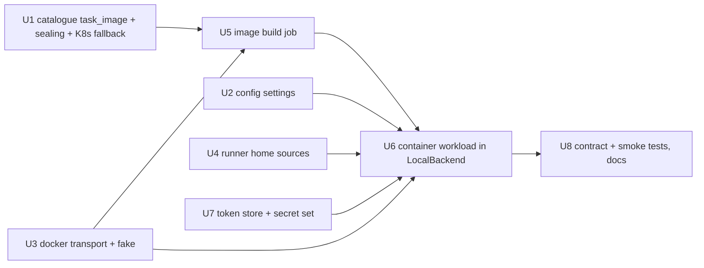

# feat: Docker work mode for the local backend

## Summary

`LocalBackend` gets a second workload kind: a Docker container instead of a
host process for the working runner. The mode is a `controller.local`
setting, read when the controller starts (like the HOME mode of D57). The
controller calls the `docker` CLI through a transport trait with an
in-memory fake (the `KubeTransport` precedent). The global task image is
defined in the catalogue (`runtime.yaml`), and the control plane seals it
into the task at creation.

The controller builds a layered image from the sealed definition **in the
background**, and the workload reports `Starting` until the image is ready.
It re-checks component versions on a TTL and records the image a task
started on in a per-task file on task storage. Secrets come from a
controller-owned token store and go through the runner's existing
`--secrets-dir` mechanism. Non-secret host configuration is copied into the
task's private HOME by a generalized form of the runner's Claude profile
source.

The global image is also the last fallback of the Kubernetes image chain
when it has no components.

---

## Problem Frame

A local task runs as a process of the daemon's user, with that user's HOME
and secrets, while the agent usually runs with
`--dangerously-skip-permissions`. Multi-repository workflows cannot take
their image from a single repository definition (see origin). Today no
Docker code exists. The local backend has no secret source and passes no
`--secrets-dir`. The production `ImageResolver` refuses tags.

---

## Requirements

Traced to the origin document (R-IDs are the origin's):

- R1–R4: work mode selection, no fallback to the host, a warning when a task
  moves from Docker back to the process mode. **R2 and R3 are reinterpreted
  in KTD3**: the mode takes effect when the controller starts, and the R3
  warning is written when a runner starts for an affected task, not when the
  daemon starts.
- R5–R6: in the container the agent writes only to task storage and sees
  only explicitly named secrets.
- R7–R13: a global image (base plus components with `install`/`version`),
  layered rebuild, periodic and forced update check, the image recorded per
  task, garbage collection, the runner mounted from the host, the global image
  as the default for every backend.
- R14–R16: tokens in a store, delivered as env or file; host configuration
  copied read-only into the private HOME; `claude setup-token` documented.

**Origin actors:** A1 (operator), A2 (agent, untrusted)
**Origin flows:** F1 (first setup of Docker mode), F2 (automatic component update)
**Origin acceptance examples:** AE1 (R2, R3), AE2 (R4), AE3 (R9, R11), AE4 (R7, R13), AE5 (R5, R6)

---

## Scope Boundaries

- **Trusted local control plane only.** Docker mode is refused when
  `narsor-controller local` serves a remote control plane. A sealed image
  definition from a server the operator does not control must not run
  scripts on the host or choose host paths and tokens (KTD13).
- **Rootful Docker on Linux only.** Rootless Docker and Podman map the host
  uid differently and break storage ownership. The availability check
  refuses them with a readable problem. There is no configurable CLI command
  in v1.
- Network: the container uses the host network (KTD4). Egress restriction
  and isolation from host services stay out of scope (origin).
- No push of a built image to a registry. Kubernetes uses the global image
  only when it has no components.
- No write-back of refreshed logins and no interactive login session
  (origin).
- Per-step images (`states.*.image`) are refused in Docker mode at
  provisioning, with a problem that names the step. One task runs in one
  container, as on Kubernetes.
- The read-only reader for a stopped task (D63) stays a host process. It
  does not run the agent, and history must stay readable when Docker is down.
- Per-user credentials on a shared server are out of scope (origin).

### Deferred to Follow-Up Work

- A statically linked (musl) `narsor-runner`, so that any base image works.
- Git over SSH and host git credential helpers inside the container.
- A tag-resolving `ImageResolver` for Kubernetes.
- Removal of the repository-level `base_image` after its deprecation period.
- A Unix-socket forwarder that would let the container drop the host network.
- Rootless Docker / Podman support (`--userns=keep-id`).
- `narsor-cli secret list|remove` (in v1, run `set` again to replace a token).

---

## Context & Research

### Relevant Code and Patterns

- `crates/narsor-controller/src/local/backend.rs`:
  - `LocalBackend`, `LocalBackendConfig`, `spawn`, `runner_args`,
    `remove_workload`, `kill_marked_group`, `phase`, `WorkloadRecord`
    (`pid` is a non-optional `u32` today);
  - the on-disk layout (`storage/`, `workloads/`, `readers/`);
  - `remove_workload` and `spawn` delete the whole workload directory.
- `crates/narsor-controller/src/local.rs`: `run` (adds `--config <file>` and
  `HarnessHome::runner_args()` to every runner), `resolve_home` (the built-in
  HOME is `host`; it is overridden only for a remote control plane, through a
  `Source` check), `check_command`, `UntrustedServer` / `LaunchCheck`.
- `crates/narsor-controller-runtime/src/controller.rs`:
  - lease TTL 60 s, renewed at the start of `step()`;
  - `try_step` awaits `provision` inline;
  - `WorkloadPhase::Starting` exists for "an image pull, a scheduling wait".
- `crates/narsor-controller-runtime/src/backend.rs`: `ExecutionBackend`. It is
  not object-safe, so the branch stays inside `LocalBackend`.
- `crates/narsor-controller/src/kubernetes/client.rs`: `KubeTransport`. This
  is the precedent for a fakeable platform transport.
- `crates/narsor-controller/src/kubernetes/manifest.rs`: `plan()` and `pod()`
  (mount roles, `SECRETS_MOUNT`, `--secrets-dir`); the adapter returns from
  provision before the image pull finishes.
- `crates/narsor-engine/src/launch.rs`: `resolve_definition` (image
  precedence, `MissingBaseImage`, `runtime()`).
- `crates/narsor-engine/src/environment/catalog.rs`,
  `crates/narsor-engine/src/environment/profile.rs`: `RuntimeCatalog`, the
  loading of `runtime.yaml`.
- `crates/narsor-model/src/domain/environment.rs`: `ImageSpec`,
  `ImageSource`, `ResolvedEnvironment`, `SecretReference` /
  `SecretDelivery`, the identity hash.
- `crates/narsor-runner/src/runner/secrets.rs`: `MountedSecrets::materialize`
  (env and file delivery from `--secrets-dir`, file secrets linked into the
  private HOME, never copied), `ProcessEnvironment::removed()`,
  `API_KEY_ENVS`.
- `crates/narsor-runner/src/runner/profile.rs`: `prepare_claude_profile`,
  `merge_profile`.
- `crates/narsor-runner/src/runner/preflight.rs`: `BaseImageContract`.
- `crates/narsor-shared/src/config/settings.rs` (`DEFAULT_LOCAL_HOME`,
  `LOCAL_HOME_MODES`), `config/file.rs`, `config/resolve.rs`.
- `crates/narsor-server/src/runtime.rs`: the daemon starts its controller
  with `--credential-file <state_dir>/local-controller/credential`.
- narsor-cli `config show` (in `src/`): it runs the hidden check command of
  the sibling binaries.
- `tests/integration/backend_contract_support/mod.rs` (`ContractTarget`,
  `contract_suite!`), `tests/integration/backend_contract_support/stub_runner.rs`.

### Institutional Learnings

- `docs/solutions/integration-issues/runner-private-home-hides-harness-login-2026-10-10.md`:
  - the mode is a launch setting and is not part of the environment identity;
  - bind-mount directories, not single files, because CLIs write atomically;
  - keep the API key scrub.
- `docs/solutions/security-issues/untrusted-control-plane-reaches-user-git-and-harness-logins-2026-10-25.md`:
  - every variable and mount that enters the container goes through the
    existing scrub and consent rules;
  - never mount the Docker socket;
  - a security specialist reviews the list before release.
- `docs/solutions/runtime-errors/agent-step-hangs-on-orphaned-background-process-2026-10-26.md`:
  process groups and signals; in a container this needs `--init`.
- `docs/solutions/architecture-patterns/auto-resume-policy-for-lost-workloads-2026-10-11.md`:
  - "cannot tell" is never treated as a loss;
  - a container label replaces the `/proc` workload marker.
- `docs/solutions/conventions/single-integration-test-crate-and-lean-target-2026-11-01.md`
  and `docs/solutions/conventions/test-network-features-through-trait-seams-not-tcp-servers-2026-10-31.md`:
  one integration crate, trait seams, `#[ignore]` for real infrastructure.
- `docs/follow-ups/2026-10-03-zdalne-backendy-pozostale-prace.md`:
  - local Docker is the deferred item this plan delivers;
  - avoid the blocking `wait_gone` pattern in async code.
- `docs/residual-review-findings/feat-remote-backends-review-needed.md`:
  trusted mode stays loopback-only. Do not spell out `PATH` in full.

### External References

- Claude Code authentication and legal pages (checked during the
  brainstorm):
  - `claude setup-token` uses the subscription, is valid for one year and
    gives model requests only;
  - using a subscription for one's own tasks with the unmodified binary is
    allowed;
  - company use of parallel unattended tasks needs confirmation by a
    specialist (origin Dependencies).

---

## Key Technical Decisions

- **KTD1: Docker is a workload kind of `LocalBackend`, not a new backend
  kind.** `ExecutionBackend` is not object-safe, and the backend id stays
  `local`: slots, catalogue and D58 semantics do not change.
  `WorkloadRecord` becomes kind-aware: a process record has a pid, and a
  container record has a container name and a build state.
- **KTD2: The `docker` CLI is called through a transport trait, not through
  a Docker API crate.** This follows how the repository calls `git` and adds
  no dependency. A fake transport makes the arguments, mounts and state
  mapping unit-testable without Docker. Transport calls run off the async
  thread.
- **KTD3: The mode takes effect when the controller starts.** The
  controller reads `controller.local.*` once per process. A daemon restart
  restarts the controller. This matches what "read at every start" means
  for the HOME mode today. The R3 warning comes from the controller when it
  starts a runner for a task whose **last workload record (KTD14)** shows the
  other mode.
- **KTD4: The container uses the host network.** The runner reaches the
  loopback-only trusted daemon without any change to the trust model. The
  operator excluded host services from the protection scope (origin R6). The
  agent reaches the daemon only with its own per-task runner credential.
- **KTD5: Container hardening.**
  - The container runs with the host user's uid and gid and an init
    process.
  - It uses `--cap-drop ALL` and `--security-opt no-new-privileges`.
  - It never uses `--privileged`, a host PID, IPC or user namespace, or a
    mount of the Docker socket.
  - HOME is always the private HOME on task storage. Docker mode forces it
    when the HOME setting is the built-in value. An **explicitly set**
    `controller.local.home: host` together with `mode: docker` is refused at
    the configuration step (the same `Source` check `resolve_home` uses).
  - The generated image adds a passwd and group entry for the host uid and
    gid, so tools that look up the current user work.
- **KTD6: The container runner gets its own argument list and its own
  mounts.** Host paths are mounted at the same paths in the container:
  - task storage, read-write;
  - the workload directory with the launch spec and credential, read-only;
  - the controller's configuration file, read-only, when `--config` is in
    use;
  - a local workspace source, read-only;
  - the per-workload secrets directory, read-only;
  - each home source, read-only.

  The runner binary is mounted read-only at a fixed path. Host harness
  directory flags (`--home host`, `--codex-home`, `--claude-config-dir`) are
  never passed. A test asserts that every path argument is covered by a
  mount.
- **KTD7: The container environment is an allowlist.** The container gets:
  - `LocalBackendConfig.env`;
  - the workload mark;
  - a short named list of pass-through variables (`TERM`, `LANG`, `LC_*`,
    `TZ`, proxy variables).

  It never gets `PATH`, `HOME`, `USER`, `XDG_*`, `NARSOR_*` or the
  `API_KEY_ENVS` variables. Secrets do not travel in the environment at
  create time (KTD10).
- **KTD8: The task image definition lives in `runtime.yaml` and is sealed
  into the task.**
  - The control plane reads `task_image` (base `ImageSpec` plus ordered
    components) at task creation.
  - It loads the script files relative to the catalogue and seals the
    definition, script text included, into `ResolvedEnvironment`.
  - The definition is part of the identity hash. A catalogue without
    `task_image` leaves the identity unchanged.
  - A Docker-mode task with no sealed definition (created before this change,
    or a catalogue without `task_image`) fails provisioning with a problem
    that names `runtime.yaml task_image`. There is no fallback.
- **KTD9: Image precedence on image-running backends.**
  - The order is: step image, then workflow `globals.image`, then repository
    `base_image` (deprecated, logs a warning), then the global `task_image`.
  - The global image counts only when it has no components. A global image
    with components on an image-running backend is a readable launch error.
  - The base goes through the existing `resolve_image` rules only on that
    path. Docker mode lets `docker` pull the base tag itself.
- **KTD10: Secrets use the existing `--secrets-dir` mechanism.**
  - The token store is a controller-owned directory (mode 0700, one 0600 file
    per name).
  - For each container start, the controller copies the entries the sealed
    components name into a per-workload secrets directory (0700/0600),
    mounts it read-only and passes `--secrets-dir`.
  - The controller passes the matching secret references (env or file
    delivery) to the runner, and `MountedSecrets` handles them as on
    Kubernetes: env secrets go into the harness environment, and file
    secrets are linked into the private HOME, never copied.
  - The per-workload directory is removed with the workload.
  - A missing store entry fails provisioning with a problem that names
    `narsor-cli secret set <name>`.
- **KTD11: Home sources: copy for configuration, merge only for Claude.**
  - The runner's Claude profile source is generalized to a list of
    `(read-only source, target under HOME)` pairs.
  - Non-Claude sources are overwritten from the source at every start.
  - The Claude profile keeps its existing three-way merge.
  - Directories are preferred to single files.
- **KTD12: Background image build.**
  - In Docker mode, `provision`/`resume` write a container workload record in
    a "building" state, start the build as a background job (serialized per
    definition hash), and return at once.
  - `phase` reports `Starting` while the build runs, creates and starts the
    container when the image is ready, and reports `Exited` with a recorded
    problem when the build fails and no previous image exists.
  - `version` checks and the base re-pull run in the same job, never in the
    reconcile step.
  - Each component is one layer whose build argument is its `version`
    output.
  - `version` scripts run on the host with a scrubbed environment, a timeout
    and an output size cap.
  - Garbage collection removes labelled narsor images that are not the
    latest build of any definition and not referenced by any existing
    per-task record (KTD14). It also prunes the narsor build cache by age.
- **KTD13: Docker mode needs the trusted local control plane.** At start, the
  configuration step refuses `mode: docker` together with a remote control
  plane.
- **KTD14: A per-task record on task storage holds the last workload kind
  and the image id.** The controller writes it at every start. It lives as
  long as the task storage, so it survives pause, release and loss. The R3
  check, image reuse on resume (R11) and GC protection read it. On resume a
  task uses the recorded image id while that image exists.

---

## Open Questions

### Resolved During Planning

- Where the image definition lives: in the catalogue (`runtime.yaml`), by
  the operator's choice.
- How the runner reaches the daemon: through the host network (KTD4).
- When the mode takes effect: when the controller starts (KTD3).
- HOME in Docker mode: always private. An explicit `host` setting is refused
  (KTD5).
- Container user: the host uid and gid, with a passwd entry (KTD5).
- Remote clones: HTTPS with a token from the store, through the credential
  helper of a tool in the image (for example `glab`/`gh`). SSH is deferred.
- Recording the image (R11): the image id goes in the per-task record on
  task storage (KTD14), not in the sealed environment. The sealed definition
  is the identity.
- How narsor-cli finds the controller's store: it resolves the daemon's
  state directory from the same configuration as the daemon. It passes
  `--credential-file <state_dir>/local-controller/credential` to the sibling
  subcommands, and they derive the store and refresh marker from that
  file's directory. Without the flag they use the hand-started default.

### Deferred to Implementation

- The exact runner argument shape for home sources and for the secret
  references, and whether the Claude profile flag stays as an alias.
- How "the runner cannot execute in the image" is detected: an early
  container exit with a loader error within a defined start window, or a
  probe container.
- Whether the `docker build` context is a temporary directory or a tar
  stream.
- Label keys, content-tag format, build-cache prune age.
- The behavior of the Claude Code sandbox (bubblewrap) under Docker's default
  seccomp profile. Document the outcome.

---

## High-Level Technical Design

> *This illustrates the intended approach and is directional guidance for review, not implementation specification. The implementing agent should treat it as context, not code to reproduce.*

```mermaid
sequenceDiagram
    participant CP as Control plane (server)
    participant C as narsor-controller local (docker mode)
    participant B as Image build job
    participant D as docker CLI (transport)
    participant R as narsor-runner (in container)
    CP->>CP: create task: seal task_image from runtime.yaml
    CP->>C: provision(task, launch spec)
    C->>C: record {kind: container, state: building}; start job
    C-->>CP: Starting
    C->>B: build for sealed definition (background)
    B->>B: version scripts on host (TTL / forced)
    B->>D: pull base, build changed layers, tag + label
    B-->>C: image id
    C->>C: per-task record {kind, image id}; per-workload secrets dir
    C->>D: run --init --network host --user uid:gid --cap-drop ALL, mounts
    D->>R: start runner (Docker-mode argument list)
    R->>R: preflight contract, home sources, MountedSecrets
    R->>CP: runner API over loopback
    C->>D: inspect (phase) / rm -f (remove) by label
```

Image definition shape in `runtime.yaml` (directional):

```yaml
task_image:
  base: debian:trixie-slim          # ImageSpec: string or {reference, digest_policy}
  components:
    - name: claude-code
      install: components/claude-code.sh      # path relative to the catalogue, or inline text
      version: components/claude-code.version.sh
      secrets:
        - { name: claude-token, env: CLAUDE_CODE_OAUTH_TOKEN }
      home:                                    # host config copied into the private HOME
        - { from: ~/.claude/skills, to: .claude/skills }
        - { from: ~/.claude/settings.json, to: .claude/settings.json }
    - name: glab
      install: components/glab.sh
      version: components/glab.version.sh
      secrets:
        - { name: gitlab-token, env: GITLAB_TOKEN }
```

Mode by workload outcome:

| Configured mode | Last workload (per-task record) | Result at start/resume |
|---|---|---|
| process | none or process | process runner, as today |
| process | container | process runner; warning names the task (R3) |
| docker | none or container | container runner on the recorded or a new image |
| docker | process | container runner; host harness sessions are not visible |
| docker | no sealed `task_image` | provisioning problem, no host fallback |
| docker | Docker unreachable or rootless | provisioning problem, no host fallback (R4) |
| docker + remote control plane | — | controller refuses to start (KTD13) |

---

## Implementation Units



U7 has no dependencies and must land before U6. The unit order below is
by topic, not by landing order. Follow the graph.

### U1. Task image definition in the catalogue, sealed into the task

**Goal:** `runtime.yaml` gets an optional `task_image` (base plus
components). The control plane validates it, loads the component scripts,
seals it into `ResolvedEnvironment`, and uses it as the last image fallback
on image-running backends.

**Requirements:** R7, R8, R13; AE4

**Dependencies:** none

**Files:**
- Modify: `crates/narsor-model/src/domain/environment.rs` (a sealed
  task-image type, a new `ImageSource` variant, identity hash input)
- Modify: `crates/narsor-engine/src/environment/profile.rs`,
  `crates/narsor-engine/src/environment/catalog.rs` (parse and validate
  `task_image`; load scripts relative to the catalogue)
- Modify: `crates/narsor-engine/src/launch.rs` (`resolve_definition`: seal
  the definition; precedence per KTD9; deprecation warning; error for
  components on an image backend)
- Modify: `crates/narsor-engine/src/environment/resolver.rs` (new launch
  errors)
- Modify: `crates/narsor-controller/src/kubernetes/manifest.rs` (the error
  text that says a task "runs in its repository's image")
- Test: the tests modules of `crates/narsor-engine/src/launch.rs` and
  `crates/narsor-engine/src/environment/catalog.rs`;
  `tests/integration/orchestration.rs`

**Approach:**
- A component has:
  - a name matching `[a-z0-9][a-z0-9-]*`, unique in the definition;
  - an `install` script (inline text or a path inside the catalogue
    directory);
  - an optional `version` script;
  - optional `secrets`: a store name plus delivery, either an `env` name or
    a `file` path under HOME;
  - optional `home` entries: a host `from` path and a relative `to` path.
- Validation rejects:
  - env names that are not identifiers, or that are `PATH`, `LD_*`,
    `NARSOR_*` or an `API_KEY_ENVS` entry;
  - a `to` or file path that is absolute or contains `..`;
  - a `from` that is a filesystem root or the Docker socket.
- `~` in `from` is expanded by the controller, not by the control plane.
- The sealed definition always carries the script text, never a path.
- On the `local` backend the definition is sealed when present, whatever
  the mode, so a later mode switch finds it.
- New fields are optional, so old sealed specs still deserialize (the
  "removing a field" convention).

**Patterns to follow:** the existing `runtime.yaml` bundle and tools
handling; `resolve_image`; `ImageSource` variants.

**Test scenarios:**
- Happy path: given a `runtime.yaml` with a base and two components whose
  scripts are files, when a local task is created, the sealed environment
  holds both scripts' text in order. Its identity differs from a catalogue
  without `task_image`, and a catalogue without `task_image` gives the same
  identity as before the change.
- Covers AE4: given a `task_image` with no components, a workflow with two
  repositories and no images, when the task targets the Kubernetes backend,
  the base image is the global image with the new source.
- Edge case: a workflow `globals.image` wins over the global image. A
  repository `base_image` wins over the global image and logs a deprecation
  warning.
- Error path: a global image with components and no other image on an
  image-running backend fails creation with the new launch error.
- Error path (table-driven): an escaping script path, a duplicate or invalid
  component name, a reserved env name, a `to` with `..`, and a `from` of `/`
  are each a `runtime.yaml` validation error that names the field.

**Verification:** existing launch tests pass. A task created before the change
still deserializes.

---

### U2. Configuration settings for the work mode

**Goal:** `controller.local.mode` (`process`, `docker`; built-in `process`)
and `controller.local.docker.update_interval` (duration; built-in 24h) exist,
are validated, and appear in `config show`. The cross checks (KTD5, KTD13)
refuse invalid combinations.

**Requirements:** R1

**Dependencies:** none

**Files:**
- Modify: `crates/narsor-shared/src/config/settings.rs`,
  `crates/narsor-shared/src/config/file.rs`,
  `crates/narsor-shared/src/config/resolve.rs` (typed accessor)
- Modify: `crates/narsor-controller/src/local.rs` (read the mode; refuse an
  explicit `home: host` with `docker`; refuse `docker` with a remote control
  plane; force a private HOME when the HOME setting is built-in)
- Modify: `docs/user/configuration.md` (example tree and settings table)
- Test: config tests next to `settings.rs` / `file.rs`;
  `crates/narsor-controller/src/local.rs` tests;
  `tests/integration/config_*.rs`

**Approach:** follow `LocalHome` exactly: a `SettingKey` variant, a path key,
`one_of` validation, a constant for the modes. The cross checks run in the
controller's configuration step and use the setting's `Source`, the same way
`resolve_home` does.

**Patterns to follow:** `SettingKey::LocalHome`, `DEFAULT_LOCAL_HOME`,
`LOCAL_HOME_MODES`, `resolve_home`.

**Test scenarios:**
- Happy path: given only `controller.local.mode: docker` in the file, the
  controller starts with a private HOME. The check reports `docker` from
  `file`.
- Error path: `mode: dokcer` fails and names the path and the allowed
  values.
- Error path: `mode: docker` with an explicitly set `home: host` refuses to
  start and names both keys.
- Error path: `mode: docker` with a remote control plane refuses to start
  with a message that says Docker mode needs the local daemon.

**Verification:** `narsor-cli config show` lists both settings with their
built-in values when the file is empty.

---

### U3. Docker transport with a fake

**Goal:** a narrow trait for the Docker operations the controller needs,
with a CLI implementation and an in-memory fake.

**Requirements:** R4, R12 (enabler)

**Dependencies:** none

**Files:**
- Create: `crates/narsor-controller/src/local/docker.rs` (trait, CLI
  implementation, state mapping)
- Create: `crates/narsor-controller/src/local/docker_fake.rs` (fake
  transport; test-only or behind the testkit pattern)
- Modify: `crates/narsor-controller/src/local.rs` (module declarations)
- Test: unit tests in `crates/narsor-controller/src/local/docker.rs`

**Approach:**
- Operations:
  - an availability check that reports rootless mode;
  - image: pull, build from a context, inspect, list by label, remove,
    build-cache prune;
  - container: create and start, inspect by name, list by label,
    force-remove.
- `std::process::Command` with explicit arguments (no shell). Parse JSON from
  `inspect` / `--format`.
- State mapping:
  - `running` → running;
  - `created` → starting;
  - `exited` and `dead` → exited, with the exit code;
  - "no such container" → missing;
  - a daemon that cannot be reached → unreachable, never missing.

**Patterns to follow:** `crates/narsor-controller/src/kubernetes/client.rs`
(`KubeTransport`); the `run_git*` helpers in
`crates/narsor-exec/src/workspace/provisioner.rs`.

**Test scenarios:**
- Happy path: the CLI implementation builds the expected argv for run,
  inspect and remove from a container request (assert on the command, no
  Docker).
- Edge case (table-driven): `inspect` output for `running`, `created`,
  `exited` 137, `dead` and "no such container" maps as above.
- Error path: the "cannot connect to the Docker daemon" output maps to
  unreachable. A missing `docker` binary fails the availability check with a
  readable message. A rootless `docker info` fails the check with the
  rootless message.

**Verification:** the fake and the CLI implementation satisfy the same trait.
No test needs Docker.

---

### U4. Runner home sources

**Goal:** the runner takes any number of read-only sources into the private
HOME. Non-Claude sources are overwritten at each start, and the Claude
profile keeps its merge.

**Requirements:** R15

**Dependencies:** none

**Files:**
- Modify: `crates/narsor-runner/src/runner/profile.rs` (the source list;
  overwrite for generic sources; the Claude source keeps `merge_profile`)
- Modify: `crates/narsor-runner/src/runner/cli.rs` (a repeatable home-source
  argument; `--claude-profile-source` keeps working)
- Test: the tests module of `crates/narsor-runner/src/runner/profile.rs`

**Approach:** a source is a file or a directory. The target is relative to
the private HOME and must not escape it. A directory target is replaced as a
whole from the source. A source is refused without a private HOME, like
`file` delivery today. Secrets never use this path (KTD10).

**Patterns to follow:** `prepare_claude_profile`, the `..data` skip rules.

**Test scenarios:**
- Happy path: given a directory source `skills/` and a file source
  `.gitconfig`, the first start writes both under HOME. After the source
  changes, the next start shows the new content, and a file removed from the
  source directory is gone.
- Error path: a target that escapes HOME (`../x`) is refused before any
  write. A source with the host HOME mode is refused.
- Integration: `--claude-profile-source` alone gives the same result as
  before (the existing profile tests stay green unchanged).

**Verification:** the existing profile tests pass without edits.

---

### U5. Image build job

**Goal:** from a sealed task image definition, produce a local image id in a
background job: pull the base, build changed layers, label, cache, refresh on
TTL or force, and collect garbage.

**Requirements:** R8, R9, R10, R11, R12; F2; AE3

**Dependencies:** U1, U3

**Files:**
- Create: `crates/narsor-controller/src/local/image.rs` (job registry per
  definition hash, version cache, refresh marker, build context generation,
  garbage collection)
- Modify: `crates/narsor-controller/src/local.rs` (a hidden `local image
  refresh` subcommand that writes the refresh marker; `--credential-file`
  locates the controller directory)
- Modify: the narsor-cli command tree in `src/` (`narsor-cli image refresh`,
  which resolves the daemon's state directory and delegates to the sibling
  binary)
- Test: unit tests in `crates/narsor-controller/src/local/image.rs` against
  the fake transport

**Approach:**
- The definition hash selects a cache entry in the controller directory: the
  last `version` outputs, their time, and the last image id.
- A job starts when no image exists for the hash, the cache is older than
  `update_interval`, or the refresh marker is newer than the cache. At most
  one job runs per hash. Callers poll the job state.
- `version` scripts run on the host with a scrubbed environment (no
  `NARSOR_*`, no `API_KEY_ENVS`), a timeout and an output cap. A failed
  script keeps its last output and logs a warning.
- The build context holds one script file per component and a build file:
  - `FROM` the base;
  - a passwd and group entry for the host uid/gid;
  - one layer per component, with its `version` output as a build argument.
- Images carry narsor labels: ownership, the definition hash and the build
  time.
- A failed build with a previous image for the same hash keeps that image
  and logs a warning. Without one, the job reports a failure that names the
  component whose layer failed.
- Garbage collection runs after a successful build and at controller start.
  It keeps the latest image of each cached hash and every image id named in
  any existing per-task record (KTD14). It prunes the narsor build cache
  older than a fixed age.

**Patterns to follow:** the staging-rename writes in
`crates/narsor-controller/src/local/backend.rs`; `child_process.rs` timeout
style.

**Test scenarios:**
- Happy path: a fresh cache and a definition with two components gives one
  pull and one build, and the job reports the image id. A second request
  within the TTL runs no `version` script and no build.
- Covers AE3: after the TTL, the second component's `version` prints a new
  value. A new build runs with the new argument and reports a new id. The old
  id survives GC while a per-task record names it, and is removed after the
  record is gone.
- Edge case: a refresh marker newer than the cache forces the check inside
  the TTL.
- Error path: a build fails with a previous image: the previous id is
  reported with a warning. With no previous image: the failure names the
  component.
- Error path: a `version` script that times out keeps the previous output.
- Integration: two concurrent requests for the same hash produce one build
  call on the fake. A request while a job runs returns "building" at once.

**Verification:** the job is fully exercised against the fake transport. The
real build is covered by the ignored smoke test in U8.

---

### U7. Token store and `secret set` command

**Goal:** the operator stores a token once. The controller copies the tokens
a task needs into the per-workload secrets directory.

**Requirements:** R14, R16; F1

**Dependencies:** none (must land before U6)

**Files:**
- Create: `crates/narsor-controller/src/local/secrets.rs` (store: set, read;
  directory 0700, files 0600, atomic write; name validation)
- Modify: `crates/narsor-controller/src/local.rs` (hidden `local secret set
  <name>`; the value from stdin, never from argv; `--credential-file`
  locates the controller directory)
- Modify: the narsor-cli command tree in `src/` (`narsor-cli secret set
  <name>`, which resolves the daemon's state directory and delegates to the
  sibling binary)
- Test: unit tests in `crates/narsor-controller/src/local/secrets.rs`; an
  integration test in `tests/integration/` where `secret set` through
  narsor-cli and the controller's read use the same file

**Approach:** the store lives next to the controller credential. Names follow
the existing secret name rules. No code path prints a token value or passes
one in argv.

**Patterns to follow:** credential file writing in the controller (0600,
atomic rename); the `config show` sibling-binary delegation in narsor-cli.

**Test scenarios:**
- Happy path: `set` from stdin, then a read by the controller, gives the
  value. The file mode is 0600 and the directory mode is 0700.
- Error path: an invalid name (`../x`, empty) and an empty stdin are
  refused.
- Integration: `narsor-cli secret set` writes the file that a controller
  started by the daemon reads.

**Verification:** a grep of the new code shows no logging of the value.

---

### U6. Container workload in `LocalBackend`

**Goal:** in Docker mode the working runner is a container: building state,
start, phase, remove, secrets, home sources, the R3 warning, and no host
fallback.

**Requirements:** R1–R6, R11, R12, R14, R15; F1; AE1, AE2, AE5

**Dependencies:** U2, U3, U4, U5, U7

**Files:**
- Modify: `crates/narsor-controller/src/local/backend.rs` (kind-aware
  `WorkloadRecord`; the per-task record on task storage; container
  provisioning through the build job; phase and remove by kind; the
  Docker-mode runner argument list and mounts; the per-workload secrets
  directory; the R3 warning; refusal of step images)
- Modify: `crates/narsor-controller/src/local.rs` (build
  `LocalBackendConfig` for Docker mode: transport, build job registry, token
  store, uid and gid)
- Test: unit tests in `crates/narsor-controller/src/local/backend.rs` with
  the fake transport

**Approach:**
- Provision or resume in Docker mode:
  1. refuse with a problem when the sealed spec has no `task_image` or
     declares step images;
  2. write the workload record (kind container, state building) and request
     the image from the build job. The image is the recorded image id from
     the per-task record when that image still exists;
  3. return at once.
- Phase while building: report `Starting`. When the job reports an image:
  1. write the per-task record (kind, image id);
  2. prepare the per-workload secrets directory;
  3. create and start the container per KTD5–KTD7, with a name and a label
     equal to the workload uid;
  4. report the container state.

  When the job fails: report `Exited` and record the problem.
- Phase after start:
  - running → alive;
  - created → starting;
  - exited → exited;
  - missing → absent;
  - unreachable → cannot tell (stays `Unknown`, D58).
- An early exit with a loader or "exec format" error within the start window
  becomes the "runner cannot run in this image" problem, which names the
  glibc requirement.
- Remove: the record kind decides, not the current mode. A container record
  is force-removed by label. A process record uses the process-group path.
  The per-workload secrets directory goes with the workload directory. The
  per-task record stays.
- R3: when the configured mode is process and the per-task record says
  container, log a warning that names the task before the host runner
  starts. Then update the record.
- A local workspace source (`TaskRepositorySource::Local`) is mounted
  read-only at its host path.
- The reader (D63) is unchanged: a host process with `--read-only`.
- Records written before this change have no kind and are read as process
  records.

**Execution note:** start with fake-transport unit tests for the container
request (flags, mounts, arguments, environment) and the phase mapping before
wiring the real transport.

**Patterns to follow:** the existing `spawn`, `phase` and `remove_workload`;
`manifest.rs` `pod()` for mount roles and `--secrets-dir`; the label as the
"prove it is ours" rule (instead of `kill_marked_group`).

**Test scenarios:**
- Happy path: in Docker mode, provision returns without waiting for a slow
  fake build, and phase reports `Starting`. After the job finishes, phase
  creates one container with:
  - the image id, the workload label, init, host network, the host uid,
    `--cap-drop ALL` and no-new-privileges;
  - storage read-write; the workload directory, runner, configuration file
    and secrets directory read-only;
  - `--secrets-dir`.
- Covers AE5:
  - the container request has no `--privileged`, no host PID, IPC or user
    namespace, and no mount of the host HOME, `~/.ssh` or the Docker
    socket;
  - its environment is exactly the allowlist (no `PATH`, `HOME`, `NARSOR_*`
    or API keys);
  - every path in the runner arguments is covered by a mount.
- Covers AE1: a task runs in a container, is released (pause), and the
  controller restarts in process mode. The resume starts a host runner and
  logs a warning that names the task. The per-task record survived the
  release.
- Covers AE2: a transport that reports the daemon unavailable, or rootless,
  fails provisioning with a problem that names the cause. No process is
  spawned.
- Integration (R11): a task is released, the definition gets a new
  build, and the task is resumed: the container uses the original image id
  from the per-task record.
- Edge case: phase with an unreachable daemon is "cannot tell". A missing
  container with storage present is absent.
- Edge case: removing a process-kind record in Docker mode uses the
  process-group path. Removing a container-kind record in process mode uses
  the transport.
- Error path: a sealed spec without `task_image`, or with a step image, fails
  provisioning with a problem that names `runtime.yaml task_image` or the
  step. A component secret missing from the store names
  `narsor-cli secret set <name>`.
- Error path: a fake build failure with no previous image ends in `Exited`
  with the component named.

**Verification:** the existing `LocalBackend` unit tests pass unchanged in
process mode.

---

### U8. Contract tests, real-Docker smoke test and documentation

**Goal:** the shared backend contract runs against the container workload.
An ignored smoke test proves a real image and a real harness. The docs
describe the mode.

**Requirements:** success criteria; R16

**Dependencies:** U6

**Files:**
- Create: `tests/integration/backend_contract_support/local_docker.rs` (a
  `ContractTarget` for Docker mode on the fake transport; no Docker daemon)
- Modify: `tests/integration/backend_contract_support/stub_runner.rs` only if
  the fake needs it to start the stub runner for a simulated container
- Modify: `tests/integration/backend_contract.rs`,
  `tests/integration/main.rs` (module declaration)
- Create or modify: `examples/catalog/runtime.yaml` and
  `examples/catalog/components/` (reference components: Claude Code and
  glab)
- Create: `docs/user/local-docker.md`, covering:
  - the setup flow F1, the image definition, update and refresh;
  - tokens and `claude setup-token`;
  - limits: no claude.ai connectors, the glibc requirement, the host network,
    no SSH, rootful Docker only, trusted local daemon only;
  - Docker group equals root access on the host;
  - a licensing note;
  - how to remove narsor images and build cache by label.
- Modify:
  - `docs/user/configuration.md` (link);
  - `docs/dev/architecture.md` (a new decision entry that amends D57, D58
    and the Kubernetes image precedence);
  - `docs/operations/remote-backends.md` (repository `base_image`
    deprecated; global image fallback; a tag needs a digest on Kubernetes);
  - `docs/dev/workflow-schema.md` (image precedence);
  - `docs/dev/building-and-testing.md` (how to run the Docker contract
    tests).

**Approach:**
- **No committed test needs a Docker daemon or other real infrastructure**
  (operator decision during execution: Docker availability on the test
  platform is not guaranteed).
- The Docker contract target uses the fake transport. The fake simulates the
  container lifecycle in memory. Where the contract needs a live runner, the
  fake starts the stub runner as a local process, as the `local` target does.
  It follows the same `#[ignore]` rule as the `local` target, because it
  starts processes.
- Real Docker is used only for manual verification during implementation:
  build the example image, start a container, run one agent step with a real
  `claude` and a `setup-token`, and make a git commit inside the container.
  Record the outcome in the PR description. Do not commit these checks as
  tests.
- The architecture entry records KTD1–KTD14 in short form.

**Test scenarios:**
- Integration: the full contract suite passes for the Docker target
  (provision, observe, release, resume, auto-resume after a killed
  container).
- Integration: a container killed from outside is observed as absent and
  auto-resumes under D58 on the same image id.
- Manual (not committed): the example image builds on real Docker. An agent
  step succeeds on a subscription token with no host `~/.claude` mount. A git
  commit inside the container works.

**Verification:** `cargo test --workspace` passes. The Docker contract suite
passes on the fake transport (with `--include-ignored`) on a machine without
Docker. The manual real-Docker check is recorded in the PR description.

---

## System-Wide Impact

- **Interaction graph:** control plane launch resolution (U1), local
  controller (U2, U3, U5–U7), runner (U4), narsor-cli (U5, U7). The
  Kubernetes controller changes only an error text and sees a new image
  source.
- **Error propagation:**
  - build failures become `Exited` with a recorded problem;
  - transport and configuration errors become provisioning problems or
    start refusals;
  - an unreachable daemon becomes `Unknown` through the existing
    observation path.
- **Lease safety:** no Docker build or `version` script runs inside a
  reconcile step (KTD12). A transport call in `phase` is short (inspect).
- **State lifecycle risks:**
  - the per-workload secrets directory must be removed on every path,
    including a failed create;
  - GC must never remove an image a per-task record names;
  - a workload record without a kind is read as a process record.
- **API surface parity:** no new HTTP API. Two CLI commands (`image
  refresh`, `secret set`) work only next to a local daemon. On a remote
  setup they report that.
- **Integration coverage:** the contract suite (U8) is the only proof that
  D58 holds with containers.
- **Unchanged invariants:**
  - process mode behaves exactly as today;
  - the identity of tasks created without `task_image` does not change;
  - trusted mode stays loopback-only;
  - runners never inherit `NARSOR_*`;
  - the reader stays a host process.

---

## Risks & Dependencies

| Risk | Mitigation |
|------|------------|
| The host runner needs glibc ≥ 2.39, so it does not run in older or Alpine images | Documented requirement and a reference base (`debian:trixie-slim`). A clear problem on an early loader exit. Static runner deferred. |
| The host network exposes host loopback services to the agent | An explicit operator choice (origin R6). Documented. The Docker socket is never mounted. The daemon accepts only the per-task runner credential from the container. |
| A sealed definition from an untrusted server could run host scripts or pick host paths | Docker mode is refused with a remote control plane (KTD13). |
| Subscription token licensing for unattended parallel tasks is unclear | A note in `docs/user/local-docker.md`. A specialist confirms before company use (origin). |
| The Claude Code sandbox may not work under the default seccomp profile | Verify in the smoke test. Document the result. Do not widen seccomp in v1. |
| Base image tags and install scripts are a supply-chain surface | Operator trust choice. Documented. Digest pinning of the base is possible through `ImageSpec`. |
| A security review of the variable and mount list is required (learnings) | The PR description lists every mount, flag and variable. A security specialist review before release. |

---

## Documentation / Operational Notes

- New user doc `docs/user/local-docker.md`. Configuration table updates.
  Architecture decision entry. Deprecation note for the repository
  `base_image`.
- Narsor images and build cache are labelled. GC removes them. The doc
  explains `narsor-cli image refresh` and manual removal by label.

---

## Sources & References

- **Origin document:** [docs/brainstorms/2026-11-21-local-docker-runner-requirements.md](../brainstorms/2026-11-21-local-docker-runner-requirements.md)
- Related decisions: `docs/dev/architecture.md` D57, D58, D63, D68, D79
- Related plan: `docs/plans/2026-10-01-2329-feat-zdalne-backendy-wykonawcze-plan.md`
  (remote backends, image contracts)
- Kind images: `deploy/kind/images.Dockerfile`
