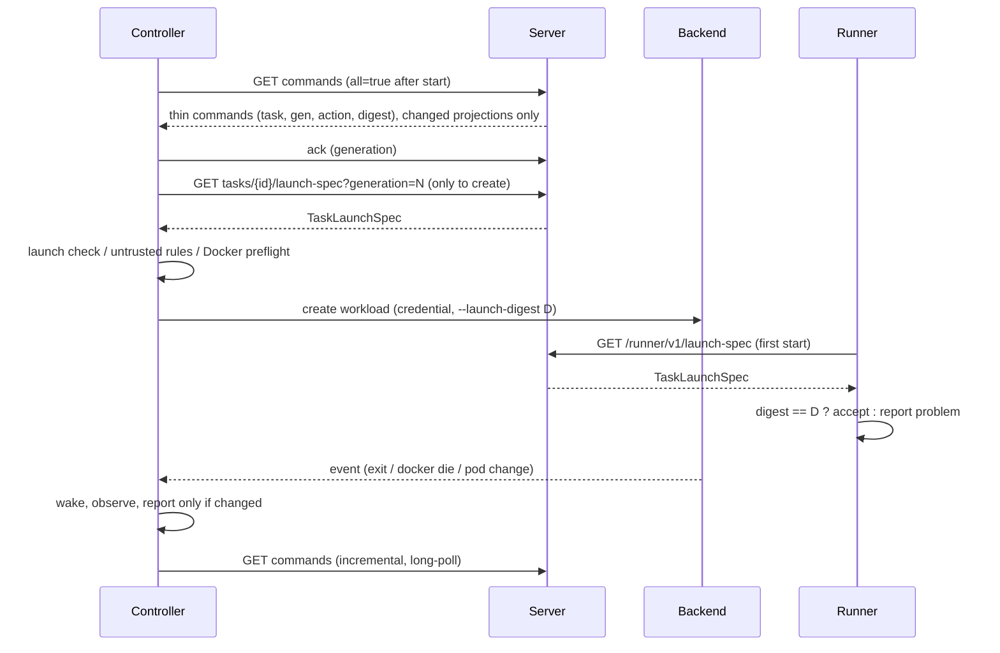
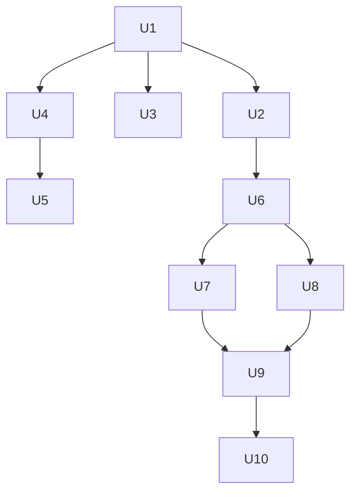

# refactor: Slim the controller protocol and give every binary its own state directory

## Summary

Two related changes, shipped together with all binaries at once (no wire or
layout compatibility with older binaries; one automatic on-disk migration):

1. **Controller protocol.** Commands carry only what the controller needs to
   reconcile (no launch spec); the controller fetches a spec on demand; reads
   are incremental instead of the whole desired state every step; native
   backend events wake the controller; the runner fetches its own launch spec
   with its credential, pinned to the digest the controller checked, so the
   workload directory no longer carries `launch-spec.json`.
2. **State ownership.** Every binary keeps its state in `state/<binary>/` and
   its work in `work/<binary>/`; cross-binary rendezvous files live only in
   `state/run/` with a written writer/reader list; a parent hands a child an
   explicit path to one resource. Path types make other directories
   unreachable from a binary's code, an architecture test guards it, and the
   server stops reading local task storage directly.

---

## Problem Frame

- `GET /controller/v1/commands` returns every non-archived task of the backend
  with its full `TaskLaunchSpec` (definition snapshot, inputs, environment
  with `task_image` scripts) on every controller step (`all=true`, about every
  10 s). Stopped tasks accumulate, so traffic grows with idle tasks, while the
  spec is needed only when a workload is created.
- A dead runner is noticed at the idle pace (up to `poll_wait`, 10 s) although
  every backend has native events.
- The controller writes `launch-spec.json` for the runner although the runner
  already holds a credential to the control plane.
- State files of different binaries share one directory. Clients write
  `daemon.lock` next to server records; the autostarted daemon and the TUI
  both write `{state}/narsor.log`; `narsor-web` writes `web-session` there;
  the local controller's directory sits inside the server's state;
  `narsor-server` reads local task storage for `/executions`
  (`crates/narsor-server/src/api/routes.rs`) and checks the controller
  credential file; `narsor-cli` computes controller paths. Nothing prevents a
  binary from reaching into another binary's files.

---

## Requirements

**Protocol**
- R1. A controller command carries no launch spec: task id, generation,
  action, resource key, runner progress, reader flag and the spec digest
  only; the server tracks per controller what it delivered (KTD1).
- R2. The controller fetches a launch spec only to create a workload or start
  a reader (and the Docker mode needs it to start a container after the image
  build); the fetch is bound to task and generation and refused for a stale
  generation or lost lease.
- R3. After a (re)start, a lease change or fencing, and on a periodic safety
  interval, the controller reads the whole desired state; otherwise it reads
  only what changed. No change the controller acts on may be missed:
  generation, runner state, admission, runner progress, reader lease,
  archival.
- R4. A native backend event (runner process exit, Docker container event,
  Kubernetes Pod change) wakes the controller at once. An event is only a
  trigger to observe again; it never confirms a loss by itself (D58
  `LossConfirmed` gating, lease check at step start and
  `reader_restart_interval` stay).
- R5. The workload directory and the Kubernetes launch Secret carry no launch
  spec. A working runner on its first start fetches the spec from the control
  plane with its credential and accepts it only when its digest equals the
  digest the controller checked and passed to it; later starts and the reader
  use the copy on task storage.

**State ownership**
- R6. Each binary writes and reads state only under `state/<binary>/` and
  work only under `work/<binary>/`. Exceptions are only: (a) files in
  `state/run/`, each with a documented writer and readers; (b) a path a parent
  passes explicitly to a child for one resource (controller → runner:
  workload directory, task storage, secrets directory); (c) the one-time
  migration's read of the legacy controller records by the server (KTD10).
- R7. Clients find the server only through `state/run/` (discovery file,
  autostart lock, autostart log). `state/run/` is 0700.
- R8. `narsor-server` serves execution history for local tasks the same way
  as for any backend, through the runner/reader channel and its own records,
  never by reading task storage.
- R9. Binaries get typed path objects for their own directories only; an
  architecture test fails when a binary crate uses another binary's paths or
  the raw state root.
- R10. An existing installation is migrated once, automatically, at the first
  start of the new binaries: idempotent, crash-safe, under a lock, loud on
  failure, refused while workloads are alive.

---

## Scope Boundaries

- No compatibility with older binaries: wire fields are removed outright and
  binaries are released together. The update notes still state the order and
  the "stop everything first" rule because of the migration.
- No runtime OS enforcement (Landlock, separate users): structural types plus
  the architecture test are the guarantee (user decision).
- The catalogue (`server.catalog`) is configuration, not state, and keeps its
  layout.
- The connection profile under `$XDG_CONFIG_HOME/narsor/` is client
  configuration and stays.

### Deferred to Follow-Up Work

- A lifetime lock in `state/run/` that closes the known double-autostart race
  (`DISCOVERY_TIMEOUT` frees `daemon.lock` while a slow daemon starts;
  `docs/residual-review-findings/feat-daemon-lokalny-2654853.md`). The new
  `state/run/` makes it easy, but it changes autostart semantics.
- Automatic refresh of the runner credential (15 min TTL) beyond the retry in
  U2 (`docs/follow-ups/2026-10-03-zdalne-backendy-pozostale-prace.md`).
- Splitting `narsor-controller` into `local` and `kubernetes` crates.
- Removing the blocking `wait_gone` from the local backend's async path.

---

## Context & Research

### Relevant Code and Patterns

- Commands and acks: `crates/narsor-protocol/src/controller/runner/commands.rs`
  (`DesiredCommand`, `CommandsResponse`);
  `crates/narsor-engine/src/controller_protocol/service/runner_channel/controller_commands.rs`
  (`commands_and_readers`, `desired_command`, `wait_for_commands`,
  `acknowledge`, `readers_wanted`); `long_poll.rs` (`wait_for` on the
  `changes` broadcast).
- Controller loop: `crates/narsor-controller-runtime/src/controller.rs`
  (`try_step`, `pause`, `acknowledge`, `launch`, `start_reader`,
  `forget_all`, `ControllerLink`, `ControllerConfig`); test doubles in
  `testkit.rs` (`Probed`, `SeverableLink`) and the `StubLink`/`StubBackend` in
  the same file's tests.
- Backend trait: `crates/narsor-controller-runtime/src/backend.rs`
  (`ExecutionBackend`, not object-safe; `WorkloadLaunch.launch_spec`).
- Task record: `crates/narsor-engine/src/orchestration/model.rs`
  (`TaskRecord.launch_spec` immutable since create, `revision` raised on every
  accepted mutation).
- Runner: `crates/narsor-runner/src/runner/mod.rs` (`load_spec`, `Link`,
  `report_problem`), `init.rs` (`initialize_task_launch_spec`),
  `reader.rs`, `cli.rs` (`--launch-spec`), runner client in
  `crates/narsor-controller-client/src/client.rs` (`RunnerClient`).
- Runner routes: `crates/narsor-server/src/controller_protocol/http.rs`
  (`runner_routes`, `require_runner`); `RunnerIdentity` with `role` in
  `crates/narsor-engine/src/controller_protocol/credentials.rs`.
- Conversation reads relayed through runner/reader:
  `crates/narsor-engine/src/controller_protocol/service/reads/conversation.rs`,
  `runner_poll.rs` (`conversation_pages`); server-side timeline from the task
  record: `service/tasks/history.rs` (`served_timeline`).
- Local backend: `crates/narsor-controller/src/local/{backend.rs,workload.rs,process.rs}`,
  Docker mode `local/container/{mod.rs,docker.rs,docker_fake.rs,image.rs,secrets.rs}`;
  untrusted control plane check `local/untrusted.rs`.
- Kubernetes: `crates/narsor-controller/src/kubernetes/{client.rs,manifest.rs,mod.rs}`
  (`LAUNCH_SPEC_KEY`, `launch_secret_of`, `reader_pod`), RBAC
  `deploy/kubernetes/controller-rbac.yaml`, fake
  `tests/integration/kubernetes_support/mod.rs` (`MockCluster`).
- Paths: `crates/narsor-store/src/paths.rs` (`StatePaths`; separate path
  types per root, no raw join), `crates/narsor-shared/src/config/{client_paths.rs,resolve.rs,scope.rs,local_controller.rs}`,
  discovery and autostart `crates/narsor-api-client/src/api/{discovery.rs,launch.rs}`,
  `crates/narsor-store/src/daemon_info.rs`, web `crates/narsor-web/src/{main.rs,launch.rs}`,
  TUI log `src/bin/narsor.rs`, CLI helpers `src/cli/commands/{secret.rs,image.rs}`,
  `src/cli/init.rs` (`set_root_paths`, `purge`), `dist/install.sh`.

### Current on-disk channels between binaries

| File | Writer | Readers | Today |
|---|---|---|---|
| `daemon.json` | narsor-server | narsor, narsor-cli, narsor-web, `narsor-server stop` | `{state}/` |
| `daemon.lock` (+ guard) | clients | clients | `{state}/` |
| autostart log | client opens, daemon writes | operator, client error text | `{state}/narsor.log` (collides with TUI log) |
| TUI log | narsor | operator | `{state}/narsor.log` |
| `web-session`, `web-open.html` | narsor-web | operator, browser | `{state}/` |
| controller credential, lock, `secrets/`, `images/` | narsor-controller | narsor-controller (server checks credential `exists()`, CLI computes paths) | `{state}/local-controller/` |
| storage, workloads, readers, per-task records | narsor-controller, narsor-runner | narsor-runner, narsor-controller, **narsor-server** (`/executions`) | `{work}/local-controller/` |

### Institutional Learnings

- `docs/solutions/architecture-patterns/auto-resume-policy-for-lost-workloads-2026-10-11.md`:
  reports are fenced by lease epoch, desired generation and resource
  generation; `Unknown → Interrupted` only via `LossConfirmed`; policy
  commands (`auto-resume:<gen>`, `slot-release:<gen>`) must not be lost or
  reordered.
- `docs/solutions/security-issues/untrusted-control-plane-reaches-user-git-and-harness-logins-2026-10-25.md`:
  the controller checks every spec from a remote control plane before it
  creates anything; a runner that fetches its own spec must not be able to get
  a different one (→ digest pinning, KTD3).
- `docs/solutions/conventions/removing-a-field-from-serde-wire-and-persisted-types-2026-11-18.md`:
  remove fields outright, test old persisted shapes, grep docs and web UI JS.
- `docs/solutions/conventions/test-network-features-through-trait-seams-not-tcp-servers-2026-10-31.md`:
  new calls and event sources behind narrow traits with fakes.
- `docs/solutions/design-patterns/latest-value-reports-coalesce-per-key-one-send-at-a-time-2026-10-31.md`:
  wake-triggered reports must not overlap.
- `docs/solutions/logic-errors/gate-queue-entries-outlive-runner-problems-and-bad-files-2026-11-18.md`:
  an unreadable file skips only its own entry (applies to migration).
- D58 (auto-resume), D63 (reader), D68 (local controller process and
  credential lock), D79 (config sections), D81 (Docker mode, image label
  `io.narsor.controller` = hash of the controller directory, protected
  directories).

---

## Key Technical Decisions

- KTD1. **Cursor = the controller-relevant projection of a task, kept in
  server memory.** Generation alone misses changes (runner state, admission,
  runner progress, reader lease); the raw record `revision` would wake the
  controller on every runner heartbeat and progress snapshot (up to 1 Hz per
  running task) and undo the goal. The server computes, per task, the
  projection the controller acts on: generation, runner state, action,
  admission, reader flag, archival, spec digest and the `RunnerProgress`
  fields the loop reads (incarnation, launch generation, safe-point
  acknowledgement — not event cursors or timestamps). It keeps, **in memory,
  per controller identity**, the projection digest it last delivered and the
  `reader_needed` value it last delivered. An incremental read returns tasks
  whose projection differs; nothing new is persisted (a server restart simply
  makes the next read return everything, which is safe). The long-poll wakes
  on a projection change and sets its deadline no later than the earliest
  reader-lease expiry among the controller's tasks, so an expiry is delivered
  without a mutation. Acknowledgements stay as today (generations). Archival
  delivers one final `Forget` in incremental mode; a full read prunes
  everything else.
- KTD2. **The controller keeps a desired-state cache** and reconciles every
  cached task each step, as today; the long-poll response feeds the cache and
  `try_step` uses the cache instead of making a second read. Full reads after
  start, lease change, `forget_all` and every `full_read_interval` (new
  `ControllerConfig` field, default a few minutes).
- KTD3. **Spec pinning by recomputed digest.** Commands carry the spec digest.
  The controller fetches the spec
  (`GET /controller/v1/tasks/{id}/launch-spec?generation=N`, lease- and
  backend-scoped), **recomputes the content digest** with the model's
  `compute_digest`, refuses to create anything unless it equals the command's
  digest, runs its checks (launch check, untrusted-control-plane rules, Docker
  preflight) and passes the **recomputed** value to the runner
  (`--launch-digest`; on Kubernetes in the Pod args). The runner fetches the
  spec (`GET /runner/v1/launch-spec`, worker role, generation and incarnation
  of its credential must be current), recomputes the content digest and
  accepts the spec only when it equals `--launch-digest`; the spec's own
  `digest` field is never trusted alone. The reader never fetches: it uses the
  storage copy only. Spec bodies are never logged on either endpoint.
- KTD4. **No controller-side spec store.** Docker `observe` needs the spec to
  start a container after the image build; after a controller restart it
  refetches it through the controller endpoint (the controller needs the
  control plane anyway to report). An in-memory cache per (task, generation)
  serves the common case. *(Simplified after document review: no `specs/`
  directory, no extra lifecycle.)*
- KTD5. **Wake seam on the backend trait.** `ExecutionBackend` gets a default
  method that resolves when the backend saw a change (default: never);
  `Controller::pause` selects on it next to the long-poll and the sleeps.
  - Local process mode: a SIGCHLD listener (not a thread waiting on each
    child, so `observe` still reaps and reads exit codes with `try_wait`) for
    runners this controller started; periodic observation for survivors of a
    controller restart.
  - Docker mode: a long-lived `docker events` stream filtered by the managed
    label, read on a blocking thread and forwarded over a channel (the
    `DockerTransport` trait is synchronous), behind a new transport method;
    the fake can inject events.
  - Kubernetes: a Pod watch with list + resourceVersion resume through a new
    streaming `KubeTransport` method on a separate HTTP client without the
    30 s total timeout (bounded by `timeoutSeconds`), reqwest `stream`
    feature enabled; RBAC gains `list`, `watch` on pods.
- KTD6. **Layout.** Directory names are binary names:

  ```
  state/
    run/                         0700  rendezvous only
      daemon.json                server writes; clients read (and delete when stale)
      daemon.lock (+ .guard)     clients write/read (autostart)
      narsor-server.log          client creates for autostart; server writes; client reads tail
    narsor-server/               auth/, orchestration/, materials/, observer-queues/,
                                 agent-harness.json, daemon.instance.lock, server log
    narsor-controller-local/     credential(.lock), controller-id, secrets/, images/, tasks/
    narsor-web/                  web-session, web-open.html
    narsor/                      narsor.log (TUI)
  work/
    narsor-controller-local/     storage/<task>/, workloads/<task>/, readers/<task>-reader/
  ```

  *Directional guidance for review, not implementation specification.*

  `server.state` and `server.work` keep their meaning as the **roots**; their
  built-in values become `state` and `work` below `global.root` (today both
  are `.`, the same directory as the catalogue). `narsor-server` has no work
  directory today (it stopped running workflows in #109); if it ever needs
  one it is `work/narsor-server/`, and R6 already covers it.
- KTD7. **Roots in, own name appended; delegation instead of shared
  knowledge.** Every binary receives the state and work *roots* and appends
  only its own directory name; no binary spells another binary's name.
  - `narsor-server` passes the local controller `--state-root` and
    `--work-root` (the configured roots). The controller derives
    `<state-root>/narsor-controller-local` and
    `<work-root>/narsor-controller-local` itself.
  - `narsor-cli secret set` / `image refresh` pass the same roots to the
    controller binary; the CLI never constructs the controller's paths.
  - Hand-started controllers: `--credential-file` and `--storage` are
    replaced by `--state-root` (default: `$XDG_STATE_HOME/narsor`) and
    `--work-root` (required, takes the place of `--storage`). An old flag
    fails with a message naming the new one.
  - Docker protected directories: the whole state root and the controller's
    work directory. The controller knows the state root because it is given,
    not derived.
  - Enrollment: the server creates a short-lived built-in enrollment code on
    every local controller start and passes it; the controller uses it only
    when its own credential is absent. The server no longer looks at the
    credential file, and a wiped controller state enrolls again.
- KTD8. **Stable controller id for image labels.** The Docker image label
  becomes a `controller-id` file in the controller's state, written once.
  When it is missing, it is initialised to the 16-hex sha256 of the canonical
  path of the controller's **old** directory (computed before anything is
  moved; for a controller that is not migrated, its current directory), which
  equals today's label, so images built earlier keep matching (R11 of D81,
  garbage collection).
- KTD9. **Path types per binary** (`ServerStatePaths`, `ControllerStatePaths`,
  `ControllerWorkPaths`, `RunPaths`, `WebStatePaths`, `TuiStatePaths`), each
  constructed from a root and owning its directory name; the task-storage
  `StatePaths` used by the runner keeps the execution entries only. The
  architecture test lives in the integration crate (like
  `tests/integration/deploy_manifests.rs`) and makes exactly two checks, with
  a unit-tested checker: (1) a fixed table of which crate may construct which
  path type (`RunPaths`: server and the client crates; `ControllerStatePaths`
  / `ControllerWorkPaths`: `narsor-controller` only; and so on); (2) no
  binary crate uses the raw root accessors except to construct its own type
  or `RunPaths`.
- KTD10. **Migration at start, server first, nothing moved on refusal.**
  - **Old locations** are computed with the old rule: the explicit
    `server.state` / `server.work` value when configured, else
    `global.root`. With the defaults, old state, old work and the catalogue
    are one directory, and `{state}/local-controller` and
    `{work}/local-controller` are one directory too.
  - **Mapping by allowlist**, never "everything at the root":
    - server: `auth/`, `orchestration/`, `materials/`, `observer-queues/`,
      `agent-harness.json`, the old `narsor.log` → `state/narsor-server/`;
      `daemon.json` is not moved (a stopped daemon has none; a stale one is
      deleted). Legacy `executions/`, `launch-specs/` and `observers/` are
      left in place and named in the update notes for manual deletion.
    - controller: the old `local-controller/` is split entry by entry —
      `credential`, `credential.lock`, `secrets/`, `images/`, `tasks/` →
      `state/narsor-controller-local/`; `storage/`, `workloads/`, `readers/`
      → `work/narsor-controller-local/`.
    - web: no migration; `web-session` and `web-open.html` are regenerated
      and the old files are deleted at start. TUI: nothing.
  - **Refusal before any move.** The server, before moving anything: takes
    the legacy `{old state}/daemon.instance.lock` without waiting (held → an
    old daemon runs → refuse, naming it); checks the legacy controller
    workload records for a live process (pid plus start time, as today) or a
    running managed container (refuse with "stop all tasks first" and the
    manual recovery steps). This read of the controller's legacy records is
    the one documented migration-time exception to R6.
  - **Order.** The server migrates its files, then starts the controller with
    `--legacy-dir <old local-controller dir>` (migration-only argument); the
    controller takes the legacy `credential.lock`, computes `controller-id`
    (KTD8), moves its entries, writes its marker.
  - **Session resume.** Moving task storage changes every workspace path, and
    Claude Code keys its sessions by working directory. The controller
    migration renames `.claude/projects/<key of old workspace path>` to the
    key of the new path inside each task's private HOME on storage (exact key
    encoding verified during implementation). Tasks that ran with a host HOME
    lose resume; the update notes say so.
  - **Safety.** Renames within one filesystem; across filesystems copy, verify,
    re-apply original modes (0600 files, 0700 directories), then delete;
    symlinked sources are refused. Marker written last; a second start is a
    no-op; a crash mid-way finishes on the next start. A failed move stops the
    binary naming the file; an unreadable leftover skips only itself.

---

## Open Questions

### Resolved During Planning

- Compatibility: none needed; binaries ship together (user).
- Rendezvous: `state/run/` for discovery only; secrets and controller files
  stay with their owner (user).
- `launch-spec.json`: removed; the runner fetches the spec (user).
- Enforcement: structural + architecture test, no Landlock (user).
- Scope covers `server.work` too (user).
- Migration: automatic (user).
- `/executions`: served through runner/reader like other backends (user).

### Deferred to Implementation

- Exact name of the wake method and whether it returns a future or a
  `watch::Receiver`.
- The `full_read_interval` default.
- Which `/executions` routes still have clients after U8's audit (some may be
  replaced by existing `/control/v1` reads and simply removed).
- The Kubernetes watch reconnect details (bookmark events, 410 Gone handling).
- The exact Claude Code project-key encoding of a working directory (U9
  session-resume rename) — verify against the installed Claude Code.

---

## High-Level Technical Design

*This illustrates the intended approach and is directional guidance for
review, not implementation specification. The implementing agent should
treat it as context, not code to reproduce.*



---

## Implementation Units



### U1. Thin commands and on-demand spec fetch by the controller

**Goal:** Commands carry no launch spec; the controller fetches it only when
it creates a workload or starts a reader.

**Requirements:** R1, R2

**Dependencies:** none

**Files:**
- Modify: `crates/narsor-protocol/src/controller/runner/commands.rs`,
  `crates/narsor-engine/src/controller_protocol/service/runner_channel/controller_commands.rs`,
  `crates/narsor-server/src/controller_protocol/http.rs`,
  `crates/narsor-controller-client/src/client.rs`,
  `crates/narsor-controller-client/src/controller_runtime.rs` (link impl),
  `crates/narsor-controller-runtime/src/controller.rs`,
  `crates/narsor-controller-runtime/src/testkit.rs`,
  `crates/narsor-controller/src/local/container/mod.rs` (spec source for
  `observe`), `crates/narsor-controller/src/local/workload.rs`
- Test: `crates/narsor-controller-runtime/src/controller.rs` (tests),
  `crates/narsor-protocol/src/controller/tests.rs`,
  `tests/integration/backend_contract.rs`,
  `crates/narsor-controller/src/local/container/tests.rs`

**Approach:**
- Remove `launch_spec` from `DesiredCommand`; add the spec digest. (The
  projection cursor of R1 belongs to U3.)
- New controller endpoint scoped by backend and lease, bound to the
  generation; stale generation → conflict, lost lease → the usual fencing
  error.
- `ControllerLink` gains the fetch; the loop fetches in `launch()` and
  `start_reader()` only, recomputes the content digest and refuses a mismatch
  with the command's digest (KTD3), caches per (task, generation) in memory,
  and still fills `WorkloadLaunch.launch_spec` so backends keep their
  interface.
- Local Docker mode gets the spec for `observe` from that cache or refetches
  it after a controller restart (KTD4), instead of reading
  `launch-spec.json`.

**Patterns to follow:** `runner-credentials` endpoint in `controller_routes`;
`ProtocolError` codes; `validate_launch_input`.

**Test scenarios:**
- Happy path: a Start command without a spec → the controller fetches the spec
  once, creates the workload; a second step does not fetch again.
- Edge: a command for a task already running → no fetch at all.
- Error: the fetch answers "stale generation" → nothing is created; the next
  step reads commands again.
- Error: the fetch fails transiently → no create, retry next step, no
  `StartAccepted` side effects beyond today's rules.
- Error: the fetched content's recomputed digest differs from the command's
  digest → nothing is created, a readable error is logged.
- Integration: Docker mode with an image still building → after a controller
  restart, `observe` refetches the spec once and starts the container.
- Wire: a `CommandsResponse` serialized by the server contains no
  `launch_spec` key.

**Verification:** contract suite green for fake, local and local-Docker
targets; commands responses carry no spec.

---

### U2. The runner fetches its own launch spec, pinned by digest

**Goal:** No launch spec in the workload directory or the Kubernetes Secret;
the runner fetches it on first start and accepts only the digest the
controller checked.

**Requirements:** R5

**Dependencies:** U1

**Files:**
- Modify: `crates/narsor-runner/src/runner/{mod.rs,cli.rs,init.rs,reader.rs}`,
  `crates/narsor-controller-client/src/client.rs` (`RunnerClient`),
  `crates/narsor-engine/src/controller_protocol/service/runner_channel/` (new
  read), `crates/narsor-server/src/controller_protocol/http.rs`
  (`runner_routes`),
  `crates/narsor-controller/src/local/workload.rs` (`prepare_workload_dir`,
  `task_args`), `crates/narsor-controller/src/kubernetes/manifest.rs`
  (`LAUNCH_SPEC_KEY`, pod and reader args, `launch_secret_of`),
  `tests/integration/backend_contract_support/stub_runner.rs`
- Test: `crates/narsor-runner/src/runner/session_tests.rs`,
  `crates/narsor-runner/src/runner/init.rs` (tests),
  `tests/integration/kubernetes_adapter.rs`,
  `tests/integration/launch_spec_contract.rs`,
  `tests/integration/backend_contract.rs`

**Approach:**
- `--launch-spec` is replaced by `--launch-digest`. On start: storage copy
  initialized → use it (its recomputed digest must match too); otherwise
  fetch with the worker credential, recompute the content digest, accept only
  on equality with `--launch-digest`, then initialize storage as today.
- Retry the fetch with the existing link backoff; a 401 re-reads the
  credential file (existing behaviour) so a remounted credential is picked up.
- Docker mode: the container may start long after the workload was created
  (image build longer than the 15 min credential TTL), so the controller
  issues and writes a fresh runner credential when it starts the container.
- The endpoint serves only the worker role, and only while the credential's
  task generation and incarnation are current; the reader role is refused
  (it never needs it). Spec bodies are never logged.
- Kubernetes: the launch Secret keeps only the credential; the spec digest
  annotation stays (it is computed from the controller's fetched spec).

**Patterns to follow:** `load_spec`, `report_problem` with
`PROBLEM_LAUNCH_SPEC`; `require_runner` and `RunnerIdentity`.

**Test scenarios:**
- Happy path: first start, empty storage → fetch, digest matches → storage
  initialized, task runs.
- Edge: restart with initialized storage → no fetch.
- Error: fetched spec digest ≠ `--launch-digest` → `launch_spec_invalid`
  problem reported, nothing initialized (covers the untrusted control plane
  case).
- Error: fetched spec with a tampered body but an unchanged `digest` field →
  refused (the runner recomputes, never trusts the field).
- Error: a credential of an older generation calls the endpoint → refused.
- Edge (Docker): image build outlasts the credential TTL → the container
  starts with a fresh credential and the first fetch succeeds.
- Error: server unreachable on first start → retries, then reports a problem
  without crashing.
- Error: reader credential calls the endpoint → refused.
- Integration: Kubernetes Secret built for a task has no spec key; pod and
  reader args contain no `--launch-spec`.

**Verification:** no file named `launch-spec.json` is written by any backend;
runner and contract tests green.

---

### U3. Incremental command reads

**Goal:** In steady state the controller receives only what changed.

**Requirements:** R3

**Dependencies:** U1

**Files:**
- Modify: `crates/narsor-protocol/src/controller/runner/commands.rs`
  (`Forget` action, incremental flag),
  `crates/narsor-engine/src/controller_protocol/service/runner_channel/controller_commands.rs`
  and `long_poll.rs` (projection digests and delivered `reader_needed` per
  controller in memory, lease-expiry deadline),
  `crates/narsor-controller-runtime/src/controller.rs` (`try_step`, `pause`,
  cache, `forget_all`, `ControllerConfig`)
- Test: `crates/narsor-controller-runtime/src/controller.rs` (tests),
  `tests/integration/backend_contract.rs`, `tests/integration/orchestration.rs`

**Approach:** KTD1, KTD2. The long-poll returns as soon as a task's
controller-relevant projection or its `reader_needed` differs from what was
delivered to this controller, or at the earliest reader-lease expiry; the
controller merges the response into its cache. `Forget` for archived tasks in
incremental mode. Any lease epoch change or fencing forces a full read.

**Execution note:** Start with failing loop tests for each "change without a
generation bump" listed in Requirements R3.

**Test scenarios:**
- Happy path: idle backend with N stopped tasks → after the first full read,
  following reads return no commands and the controller still observes every
  cached task.
- Each change without a generation bump reaches the controller in the next
  incremental read: `StartAccepted` → Provisioning, `RunnerReady` → Running,
  admission of a queued task, a safe-point acknowledgement, a reader lease
  start and its expiry.
- Policy commands `auto-resume:<gen>` and `slot-release:<gen>` are delivered
  once and in order.
- Edge: archived task → `Forget` delivered, cache entry removed, no further
  commands.
- Edge: lease lost and reacquired with a new epoch → next read is full.
- Edge: `full_read_interval` elapses → full read, stale cache entries pruned.
- Edge: a running task sends heartbeats and progress-only snapshots (event
  cursor moves) → the controller's long-poll does not wake.
- Edge: a reader lease expires with no mutation → the long-poll returns at the
  expiry with `reader_needed = false` for that task.
- Edge: server restart → the next incremental read returns every task (empty
  in-memory cursor), and nothing breaks.

**Verification:** contract suite green; a test proves an idle step transfers
no task commands.

---

### U4. Backend wake signal; local process and Docker events

**Goal:** A runner exit or container event wakes the controller at once.

**Requirements:** R4

**Dependencies:** U1 (touches the same loop; independent of U3 in content)

**Files:**
- Modify: `crates/narsor-controller-runtime/src/backend.rs`,
  `crates/narsor-controller-runtime/src/controller.rs` (`pause`),
  `crates/narsor-controller-runtime/src/testkit.rs` (`Probed` forwards),
  `crates/narsor-controller/src/local/{backend.rs,process.rs}`,
  `crates/narsor-controller/src/local/container/{docker.rs,docker_fake.rs,mod.rs}`,
  `tests/integration/backend_contract_support/fake.rs`
- Test: `crates/narsor-controller-runtime/src/controller.rs` (tests),
  `crates/narsor-controller/src/local/container/tests.rs`,
  `crates/narsor-controller/src/local/process.rs` (tests),
  `tests/integration/backend_contract.rs`

**Approach:** KTD5. Events only wake; the step does the observing, lease check
and reporting as today. Reader exits wake too but are not workload losses and
respect `reader_restart_interval`. Reports stay one at a time per task.

**Patterns to follow:** `DockerTransport` / `FakeDocker` seam;
`kill_marked_group` stays on the relaunch path.

**Test scenarios:**
- Happy path: a runner process exits → controller step runs well before
  `poll_wait` and reports the loss.
- Happy path: fake Docker emits `die` for a managed container → wake and
  observation.
- Edge: event for a container without the managed label → ignored.
- Edge: event while the controller is in standby (no lease) → no backend
  action.
- Edge: a burst of reader exits → reader replaced at most once per
  `reader_restart_interval`.
- Error: the `docker events` stream ends → it is restarted; meanwhile the
  periodic pace still observes.
- Integration: a `die` event for a container in `Deleting` / unknown state
  does not produce `LossConfirmed` by itself.

**Verification:** loss detection time in the contract tests drops below the
idle pace; no new flakiness.

---

### U5. Kubernetes Pod watch

**Goal:** Pod changes wake the Kubernetes controller.

**Requirements:** R4

**Dependencies:** U4

**Files:**
- Modify: `crates/narsor-controller/src/kubernetes/{client.rs,mod.rs}`
  (streaming `watch` on `KubeTransport`, separate client without total
  timeout), `crates/narsor-controller/Cargo.toml` (reqwest `stream`),
  `deploy/kubernetes/controller-rbac.yaml`,
  `tests/integration/kubernetes_support/mod.rs` (`MockCluster` watch)
- Test: `tests/integration/kubernetes_adapter.rs`,
  `tests/integration/deploy_manifests.rs`

**Approach:** list + watch with resourceVersion resume, label-selected to
managed Pods; on stream end or 410, relist. Only wakes (KTD5).

**Test scenarios:**
- Happy path: Pod phase changes to Failed → wake and observation.
- Edge: watch returns 410 Gone → relist, no missed wake.
- Error: watch forbidden (old RBAC) → logged, controller keeps the periodic
  pace.
- Manifest: RBAC grants `list` and `watch` on pods.

**Verification:** adapter tests green; deploy manifest test updated.

---

### U6. Per-binary path types and the new layout

**Goal:** Each binary gets typed paths for its own directories; defaults put
`state/` and `work/` below the root; the controller works from directories it
is given.

**Requirements:** R6, R9 (structure), KTD6, KTD7, KTD8, KTD9

**Dependencies:** U2 (both change `prepare_workload_dir` and `task_args`;
sequencing avoids conflicting edits, not a design dependency)

**Files:**
- Modify: `crates/narsor-store/src/paths.rs` (split server state paths from
  task-storage paths), `crates/narsor-shared/src/config/{resolve.rs,settings.rs,client_paths.rs,local_controller.rs,scope.rs}`,
  `crates/narsor-server/src/{runtime.rs,local_controller.rs,main.rs}`,
  `crates/narsor-controller/src/{local.rs,local/workload.rs,local/container/secrets.rs,local/container/image.rs,local/container/mod.rs}`
  (protected directories), `crates/narsor-web/src/{main.rs,launch.rs}`,
  `src/bin/narsor.rs`, `src/cli/commands/{secret.rs,image.rs}`,
  `src/cli/init.rs`
- Test: `tests/integration/{config_resolve.rs,server_config.rs,secret_store.rs,persistence.rs}`,
  `crates/narsor-controller/src/local/container/tests.rs`

**Approach:** KTD6–KTD9. The server passes `--state-root`/`--work-root` and
a built-in enrollment code to the local controller; hand-started controllers
use the same flags (KTD7). Protected directories in Docker mode become: the
whole state root and the controller's work directory. The image label reads
the `controller-id` file. Update the hand-started controller command lines in
`docs/operations/remote-backends.md`.

**Test scenarios:**
- Happy path: default config → server state in `<root>/state/narsor-server`,
  controller in `<root>/state/narsor-controller-local` and
  `<root>/work/narsor-controller-local`.
- Edge: explicit absolute `server.state` → layout below it.
- Edge: `narsor-cli secret set` passes the roots; the token lands in the
  controller state dir, written by the controller binary.
- Error: a home source inside the state root (e.g. `state/run/`) is refused
  in Docker mode.
- Edge: `controller-id` missing on a controller that was never migrated →
  initialised to the hash of its current canonical directory (today's label);
  present → reused.
- Edge: the controller's credential is deleted → next start enrolls again
  with the server's built-in code.
- Error: `narsor-controller local --storage …` → refused with a message
  naming `--work-root`.

**Verification:** no binary constructs another binary's path type;
all tests green.

---

### U7. Rendezvous in `state/run/`

**Goal:** Discovery, autostart lock and autostart log live in `state/run/`
(0700); logs no longer collide.

**Requirements:** R6, R7

**Dependencies:** U6

**Files:**
- Modify: `crates/narsor-api-client/src/api/{discovery.rs,launch.rs}`,
  `crates/narsor-store/src/daemon_info.rs`, `crates/narsor-server/src/{runtime.rs,main.rs}`,
  `crates/narsor-shared/src/config/client_paths.rs`, `src/bin/narsor.rs`,
  `crates/narsor-web/src/main.rs`
- Test: `crates/narsor-api-client/src/api/discovery.rs` (tests),
  `tests/integration/` discovery/daemon tests

**Approach:** Clients derive `state/run/` from `server.state` (they already
read it). Keep the `0600` and owner checks on `daemon.json`. `state/run/` is
created 0700; an existing one owned by another user, or a symlink, is
refused; one owned by the user with wider permissions is tightened to 0700.
The TUI log moves to `state/narsor/`. The server's own log (when not
autostarted) goes to `state/narsor-server/`.

**Test scenarios:**
- Happy path: autostart creates `state/run/` with 0700, daemon writes
  `daemon.json` there, client connects.
- Edge: `state/run/` owned by the user with 0755 → tightened to 0700.
- Error: `state/run/` is a symlink or owned by another user → refused with a
  readable error.
- Error: daemon refuses its config → client error shows the tail of
  `state/run/narsor-server.log`.
- Edge: TUI with `RUST_LOG` set writes `state/narsor/narsor.log`, never the
  server log.

**Verification:** no file of a client is written outside `state/run/` or its
own directory.

---

### U8. `/executions` through the runner/reader channel

**Goal:** The server never reads local task storage; local tasks are read like
any backend.

**Requirements:** R8

**Dependencies:** U6

**Files:**
- Modify: `crates/narsor-server/src/api/routes.rs` (remove
  `local_storage_root` and direct `ExecutionStore` reads),
  `crates/narsor-engine/src/controller_protocol/service/reads/` (any missing
  neutral read, e.g. events after a sequence),
  `src/cli/commands/{task_read.rs,daemon_access.rs,task_control.rs,open_matters.rs}`,
  `crates/narsor-api-client/src/api/client.rs`
- Test: `tests/integration/orchestration.rs`, server route tests, CLI tests
  that use these reads

**Approach:** Audit each `/executions` route: events, timeline,
conversation, list, input, permission.
- **List and single lookup** come from the task records (the runner snapshot
  already carries execution id, status and cursors): no reader is started to
  list. Add a single-execution read so `find_execution` in
  `src/cli/commands/daemon_access.rs` stops listing everything.
- **Per-execution content** (events, conversation) is relayed through the
  running runner or an on-demand reader (D63); the timeline comes from the
  task record (`served_timeline`).
- **Input and decisions** go through the existing control API.
- **Authorization parity:** every replacement and every new relayed read uses
  the same authentication and task-level authorization as the existing
  `/control/v1` task reads; the audit records, per removed route, which check
  it applied.
Switch the clients, then remove the routes and the storage-reading code.

**Execution note:** Characterize the current CLI outputs for a local task
first, so the switch is proven behaviour-preserving.

**Test scenarios:**
- Happy path: `narsor-cli` shows the timeline and the conversation of a
  running local task through the control API.
- Happy path: the same for a stopped task (reader started on demand, D63).
- Edge: a task on another backend → same output path, no special case.
- Error: a stopped task whose reader cannot start → readable error, no direct
  file read fallback.
- Edge: listing M stopped local tasks starts no reader.
- Error: a caller without access to a task gets the same refusal through the
  replacement read as through the old route.
- Architecture: `narsor-server` sources contain no reference to the
  controller's work directory.

**Verification:** `local_storage_root` gone; CLI behaviour unchanged.

---

### U9. One-time automatic migration

**Goal:** Existing installations move to the new layout at the first start.

**Requirements:** R10, KTD10

**Dependencies:** U7, U8

**Files:**
- Create: `crates/narsor-server/src/layout_migration.rs`,
  `crates/narsor-controller/src/local/layout_migration.rs`
- Modify: their start paths, `crates/narsor-web/src/main.rs` (delete old
  session files), `docs/operations/updates.md`
- Test: `tests/integration/layout_migration.rs` (new), unit tests next to the
  modules

**Approach:** KTD10 in full: old locations by the old rule, allowlist
mapping, refusal checks before any move (legacy instance lock, live
workloads), server first then controller with `--legacy-dir`, controller
splits `local-controller/` into state and work entries, `controller-id` from
the old canonical directory, Claude project-key rename per task, mode
preservation and symlink refusal, marker last. `docs/operations/updates.md`
gets the update order, the manual recovery for live runners (kill the
processes and containers carrying the workload mark; D58 then resumes them as
losses) and the legacy directories left for manual deletion.

**Test scenarios:**
- Happy path (defaults): state == work == catalogue root fixture → server
  files in `state/narsor-server/`, controller entries split into
  `state/narsor-controller-local/` and `work/narsor-controller-local/`,
  catalogue untouched, markers written, binaries run.
- Happy path (explicit roots): `server.state` and `server.work` explicit and
  different → each moved below its own root.
- Edge: second start → no-op (markers present).
- Edge: crash after moving half the files (simulated) → next start finishes.
- Error: legacy `daemon.instance.lock` held → server refuses, nothing moved.
- Error: a legacy workload record names a live process or running container
  → server refuses before moving anything; installation unchanged.
- Error: a file cannot be moved (permissions) → binary stops naming the file.
- Edge: credential file keeps mode 0600 after a cross-filesystem move;
  a symlinked source is refused.
- Edge: Docker images built before the move are still found and garbage
  collection still recognizes them (controller-id = hash of old dir).
- Integration: a stopped task's Claude session fixture under the old
  workspace key is found under the new key after migration.

**Verification:** migration test green on a fixture copied from the current
layout; operator notes written.

---

### U10. Architecture test and documentation

**Goal:** The ownership rule is checked automatically and documented.

**Requirements:** R6, R9

**Dependencies:** U9

**Files:**
- Create: `tests/integration/state_ownership.rs` (registered in
  `tests/integration/main.rs`)
- Modify: `docs/dev/architecture.md` (new decision D82),
  `docs/dev/components.md`, `docs/user/configuration.md` (layout section),
  `docs/user/{local-docker.md,web.md,tui.md}`,
  `docs/operations/{installation.md,remote-backends.md,updates.md}`,
  `dist/install.sh` (comments, purge), `deploy/` manifests if paths change

**Approach:** The test scans crate sources: each binary crate may construct
only its own path types; `RunPaths` only in server and clients; no binary
crate uses the raw roots except to build its own type or `RunPaths`
(KTD9). Document
the `state/run/` table (writer/readers per file) and the delegation rule.

**Test scenarios:**
- A deliberate violation in a fixture string (e.g. a client constructing
  `ControllerStatePaths`) is detected by the checker's own unit test.
- The real workspace passes.

**Verification:** test green; docs describe the new layout and the update
order.

---

## System-Wide Impact

- **Interaction graph:** server ↔ controller protocol (commands, acks, new
  spec endpoint), server ↔ runner (new spec read), controller ↔ backends
  (wake), clients ↔ server (discovery in `state/run/`, history through the
  control API).
- **Error propagation:** spec fetch failures are transient for the controller
  and a reported problem for the runner; migration failures stop the binary.
- **State lifecycle risks:** migration while workloads run (refused);
  Docker image label continuity (KTD8); Claude session keys after the
  storage move (KTD10).
- **API surface parity:** `narsor-web` and the TUI use the same discovery;
  web UI JS must not depend on `launch_spec` in any view (grep during U1).
- **Integration coverage:** the backend contract suite for fake, local and
  local-Docker targets covers U1–U4; the Kubernetes adapter tests cover U2
  and U5.
- **Unchanged invariants:** D58 loss confirmation, D63 reader rules and R15
  ordering, lease fencing, `StartAccepted` before create, secrets as files
  never in env or args.

---

## Risks & Dependencies

| Risk | Mitigation |
|---|---|
| A change without a generation bump is missed by incremental reads | projection cursor + lease-expiry deadline (KTD1), periodic full read, tests per change kind (U3) |
| Incremental reads wake on every runner heartbeat | projection excludes event cursors and timestamps (KTD1), no-wake test (U3) |
| Migration runs beside an old daemon or leaves a half-migrated install | legacy lock and live-workload checks before any move (KTD10) |
| Paused Claude tasks lose session resume after the storage move | project-key rename per task (KTD10), fixture test (U9) |
| Runner gets a different spec than the controller checked | digest pinning (KTD3), mismatch test (U2) |
| Event-driven wake causes extra restarts or false losses | events only wake; existing gates unchanged; reader restart limit test (U4) |
| Migration breaks a running installation | refused with live workloads; idempotent marker; crash-resume test (U9) |
| Docker images orphaned after the move | `controller-id` keeps the old hash (KTD8) |
| Kubernetes clusters with old RBAC | watch failure falls back to the periodic pace (U5) |

---

## Documentation / Operational Notes

- `docs/operations/updates.md`: stop all tasks and the server, update all
  binaries together, start the server (migration runs), then controllers on
  other machines; rollback = restore the state backup (the migration is one
  way).
- Kubernetes: apply the new RBAC before the new controller image.

---

## Sources & References

- Conversation decisions (this session): thin commands, incremental reads,
  backend events, runner-fetched spec, `state/<binary>/` and `state/run/`,
  structural enforcement, automatic migration, `/executions` via
  runner/reader.
- Related plans: `docs/plans/2026-11-21-001-feat-local-docker-work-mode-plan.md`,
  `docs/plans/2026-10-01-2329-feat-zdalne-backendy-wykonawcze-plan.md`.
