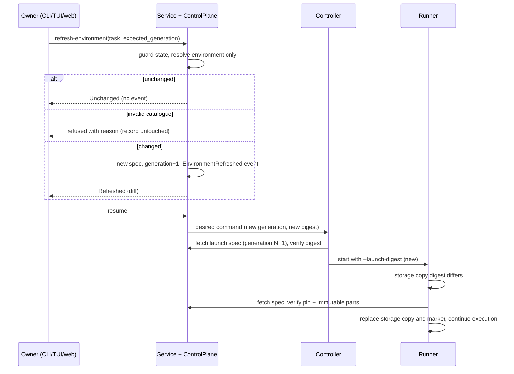

# feat: Refresh the environment of an existing task

## Summary

A new owner refresh request, sent to its own endpoint (not a new
`OwnerCommand`), re-resolves the catalogue-derived part of a stopped
task's environment, stores it in the task's launch spec under a new
generation and records an event with the difference. The runner learns to
accept a newer, verified launch spec on storage it already initialized. The
action reaches the TUI and web through the server action offer, the CLI gets
`narsor-cli task refresh-env`, and the single-task views show a drift marker.

---

## Problem Frame

A task seals its environment at creation (KTD8). A task created before
`task_image` existed cannot run in the Docker work mode, and a component added
to `runtime.yaml` never reaches a running task; today the only way out is
archive and create again, which loses progress (see origin:
docs/brainstorms/2026-11-22-refresh-task-environment-requirements.md).

---

## Requirements

- R1. Refresh from CLI, TUI and web.
- R2. Re-resolve the environment from the current catalogue; the workflow
  definition and version do not change.
- R3. Works on the local and the Kubernetes backend, with the creation rules
  of that backend.
- R4. Refused while the task has a live workload; the message says to pause.
- R5. Refused for archived or finished tasks.
- R6. All or nothing against the catalogue; the token store is not checked —
  a missing secret is reported by the controller preflight at the next start.
- R7. Written at once, no preview or confirmation.
- R8. An unchanged environment reports "nothing changed" and records nothing.
- R9. A task event names who refreshed and the difference, with old and new
  environment identity.
- R10. Single-task views mark an environment that differs from the catalogue
  and name the action.
- R11. An unresolvable catalogue shows as a catalogue problem, not as drift.
- R12. The Docker-mode "no task image" error points to the refresh.

**Origin actors:** A1 (task owner), A2 (control plane), A3 (controller and
runner)
**Origin flows:** F1 (refresh a stopped task)
**Origin acceptance examples:** AE1 (R2, R6, R12), AE2 (R4), AE3 (R6), AE4
(R8), AE5 (R10, R11)

---

## Scope Boundaries

- No refresh of the workflow definition, its version, inputs, workspace
  (repositories, branch, commit, git credentials), resources, title or
  ticket.
- No automatic refresh, preview, undo, environment history or bulk refresh
  (see origin).
- No refresh of a task whose launch spec version is too old to deserialize.
- No drift marker in the task list.
- No check of the controller's token store by the control plane.

### Deferred to Follow-Up Work

- Runtime bundle compatibility rules on Kubernetes (a newer runner resuming
  an older execution), including whether a refresh should warn when the
  bundle version changes (origin open question): no documented contract
  exists; capture with `/ce-compound` once the feature lands.

---

## Context & Research

### Relevant Code and Patterns

- Sealing: `crates/narsor-engine/src/launch.rs` (`CatalogLaunchResolver::resolve_definition`),
  `crates/narsor-engine/src/environment/resolver.rs` (`LaunchResolver`,
  `LaunchIntent`, `LaunchError`), `crates/narsor-model/src/domain/environment.rs`
  (`ResolvedEnvironment`, `TaskImage`, identity), `crates/narsor-model/src/domain/task.rs`
  (`TaskLaunchSpec`, digest checks).
- Record and mutations: `crates/narsor-engine/src/orchestration/model.rs`
  (`TaskRecord`, `RunnerState`), `crates/narsor-engine/src/orchestration/control_plane.rs`
  (`mutate`, `move_task`, `same_creation`), `crates/narsor-engine/src/orchestration/lifecycle.rs`
  (`Stopped + ReleaseSlot` bumps generation without a state change).
- Spec delivery: `crates/narsor-engine/src/controller_protocol/service/runner_channel/controller_commands.rs`
  (`desired_command`, `launch_spec`), `crates/narsor-controller-runtime/src/launch_specs.rs`
  (cache per task and generation, no re-verify on hit),
  `crates/narsor-runner/src/runner/mod.rs` (`load_spec`),
  `crates/narsor-runner/src/runner/init.rs` (`initialize`, `ForeignStorage`),
  `crates/narsor-runner/src/runner/storage.rs` (`InitializationMarker`),
  `crates/narsor-store/src/execution_store.rs` (`initialize_task_launch_spec`,
  exclusive write, `LaunchSpecConflict`).
- Owner command pattern: `move` end to end — `src/cli/remote.rs`,
  `crates/narsor-api-client/src/api/client.rs` (`control_move_task`),
  `crates/narsor-protocol/src/controller/task/owner_command.rs` (`MoveTaskRequest`),
  `crates/narsor-server/src/controller_protocol/http.rs` (`owner_routes`, `post_move`),
  `crates/narsor-engine/src/controller_protocol/service/tasks/commands.rs` (`move_task`).
- Action offer: `crates/narsor-engine/src/controller_protocol/service/tasks/actions.rs`
  (`OFFERED`, `describe`, `unavailable_reason`, `require_available`),
  `crates/narsor-protocol/src/controller/task/actions.rs` (`TaskActionId`,
  `TaskActionSend`), `src/tui/task_app/actions.rs`, `crates/narsor-web/ui/js/panel.js`
  (`resolveSend`), `crates/narsor-web/ui/js/api.js`.
- Views: `crates/narsor-engine/src/controller_protocol/service/tasks/summary.rs`,
  `crates/narsor-protocol/src/controller/task/summary.rs`, `src/cli/task_text.rs`
  (`detail_lines`, `state_hint`, `event_line`), `src/tui/task_app/tabs/info.rs`,
  `crates/narsor-web/ui/js/ui/tabs/info.js`.
- Messages: `crates/narsor-controller/src/local/container/mod.rs` (`preflight`).

### Institutional Learnings

- `docs/plans/2026-11-21-002-refactor-controller-protocol-and-state-ownership-plan.md`
  (KTD3): commands carry the spec digest; the controller fetches by generation
  and verifies; the runner prefers the storage copy.
- `docs/solutions/architecture-patterns/auto-resume-policy-for-lost-workloads-2026-10-11.md`:
  fencing by generation; `Unknown` may still have a workload; policy commands
  race with `expected_generation`.
- `docs/solutions/design-patterns/tui-panel-actions-from-server-offer-2026-11-13.md`
  and `docs/solutions/ui-bugs/tui-action-panel-refresh-stale-generation-and-lost-action-lock-2026-11-13.md`:
  one offer drives TUI and web; send the generation the operator saw.
- `docs/solutions/conventions/removing-a-field-from-serde-wire-and-persisted-types-2026-11-18.md`:
  new wire variants decode as `Unrecognized` on old clients; new view fields
  take `serde(default)`; add raw-JSON decode tests.
- `docs/plans/2026-11-21-001-feat-local-docker-work-mode-plan.md` (KTD8, KTD14):
  the image cache is keyed by the definition hash, so a refreshed
  `task_image` rebuilds without extra work.

### External References

- None; local patterns cover every layer.

---

## Key Technical Decisions

- **Environment-only resolve, not `resolve_definition`:** the record does not
  keep the original `LaunchIntent`, and re-running workspace resolution could
  move branches or pick another default backend or profile. A new resolver
  operation takes the backend id and the stored spec, keeps workspace, inputs,
  definition, resources, labels and harness, and re-resolves base and step
  images, runtime bundle, tools, the profile by its stored id, profile secret
  references and the task image. It shares helpers with `resolve_definition`
  so identities agree (needed for drift, R10).
- **Workspace secret references are kept from the old spec:** they belong to
  the workspace, which does not change.
- **Separate endpoint with `expected_generation`, not a new `OwnerCommand`:**
  refresh is not a lifecycle transition, and the `move` precedent already
  carries `expected_generation`. A new `TaskActionSend::RefreshEnvironment`
  variant routes TUI and web to it.
- **The refresh bumps `generation` and leaves `RunnerState` as it is:** the
  controller's spec cache is keyed by generation and does not re-verify on a
  hit, and pending auto-resume or slot-release commands become stale (they
  lose the race, which is the wanted result). Precedent: `Stopped +
  ReleaseSlot`.
- **Allowed runner states:** `Stopped`, `Interrupted` (including exhausted
  auto-resume) and `Queued` without a reservation. All others are refused
  with a reason (R4). A task whose derived `TaskState` is `Finished` is also
  refused, whatever its runner state, with the existing "zadanie jest
  zakończone" reason (R5). Auto-resume counters are not reset; an owner
  `resume` clears them as today (D58). An `Interrupted` task with attempts
  left is resumed by the policy at the new generation soon after the
  refresh — this is intended.
- **Runner replaces the storage copy only for an environment-only change:**
  when the storage copy's digest differs from `--launch-digest`, the runner
  fetches the served spec, verifies it against the pinned digest and
  `digest_is_valid`, and requires task id, workflow id and version,
  definition, inputs, workspace, resources, ticket and title to equal the
  storage copy. Any other difference stays `ForeignStorage`. The two files
  cannot be written atomically together, so the order is fixed: the marker
  first (same task and workspace commit, new digest), then the spec copy. A
  crash between the two leaves the old copy, and the next start takes the
  replacement path again.
- **Drift is computed only on the single-task detail request:** it compares
  the stored environment identity with the identity the environment-only
  resolve would produce now, loading the catalogue once. The task list does
  not carry it (resolve per task is too costly). The TUI and web Info tabs
  read only list summaries today, so they gain a detail fetch (U7).
- **Requester comes from the authenticated principal:** the request body has
  no requester field; the event's "who" is the server-side owner reference.
- **Diff in the event is structural, built from the two environments:** added,
  removed and changed task-image components, secret references, images,
  bundle, tools and profile version, plus both identities (R9).
- **Name:** CLI `task refresh-env`, action label "Odśwież środowisko"
  (owner UI text is Polish), to avoid a clash with `narsor-cli image refresh`.

---

## Open Questions

### Resolved During Planning

- Token store check (origin R6): not done by the control plane; the user
  chose "check at start".
- Which states count as "no live workload": runner states above, not
  `TaskState` (`HumanNeeded` can hold a live runner).
- Idempotent create after a refresh: service paths match `request_digest`
  before resolving, so a retry still returns the task; only records without a
  `request_digest` would conflict, which is acceptable.

### Deferred to Implementation

- Exact name and shape of the resolver operation and the event payload type.
- Whether the reader mode needs to accept a refreshed spec before the first
  resume (it reads only the storage copy and does not check the digest; likely
  no change).
- Whether the detail endpoint is a flag on the existing task fetch or a
  separate call.

---

## High-Level Technical Design

> *This illustrates the intended approach and is directional guidance for review, not implementation specification. The implementing agent should treat it as context, not code to reproduce.*

---

## Implementation Units

### U1. Environment-only resolve

**Goal:** Resolve a new `ResolvedEnvironment` for an existing spec from the
current catalogue, with the same rules as creation.

**Requirements:** R2, R3, R6

**Dependencies:** None

**Files:**
- Modify: `crates/narsor-engine/src/launch.rs`
- Modify: `crates/narsor-engine/src/environment/resolver.rs`
- Test: `tests/integration/environment.rs` (helpers in `tests/integration/environment_support/mod.rs`)

**Approach:**
- Extract the environment steps of `resolve_definition` (runtime, base image
  precedence KTD9, task image sealed on the local backend only as at
  creation, step images, profile, bundle, tools, profile secrets) into a
  shared helper used by both paths.
- Add a required `LaunchResolver` operation (no default implementation);
  update the test fakes, so every resolver must handle refresh.
- Inputs: backend id from the record and the stored spec.
- Profile: the stored profile id; the id `DEFAULT_PROFILE` with no profile
  file resolves to the empty profile, as an implicit profile does at
  creation; any other missing id is an error.
- Repository `base_image` (deprecated precedence step): look up the registry
  entry by the primary repository identity in the stored workspace; a
  missing entry is a resolve error.
- Workspace secret references are rebuilt from the git identities of the
  stored workspace (the flat secret set does not say where each came from),
  not filtered from the old set.
- Returns the same `LaunchError` kinds as creation, so the refusal reason
  matches what `task create` would say.

**Patterns to follow:**
- `resolve_definition` in `crates/narsor-engine/src/launch.rs`; resolver tests
  with `seed_catalog` and `write_task_image`.

**Test scenarios:**
- Happy path: a spec sealed without `task_image`, catalogue now defines one →
  the new environment carries the sealed task image and a new identity; the
  workflow definition, inputs and workspace in the spec are unchanged.
- Happy path: unchanged catalogue → identity equals the stored one (basis for
  R8 and drift).
- Edge case: stored profile id no longer in the catalogue → error naming the
  profile, no default profile substituted.
- Edge case: task sealed with the implicit default profile on an
  installation without profile files → refresh succeeds; with an unchanged
  catalogue the identity is unchanged.
- Edge case: task sealed with a repository `base_image` on a container
  backend → the same base image is resolved again (no false drift).
- Error path: invalid `runtime.yaml` → `InvalidRuntime` with the problems.
- Integration: on a Kubernetes-kind backend, a changed runtime bundle in the
  catalogue appears in the new environment; the task image is not sealed
  (same rule as creation).

**Verification:**
- Resolving at creation and refreshing an unchanged catalogue give equal
  identities.

---

### U2. Runner accepts a newer verified spec on initialized storage

**Goal:** A runner started with a new pinned digest on storage that holds an
older spec of the same task continues the execution.

**Requirements:** R2, R3 (enables F1)

**Dependencies:** None (can land before U3; old behaviour is unchanged while
no refresh exists)

**Files:**
- Modify: `crates/narsor-runner/src/runner/mod.rs`
- Modify: `crates/narsor-runner/src/runner/init.rs`
- Modify: `crates/narsor-runner/src/runner/storage.rs`
- Modify: `crates/narsor-store/src/execution_store.rs`
- Test: `crates/narsor-runner/src/runner/session_tests.rs`, `crates/narsor-runner/src/runner/init.rs` (tests), `crates/narsor-store/src/execution_store.rs` (tests)

**Approach:**
- In spec loading: when the storage copy does not match the pinned digest,
  fetch the served spec, check it against the pin and `digest_is_valid`, and
  compare the immutable parts with the storage copy (task id, workflow id and
  version, definition, inputs, workspace, resources, ticket, title). Equal →
  accept; else refuse as today.
- Spec loading returns an "accepted replacement" result that `initialize`
  receives, so `initialize` accepts the marker of the same task on that path
  only.
- Add a store operation that replaces the stored launch spec atomically (not
  exclusive) and a marker update for the new digest. Write order: marker
  first, then the spec copy.
- Keep the existing refusal text for a genuinely foreign storage.

**Execution note:** Start with a failing test for "storage copy with old
digest + new pin + valid served spec".

**Patterns to follow:**
- `write_json_atomic_exclusive` and its non-exclusive sibling in the store;
  existing `ForeignStorage` checks in `init.rs`.

**Test scenarios:**
- Happy path: storage holds spec A, pin is digest of B, B differs only in
  environment → runner replaces the copy and marker and loads B; a second
  start with pin B uses the storage copy without fetching.
- Error path: served spec does not match the pin → refused, storage unchanged.
- Error path: B differs from A in workflow definition (or inputs, or
  workspace) → refused as foreign storage, storage unchanged.
- Error path: served spec has a tampered environment identity
  (`digest_is_valid` false) → refused.
- Edge case: pin equals the storage digest → no fetch (unchanged behaviour).
- Edge case: crash after the marker write and before the spec write → the
  next start takes the replacement path again and succeeds.
- Error path: served spec differs only in title or ticket → refused.

**Verification:**
- A refreshed task resumes on its storage; no path writes the copy without
  both checks passing.

---

### U3. Control-plane refresh mutation and event

**Goal:** Store a new environment on a task record with guard, generation
bump and event, atomically.

**Requirements:** R4, R5, R7, R8, R9

**Dependencies:** U1

**Files:**
- Modify: `crates/narsor-engine/src/orchestration/control_plane.rs`
- Modify: `crates/narsor-engine/src/orchestration/model.rs`
- Modify: `crates/narsor-protocol/src/controller/task/events.rs`
- Modify: `crates/narsor-model/src/domain/environment.rs` (environment diff)
- Test: `tests/integration/orchestration.rs`, `crates/narsor-model/src/domain/environment.rs` (tests), `crates/narsor-protocol/src/controller/task/events.rs` (decode test)

**Approach:**
- A control-plane operation takes task id, the new environment, the
  requester and `expected_generation`; uses `mutate`; refuses on generation
  mismatch, on disallowed runner states (with a reason per state), on
  archival states and on a `Finished` task. The guard is one function shared
  with the action offer (U5).
- The requester is the authenticated owner reference passed by the service,
  never a request field.
- Rebuilds the spec with the new environment (re-seal identity and digest),
  bumps `generation`, keeps `RunnerState`, resume counters and the
  reservation.
- Equal identity → no mutation, outcome "unchanged".
- New `TaskEventKind` variant (environment refreshed) carrying requester, old
  and new identity and a structural diff; it decodes as `Unrecognized` on old
  clients.

**Patterns to follow:**
- `ControlPlane::move_task` (expected generation) and `mutate`;
  `OperatorCommandQueued.requested_by` for "who".

**Test scenarios:**
- Happy path: `Stopped` task, new environment → generation +1, spec digest
  changes, workflow/inputs/workspace unchanged, one event with both
  identities and the added component.
- Covers AE4. Same identity → outcome unchanged, generation and revision
  unchanged, no event.
- Covers AE2. `Running`, `Provisioning`, `PauseRequested`, `Unknown`,
  `Queued` with reservation, and `Stopped` with a completed execution
  (finished) → refused, record unchanged (table-driven).
- Edge case: `Interrupted` with exhausted auto-resume → allowed; the state
  stays `Interrupted` and a pending auto-resume command for the old
  generation is refused as stale.
- Error path: archived or archiving task → refused (R5).
- Error path: stale `expected_generation` → stale-generation refusal.
- Integration: after refresh, the served launch spec for the new generation
  verifies against the new digest; a fetch for the old generation is refused.
- Raw JSON of the new event decodes; an unknown kind still decodes as
  `Unrecognized`.

**Verification:**
- The record either has the old spec and generation or the new ones, never a
  mix.

---

### U4. Service, HTTP route and API client

**Goal:** Expose the refresh to owners over `/control/v1`.

**Requirements:** R1, R6, R7, R8

**Dependencies:** U1, U3

**Files:**
- Create: `crates/narsor-engine/src/controller_protocol/service/tasks/refresh.rs`
- Modify: `crates/narsor-engine/src/controller_protocol/service/tasks/mod.rs`
- Modify: `crates/narsor-protocol/src/controller/task/owner_command.rs` (request and outcome types)
- Modify: `crates/narsor-server/src/controller_protocol/http.rs`
- Modify: `crates/narsor-api-client/src/api/client.rs`
- Test: `tests/integration/web_ui.rs` or a new `tests/integration/refresh_environment.rs` with `ProtocolService::new`

**Approach:**
- Service: `owned_task` → availability check (shared with the offer) →
  environment-only resolve (U1) → control-plane mutation (U3) → notify and
  reschedule.
- Resolve errors map to a client error with the resolver's reason; the record
  is untouched (R6).
- Response distinguishes "refreshed" (with the diff summary) and
  "unchanged".
- Route: `POST /control/v1/tasks/{task_id}/refresh-environment`; the web
  gateway already passes every `/control/v1/` path.

**Patterns to follow:**
- `move_task` in `service/tasks/commands.rs`, `post_move` in `http.rs`,
  `control_move_task` in the API client.

**Test scenarios:**
- Covers AE1. Interrupted task without task image, catalogue with
  `task_image` → refreshed; the next desired command carries the new digest
  and generation.
- Covers AE3. Invalid `runtime.yaml` → refused with the catalogue problem;
  task still resumable with its old spec.
- Covers AE3. Valid catalogue adds a component whose secret is not in the
  token store → refresh succeeds with the diff; the next start in Docker mode
  is refused by preflight naming the missing secret; after the secret is
  stored, the next resume starts (controller side with the docker fake in
  `crates/narsor-controller/src/local/container/tests.rs`).
- Error path: a requester field in the body is ignored; the event names the
  authenticated owner.
- Error path: another owner's task → not found (network mode).
- Happy path: unchanged catalogue → "unchanged" response.

**Verification:**
- The full owner path works over HTTP with a real `ProtocolService`.

---

### U5. Action offer, TUI and web

**Goal:** The refresh appears as an action with an availability reason in
the TUI and web panels.

**Requirements:** R1, R4, R5

**Dependencies:** U4

**Files:**
- Modify: `crates/narsor-protocol/src/controller/task/actions.rs`
- Modify: `crates/narsor-engine/src/controller_protocol/service/tasks/actions.rs`
- Modify: `src/tui/task_app/actions.rs`
- Modify: `crates/narsor-web/ui/js/panel.js`, `crates/narsor-web/ui/js/api.js`
- Test: `crates/narsor-engine/src/controller_protocol/service/tasks/actions.rs` (tests), `tests/integration/tui_panel.rs`, `crates/narsor-web/ui-tests/`

**Approach:**
- New `TaskActionId` and `TaskActionSend` variants, both with forward-
  compatible decoding; `describe()` gives the Polish label and description;
  `unavailable_reason()` reuses the U3 state rules so offer and command agree.
- TUI and web send the generation shown at the choice; a stale generation
  surfaces as the existing stale-generation message.

**Patterns to follow:**
- Offer entries for `Resume`/`Archive`; `resolveSend` routing in `panel.js`.

**Test scenarios:**
- Happy path: offer for a `Stopped` task lists the action as available.
- Covers AE2. Offer for a running task lists it unavailable with the "pause
  first" reason.
- Edge case: older-client decoding of the new send variant falls back to the
  "requires a newer client" path (raw JSON test).
- Integration: TUI panel sends the refresh and shows the outcome; web panel
  calls the new endpoint (ui-tests, run manually with `node --test`).

**Verification:**
- Offer and command refuse exactly the same states.

---

### U6. CLI subcommand and event text

**Goal:** `narsor-cli task refresh-env <task>` and readable event lines.

**Requirements:** R1, R8, R9

**Dependencies:** U4

**Files:**
- Modify: `src/cli/remote.rs`
- Modify: `src/cli/task_text.rs`
- Test: `tests/integration/cli_task_text.rs`

**Approach:**
- Read the task's current generation, send the request (as `move` does),
  print "refreshed" with the diff summary, or "nothing changed".
- `event_line` renders the new event (shared by CLI and TUI).

**Test scenarios:**
- Happy path: the refreshed outcome prints added/removed components and both
  identities.
- Covers AE4. "Unchanged" prints a single "nothing changed" line.
- Happy path: the event line shows who refreshed and the change count.

**Verification:**
- `task events` shows the refresh between the interruption and the resume.

---

### U7. Drift marker in single-task views

**Goal:** Show when the stored environment differs from the catalogue.

**Requirements:** R10, R11

**Dependencies:** U1

**Files:**
- Modify: `crates/narsor-protocol/src/controller/task/summary.rs` (optional drift field, `serde(default)`)
- Modify: `crates/narsor-engine/src/controller_protocol/service/tasks/summary.rs` (detail path only)
- Modify: `src/cli/task_text.rs` (`detail_lines` / attention)
- Modify: `src/tui/task_app/tabs/info.rs` and the TUI app state under `src/tui/task_app/` (detail fetch)
- Modify: `crates/narsor-web/ui/js/ui/tabs/info.js`, `crates/narsor-web/ui/js/api.js`
- Test: `tests/integration/cli_task_text.rs`, `tests/integration/tui_state.rs`, service test for the detail path

**Approach:**
- Drift states: current, differs (name the refresh action), catalogue problem
  (with the reason), not applicable (archived tasks).
- Computed only for the single-task fetch, never in list or action-offer
  summaries.
- The TUI and web Info tabs read only list summaries today; they request the
  single task with drift when the tab opens and again after an
  environment-refreshed event for that task. No marker while loading; a
  failed fetch shows "drift unknown".

**Test scenarios:**
- Covers AE5. Catalogue adds a component → detail shows "differs" and the
  action name.
- Covers AE5. Broken `runtime.yaml` → detail shows the catalogue problem, not
  drift.
- Edge case: unchanged catalogue → no marker.
- Edge case: list summaries carry no drift field (cost guard).

**Verification:**
- `task show`, TUI Info and web Info agree for the same task.

---

### U8. Messages and documentation

**Goal:** Point users to the refresh and document the new rules.

**Requirements:** R12

**Dependencies:** U4, U6

**Files:**
- Modify: `crates/narsor-controller/src/local/container/mod.rs` (preflight message)
- Modify: `crates/narsor-controller/src/local/container/tests.rs`
- Modify: `docs/operations/updates.md` (upgrade order: control plane, then
  controllers and runners, then clients; use refresh only after runners are
  updated; on Kubernetes the runner comes from the sealed runtime bundle, so
  publish a bundle with the U2 runner and set it in `runtime.yaml` before
  refreshing any task)
- Modify: `docs/user/local-docker.md`, `docs/dev/domain-model.md`,
  `docs/dev/architecture.md` (the launch spec is immutable except for the
  environment refresh)

**Approach:**
- The preflight text names `narsor-cli task refresh-env` instead of "must be
  created again".

**Test scenarios:**
- Covers AE1. The Docker preflight refusal for a task without a task image
  names the refresh command.

**Verification:**
- No doc still states that the environment can never change after creation.

---

## System-Wide Impact

- **Interaction graph:** owner API → service → control plane → controller
  desired command → controller spec cache → runner storage. Auto-resume and
  slot-release policies race through `expected_generation`.
- **Error propagation:** resolver errors stop at the service (record
  untouched); a missing token-store secret surfaces at the next start through
  the existing preflight → workload lost → auto-resume path.
- **State lifecycle risks:** partial write between record and storage is
  avoided — the record changes first, the runner rewrites storage only after
  verification; an interrupted rewrite leaves either the old or the new copy
  (atomic write), and the next start repeats the check.
- **API surface parity:** CLI, TUI and web all go through the same endpoint
  and offer rule.
- **Integration coverage:** refresh → resume → runner on existing storage
  (U2 + U4) needs an end-to-end test with real storage, not only unit tests.
- **Unchanged invariants:** the workflow, inputs and workspace of a task never
  change after creation; spec digest pinning still binds the workflow,
  inputs and workspace; tasks that are never refreshed behave exactly as
  today.
- **Changed trust model:** after U2 the environment part of an initialized
  task is control-plane-authoritative — a control plane can change images,
  tools, bundle and secret names of a stopped task. Before the change, the
  storage copy anchored them after the first start.

---

## Risks & Dependencies

| Risk | Mitigation |
|------|------------|
| Old runner meets a refreshed spec and fails as foreign storage | Upgrade-order note (U8); failure is loud and recoverable after the upgrade |
| Kubernetes: the refresh seals a runtime bundle whose runner predates U2 | U8 note: publish and select a U2-capable bundle before any refresh |
| Newer runtime bundle cannot resume an older execution on Kubernetes | Accepted risk (origin Key Decisions); fix catalogue and refresh again; follow-up to document compatibility |
| Offer and command disagree on allowed states | One shared guard used by both (U3, U5) |
| Identity mismatch between creation and refresh produces false drift | Shared resolve helper (U1) and the "unchanged catalogue → equal identity" test |
| Runner replacement path weakens tamper checks | Pin + `digest_is_valid` + immutable-part equality, each with a refusal test (U2) |

---

## Documentation / Operational Notes

- Upgrade order in `docs/operations/updates.md` (U8).
- After landing, record the runner storage replacement rule and bundle
  compatibility findings with `/ce-compound`.

---

## Sources & References

- **Origin document:** [docs/brainstorms/2026-11-22-refresh-task-environment-requirements.md](../brainstorms/2026-11-22-refresh-task-environment-requirements.md)
- Related plans: `docs/plans/2026-11-21-001-feat-local-docker-work-mode-plan.md`,
  `docs/plans/2026-11-21-002-refactor-controller-protocol-and-state-ownership-plan.md`
- Related follow-up: `docs/follow-ups/2026-11-21-per-workflow-secrets.md`
