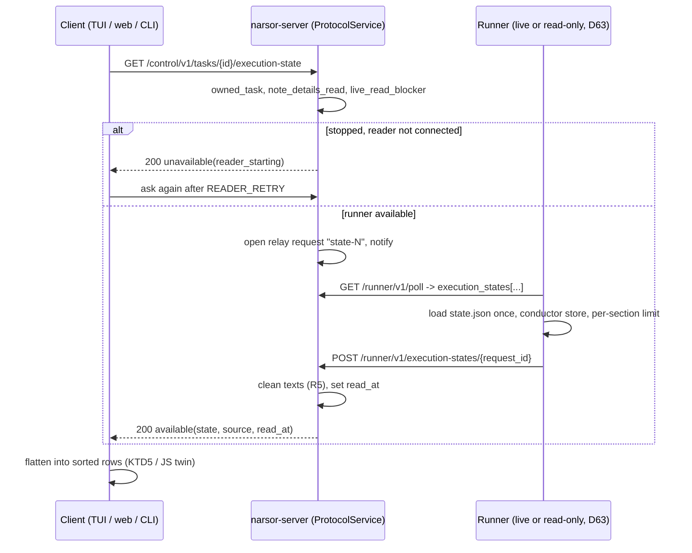
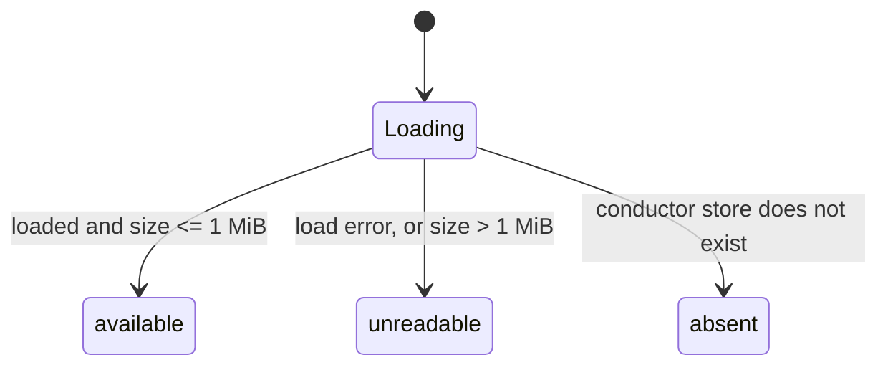

# Task State Preview - Plan

## Goal Capsule

- **Objective:** The owner of a local or Kubernetes task can read every value the workflow sees now (context, step locals, conductor state) in the TUI, the web interface or the CLI, without access to the task storage.
- **Means:** A new owner-only relayed read, built like `execution-details` (KTD1), that returns structured sections (KTD2). One Rust function and one matching JS function flatten them into sorted `path: value` rows (KTD5, KTD6).
- **Authority:** The Product Contract (R-IDs) wins on behavior. KTDs win on mechanism. Units override neither. Where a unit and a KTD disagree, the KTD wins.
- **Execution profile:** One pull request. All units ship together. No unit needs a separate deploy.
- **Stop conditions:** Stop and ask if implementation shows that the relay cannot carry a new read kind without a change to the runner credential model, or that `state.json` does not hold the step locals for a stopped task.
- **Who finishes:** `ce-work` implements, verifies and opens the PR.

---

## Product Contract

Product Contract preservation: changed: R4, R6, R8, R10. The origin names the `context.json` sections `artifacts_index` and `workspace_info`. The stored file has the keys `task`, `variables`, `artifacts`, `repositories`, `workspace` and `workspace_prs` (`crates/narsor-model/src/domain/context.rs`). R4 and R6 now use the stored keys. Scope is unchanged: R4 already asks for "all sections". R8 states the per-section sort that the origin review gave as the intended reading. R10 drops the origin words "the refresh key of the other tabs", because the TUI task view has no such key. KTD8 chooses the key (Q5). The origin's R7 and Z4 are kept as written; the review items about them are in "Pytania otwarte dla użytkownika".

### Summary

The owner opens a preview of the complete execution state of one task: all of the context, the step locals and the conductor's state. The TUI (*Stan* tab), the web interface and the CLI (`narsor-cli task state`) show it as one flat, sorted list of `path: value` rows. The server keeps nothing: at each request it asks the task's runner through the existing relay, or the read-only runner of D63 for a stopped task.

### Problem Frame

Today the owner sees only parts of the state. `narsor-cli show --details` prints the context variables as one-line JSON, so a multi-line value (a plan, an agent summary) is hard to read. The TUI and the web interface do not show context variables at all. Nothing shows the other context sections, the step locals (`metadata.engine.step_locals` in `state.json`) or the conductor's `ConductorState`. To debug a wrong `when` branch, an empty template or a silent conductor, the operator must open the task storage on disk or in the pod. That does not work for the owner of a remote task. (see origin: docs/brainstorms/2026-11-22-task-state-preview-requirements.md)

### Actors

- A1. Task owner: opens the preview in the TUI, the web interface or the CLI.
- A2. Control plane (`narsor-server`): checks ownership, asks the runner through the relay, cleans the answer and returns it.
- A3. Runner (`narsor-runner`, live or read-only): reads the execution record (`state.json`) and the conductor store, and uploads the state (KTD3).

### Key Flows

- F1. Preview of a running task
  - **Trigger:** The owner opens the *Stan* tab, the web state view, or runs the CLI command.
  - **Actors:** A1, A2, A3
  - **Steps:** The client asks the server. The server opens a relay request and wakes the runner's long-poll. The runner reads each section of its storage and uploads the state. The server cleans the texts and answers. The client flattens and shows the rows.
  - **Outcome:** The owner sees the state at the time of the read. Each section is read separately (KTD3).
  - **Covered by:** R1, R2, R4, R6
- F2. Preview of a stopped task
  - **Trigger:** Same as F1, for a paused, failed or finished task that is not archived.
  - **Steps:** The server has the controller start a read-only runner (D63). Until it connects, the answer is `reader_starting` and the client asks again. Then as in F1.
  - **Covered by:** R2, R3
- F3. Reading a long value in the TUI
  - **Trigger:** A row shows a folded multi-line value.
  - **Steps:** The owner moves the cursor to the row and presses `Enter`. The row unfolds to all lines. `Enter` again folds it.
  - **Covered by:** R11, R12

### Requirements

**Source of data**

- R1. The server gives a new owner-only read of the complete execution state of one task, with the same ownership check as `execution-details`.
- R2. The server does not keep or cache the state. At each request it asks the task's runner through the relay: the live runner while the task runs, the read-only runner (D63) while it is stopped.
- R3. When the state cannot be read, the answer says why, with the reasons the existing reads use (`not_started`, `reader_starting`, `archived`, the other `ConversationUnavailableReason` values). A runner that does not answer in time gives a retryable `503`, as today.
- R4. The state contains:
  - `context`: all sections of the execution context as stored (`task`, `variables`, `artifacts`, `repositories`, `workspace`, `workspace_prs`, and any section added later).
  - `locals`: the step locals, per step (`state_id → { NAME: value }`).
  - `conductor`: all fields of `ConductorState` and the conductor's generated title when it has one. When the task has no conductor state, the section says so.
- R5. The server cleans the texts of the state (names and values) before it answers, as `execution-details` does (`without_unsafe_chars`, `without_unsafe_chars_json`).

**Flat list (all interfaces)**

- R6. Each interface shows the state as a flat list of `path: value` rows. The path joins the keys with `:`, starting with the section: `context:variables:NAME`, `context:artifacts:NAME:location`, `locals:STATE_ID:NAME`, `conductor:failure:reason`.
- R7. JSON objects are flattened down to their leaves. A JSON array stays one row whose value is the compact JSON of the array. An empty object is one row with the value `{}`.
- R8. A string value is shown as its text, without JSON quotes or escapes, so a multi-line string keeps its real lines. Other values (number, bool, `null`, array) are shown as compact JSON. Rows are sorted by path within each section, and the sections come in the fixed order `context`, `locals`, `conductor`.
- R9. One flattening function produces the rows for the TUI and the CLI. The web interface follows the same rules (R6–R8).

**TUI**

- R10. The task view has a new tab *Stan*. It reads the state when the owner opens it and when the owner asks for a refresh. It does not read again in the background, except that after `reader_starting` it asks again until it gets the state or another reason.
- R11. A row whose value has more than one line, or one line wider than the screen, shows only the first line clipped to the width, with the collapsed marker of the conversation view (`›`). An unfolded row uses the expanded marker (`⌄`) and shows every line, wrapped to the width. A value that fits on one line has the neutral marker (`·`).
- R12. A cursor selects one row. The movement keys of the conversation view move it (line up/down, page up/down, start/end). `Enter` folds or unfolds the selected row. When the selected row is unfolded and taller than the screen, the movement keys first scroll inside it, and move to the next row only when the first or last line of the value is in view. Unfolded rows stay unfolded after a refresh when their path still exists.
- R13. The tab shows the reason of R3 when there is no state, and the time of the read when there is one.

**Web interface**

- R14. The web task view has the same list. A row that R11 folds in the TUI is folded to one line with the same marker. A click, or `Enter` on the focused row, unfolds it, and the same action folds it again. The view shows the reason of R3 when there is no state, and the time of the read when there is one.

**CLI**

- R15. A CLI command prints the flat list of one task, one row per line. A multi-line value is printed in full, with its next lines indented under the row. A `--json` option prints the unflattened state as JSON. When there is no state, the command prints the reason of R3 to the error output and exits with a non-zero status.

### Acceptance Examples

- AE1. **Covers R6, R7, R8.** Given `variables = { "branch": "feat/x", "pr": 12, "files": ["a", "b"] }`, the list has the rows `context:variables:branch: feat/x`, `context:variables:files: ["a","b"]` and `context:variables:pr: 12`, in this order.
- AE2. **Covers R11, R12.** Given a variable `plan` with three lines, the *Stan* tab shows `› context:variables:plan: <first line>`. With the cursor on the row, `Enter` shows `⌄ context:variables:plan:` with all three lines. `Enter` again folds it.
- AE3. **Covers R2, R3.** Given a paused task whose read-only runner is not yet connected, the *Stan* tab says that the reader is starting and asks again. When the runner connects, it shows the state.
- AE4. **Covers R3.** Given an archived task, every interface says that the storage was deleted and shows no rows.
- AE5. **Covers R4.** Given a task whose conductor waits on a failed step, the list has rows under `conductor:failure:` and `conductor:pending:`.

### Success Criteria

- The owner can answer "what value does the workflow see now?" for any variable of a local or Kubernetes task without access to the task storage.
- The TUI, the web interface and the CLI show the same rows for the same state.
- A multi-line value of hundreds of lines takes one row in the *Stan* tab until the owner unfolds it.

### Scope Boundaries

- Read-only. The preview does not edit a variable or the conductor's state.
- No live updates: the state is read on demand (R2, R10).
- No search, filter or clipboard copy in the list.
- The *Dyrygent* tab does not change. *Stan* shows only the raw `ConductorState` fields and the title (R4).
- No change to `show --details` or to the `execution-details` read.
- No history of the state (values at an earlier step).
- Artifact contents are not shown, only their entries in `context:artifacts`.

**Considered and not built**

- A per-value size limit that replaces only the oversized value. One section limit (KTD4) already makes an oversized state visible. Build it if owners report that one large variable hides the rest of the context.
- An escape for a `:` inside a key. Paths are display text only, and `--json` gives the exact structure. Build it if a client starts to parse paths.
- Re-reading the state when the task's revision changes. R10 and Z7 forbid background reads.

### Key Decisions

- **A new read, not a wider `execution-details`.** The summary read stays small and fast. Governs R1, R2.
- **The runner sends structured state; the client flattens it.** `--json` and future clients get the structure. Governs R4, R9, R15.
- **Strings unquoted, other values as JSON.** Text reads as text. As a result `12` and `"12"` both show as `12`; `--json` shows exact types. Governs R8.

### Dependencies / Assumptions

- The relay and the read-only runner of D63 serve this read in the same way as `execution-details` and `conductor`.
- The context does not store large blobs (domain model §2.6), so a normal read is small. KTD4 protects the server anyway.
- Only the task owner can read the state. The preview does not mask values (origin Z9; see Pytania otwarte, Q1).

---

## Planning Contract

### Key Technical Decisions

- KTD1. **Endpoint, wire names and CLI command.** Owner route `GET /control/v1/tasks/{task_id}/execution-state` (T16 in the wire reference). Runner upload route `POST /runner/v1/execution-states/{request_id}`. Poll field `execution_states` on `RunnerPollResponse`, with `#[serde(default)]` so older runners and servers keep working. CLI command `narsor-cli task state TASK_ID [--json]`. The relay timeout is the existing `conversation_page_timeout`. The names follow `execution-details` and the `task` subcommands, which take task ids.
- KTD2. **Wire shape.** The protocol types live in `crates/narsor-protocol/src/controller/relay.rs` beside `ExecutionDetails`. `ExecutionState` has three sections, `context`, `locals` and `conductor`. Each is a `StateSection`: `available { value }` (a JSON value), `absent { message }`, or `unreadable { reason }`. `ExecutionStateResponse` is `available { state, source, read_at }` or `unavailable { reason, message }`, tagged by `status` like `ExecutionDetailsResponse`. The server sets `read_at` when the upload arrives, so the time comes from the trusted clock. Section values are raw JSON, so new fields of `Context` or `ConductorState` appear without a wire change (R4 "any section added later").
- KTD3. **Each section is read and reported separately.** The runner loads the execution record (`state.json`) once and takes both `context` and `locals` from it. `state.json` is the authority, and `context.json` is only a projection of the same context (`crates/narsor-store/src/execution_store.rs`), so the two sections come from one consistent snapshot. The conductor section comes from `ConductorStore` (`load_state` and `load_generated_title`). It is `absent` when the store does not exist. A source that fails to load makes its section `unreadable` with the error text. It never shows as empty. The whole read fails (relay failure, `503 runner_read_failed`) only when the execution record cannot load. This closes the origin review item "a section that fails to load looks empty" (Q4).
- KTD4. **One size limit per section.** The runner serializes each section. A section over `MAX_STATE_SECTION_BYTES` (1 MiB) is sent as `unreadable` with a reason that gives its size and the limit. The upload route gets an explicit `DefaultBodyLimit` of 4 MiB (three full sections plus envelope), because the axum default of 2 MiB would turn a valid state into a `503`. The oversize error is visible in the section that caused it, and the other sections still show (Q2).
- KTD5. **The flattening function is in the client library.** It is in `src/client/state_rows.rs`, registered in `src/client_lib.rs`. It takes an `ExecutionState` and returns ordered rows (path, display value, line count). Both the TUI and the CLI use it (R9). A non-`available` section gives one row whose path is the section name and whose value is its message or reason in parentheses, for example `conductor: (no conductor state)`.
- KTD6. **One fixture keeps the Rust and JS flattening equal.** `crates/narsor-web/ui-tests/fixtures/state-rows.json` holds input states and the expected rows, starting with AE1. A Rust test (via `include_str!`) and a `node --test` test both check it. Without it, nothing would catch the two copies drifting apart (success criterion "same rows").
- KTD7. **TUI read model.** A new `DetailJob::State` runs through `Background`, like the *Info* tab's `Drift` read. `TaskApp::start_detail_reads` starts it only when *Stan* is the active tab and the tab needs a read: it was never read, the owner asked for a refresh, or the answer was `reader_starting` and `READER_RETRY` (2 s) has passed. The list refresh (`DetailState::invalidate_changed`) does not invalidate it (R10).
- KTD8. **TUI refresh key `R`.** There is no manual refresh key in the TUI task view today, so R10's "refresh key of the other tabs" does not exist. The plan binds `R` in `Context::Details`, scoped to the *Stan* tab ("zakładka Stan: odczytaj stan ponownie"). `r` is `RetrySend`, and `R` is free in `Context::Details` (Q5).
- KTD9. **Web read model.** The state view uses `useRead` (`crates/narsor-web/ui/js/ui/read.js`) keyed on the task id and a local refresh counter, not on the revision. `useRead` retries only a thrown error with code `conversation_reader_starting`, so the view's load function turns a `200 unavailable(reader_starting)` answer into that error. The existing 1500 ms retry then applies. Every other `unavailable` answer stays data, and the view shows its reason (R3). Only an "Odśwież" button increases the counter. The global key handler in `ui/js/ui/app.js` already maps `u`, `Enter` and `Space` to other actions, so the view binds no refresh key.
- KTD11. **Loading and failure display, TUI and web.** Before the first answer, the tab shows a short "odczytuję stan…" line. A re-read keeps the old rows and the old read time, with a marker that a read is running. A `503` or connection error keeps the old rows and shows a retryable error note. When there are no old rows, the note is shown alone. The texts follow the existing error texts of the *Dyrygent* tab in each interface.
- KTD10. **Reading the state is a details read.** `ProtocolService::execution_state` calls `note_details_read` like `execution_details`, so reading a stopped task extends its slot release deadline in the same way (D62).

### High-Level Technical Design

The read follows the existing relay sequence. Only the payload and the names are new.

The section status rules form a small state model per section:

### Assumptions

These are unconfirmed choices. The plan builds them; each matches the recommended option of a question in "Pytania otwarte dla użytkownika".

- All sections are shown to the owner, unmasked (Q1).
- A per-section size limit of 1 MiB (KTD4, Q2).
- Arrays stay one row, as R7 says, including the arrays of objects in the conductor (`queue`, `unapplied_decisions`) (Q3). The array branch of the flattening is one place in each implementation, so a later change touches only that branch and the fixture.
- Per-section read status (KTD3, Q4).
- `R` is the refresh key of the *Stan* tab (KTD8, Q5).
- The *Stan* tab sits after *Dyrygent* and before *Info*, in the TUI and in the web (origin Z6).
- The TUI and web `reader_starting` retries have no attempt limit, like the *Dyrygent* tab. The CLI waits up to `READER_WAIT` (30 s), like `show --details`.

### System-Wide Impact

- **Rolling upgrade:** an older runner ignores `execution_states`. The owner then gets `503 runner_timeout` until the runner is updated. An older server never sends the field. No stored data changes.
- **Slot deadlines:** reading the state of a stopped task extends its release deadline, like other details reads (KTD10).
- **Security:** the read is owner-only. Runner texts are cleaned on the way in (R5). The runner can answer only its own task's requests (`Relay::take`).
- **Web gateway:** `is_proxied` already passes every `/control/v1/` path. No gateway change.

### Risks & Dependencies

| Risk | Mitigation |
|---|---|
| Three sections at the 1 MiB limit make an upload of about 3 MiB, which can be slow on a remote backend. | The 4 MiB upload limit accepts it. A slow relay gives a retryable `503`. |
| The TUI scroll-inside-a-row behavior (R12) has no existing code to reuse. | U6 builds it in the tab module on `ScrollState` (`src/tui/scroll.rs`), with tests at the visible-line level. |
| The Rust and JS flattening drift apart. | KTD6 fixture. |

---

## Implementation Units

### U1. Wire types and the runner-side state reader

**Goal:** Define the state on the wire and read it from a task's storage.

**Requirements:** R4, KTD2, KTD3, KTD4

**Dependencies:** none

**Files:**
- `crates/narsor-protocol/src/controller/relay.rs` (`ExecutionStateRequest`, `ExecutionState`, `StateSection`, `ExecutionStateResponse`)
- `crates/narsor-protocol/src/controller/runner/poll.rs` (`execution_states` field)
- `crates/narsor-exec/src/api/state.rs` (new: `execution_state(store, execution_id)`), `crates/narsor-exec/src/api/mod.rs`
- `crates/narsor-exec/src/engine/runner/step/step_memory.rs` (a crate-visible reader of all step locals)
- `crates/narsor-controller-client/src/wire.rs` (re-exports)
- Test: `crates/narsor-exec/src/api/state.rs` (unit tests over a temp `ExecutionStore`)

**Approach:**
1. Add the protocol types per KTD2, with serde tags that match `ExecutionDetailsResponse`.
2. In `execution_state`, load the execution record once. Serialize `execution.context` for `context` and the step-locals record for `locals` (KTD3).
3. Read the conductor section from `ConductorStore`: `absent` when `exists()` is false, otherwise the serialized `ConductorState` plus a `title` key when `load_generated_title` returns one.
4. Apply the per-section size limit of KTD4.

**Patterns to follow:** `crates/narsor-exec/src/api/details.rs` (`execution_details`, `conductor_activity`).

**Test scenarios:**
- Happy path: an execution with variables, an artifact, locals of two steps and a conductor state with `pending` and `failure` returns three `available` sections whose JSON contains those values and the title. Covers AE5.
- Edge case: an execution without a conductor directory returns `conductor` as `absent`.
- Error path: a corrupt conductor `state.json` returns `conductor` as `unreadable` with a reason, while `context` and `locals` stay `available`.
- Edge case: a variable larger than 1 MiB makes `context` `unreadable` with a reason naming the size and the limit, while `locals` stays `available`.
- Error path: a missing execution record returns an error, not a state.

**Verification:** The unit tests pass, and the new poll field deserializes from a poll answer that does not have it.

### U2. Control plane: relayed read, routes and cleaning

**Goal:** The server answers the owner's state request through the relay and accepts the runner's upload.

**Requirements:** R1, R2, R3, R5, KTD1, KTD2, KTD10

**Dependencies:** U1

**Files:**
- `crates/narsor-engine/src/controller_protocol/service/reads/state.rs` (new), `.../reads/mod.rs`
- `crates/narsor-engine/src/controller_protocol/service.rs` (`StateRelay`, the `state_reads` field)
- `crates/narsor-engine/src/controller_protocol/service/reads/relay_answers.rs` (`lock_state_reads`, `runner_relay_failure` also takes from `state_reads`)
- `crates/narsor-engine/src/controller_protocol/service/runner_channel/runner_poll.rs` (offer `execution_states`, count them as pending work)
- `crates/narsor-server/src/controller_protocol/http.rs` (both routes, upload body limit of KTD4)
- Test: `crates/narsor-engine/src/controller_protocol/service/tests.rs`, and a body-limit test for the upload route through the router (`tower::ServiceExt::oneshot`)

**Approach:**
1. Copy the shape of `reads/details.rs`: ownership, `NotStarted`, `live_read_blocker`, `reader_ready`, then the relay with `RelayGuard` and `conversation_page_timeout`.
2. Clean the upload in `runner_execution_state` with `without_unsafe_chars_json` over each `available` value, and `without_unsafe_chars_multiline` over `absent` and `unreadable` texts (R5). Set `read_at` from `self.control.now()`.

**Patterns to follow:** `reads/details.rs`, `reads/conductor.rs`, `post_execution_details` in `http.rs`. Test through trait seams, not TCP (`docs/solutions/conventions/test-network-features-through-trait-seams-not-tcp-servers-2026-10-31.md`).

**Test scenarios:**
- Happy path: an owner's request is offered on the runner's next poll. The runner's upload reaches the owner with `source: runner` and `read_at` set.
- Error path: a task of another owner returns `404`.
- Edge case: a task with no execution returns `unavailable(not_started)`. An archived task returns `unavailable(archived)` with the "storage was deleted" message. Covers AE4.
- Error path: a relay failure from the runner gives `503 runner_read_failed`, and no answer within the timeout gives `503 runner_timeout`.
- Error path: an upload for another task's request id is not delivered.
- Integration: an uploaded variable name and value with an ANSI escape and a bidi override reach the owner without them, and the value keeps its line feeds.
- Edge case: an upload of 3 MiB is accepted by the upload route.

**Verification:** The service and route tests pass, and existing `execution-details` tests still pass.

### U3. Runner: serve the read, live and read-only

**Goal:** Both the live runner and the D63 reader answer `execution_states` requests.

**Requirements:** R2, R3, F1, F2

**Dependencies:** U1, U2

**Files:**
- `crates/narsor-controller-client/src/client.rs` (`upload_execution_state`)
- `crates/narsor-runner/src/runner/reader.rs` (`serve_state`, the reader poll loop, `waiting_request_ids`)
- `crates/narsor-runner/src/runner/mod.rs` (live poll loop, `serve_state` method)
- Test: `crates/narsor-runner/src/runner/reader.rs` tests module

**Approach:** Mirror `serve_details`. Call `fail_read` when the execution record cannot load, and when the runner has no execution id.

**Patterns to follow:** `reader::serve_details`, `waiting_request_ids`.

**Test scenarios:**
- Happy path: a reader that gets one `execution_states` request uploads a state built from its store.
- Error path: a reader without an execution answers the request with a relay failure, like the other read kinds.

**Verification:** The runner tests pass. The integration test in U5 drives the live and the reader paths end to end.

### U4. Client flattening, shared fixture and API client call

**Goal:** One function turns a state into the rows of R6–R8, and the TUI and CLI can fetch the state.

**Requirements:** R6, R7, R8, R9, KTD5, KTD6

**Dependencies:** U1

**Files:**
- `src/client/state_rows.rs` (new), `src/client_lib.rs`
- `crates/narsor-api-client/src/api/client.rs` (`control_execution_state`, through `get_relayed`)
- `crates/narsor-web/ui-tests/fixtures/state-rows.json` (new)
- Test: `src/client/state_rows.rs` tests module (table-driven over the fixture plus a few local cases)

**Approach:**
1. Walk each section in the fixed order. Recurse into objects, and emit a leaf row for a scalar, an array (compact JSON) or an empty object (`{}`).
2. Sort rows by path within a section.
3. A string row keeps its raw text. Record its line count for the fold rules of R11.

**Test scenarios:**
- Covers AE1. The fixture case gives `branch`, `files`, `pr` in that order with `feat/x`, `["a","b"]`, `12`.
- Happy path: a nested object `artifacts.report.location` becomes `context:artifacts:report:location`, and `locals` gives `locals:STATE_ID:NAME`.
- Edge case: an empty object gives one row `{}`, `null` gives `null`, and a three-line string gives one row with three lines.
- Edge case: sections come out as `context`, `locals`, `conductor` even when a `conductor` path sorts first.
- Edge case: an `absent` conductor gives one row `conductor: (…)`, and an `unreadable` section gives one row with its reason.

**Verification:** The fixture test passes, and the fixture file is valid JSON that the JS test (U7) can read.

### U5. CLI `task state`

**Goal:** The owner prints the state of one task from the terminal.

**Requirements:** R15, R3, KTD1

**Dependencies:** U2, U3, U4

**Files:**
- `src/cli/remote.rs` (`TaskCommand::State { task_id, json }` and dispatch)
- `src/cli/commands/task_read.rs` (the command, and a `reader_starting` wait reusing `READER_WAIT`)
- Test: `tests/integration/cli_execution_reads.rs`

**Approach:**
1. Print one `path: value` line per row. Print the next lines of a multi-line value indented under the row.
2. With `--json`, print the unflattened `ExecutionState` as pretty JSON.
3. When the answer is `unavailable`, print the message to stderr and exit non-zero.

**Patterns to follow:** `execution_show_details_lines` and `execution_details` in `task_read.rs`, and the table-driven cases of `show_details_adds_what_the_task_storage_holds_of_a_running_or_stopped_task`.

**Test scenarios:**
- Integration: for a running task and for a stopped task read through a reader started on demand, `task state` prints `context:variables:…` rows and a `locals:` row. Covers F1, F2.
- Edge case: a multi-line variable prints its first line on the row and its next lines indented.
- Happy path: `--json` prints JSON that parses back to the three sections.
- Error path: an archived task prints the archived message to stderr and exits non-zero. Covers AE4.

**Verification:** The integration tests pass in `cargo test --workspace`.

### U6. TUI *Stan* tab

**Goal:** The task view gets a *Stan* tab that shows, folds and unfolds the rows.

**Requirements:** R10, R11, R12, R13, F3, AE4, KTD7, KTD8, KTD11

**Dependencies:** U4

**Files:**
- `src/tui/task_app/mod.rs` (`DetailTab::State`, title "Stan", order in `ALL` after `Conductor`)
- `src/tui/task_app/tabs/state.rs` (new: rows, fold set by path, cursor, scroll, `apply`, `on_action`, `render`), `src/tui/task_app/tabs.rs`
- `src/tui/task_app/detail.rs` (`TaskDetail` field, read start in `start_detail_reads`, `render_view`)
- `src/tui/task_app/background.rs` (`DetailJob::State`)
- `src/tui/keymap.rs` (`R` → refresh in `Context::Details`, help text)
- Tests: `tests/integration/tui_state.rs`, `tests/integration/tui_render.rs`

**Approach:**
1. Use the markers `›`, `⌄` and `·` as in `TranscriptState::lines_for` (`src/tui/transcript/state.rs`). Extract them into shared constants so the two views cannot differ.
2. Fold rule (R11): a row folds when its value has more than one line, or when the row (marker, path and value) is wider than the tab's width.
3. Cursor and scroll (R12): keep a `ScrollState` over visual lines. A line move inside an unfolded row taller than the viewport scrolls one line. It moves the cursor only when the row's first or last line is in view.
4. Refresh keeps the fold set and drops paths that no longer exist.
5. Show the read time (R13) or the unavailable message, and the loading and failure display of KTD11.
6. `DetailTab::ALL` also drives the history view, where `start_detail_reads` reads only the archived timeline. In the history view, *Stan* starts no read and shows the archived message ("the task is archived: its storage was deleted").

**Execution note:** Write the R12 movement cases as state tests first. This is the only behavior with no existing code to copy.

**Patterns to follow:** `tabs/conductor.rs` (`apply`, `needs_read`, `READER_RETRY`), `tabs/info.rs` (one-shot read on open), `transcript_action` in `tabs/conversation.rs` for the key mapping. Tab state tests follow `task_app_conductor` in `tui_state.rs`.

**Test scenarios:**
- Covers AE2. A three-line `plan` shows `› context:variables:plan: <first line>`. `Enter` shows `⌄` and three lines. `Enter` again folds it.
- Covers AE3. A `reader_starting` answer shows the starting message, and a new read starts after `READER_RETRY` without a key press. An `available` answer then shows rows and the read time.
- Happy path: opening *Stan* starts one read. A list refresh with a changed revision does not start another. `R` starts one.
- Edge case: an unfolded value taller than the viewport scrolls line by line on `j` until its last line is in view, and the next `j` moves to the next row. `k` does the reverse.
- Edge case: after a refresh, an unfolded row whose path still exists stays unfolded, and a removed path is forgotten.
- Edge case: a one-line value whose row is wider than the tab is folded with `›` and clipped, and a short value has `·`.
- Covers AE4. An archived task opened from the history shows the archived message on *Stan*, no rows, and starts no read.
- Error path: a `503` on a re-read keeps the old rows and shows the retryable error note.
- Edge case: `[` and `]` reach *Stan* between *Dyrygent* and *Info*.

**Verification:** State and render tests pass, and the help lists `R` for the *Stan* tab.

### U7. Web state tab

**Goal:** The web task view shows the same rows with the same fold rules.

**Requirements:** R14, R6–R9, KTD6, KTD9, KTD11

**Dependencies:** U2, U4 (fixture)

**Files:**
- `crates/narsor-web/ui/js/api.js` (`executionState(taskId, signal)` with `RELAYED_TIMEOUT_MS`)
- `crates/narsor-web/ui/js/stateRows.js` (new: pure flattening twin of KTD5)
- `crates/narsor-web/ui/js/ui/tabs/state.js` (new), `crates/narsor-web/ui/js/ui/details.js` (`TABS` entry `['state', 'Stan']` before `info`)
- `crates/narsor-web/ui/styles.css`
- Test: `crates/narsor-web/ui-tests/stateRows.test.mjs`

**Approach:**
1. Port the flattening rules as a pure function.
2. Render each row with a marker. A folded row uses a focusable element that toggles on click and on `Enter` or `Space`. Its keydown handler calls `stopPropagation`, so the global handler in `app.js` does not open the details pane or jump to the next waiting task.
3. Width-based folding (R11): a row is foldable when its value has more than one line, or when its one-line clipped element has `scrollWidth > clientWidth`. Measure after render and again on resize. An unfolded row shows the value in a `pre-wrap` block under the same path line. Do not use the `
` element of `Fold`: it cannot show a clipped first line.
4. Use the loading and failure display of KTD11.

**Patterns to follow:** `tabs/conductor.js` and `useRead` for the read, the marker styles of `tabs/conversation.js`, the `node:test` style of `ui-tests/text.test.mjs`.

**Test scenarios:**
- Covers AE1. The shared fixture gives the same rows in JS as in Rust.
- Edge case: a multi-line string keeps its lines and is marked foldable. A one-line string is not.
- Edge case: an `unavailable` answer gives no rows and the message, which covers AE4 for the web.
- Covers AE3. The load function turns a `reader_starting` answer into the retryable error, and returns an `archived` answer as data.
- Manual check: `Enter` on a focused row toggles it and does not open the details pane. A long one-line value is folded with `›` and unfolds in full.

**Verification:** `node --test crates/narsor-web/ui-tests/*.mjs` passes. The tab shows rows in a manual check against a running task.

### U8. Documentation

**Goal:** Readers of the wire reference and the user guides find the new read.

**Requirements:** R1, R10, R14, R15

**Dependencies:** U2, U5, U6, U7

**Files:**
- `docs/sources/narsor-owner-api-wire-reference.md` (T16 row and section, like T15)
- `docs/user/tui.md` (*Stan* tab, `R`)
- `docs/user/web.md` (state view)
- `docs/dev/components.md` (the new relayed read beside the others)

**Approach:** Describe the response, the section statuses, the size limit and the reasons. Use English, as AGENTS.md requires.

**Test expectation:** none -- documentation only.

**Verification:** Every route, key and command in the docs matches the code.

---

## Verification Contract

| Gate | Command or check | Proves |
|---|---|---|
| Rust tests | `cargo test --workspace --locked` | U1–U6 and the existing reads still pass |
| Web tests | `node --test crates/narsor-web/ui-tests/*.mjs` (CI does not run it; run it locally) | U7 and the shared fixture |
| Build | `cargo build --workspace --bins` | Binaries side by side for the integration tests |
| Manual | Open *Stan* in the TUI and the web on a running and on a paused local task | F1, F2, F3 end to end |

`#[ignore]`d tests (real `claude`, Kubernetes) are not needed for this change.

---

## Definition of Done

- Every unit's verification holds, and both test commands above pass.
- AE1–AE5 each have a passing test that names them.
- The TUI, the web and the CLI show the same rows for the fixture state.
- The docs of U8 match the shipped names.
- No experimental or abandoned code is left in the diff.

---

## Pytania otwarte dla użytkownika

These questions do not block implementation. The plan builds the first option of each (see Assumptions).

- Q1. **Exposure of the new sections** (Product Contract, R4 and Dependencies/Assumptions; origin Z9). The preview shows the owner data that no read shows today: the other context sections (including the workspace path), the step locals, and the payloads of the conductor's queued and pending requests. Origin Z9 says that nothing new is exposed, which is true only for `context:variables`.
  1. (recommended) Show all sections to the owner, unmasked. Limit the "already visible" reasoning to `context:variables`.
  2. Drop the sections that are not wanted (for example, the conductor request payloads or the workspace).
- Q2. **Size limit** (Planning Contract, KTD4; origin Z8). The default runner upload limit is about 2 MiB. An oversized state would otherwise end as a retryable `503` and not as a clear error.
  1. (recommended) A limit per section (1 MiB). An oversized section shows as unreadable with its size, and the other sections still show.
  2. One limit for the whole state, reported as one error.
  3. A limit per value: only the oversized value is replaced by a note.
  4. No dedicated limit: keep the default body limit and accept a `503`.
- Q3. **Arrays of objects** (Product Contract, R7; origin Z4). `conductor:queue` and `conductor:unapplied_decisions` are arrays of objects with free-form payloads. As one compact-JSON row, nested multi-line text shows as escaped `\n` and cannot be unfolded.
  1. (recommended) Keep R7 as written: every array is one row.
  2. An array with any object item is flattened per index (`conductor:queue:0:payload:…`), and an array of scalars stays one row.
- Q4. **Per-section read status** (Planning Contract, KTD3; origin R3/R4/F1). If one source fails to load, the section could look empty, and the owner could conclude, for example, that there is no conductor failure.
  1. (recommended) Each section has its own status (`available`, `absent`, `unreadable` with a reason). The whole read fails only when the execution record cannot load.
  2. Keep only the whole-read failure of R3.
- Q5. **TUI refresh key** (Product Contract, R10; Planning Contract, KTD8). The origin R10 refers to "the refresh key of the other tabs", but the TUI task view has no manual refresh key. Its tabs refresh automatically.
  1. (recommended) A new key `R` in the *Stan* tab only.
  2. Re-read the state when the task's revision changes. This is a background read, which R10 and Z7 exclude.

---

## Sources & Research

- Relayed read pattern: `crates/narsor-engine/src/controller_protocol/service/reads/details.rs`, `reads/conductor.rs`, `reads/relay.rs`, `reads/relay_answers.rs`.
- Runner side: `crates/narsor-runner/src/runner/reader.rs` (`serve_details`, `waiting_request_ids`), `crates/narsor-runner/src/runner/mod.rs` (`serve_details`).
- Storage: `crates/narsor-store/src/execution_store.rs` (state.json is the authority), `crates/narsor-exec/src/engine/runner/step/step_memory.rs` (`METADATA_STEP_LOCALS_KEY`), `crates/narsor-exec/src/conductor/store.rs` (`ConductorState`, `title.json`).
- Text cleaning: `crates/narsor-protocol/src/display.rs` (`without_unsafe_chars_json` keeps line feeds).
- TUI: `src/tui/task_app/tabs/conductor.rs` (`READER_RETRY`), `src/tui/transcript/state.rs` (markers), `src/tui/scroll.rs`, `src/tui/keymap.rs`.
- Web: `crates/narsor-web/src/gateway.rs` (`is_proxied`), `crates/narsor-web/ui/js/ui/read.js`, `ui/js/ui/details.js`.
- Learnings: `docs/solutions/conventions/test-network-features-through-trait-seams-not-tcp-servers-2026-10-31.md`, `docs/solutions/logic-errors/tui-list-read-on-every-runner-report-2026-10-22.md` (keep the state read out of the list refresh path).
