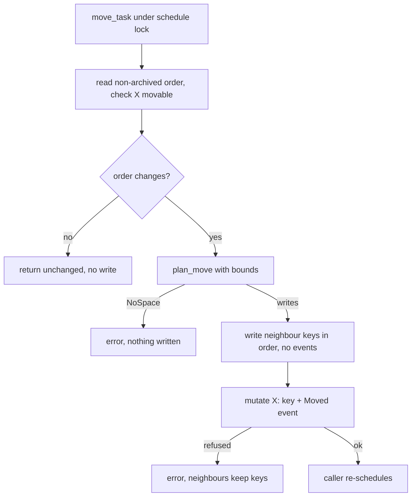

# Fixed queue order with sparse position keys - Plan

## Goal Capsule

- **Objective:** A task never changes its place in its backend's queue by itself. Only the owner's move changes the order, and an answer, a comment, an operator command, a resume or a limit stop leaves the task where the owner put it.
- **Means:** Replace the dense `rank` with a sparse integer position key per task, written only at creation, by a move and by a local rebalance (KTD1, KTD2).
- **Authority:** Product Contract R-IDs win on behaviour. KTDs win on mechanism inside the R-IDs. Units override neither. Origin: `docs/brainstorms/2026-11-22-fixed-queue-order-position-keys-requirements.md`.
- **Execution profile:** One pull request. Units U1 to U5 in order. Rust workspace, `cargo test --workspace` is the gate.
- **Stop conditions:** Stop and report if an existing test shows a path that writes the order outside creation, move and rebalance and the fix needs a product decision. Stop if the record version bump breaks a stored-record test that the plan does not name.
- **Who finishes:** `ce-work` or a person implements, a person reviews and merges.

---

## Product Contract

Product Contract carried from the origin document. Meaning and IDs unchanged. Open points that the origin did not settle are in "Open questions for the user".

### Summary

A task keeps its place in the queue through every state change. The dense `rank` (1, 2, 3, ...) becomes a sparse position key: the creation time of the task in microseconds. A move gives the moved task the rounded-down mean of its new neighbours' keys. When there is no free integer between them, a few nearby tasks get new keys (rebalance). Archived tasks are not part of the order.

### Problem Frame

A resume of a `Stopped` task on a full backend puts the task at the front of the queue (R20 of `docs/plans/2026-10-18-002-feat-zwalnianie-slotow-i-runner-do-odczytu-plan.md`). `ControlPlane::command_routed` sets `record.rank = 0` and `ControlPlane::put_first_in_queue` renumbers the backend behind it. The same path runs when the owner answers a question, comments or sends an operator command to a paused task (`resume_for_work`), so the answered task jumps over tasks the owner put in front of it.

The dense rank also costs writes: a move renumbers every task between the old and new place, and `put_first_in_queue` renumbers the whole backend under the schedule lock. A crash in the middle leaves equal ranks that `dense_backend_tasks` must repair.

### Actors

- Owner — sets the order (CLI `task move`, TUI, web), answers questions, pauses and resumes tasks.
- Scheduler (`ControlPlane::schedule`) — admits waiting tasks in queue order.
- Policy (limit stop) — stops a running task when the limit goes down. The task goes back to the queue with its own key.

### Key Flows

- F1. Answer to a waiting task when no slot is free: the task goes to `Queued` with its key unchanged, so it keeps its place relative to the other tasks.
- F2. Move between two tasks with free space: only the moved task gets a new key (example 1000, 2000 → 1500).
- F3. Move with no free key: the rebalance (R7) moves nearby tasks away from the gap, then the moved task goes into the gap.
- F4. Move to the top or the bottom: the virtual neighbour is key 0 at the top and the current time at the bottom (R6).

### Requirements

**Order**

- R1. The queue order of a backend is the order of the position keys of its non-archived tasks, lowest first. Archived tasks have no place in the order: they are not neighbours in a move, and they are not counted in the position that a client shows.
- R2. No transition of a task changes its position key. This includes resume of a `Stopped` task with or without a free slot, resume caused by an answer, comment or operator command, the limit stop and its return to the queue, a retry or auto-resume, admission, and every other state change. Only the owner's move (R5–R8), creation (R3) and the rebalance (R7) write a position key.
- R3. A new task gets the position key made from its creation time as an integer (A1). The key is unique and greater than every key on the backend: when the clock gives a value that is not greater, the key is the current maximum + 1.
- R4. A task that comes back after a pause, a stop or a wait for the owner keeps its key, and so keeps its place relative to all other non-archived tasks of the backend.

**Move**

- R5. A move of task X between P (before) and N (after) gives X the key `floor((key(P) + key(N)) / 2)` (A2), if this value is strictly between `key(P)` and `key(N)`. X is taken out of the order before P and N are found.
- R6. At the first place P is a virtual task with key 0. At the last place N is a virtual task whose key is the current time in the unit of R3. If this value is not greater than `key(P)`, then N = `key(P)` + 2. The targets `Before(anchor)`, `After(anchor)`, `Top` and `Bottom` keep their meaning.
- R7. Rebalance. When no integer is strictly between `key(P)` and `key(N)`, nearby tasks move away from the gap in this order, and the procedure checks the gap after each step and stops as soon as it has a free integer:
  1. P (index −1) goes to the middle between its predecessor and its current key.
  2. N (index +1) goes to the middle between its current key and its successor.
  3. Index −2, then −1 again: each goes to the middle between its predecessor and its current key.
  4. Index +2, then +1 again: each goes to the middle between its current key and its successor.
  5. And so on with −3…−1, +3…+1.
  The R6 boundaries apply to the rebalance too. A task whose step gives no new key keeps its key, and the procedure continues.
- R8. If the rebalance reaches both ends of the order and finds no space, the move fails with a clear error and changes nothing.
- R9. Each single key write keeps a strict order of all tasks: a task moves only inside the gap between its current neighbours. A crash in the middle of a rebalance can leave a partly made space, but never two tasks with the same key and never a changed order. The current neighbours of a write come from the full order of the backend, which includes X at its old key until X's own write. X is left out only to find P and N.
- R10. A move and its rebalance run under the backend's schedule lock. The moved task's key is written last, with the `Moved` event as the single commit point. If the move is refused at the end, the neighbours keep their new keys.
- R11. A move that does not change the order writes and announces nothing. Only a `Queued` task can be moved.

**Admission and display**

- R12. The scheduler admits waiting tasks by position key, lowest first. The tie-breaker for equal keys (only legacy data can have them) is `queue_sequence`.
- R13. Clients (CLI `#N`, TUI, web) keep showing a 1-based position. The server computes it from the key order of the non-archived tasks of the backend. The `Moved` event keeps its `order` list. Clients that worked with `rank` keep working (A5).

**Migration**

- R14. Existing records get position keys in their current queue order (current `rank`, then `queue_sequence`). A task whose creation time is greater than the key of its predecessor gets its creation time as key. Otherwise it gets the key of its predecessor + 1. Archived tasks keep a key, but it has no effect on the order.
- R15. The migration is idempotent and safe to stop and run again, like the existing rank migration (`migrate_backend` in `crates/narsor-engine/src/orchestration/store.rs`).

**Removed behaviour**

- R16. The "front of the queue" resume is removed: `rank = 0` in `command_routed`, `put_first_in_queue`, and the doc comments that describe it. The dense renumbering for equal ranks (`dense_backend_tasks`, `normalise_ranks`) is removed.

### Acceptance Examples

- AE1. Covers F1, R2, R4. Limit 1. T1 runs. T2 is `Stopped` and waits for the owner. T3 and T4 are queued after T2. The owner answers T2. T2 is `Queued`, the order is T2, T3, T4, and T2 starts when T1 frees its slot.
- AE2. Covers R2, R4. Same as AE1, but the owner moved T3 and T4 before T2 earlier. After the answer the order is T3, T4, T2, and T3 starts first.
- AE3. Covers F2, R5. The owner moves T5 between keys 1000 and 2000. T5 gets 1500. No other record changes.
- AE4. Covers F3, R7. Keys A = 500, P = 1000, N = 1001, B = 3000. X moves between P and N. P gets 750, X gets 875. Only P and X change.
- AE5. Covers R1. An archived task Z is between P and N in key order. The owner moves X "after P". X goes between P and N.
- AE6. Covers R2. The limit goes down and running task T stops at a safe point. T goes back to `Queued` with its old key.

### Success Criteria

- No path from `Stopped`, a wait for the owner or a limit stop to `Queued` changes the queue order.
- A typical move writes one record. A move into a full gap writes the moved task and a few neighbours, not the whole backend.
- Existing installations keep the order that the owner set before the upgrade.
- `cargo test --workspace` passes, with tests for AE1/AE2, AE3, AE4 and the migration.

### Scope Boundaries

- The order stays per backend. A global order across backends is not in scope.
- No new move targets and no changes to the CLI, TUI or web move UI.
- Observer queues (`observer-queues/`, decision gates) are a different mechanism and are not in scope.
- Admission rules (limits, reservations, non-preemption) do not change. Only the order key changes.
- Considered and not built: a background "respread" job that spaces keys out after a rebalance. R7 already keeps writes local, and with microsecond keys a full gap is rare. Migrated queues are the exception, see Q3. Evidence that would change this: moves that regularly write more than a few records.
- Considered and not built: the position key on the wire (`TaskSummary`, `Moved`). A5 permits it, but no client needs it, because the server sends the 1-based position and the `order` list. Add it when a client must compute positions itself.

### Deferred to Follow-Up Work

- The web task info tab shows `task.rank + 1` (`crates/narsor-web/ui/js/ui/tabs/info.js`), one more than the 1-based position. This bug exists today and the scope excludes client UI changes.
- The CLI list line shows `#0` for an archived task (see Q2). A clearer mark, such as `#-`, is a client change.
- Removing `queue_sequence` as a tie-breaker. It stays: `list_tasks` also uses it to order backends, and legacy equal keys need it (R12).

### Key Decisions

- **Sparse integer keys instead of dense ranks.** A move writes O(1) records in the usual case and an interrupted move cannot make an invalid order. Governs R5, R7, R9.
- **Creation time as the initial key.** New tasks go to the end without reading the other ranks, and the current time is always after every task. Governs R3, R6.
- **Archived tasks are out of the order.** Governs R1, R13.
- **The R20 "front of the queue" rule is reversed.** The order belongs to the owner. Governs R2, R4, R16.

### Origin Assumptions

A1–A8 of the origin document are carried as written:

- A1. The key is the creation time in microseconds since the Unix epoch.
- A2. The mean is rounded down. R5 checks the result.
- A3. R7 is a reading of "−1, +1, −2 and −1, +2 and +1, …" that stops as soon as the gap has space.
- A4. All non-archived tasks, also running, stopped and finished ones, are in the order and can be anchors.
- A5. `rank` in `TaskSummary` and in `Moved` stays and means the 1-based position among the non-archived tasks of the backend, computed by the server.
- A6. The migration keeps the current order instead of resetting keys to creation times.
- A7. Archived tasks do not come back. If this changes, a task returns with its old key.
- A8. A refused move may leave rebalanced neighbours. Their order does not change.

---

## Planning Contract

### Key Technical Decisions

- KTD1. **Record field `position_key: u64`, record version 3.** `TaskRecord.rank` is removed from the stored shape. A read-only `legacy_rank: Option<u32>` (`rename = "rank"`, `skip_serializing`) holds the old value only for the migration, as `legacy_priority` does for version 1. `u64` because keys are non-negative and the virtual top bound is 0. Rationale: the record is the only durable order, and the `legacy_*` pattern already exists in `crates/narsor-engine/src/orchestration/model.rs`.
- KTD2. **A pure planner computes the whole move before the first write.** A new module `crates/narsor-engine/src/orchestration/position.rs` takes the backend's full order as `(task, key)` pairs (X included at its old key), the target slot and the two virtual bounds, and returns either the ordered list of key writes (neighbours first, X last) or `NoSpace`. Rationale: R8 requires "changes nothing" on failure, which only a plan made before any write gives, and a pure function makes R7 and R9 testable without a store.
- KTD3. **Bounds and arithmetic.** The lower bound is 0. The upper bound is the current time in microseconds if it is greater than the last key, else last key + 2 (R6). The planner computes it once per move and uses it for X and for the rebalance. The midpoint is `lo + (hi - lo) / 2`, which equals `floor((lo + hi) / 2)` for non-negative values and cannot overflow. All additions are checked. An overflow counts as "no space" on that side.
- KTD4. **Write path.** Neighbour keys are written in plan order by a `set_position_key` helper without an event, like today's `set_rank`. X's key is written in the `mutate` call that emits `Moved` (R10). On a refused or failed commit the neighbours are not restored (R10, A8), so `restore_ranks` goes.
- KTD5. **One definition of the order.** A store-level comparison sorts by `(position_key, queue_sequence)`. A control-plane helper returns the backend's non-archived tasks in that order. "Archived" means `runner_state == Archived` (see open question Q1). `move_task`, `schedule_with`, the revoke order and the position computation all use this helper. `list_tasks` keeps archived records in its output and sorts them by the same comparison.
- KTD6. **Positions are computed on read.** A control-plane function returns the 1-based positions of a backend's non-archived tasks. `ProtocolService::summarize` computes it for the record's backend. The task list computes it once per backend and reuses it, as it reuses the controller presence. Archived tasks report `rank: 0` (see Q2). The `Moved` event carries the mover's new position and an `order` list without archived tasks.
- KTD7. **Migration to version 3 extends `migrate_backend`.** The trigger becomes "any record of the backend below version 3". The order is: version 3 records by key (the already migrated front), then version 2 records by `(legacy_rank, queue_sequence)`, then version 1 records by `(priority desc, queue_sequence)`. Keys follow R14 along that sequence: `max(created_at_micros, previous key + 1)`, with version 3 records keeping their key. Archived records are part of the sequence, so they get a key in their old place. Rationale: the interrupted-migration resume works as today, because the migrated records are always the written front.
- KTD8. **Creation.** Under the backend schedule lock (already held in `create_task`), the key is `max(now_micros, max key of the backend's records + 1)`. The maximum includes archived records, so a new key is greater than every key on the backend (R3). A move can give a task a key equal to an archived task's key. This has no effect, because archived tasks are not in the order and do not come back (A7).
- KTD9. **What is removed.** `put_first_in_queue`, the `record.rank = 0` line in `command_routed`, `dense_backend_tasks`, `normalise_ranks` (also its call in `ControlPlane::recover`), `restore_ranks` and `set_rank`. The `queue_resume` branch stays: a resume on a full backend still goes to `Queued` with no reservation, but with its key unchanged.

### High-Level Technical Design

The move planner, as directional pseudo-code. Indices −k and +k count in the order without X. The bounds of each step come from the full order, which includes X at its old key (R9).

```text
plan_move(full_order, X, slot, lo_bound, hi_bound):
  order   = full_order without X
  P, N    = neighbours of slot in order (virtual lo_bound / hi_bound at the ends)
  keys    = working copy of all keys (X included)
  writes  = []
  if gap(P, N) has a free integer: return writes + [(X, mid(P, N))]
  for k in 1, 2, 3, ...:
    if k > tasks left of the gap and k > tasks right of the gap: return NoSpace
    for j in k, k-1, ..., 1:                # left side, -k ... -1
      t = order[-j]; new = mid(pred_in_full_order(t), key(t))
      if new strictly between pred and key(t): keys[t] = new; writes += (t, new)
      if gap(P, N) has a free integer: return writes + [(X, mid(P, N))]
    for j in k, k-1, ..., 1:                # right side, +k ... +1
      t = order[+j]; new = mid(key(t), succ_in_full_order(t))
      ... same as left ...
```

Round 1 is "−1, then +1", round 2 is "−2, −1, then +2, +1" (R7). Every write keeps the strict order, because a task moves only between its current neighbours.



### Assumptions

- The rebalance upper bound uses the R6 fallback (last key + 2) when the clock is not ahead of the last key. R7 names only "the current time" as the bound. With the fallback, the right side always has space below `u64::MAX`, so R8 is reachable only near the integer limit. The planner still returns `NoSpace` and its unit tests cover it with explicit bounds.
- The anchor of `Before`/`After` must be a non-archived task of the same backend. An archived anchor gets `InvalidMoveAnchor`, because R1 takes archived tasks out of the order.
- `WaitingForCapacity.position` stays the position among waiting tasks, as today. Only its order source changes.
- The wire stays unchanged (`rank: u32` in `TaskSummary` and `Moved`), so client and server can update in any order. Only the stored record version changes.

### Sources

- `crates/narsor-engine/src/orchestration/scheduler.rs` — `schedule_with`, `command_with_capacity_from`, `put_first_in_queue`, `move_task`, `reordered`, `dense_backend_tasks`, `normalise_ranks`.
- `crates/narsor-engine/src/orchestration/control_plane.rs` — `create_task` (rank and `queue_sequence` assignment), `command_routed` (`record.rank = 0`), the limit-stop requeue, `recover`.
- `crates/narsor-engine/src/orchestration/store.rs` — `list_tasks`, `migrate_backend`, `migrate_backend_if_legacy`, `queue_order`, the `migrated` set and `LegacyRecordAppeared`.
- `crates/narsor-engine/src/controller_protocol/service/tasks/summary.rs` and `lookup.rs` — where `TaskSummary.rank` is filled.
- `docs/solutions/conventions/removing-a-field-from-serde-wire-and-persisted-types-2026-11-18.md` — stored records ignore a removed key, the next save drops it. Add a store test that loads the old shape.
- `tests/integration/orchestration.rs` — existing rank, move, migration and resume-through-queue tests, and the `ManualClock` fixture.

---

## Implementation Units

### U1. Position key field and move planner

- **Goal:** Add the position key to the record and a pure planner for moves and rebalance.
- **Requirements:** R5, R6, R7, R8, R9; KTD1, KTD2, KTD3.
- **Dependencies:** none.
- **Files:**
  - `crates/narsor-engine/src/orchestration/model.rs` (field, `legacy_rank`, `TASK_RECORD_VERSION = 3`, doc comments)
  - `crates/narsor-engine/src/orchestration/position.rs` (new, with unit tests)
  - `crates/narsor-engine/src/orchestration/mod.rs` (module declaration)
- **Approach:**
  1. Replace `rank` with `position_key: u64` and add `legacy_rank` as KTD1 describes. Update the version doc comment (version 3: position key replaces rank).
  2. Write the planner per the High-Level Technical Design. Input is owned data (ids and keys), not records, so it has no store dependency.
  3. Also expose the key-from-time helper (microseconds from `DateTime<Utc>`, negative clamped to 0) for U2 and U3.
- **Patterns to follow:** `legacy_priority` in `model.rs`. Pure helpers with `#[cfg(test)]` tables, like `reordered` and `skip_unreadable_archive`.
- **Test scenarios** (unit tests in `position.rs`; they catch planner arithmetic and step order, they miss store writes and locking):
  - Covers AE3. Keys 1000, 2000, X elsewhere: one write, X = 1500.
  - Covers AE4. Keys A 500, P 1000, N 1001, B 3000: writes P = 750, then X = 875, nothing else.
  - Top with first key 1 and a free right side: the rebalance moves +1 to the right, X gets a key between 0 and the new +1 key.
  - Bottom with the upper bound at "now" greater than the last key: X gets the midpoint. With the clock behind the last key: X gets last + 1.
  - X is the predecessor of P in the full order with no space between them: P's left step is bounded by X's old key (R9), and the right side makes the space.
  - After every write in a returned plan, the keys of the full order stay strictly increasing (check each prefix of the plan).
  - Contiguous keys on both sides with tight explicit bounds: `NoSpace` and an empty plan (R8).
- **Verification:** The planner unit tests pass once U3 removes the last reads of the old `rank` field. Until then the engine crate does not build, because the scheduler and the control plane still read it.

### U2. Store order and migration to version 3

- **Goal:** Sort by key and migrate version 1 and version 2 records to keys that keep the current order.
- **Requirements:** R12, R14, R15; KTD5, KTD7.
- **Dependencies:** U1.
- **Files:**
  - `crates/narsor-engine/src/orchestration/store.rs`
  - `tests/integration/orchestration.rs` (migration tests)
- **Approach:**
  1. `queue_order` compares `(position_key, queue_sequence)`. Update the module doc "Queue order and record versions".
  2. Extend `migrate_backend` per KTD7. Keep the lock order and the `migrated`/`LegacyRecordAppeared` logic, with the threshold now version 3.
  3. A version 1 record goes to version 3 in one write. `legacy_priority` and `legacy_rank` are not written back.
- **Patterns to follow:** the existing `migrate_backend` and its tests `resuming_an_interrupted_migration_keeps_the_migrated_tasks_in_front` and the version 1 test near "`priority`, no `rank`" in `tests/integration/orchestration.rs`.
- **Test scenarios** (integration tests on real store files; they catch serde shape and lock behaviour, they miss nothing the planner owns):
  - A version 2 backend that the owner reordered (ranks not in creation order) migrates to keys in the same order. Unreordered tasks get their creation time, a task after a later-created one gets predecessor + 1.
  - The stored file after migration has `position_key`, `record_version: 3` and no `rank` key.
  - An interrupted migration (first record already at version 3, others at version 2) resumes and keeps the order. A second run writes nothing.
  - A version 1 backend (`priority`, no `rank`) migrates straight to version 3 in its old priority order.
  - An archived version 2 record gets a key and does not change the positions of the others.
- **Verification:** Migration tests pass. The existing version 1 tests pass with version 3 expectations.

### U3. Control plane: creation, move, admission, no front-of-queue

- **Goal:** Write keys only at creation, move and rebalance, and admit by key.
- **Requirements:** R1, R2, R3, R4, R10, R11, R12, R16; KTD4, KTD5, KTD8, KTD9.
- **Dependencies:** U1, U2.
- **Files:**
  - `crates/narsor-engine/src/orchestration/control_plane.rs`
  - `crates/narsor-engine/src/orchestration/scheduler.rs`
  - `crates/narsor-engine/src/controller_protocol/service/operator/input.rs` (doc comment)
  - `tests/integration/orchestration.rs`
- **Approach:**
  1. `create_task`: key per KTD8.
  2. `command_routed`: drop `record.rank = 0`. Rewrite the doc comment on `queue_resume` (the task goes to `Queued` with its own key).
  3. `command_with_capacity_from`: drop the `put_first_in_queue` call and the re-read it needed. Rewrite its doc comment (no "front of the queue", no "R20").
  4. `move_task`: use the KTD5 order helper, keep `check_movable` and the no-op check (R11). Call the planner with the KTD3 bounds, apply the writes per KTD4. The `Moved` event's `rank` is X's 1-based position in the new order, and `order` lists the mover's non-archived tasks.
  5. `schedule_with`: read through the order helper, sort waiting and revoked tasks by `(position_key, queue_sequence)`.
  6. Remove the items in KTD9 and the `recover` call to `normalise_ranks`. Update the scheduler module doc ("Order and non-preemption", the limit-stop sentence).
- **Execution note:** Start with the AE1/AE2 tests failing against the current code. They prove the bug before the fix.
- **Patterns to follow:** today's `move_task` (lock, `check_movable`, `mutate` with `Moved`). `stopped_beside_a_running_task`, `run_in_single_slot`, `queue_order` and `move_to` helpers in `tests/integration/orchestration.rs`.
- **Test scenarios** (integration tests through `ControlPlane`; they catch ordering across state changes, they miss the wire shape):
  - Covers AE1. Limit 1, T1 running, T2 stopped waiting for the owner before T3 and T4. A work-resume of T2 through `command_with_capacity`: T2 is `Queued`, the order is T2, T3, T4, and after T1 releases the slot `schedule` admits T2.
  - Covers AE2. Same, after T3 and T4 were moved before T2: the order after the resume is T3, T4, T2 and `schedule` admits T3. This replaces `two_resumes_through_the_queue_put_the_later_one_first`.
  - Covers AE6. A limit stop returns T to `Queued` with an unchanged `position_key`.
  - Covers AE3. A move into a gap with space changes the stored file of the moved task only (compare the other records before and after).
  - Covers AE5. An archived task between P and N: "after P" puts X between P and N, and an archived anchor is refused with `InvalidMoveAnchor`.
  - A move whose final commit is refused (a command came first) leaves the rebalanced neighbours with their new keys and the order unchanged. This replaces `a_move_that_fails_after_renumbering_a_neighbour_restores_the_queue`.
  - Two tasks created in the same `ManualClock` microsecond get keys `t` and `t + 1`.
  - Remove the equal-rank repair tests (`equal_ranks_left_by_an_interrupted_renumbering_...`, `recovery_makes_equal_ranks_dense`) with the behaviour. Keep `concurrent_moves_are_serialized_...` with a strict-order check instead of dense ranks.
- **Verification:** Every orchestration test passes. No code path outside creation, `move_task` and the migration writes `position_key` (search confirms it).

### U4. Server-computed positions on the wire

- **Goal:** Clients get the 1-based position among non-archived tasks in `TaskSummary.rank`.
- **Requirements:** R1, R13; KTD6.
- **Dependencies:** U3.
- **Files:**
  - `crates/narsor-engine/src/orchestration/scheduler.rs` or `control_plane.rs` (positions function)
  - `crates/narsor-engine/src/controller_protocol/service/tasks/summary.rs`
  - `crates/narsor-engine/src/controller_protocol/service/tasks/lookup.rs`
  - `crates/narsor-protocol/src/controller/task/summary.rs` and `events.rs` (doc comments on `rank` only)
  - `tests/integration/orchestration.rs` or the protocol service tests in `crates/narsor-engine/src/controller_protocol/service/tasks/actions.rs`
- **Approach:**
  1. Add the positions function (KTD6).
  2. `summarize` looks up the record's position. `summarize_with` takes the position from the caller. The list in `lookup.rs` computes positions once per backend, next to the controller presence cache.
  3. Update the `rank` doc comments: "1-based position among the backend's non-archived tasks, computed by the server; 0 for an archived task".
- **Patterns to follow:** the `presences` cache in `lookup.rs`.
- **Test scenarios** (service-level tests; they catch what clients receive, they miss TUI rendering):
  - Three tasks and one archived task between the first two: the summaries show ranks 1, 2, 3 and the archived task shows 0.
  - After a move, the `Moved` event's `rank` equals the moved task's summary rank, and its `order` has no archived task.
- **Verification:** CLI `#N`, TUI and web keep working without client changes. If the owner picks Q2 option 2, add `src/cli/task_text.rs` to this unit. Existing TUI tests in `tests/integration/tui_state.rs` pass unchanged.

### U5. Documentation

- **Goal:** Docs describe the fixed order, the position key and the version 3 record.
- **Requirements:** R16, R14.
- **Dependencies:** U3, U4.
- **Files:**
  - `docs/dev/architecture.md` (new decision row D84; it changes the D62 sentence "ranked before all waiting ones")
  - `docs/operations/remote-backends.md` (queue position paragraph near "Every task has a position (`rank`)")
  - `docs/operations/updates.md` (update section: record version 3, no downgrade, migration keeps the order)
  - `docs/user/tui.md` ("The list is the queue" paragraph)
- **Approach:** Write new text in English. Do not edit the historical 2026-10-18 plan. In D84 name what it supersedes in D62 and D65 ("at its existing rank" becomes "with its own key").
- **Test expectation:** none -- documentation only.
- **Verification:** A search for "front of the queue", "rank 0" and "renumber" in `docs/dev`, `docs/operations` and `docs/user` finds no text that describes the old behaviour as current.

---

## Verification Contract

| Gate | Command or check | Proves |
|---|---|---|
| Build | `cargo build --workspace --bins` | Every crate compiles without `TaskRecord.rank` |
| Tests | `cargo test --workspace` | U1–U4 scenarios and all existing tests (CI runs it with `--locked`) |
| Order writes | search for `position_key =` and `set_position_key` in `crates/` | Only creation, move and migration write the key (R2) |
| Removed paths | search for `put_first_in_queue`, `dense_backend_tasks`, `normalise_ranks`, `rank = 0` | R16 |
| Docs | search for "front of the queue" and "rank" in `docs/dev`, `docs/operations`, `docs/user` | U5 |

`#[ignore]`d tests (real processes, real `claude`, Kubernetes) are not needed for this change.

---

## Definition of Done

- U1–U5 done, each with its verification met.
- AE1–AE6 each have a passing test that cites the AE.
- `cargo test --workspace` passes.
- No code from abandoned approaches is left in the diff (for example a restore path for neighbour keys, or a dense-rank fallback).
- The open questions below are answered, or the recommended options are implemented and the PR description names them.

---

## Open questions for the user

- Q1 (DECIDED by the owner: option 1). Product Contract, R1 (which tasks are out of the order). Does a task in `Archiving` (archive asked for, not yet confirmed) leave the order now, or only when it is `Archived`?
  - Option 1 (recommended): Only `Archived` leaves the order. An `Archiving` task still holds a slot and still shows in the list, and it leaves the order when the archive completes.
  - Option 2: `Archiving` and `Archived` both leave the order. Positions change when the owner asks for the archive, not when it completes.
- Q2 (DECIDED by the owner: option 1, no client changes; `rank` is 0 for an archived task). Product Contract, R13 and A5 (position shown for an archived task). What does `rank` show for an archived task, which has no position?
  - Option 1 (recommended): `rank` is 0 and no client changes. The CLI shows `#0` for archived tasks in `task list --archived`. This keeps the scope rule that clients do not change.
  - Option 2: `rank` is 0, and the CLI list line shows `#-` instead of `#0`. One small change in `src/cli/task_text.rs`.
  - Option 3: An archived task keeps the last position it had before the archive. This needs a stored field.
- Q3 (DECIDED by the owner: option 2, because queues are small today; R14 stays as written). Product Contract, R14 (migration keys), raised by the plan review. R14 gives each task `max(creation time, predecessor key + 1)`. Where the owner moved a newer task in front of older ones, every older task after it gets predecessor + 1. The result is a run of consecutive keys, possibly most of the backend. The first move into such a run has no free key, and the rebalance (R7) rewrites every task between the gap and the nearer end of the run, under the schedule lock. This conflicts with the success criterion "a few neighbours, not the whole backend". Which rule do you want?
  - Option 1 (recommended): Space the keys of the records that are not yet migrated evenly between the last migrated key (0 if none) and the migration time. The order stays as the owner set it (A6), and every gap has free integers. Migrated keys are then not creation times. An interrupted migration resumes from the last written key. U2 then gets one more test: after a backend whose newest task was moved to the top migrates, a move into the middle writes only the moved task.
  - Option 2: Keep R14 as written. Accept that the first moves into reordered parts of an old queue can rewrite many records once. Later moves in the same part are cheap again.
