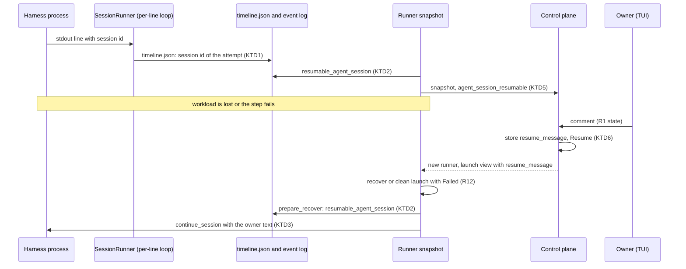
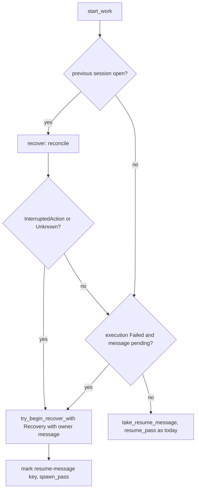

# Continue the existing agent session after a workload loss or a step error - Plan

## Goal Capsule

- **Objective:** When a task stops because its workload was lost or its step failed, the owner can write to the agent ("Napisz do agenta"). The agent continues the current step in the same harness session and keeps its context. When the session cannot be continued, the owner is told before sending that a new session starts.
- **Product authority:** Issue #140. Assumptions taken without the owner are listed in "Założenia do potwierdzenia" and "Assumptions". The questions in "Pytania otwarte dla użytkownika" were answered by the owner in the PR, and the plan follows the answers.
- **Means:** The harness session id becomes durable in `timeline.json` as soon as the harness reports it (KTD1). One engine lookup finds the session of the current step (KTD2). An owner recovery that carries a message resumes that session (KTD3). The control plane offers the comment action in four more owner/runner states (KTD6).
- **Execution profile:** One pull request. Units U1 to U7, in dependency order.
- **Stop conditions:** Stop and report if a harness cannot report its session id before the step ends (U1), or if `timeline.json` or the event log cannot be read during recovery or snapshot building without a full scan that is too slow for a long run (U2).
- **Who finishes:** The implementer runs `cargo test --workspace` and opens the PR. The owner answers "Pytania otwarte dla użytkownika" in review.

---

## Product Contract

Product Contract preservation: changed: R7 — the durable record of the in-flight session is a field of the attempt in `timeline.json`, not a field in the execution metadata, because the engine cannot save metadata during a step (KTD1). The owner chose this in Q1. The behavior that R7 asks for does not change. The other R/F/AE IDs are unchanged. "Outstanding Questions → Deferred to Planning" is resolved in place (KTD1, KTD5, KTD4). The owner answered Q1 (record in `timeline.json`) and Q2 (restart at once). Both are in the plan: KTD1, KTD7.

### Summary

The comment action ("Napisz do agenta", `TaskActionId::Comment`) becomes available in four more states: `Paused`/`Interrupted`, `Error`/`Interrupted`, `Error`/`Unknown` and `Error`/`Stopped` with a `Failed` execution. The owner's text resumes the harness session of the interrupted or failed step. When no session can be resumed, the action stays available, its description warns that a new session starts, and the text reaches the agent as the operator recovery note.

### Problem Frame

Today the owner can write to the agent only in a pause with a stopped runner, or when the task waits on an agent question, an approval or a permission. After a workload loss or a failed step, the owner can only use "Uruchom od nowa" or "Wybierz krok". Both start a new agent session, so the agent loses what it did and learned in the step. Long steps are the most exposed: a pod loss late in a step throws away the most context.

Three gaps cause this (verified in the code):

- The offer, the send and the resume accept only runner state `Stopped` (`comment_reason`, `submit_comment` in `crates/narsor-engine/src/controller_protocol/service/tasks/actions.rs`; `resume_for_work` in `crates/narsor-engine/src/controller_protocol/service/operator/input.rs`; `store_resume_message` in `crates/narsor-engine/src/orchestration/runner_state.rs`). The lifecycle already allows `Resume` from `Interrupted` and `Unknown` (`command_effect` in `crates/narsor-engine/src/orchestration/lifecycle.rs`).
- The runner `recover` (`crates/narsor-runner/src/runner/mod.rs`) appends a pending comment to the recovery note, and `prepare_recover` (`crates/narsor-exec/src/engine/runner/lifecycle/resume.rs`) starts the action afresh.
- The session id of an in-flight attempt is stored only when the step completes or the harness finishes. A pod that dies mid-step leaves no record of it.

### Requirements

**Offer and send (control plane)**

- R1. The comment action is offered in these owner/runner states: `Paused`/`Interrupted`, `Error`/`Interrupted`, `Error`/`Unknown`, and `Error`/`Stopped` when the execution is `Failed`. The states where it is offered today stay unchanged.
- R2. The comment action stays refused in `Finished`, `Archived` and `Queued`, and in every state that is neither named in R1 nor offered today.
- R3. The offer (`comment_reason`) and the server check at send (`require_available`) give the same answer for every state.
- R4. A comment sent in an R1 state is stored as the pending resume message, and the task gets `OwnerCommand::Resume`, from `Interrupted` and `Unknown` as well as from `Stopped`.
- R5. The description of the action (`comment_effect`) says, for each R1 state, whether the agent continues its session or starts a new session that gets the text as a note.
- R6. The task summary tells the client whether the session of the current step can be resumed. When this is not known, the description uses the new-session warning.

**Session continuity (engine)**

- R7. The engine durably records the harness session id of the running step as soon as the harness reports it, before the step ends. After the step completes, the record no longer counts as the in-flight session. (The record is a field of `timeline.json`, not a metadata field: see the preservation note and KTD1.)
- R8. The step failure record stores the session id when it is known.
- R9. A recovery that carries an owner message resumes the known harness session of the current step with that text, instead of restarting the action. The step's output contract applies to the result, as for a reprompt.
- R10. Session lookup order for R9: the in-flight session of the current state, then the step failure record (R8), then the output rejection or rescue record, then `completed_agent_sessions` for the state. For a `Failed` execution the failure record is the source of the failed attempt's session, because a step failure clears the rejection and rescue records. The lookup must not fall through to an older session of the same state while the failure record holds one.
- R11. When no session is found, or the harness of the step cannot resume a session, the recovery keeps today's behavior: it restarts the action and gives the text as the operator recovery note.

**Delivery (runner)**

- R12. In `recover`, the runner passes a pending resume message to the continue-session recovery of R9, not as text appended to the recovery note. A `Failed` execution does not pass through `recover`: the relaunch is a clean launch, and the existing resume-message step refuses a `Failed` execution. The clean launch of a `Failed` execution must therefore also accept the pending message and hand it to the same continue-session recovery.
- R13. Each message reaches the agent exactly once across runner restarts. The existing `resume-message:<key>` storage mark governs this.

### Key Flows

- F1. **Comment after a workload loss (session known).** Covers R1, R4, R7, R9, R12, R13.
  - **Trigger:** The task is `Error`/`Interrupted` (or `Paused`/`Interrupted`, `Error`/`Unknown`). The session id of the step was recorded before the loss.
  - **Steps:** The owner opens "Napisz do agenta". The description says the agent continues its session. The owner sends the text. The control plane stores the resume message and sends `Resume`. A new runner starts, reconciles the execution and runs the continue-session recovery. The harness resumes the stored session with the text. The runner marks the message as given.
  - **Outcome:** The step goes on in the same session. The timeline shows the same `harness_session_id`.
- F2. **Comment after a failed step.** Covers R1, R8, R9, R10, R12.
  - **Trigger:** The task is `Error`/`Stopped` and the execution is `Failed` (harness crash, timeout, or output contract failure).
  - **Steps and outcome:** As F1, except that the runner reaches the continue-session recovery through the clean launch path (R12), not through `recover`. The session comes from the step failure record (R8) of the failed attempt, because the failure clears the rejection and rescue records.
- F3. **Comment with no resumable session.** Covers R5, R6, R11.
  - **Trigger:** The harness died before it reported a session id, or the harness cannot resume.
  - **Steps:** The action is offered. The description warns that a new session starts. After sending, the recovery restarts the action. The agent gets the text as the operator recovery note.

### Acceptance Examples

- AE1. **Covers R1, R9.** A task is `Paused`/`Interrupted` after a pod loss during a requested pause. The owner sends "Dokończ testy". The agent of the interrupted step gets the text in the same harness session.
- AE2. **Covers R1, R8, R9.** A step fails its output contract and the task is `Error`/`Stopped`. The owner sends a correction. The agent gets it in the session of the failed attempt, and the output contract checks the new result.
- AE3. **Covers R5, R11.** The harness died before its `init` line. The action description says that a new session starts. After sending, the step restarts and the text is the operator recovery note.
- AE4. **Covers R13.** The runner restarts after it gave the message to the harness. The message is not given a second time.
- AE5. **Covers R2, R3.** For a `Finished` task and for a `Stopped` runner of a task that is neither paused nor failed, the action is not offered, and a send is refused with the same reason.

### Key Decisions

- **When no session can be resumed, offer the action with a warning instead of hiding it.** Reason: the owner can still give the agent direction, and the text is not lost. Decided in issue #140. Governs R5, R11.
- **The engine records the session id early, before the step ends, in `timeline.json`.** Reason: a pod loss mid-step otherwise leaves no record of the session. Governs R7.
- **The text goes through the recovery path, not as an answer to a waiting request.** Reason: the runner already carries pending comments into recovery and marks them once. Governs R9, R12, R13.

### Scope Boundaries

- `Finished` and `Archived` tasks: out of scope.
- No classification of the failure cause (for example a context overflow) to force a new session when an id is known. See Assumption 3.
- The `runner_alive` result for `HumanNeeded` + `Stopped` + `holds_slot` ("Stop" and "Przejście ręczne" offered for a stopped runner): a separate issue, out of scope.
- No change to "Uruchom od nowa" and "Wybierz krok". They still start a new session.
- An automatic resume by the resume policy (no owner message) keeps today's behavior: it restarts the action. Only a recovery with an owner message continues the session (R9).
- Considered and not built: a check that the harness's session files still exist before the offer says "the agent continues". The harness home lives on task storage (private HOME) or on the host, so it survives a pod loss. When a resume fails at run time, the `RESUME_SESSION_REJECTED` branch restarts the action at once with the text as the note (KTD7). Evidence that would change this: a backend whose harness home does not survive the workload.

### Dependencies / Assumptions

- All five harnesses handle `resume_session`: claude_code, codex, github_copilot, copilot_sdk and opencode (`--session`, `crates/narsor-exec/src/engine/actions/harness/opencode.rs`). Each one parses a session id from its stream (claude_code `system` line, codex `thread.started`, opencode `sessionID`, the copilot harnesses `session` record). This answers the first open question of the issue.

### Założenia do potwierdzenia

1. **Fallback when no session is resumable.** The action is offered with a new-session warning, as the issue decided. The text goes into the operator recovery note, as today.
2. **opencode can resume.** The code passes `--session <id>` and parses `sessionID`, so opencode is treated like the other harnesses. A harness that does not report a session id before the loss is handled as "no session" (R11).
3. **A failure caused by the session itself (for example a context overflow).** When a session id is known, the engine resumes it, with no special case for the failure cause. If the resumed session fails again, the task goes to `Error` again, and the owner can still use "Uruchom od nowa". This is the safest choice because it adds no new classification logic. A later issue can add the classification.
4. **Attempt budget.** The continue-session recovery is an owner recovery, like "Uruchom od nowa" today. It follows the same episode and attempt rules as an owner recovery (KTD4).
5. **What the task does after the step.** In `Paused`/`Interrupted`, the comment has the same effect as today's comment in a pause ("wznawia zadanie jednym krokiem"). In the `Error` states, the task continues as after an owner recovery.
6. **Unknown resumability.** When the client cannot tell whether the session can be resumed (for example an older runner without the flag), the description uses the new-session warning. A wrong warning is safer than a wrong promise.
7. **`Error`/`Stopped` needs a `Failed` execution.** An `Error`/`Stopped` task with an execution in another status does not get the action.
8. **The `runner_alive` finding** in the issue is a separate issue and is not part of this work.

### Pytania otwarte dla użytkownika

- Q1. **R7 – where the in-flight session id is recorded.** Answered by the owner: in `timeline.json`, not in `state.json` and not in a new event. See KTD1.
- Q2. **R11 / KTD7 – the harness refuses the stored session at run time.** Answered by the owner: restart the action at once with the text as the operator recovery note. See KTD7.

### Sources / Research

- Issue #140 (problem, proposed change, acceptance criteria, minimum tests).
- `crates/narsor-engine/src/controller_protocol/service/tasks/actions.rs`: `comment_reason`, `comment_effect`, `submit_comment`, `runner_alive`.
- `crates/narsor-engine/src/controller_protocol/service/operator/input.rs`: `resume_for_work`.
- `crates/narsor-engine/src/orchestration/runner_state.rs`: `store_resume_message` (refuses every runner state other than `Stopped`), `take_resume_message`.
- `crates/narsor-engine/src/orchestration/model.rs`: `derive_task_state` (how the four R1 states arise).
- `crates/narsor-engine/src/orchestration/lifecycle.rs`: `command_effect` (`Resume` from `Stopped | Interrupted | Unknown`).
- `crates/narsor-runner/src/runner/mod.rs`: `start_work`, `recover`, `take_resume_message`, `untaken_resume_message`, `resume_message_mark`.
- `crates/narsor-exec/src/engine/runner/failure/handoff.rs`: `Recovery`, `StepFailure`, `record_step_failure`.
- `crates/narsor-exec/src/engine/runner/lifecycle/resume.rs`: `prepare_recover`.
- `crates/narsor-exec/src/engine/runner/human_input/operations.rs`: `leave_resume_message` (the same-session behavior wanted here; refuses a `Failed` execution).
- `crates/narsor-exec/src/engine/runner/step/harness_attempt.rs`: `prepare_harness_attempt` (`take_agent_input` → `continue_session`, then the operator recovery note).
- `crates/narsor-exec/src/engine/runner/step/attempt.rs`: the `RESUME_SESSION_REJECTED` branch.
- `crates/narsor-exec/src/engine/actions/harness/`: session id parsing and `resume_session` for each harness.
- `crates/narsor-exec/src/engine/actions/session/process.rs`: `spawn_and_wait`, the per-line loop.
- `docs/solutions/design-patterns/output-contract-once-per-session-runtime-marker-2026-11-12.md`: when the output contract block is left out of a resumed prompt.
- `docs/solutions/architecture-patterns/auto-resume-policy-for-lost-workloads-2026-10-11.md`: the resume policy, wire enums with `Unrecognized`, upgrade order.
- `docs/dev/architecture.md`: D58 (automatic resume), D66 (task actions and the comment at a stop).

---

## Planning Contract

### Key Technical Decisions

- KTD1. **The in-flight session id is a field of the attempt in `timeline.json`, written when the harness first reports an id (and again if the id changes).** The writer is a new method on the sink that already writes the usage readings during a step (`ReadingSink` / `FileReadingSink` in `crates/narsor-exec/src/engine/timeline_file.rs`). It does not touch `state.json`. Reason: the owner chose this in Q1. The file is already written during a step under its own lock, so no second writer for `state.json` is needed, and a metadata write during the step would be overwritten by the final save. Known limit: the file is derived, and a lost file loses its readings, so it also loses the in-flight id. The recovery then gives the text as the operator recovery note (R11). The id of a completed or failed attempt stays in the event log (`AgentSessionCompleted`, `AgentSessionFailed`). No new event type is added. Governs R7. Answered in Q1.
- KTD2. **One engine read, `resumable_agent_session`, implements the R10 lookup, and both the recovery and the snapshot flag call it.** It returns the harness and the harness session id, or nothing. The in-flight source is the id in `timeline.json` for the latest action attempt of the current state (or the latest `AgentSessionFailed` with an id), and only when no `AgentSessionCompleted` follows it for that attempt. Reason: the flag that the owner sees (R6) and the session that the recovery resumes (R9) cannot disagree when they come from one function. This mirrors the "one rule for offer and check" pattern of D66.
- KTD3. **The owner message rides on `Recovery` as its own field (key and text), not inside the comment.** `prepare_recover` resolves the session through KTD2 before it clears the step failure, rejection and rescue records. With a session, it stores the text as an `agent_input` with that harness and session (the existing `store_agent_input`, `PromptAuthor::User`). Without one, it stores the text as the operator recovery note (R11). The decision comment of the runner (for example "owner resume after the task's workload stopped unexpectedly") stays the recovery note in both cases, so the agent also learns why it was resumed. `prepare_harness_attempt` already applies `continue_session` and sets `skip_output_contract`, because the session holds the contract from its first prompt. The contract still validates the result (R9). Governs R9, R11.
- KTD4. **Attempt budget: the continue-session recovery is an ordinary owner recovery.** `run_action` starts a new action attempt with a full `retry_policy` round, as for "Uruchom od nowa" today. `max_entries` is not checked on recovery today, and this does not change. Resolves the deferred question and Assumption 4.
- KTD5. **The snapshot flag is `agent_session_resumable: bool` on `RunnerSnapshotRequest`, the model `RunnerSnapshot` and `RunnerView`, with `#[serde(default)]`.** The runner sets it from KTD2 in every snapshot. `false` covers both "no session" and "an older runner", which is what Assumption 6 asks for. Reason: `TaskSummary` already carries the runner view, and `comment_effect` reads the summary on the server. For a lost workload, the value that counts is the last snapshot before the loss. A new event makes the runner report within `report_interval` (1 s by default), so the flag follows the event closely. Resolves the deferred question on the flag.
- KTD6. **The control plane widens the comment path only.** `comment_reason`, the pause branch of `submit_comment` and `store_resume_message` accept the R1 states. The resume after a comment goes through a variant of `resume_for_work` that also accepts `Interrupted` and `Unknown`, used only by `submit_comment`. Reason: `submit_input` and operator commands also call `resume_for_work`, and their behavior must not change. Governs R1–R4.
- KTD7. **A session that the harness refuses at run time restarts the action at once, with the text as the operator recovery note.** When the refused session came with an owner message from a continue-session recovery, the `RESUME_SESSION_REJECTED` branch in `crates/narsor-exec/src/engine/runner/step/attempt.rs` does not stop for the owner. It stores the text as the operator recovery note and starts the next attempt as a new session. Reason: the owner chose this in Q2. The text is not lost, and the owner does not press Enter. A refused session with no owner message keeps today's behavior. Governs R11. Answered in Q2.
- KTD8. **Exactly once (R13) has two guards.** The engine writes `resume_message_key` in the same save as the `agent_input` or note, inside `prepare_recover`. A repeated recovery with the same key stores nothing again. The runner mark `resume-message:<key>` stays as it is (written after the recovery call succeeds). Reason: today the mark is best effort in `recover` (a failed write only logs a warning), so the engine key closes the window in which the mark is lost.

### High-Level Technical Design

Where the session id comes from and where it is read:

Which states offer the comment and what its description says (R1, R2, R5). "Today" rows do not change.

| Owner state / runner state | Execution | Offered | Description |
|---|---|---|---|
| any state with a waiting question, approval or permission | — | yes (today) | today's texts |
| `Paused` / `Stopped` | — | yes (today) | today's text (comment in a pause) |
| `Paused` / `Interrupted` | any | yes (new) | continues the session, or new-session warning |
| `Error` / `Interrupted` | any | yes (new) | continues the session, or new-session warning |
| `Error` / `Unknown` | any | yes (new) | continues the session, or new-session warning |
| `Error` / `Stopped` | `Failed` | yes (new) | continues the session, or new-session warning |
| `Error` / `Stopped` | not `Failed` | no | reason, as today |
| `Running` / `Interrupted` (resume policy still waits) | any | no | reason, as today |
| `Queued`, `Finished`, `Archived` | — | no | reason, as today |

"Continues the session" is used when `RunnerView.agent_session_resumable` is `true`. A missing runner view or `false` gives the warning (Assumption 6).

Runner decision for a pending message (R12):

### Assumptions

- The scoping synthesis was not shown to a person (headless run). These inferred choices hold until review says otherwise:
  - One PR for all seven units.
  - Documentation changes are limited to `docs/dev/architecture.md` (a new decision row) and `docs/user/tui.md`.
  - A comment on a failed **script** step is offered (R1 does not exclude it). No session exists, so the description warns and the text waits as the operator recovery note for the next agent attempt (R11).
  - In the R1 states, a task that still shows a waiting form (for example `Error`/`Interrupted` with a pending agent question from the last snapshot) keeps today's path through `comment_delivery`. The implementer checks this case in U6 and records it in a test.

### Sequencing

U1 → U2 → U3 → U4. U2 → U5 → U6. U7 last. U5 and U6 can be built while U3 and U4 are built.

### Risks

| Risk | Mitigation |
|---|---|
| The last snapshot before a pod loss was sent before the session id reached `timeline.json`, so the offer warns although the recovery will resume the session. | Safe direction (Assumption 6). The recovery still uses KTD2 on the event log, so the agent still gets the session. |
| `Error`/`Unknown` may still have a live workload. A resume would put two runners on one storage. | No new risk: the lifecycle already allows an owner `Resume` from `Unknown`, and the offer already has "Uruchom od nowa" there. The controller's loss confirmation rules (D58) stay as they are. |
| The resumed agent repeats side effects of the lost part of the step. | Accepted, as for automatic resume (D58). The agent keeps its context, which lowers the risk compared to today's restart. |
| The message is lost when the pod dies after `take_agent_input` saved and before the harness read the prompt. | Same window as today's comment in a pause. The `resume_message_key` keeps it from being given twice. A test covers the repeated recovery (U3). |
| Scanning the whole event log for every snapshot is slow for long runs. | `build` already reads all events (`event_log(..).read_all()`), so KTD2 reuses that read. The lookup walks back from the end. |

### System-Wide Impact

- **Wire:** a new `EventData` variant and a new snapshot/runner-view field. Both are additive. The upgrade order of D58 applies: control plane first, then runners, then clients with their server. An older control plane drops the field, and the owner sees the warning.
- **Persisted data:** `StepFailure` gains two optional fields with `#[serde(default)]`. Old records read as "no session".
- **TUI:** no client logic change. The panel shows the comment from the server offer (`docs/solutions/design-patterns/tui-panel-actions-from-server-offer-2026-11-13.md`). A failed step keeps its own panel (`keeps_own_panel`), and "Napisz do agenta" is action 0 of every panel.

---

## Implementation Units

### U1. Report the harness session id during the run

- **Goal:** Write the harness session id into `timeline.json` as soon as a harness reports it (R7).
- **Requirements:** R7; F1. KTD1.
- **Dependencies:** none.
- **Files:**
  - `crates/narsor-exec/src/engine/timeline_file.rs` (a per-attempt session id field, a `record_session` method on `ReadingSink` and `FileReadingSink`, and a read for U2)
  - `crates/narsor-exec/src/engine/actions/harness/mod.rs` (`HarnessStreamParser`: a read of the session id the parser holds now)
  - `crates/narsor-exec/src/engine/actions/harness/claude_code.rs`, `codex.rs`, `opencode.rs`, `github_copilot.rs`, `copilot_sdk.rs` (expose the id each parser already holds)
  - `crates/narsor-exec/src/engine/actions/session/process.rs` (per-line loop of `spawn_and_wait`)
  - `crates/narsor-exec/src/engine/actions/session.rs`, `crates/narsor-exec/src/engine/actions/session/conversation.rs` (pass the `AgentEventSink` to the loop)
  - Tests: `tests/integration/actions_agent.rs`, `tests/integration/timeline.rs`
- **Approach:**
  1. Add a parser read that returns the session id known so far. The parsers already keep it in their state. `finish()` is unchanged.
  2. After each stdout line, compare the id with the last reported one. When it is new, write it through the session's `ReadingSink`, in the shape of the `UsageRelay` that the loop already gets.
  3. The copilot SDK path feeds its records into the github_copilot parser through `feed_copilot_sdk_record`. Apply the same check at that feed site.
  4. When the file is rebuilt from the log, the stored session ids are put back on it, as the readings are.
- **Patterns to follow:** `UsageRelay` / `UsageReporter` in `conversation.rs`; `docs/solutions/design-patterns/latest-value-reports-coalesce-per-key-one-send-at-a-time-2026-10-31.md`.
- **Test scenarios:**
  - A recorded claude_code stream whose first line is the `system` line puts that id on the attempt in `timeline.json` before the step ends.
  - A stream where the id is reported on several lines (opencode repeats `sessionID`) is written once, not once per line.
  - A harness process killed after its id line (the test fake stops mid-run) leaves the id in `timeline.json`.
  - A stream without an id writes no id.
  - The timeline position of an attempt that was cut after the event shows its `harness_session_id`.
  - A `timeline.json` without the new field still reads, and a rebuild of the file keeps the ids.
- **Verification:** the id is in `timeline.json` before the step ends for each of the five parsers' fixtures.

### U2. One session lookup and a failure record with the session

- **Goal:** Implement the R10 lookup in one engine read, and store the session in `StepFailure` (R8).
- **Requirements:** R8, R10; F2. KTD2.
- **Dependencies:** U1.
- **Files:**
  - `crates/narsor-exec/src/engine/runner/failure/handoff.rs` (`StepFailure` gains `harness` and `harness_session_id`, `#[serde(default)]`; `record_step_failure` fills them)
  - `crates/narsor-exec/src/engine/runner/metadata/` (a new module for `resumable_agent_session`, next to `pending_step.rs`)
  - Tests: `tests/integration/engine_recovery.rs`
- **Approach:**
  1. `record_step_failure` gets the failed attempt's session from the event log (`AgentSessionFailed` with an id, else the id of that attempt in `timeline.json`). A timeout or spawn error has no id in `AgentSessionFailed` today, so the file of U1 is the source then.
  2. `resumable_agent_session(execution, events)` walks R10 in order. It returns the step failure's session when the execution is `Failed`, and it does not fall through to `completed_agent_sessions` while the failure record holds one.
  3. A harness with no resume support gives nothing. All five built-in harnesses support it. If the harness registry has no such flag, treat an unknown harness name as not resumable.
- **Test scenarios:**
  - Covers F2. A step that failed its output contract after the harness reported "s-2": the failure record holds "s-2", and the lookup returns "s-2" although `completed_agent_sessions` holds "s-1" for the same state from an earlier entry.
  - A step that timed out after the harness reported "s-3": the failure record holds "s-3".
  - An attempt cut mid-step (the execution is `Unknown` after reconcile): the lookup returns the in-flight id.
  - An attempt whose `AgentSessionCompleted` follows the event: the in-flight source gives nothing, and the lookup returns the entry from `completed_agent_sessions`.
  - A step that failed before any id: the lookup returns nothing.
  - A `step_failure` record written before this change (no new fields) still reads.
- **Verification:** the scenarios pass, and `StepFailure` round-trips with and without the new fields.

### U3. Continue-session recovery in the engine

- **Goal:** A recovery that carries an owner message resumes the found session with the text, and gives the text as a note when no session is found.
- **Requirements:** R9, R11, R13; F1, F2, F3; AE1, AE2, AE3, AE4. KTD3, KTD4, KTD7, KTD8.
- **Dependencies:** U2.
- **Files:**
  - `crates/narsor-exec/src/engine/runner/failure/handoff.rs` (`Recovery` gains the owner message; a constructor for it)
  - `crates/narsor-exec/src/engine/runner/lifecycle/resume.rs` (`prepare_recover`)
  - `crates/narsor-exec/src/engine/runner/step/attempt.rs` (the `RESUME_SESSION_REJECTED` branch, KTD7)
  - `crates/narsor-exec/src/engine/runner/human_input/operations.rs`, `human_input/agent_input.rs` (share the "message to session or note" step with `leave_resume_message`)
  - Tests: `tests/integration/engine_recovery.rs`
- **Approach:**
  1. In `prepare_recover`, before the records are cleared: when `resume_message_key` already equals the message key, skip the message (KTD8). Otherwise call `resumable_agent_session`.
  2. With a session, store the text as `agent_input` with the session's harness and id. Without one, store it as the operator recovery note, after the runner's decision comment (today's text order).
  3. Write `resume_message_key` in the same save.
  4. `leave_resume_message` keeps its behavior. Extract only the shared step, so both paths write the key and the input the same way.
- **Execution note:** Start with a failing integration test for AE2 (failed output contract → the correction arrives in the failed attempt's session).
- **Patterns to follow:** `leave_resume_message`; the existing `a_comment_left_on_a_pause_goes_to_the_session_of_the_state` test.
- **Test scenarios:**
  - Covers AE1. An execution left `Unknown` after reconcile with in-flight session "s-1": the recovery with message "Dokończ testy" runs the next attempt with `resume_session` "s-1" and the text as the prompt, and the prompt has no output contract block.
  - Covers AE2. A `Failed` execution after an output contract failure: the recovery resumes the failed attempt's session, and a result that breaks the contract is rejected again (the contract still validates).
  - Covers AE3. No session: the attempt starts fresh, and the prompt ends with the operator recovery note that holds the decision comment and the text.
  - Covers AE4. Two recoveries with the same message key (the second after a new loss): the text is given once.
  - The runner's decision comment is in the resumed prompt as the recovery note.
  - The harness refuses the stored session on a recovery with an owner message: the action restarts at once as a new session with the text as the operator recovery note, and the task does not wait for the owner (KTD7).
- **Verification:** the scenarios pass, and the existing recovery tests in `engine_recovery.rs` pass unchanged.

### U4. Runner delivery for recover and for a failed execution

- **Goal:** The runner hands a pending message to the continue-session recovery in both launch paths (R12).
- **Requirements:** R12, R13; F1, F2; AE4. KTD3, KTD8.
- **Dependencies:** U3.
- **Files:**
  - `crates/narsor-runner/src/runner/mod.rs` (`recover`, `start_work`'s `Clean` branch)
  - Tests: `crates/narsor-runner/src/runner/session_tests.rs`
- **Approach:**
  1. In `recover`, pass the message on `Recovery` instead of joining it to the decision comment.
  2. In the `Clean` branch (and in the non-recovery branch of `recover`), when the execution is `Failed` and an untaken message exists, call `try_begin_recover_with` with the message instead of `take_resume_message`. Use `Recovery` with no episode, which means "the failure that is there".
  3. Mark the message after the recovery call succeeds, as `recover` does today.
  4. Without a message, a `Failed` execution stays as it is today (`resume_pass` leaves it alone).
- **Patterns to follow:** `a_comment_on_an_unknown_execution_goes_with_its_recovery` and the helpers `lost_unknown_between_steps`, `launch_with_comment`.
- **Test scenarios:**
  - Covers F1. A runner that starts after a loss mid-step with a pending comment: the agent gets the text in the lost attempt's session, and the poll reports the key as taken.
  - Covers F2. A clean launch of a `Failed` execution with a pending comment: the failed step is recovered in its session (no error from `leave_resume_message`).
  - Covers AE4. A runner restarted after the mark was written: the message is not given again.
  - A clean launch of a `Failed` execution with no comment: nothing runs (unchanged).
- **Verification:** the scenarios pass, and `the_comment_on_a_pause_reaches_the_next_step_once` and `an_interrupted_step_is_dropped_and_restarted_with_the_owners_note` still pass.

### U5. Report whether the session can be resumed

- **Goal:** The task summary carries the resumability of the current step's session (R6).
- **Requirements:** R6; F3. KTD5.
- **Dependencies:** U2.
- **Files:**
  - `crates/narsor-protocol/src/controller/runner/snapshot.rs` (`RunnerSnapshotRequest`)
  - `crates/narsor-protocol/src/controller/runner/state.rs` (`RunnerView`)
  - `crates/narsor-model/src/domain/runner_snapshot.rs` (model and conversions)
  - `crates/narsor-runner/src/runner/snapshot.rs` (`build`)
  - `crates/narsor-engine/src/controller_protocol/service/tasks/summary.rs` (copy to the view)
  - Tests: unit tests in `crates/narsor-runner/src/runner/snapshot.rs`; a raw-JSON test in `narsor-protocol`
- **Approach:** `build` calls `resumable_agent_session` with the events it already reads, and sets the flag. The snapshot without an execution sets `false`.
- **Test scenarios:**
  - A snapshot of an execution with an in-flight session reports `true`. One with no session reports `false`.
  - A snapshot of a `Failed` execution whose failure record has a session reports `true`.
  - A snapshot request JSON without the field reads as `false`.
- **Verification:** the flag reaches `TaskSummary.runner` in a summary built from a stored snapshot.

### U6. Offer and send the comment in the new states

- **Goal:** The control plane offers, describes and accepts the comment in the R1 states, and refuses it elsewhere with the same reason at offer and at send.
- **Requirements:** R1, R2, R3, R4, R5; AE3, AE5. KTD6.
- **Dependencies:** U5.
- **Files:**
  - `crates/narsor-engine/src/controller_protocol/service/tasks/actions.rs` (`comment_reason`, `comment_effect`, `submit_comment`, its doc comment)
  - `crates/narsor-engine/src/controller_protocol/service/operator/input.rs` (the comment variant of `resume_for_work`)
  - `crates/narsor-engine/src/orchestration/runner_state.rs` (`store_resume_message` accepts `Interrupted` and `Unknown`)
  - Tests: the test module of `actions.rs`; `tests/integration/tui_state.rs` for the panel
- **Approach:**
  1. `comment_reason`: after the waiting-form check, return `None` for the four R1 states. `Error`/`Stopped` reads `runner.execution_status == Failed` from the summary.
  2. `comment_effect`: for the R1 states, pick the continue text or the new-session warning from `agent_session_resumable` (missing view → warning).
  3. `submit_comment`: the branch with no waiting form accepts `Stopped`, `Interrupted` and `Unknown`. It then calls the comment variant of the resume.
  4. The summary already removes the comment while a message waits (`record.resume_message.is_some()`). Keep that.
- **Patterns to follow:** the table-driven tests of the `actions.rs` module (`summary(runner_state, state, holds_slot)`, `service_and_record`, `a_send_of_an_action_no_longer_allowed_is_refused_with_its_reason`).
- **Test scenarios:**
  - One table test for the offer: each row of the HLD table gives "offered" or the expected reason. The same rows go through `require_available`, with the same answer (R3, AE5).
  - The description for each new state with `agent_session_resumable` `true`, `false`, and no runner view (AE3).
  - A comment sent to an `Error`/`Interrupted` task stores the resume message and moves the task to `Provisioning` with an owner `Resume`. A retry with the same key is answered as replayed.
  - A comment sent to an `Error`/`Stopped` task whose execution is `Completed` is refused with the offer's reason.
  - `submit_input` on an `Interrupted` task does not resume it (unchanged; guards KTD6).
  - A comment sent to an `Error`/`Interrupted` task whose last snapshot still shows a waiting agent question goes through `comment_delivery` (today's path), not through the stored resume message.
  - The TUI panel of an `Error`/`Stopped` task with a failed step shows "Napisz do agenta" with the server's description.
- **Verification:** the table test covers every row of the HLD table, and the existing tests of the module pass.

### U7. Documentation

- **Goal:** Record the decision and the new owner behavior.
- **Requirements:** R1, R5, R9.
- **Dependencies:** U1–U6.
- **Files:** `docs/dev/architecture.md` (a new decision row after D83 that extends D66), `docs/user/tui.md` (the paragraph on action 0, "Napisz do agenta").
- **Approach:** The decision row states KTD1, KTD3, KTD5 and KTD6 in one entry, with this plan as the details link and the upgrade order of D58. The user doc says where the comment is offered after a loss or a failure, and what the two descriptions mean.
- **Test expectation:** none -- documentation only.
- **Verification:** both documents name the four new states and the new-session warning.

---

## Verification Contract

| Check | Command or method | Proves |
|---|---|---|
| Workspace tests | `cargo test --workspace` (CI runs it with `--locked`) | U1–U6 scenarios and no regressions |
| Build of the binaries | `cargo build --workspace --bins` | The new protocol fields compile in every binary |
| Recovery tests | `tests/integration/engine_recovery.rs` | R8–R11, R13 |
| Runner session tests | `crates/narsor-runner/src/runner/session_tests.rs` | R12, R13 |
| Offer table test | the test module of `tasks/actions.rs` | R1–R5 |
| Ignored tests | not required | The change needs no real `claude` binary and no Kubernetes cluster. The harness fixtures cover the parsers. |

---

## Definition of Done

- Every unit's test scenarios exist and pass, and `cargo test --workspace` passes.
- AE1–AE5 each have at least one test that names them.
- The comment offer and `require_available` agree for every row of the HLD table.
- Old event logs, old `step_failure` records and snapshot JSON without the new field still read.
- `docs/dev/architecture.md` and `docs/user/tui.md` are updated (U7).
- No code from abandoned attempts is left in the diff.
- The answers to Q1 and Q2 (KTD1, KTD7) are implemented.
