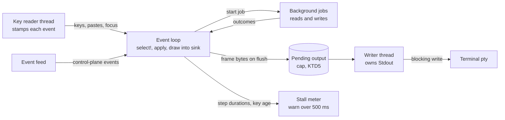

# TUI: keys stall after a window focus switch - Plan

## Goal Capsule

- **Objective:** The `narsor` TUI reacts to each key on the next frame, also after the operator returns from another window while a task changed state (for example, to "waiting for a human decision"). Keys are never held back and then applied in a burst later.
- **Product authority:** The report from the operator (2026-11-23). Assumptions taken without the operator are listed in "Assumptions to confirm".
- **Means:** First find where the loop or the screen stops (diagnosis with a reproduction and the TUI log). Then remove that cause. Then add a guard so that a slow terminal or a slow call cannot stop key handling again (KTD1).
- **Open blockers:** None. The root cause is not known yet; finding it is U2. The questions in "Pytania otwarte dla użytkownika" have recommended defaults that the plan uses; they do not block the start.
- **Execution profile:** One PR, Standard. U1 (stall log) and U2 (diagnosis, `ce-debug`) come first; U3 and U4 ship in every case; U5 only when U2 shows H2, or when U3 and U4 together do not remove the stall in the reproduction (KTD1). Merge gate: question 1 in "Pytania otwarte dla użytkownika" must be answered (or its default confirmed) before the PR merges; building U3 with the default does not wait for it.
- **Stop conditions:** Stop and report when the cause is in the terminal emulator or the compositor and no in-app mitigation (including the redraw on focus gain from assumption 6) removes it; the result is then the documented workaround from "Scope Boundaries". Stop and ask when the fix needs a change in key behavior (for example, dropping keys pressed during a stall). The one such change this plan foresees (KTD3: a second write for a target that already has a write in flight) is already asked as question 1; it does not stop U3, it gates the merge.
- **Who finishes:** `ce-work` builds U1–U5 from this plan and verifies with the Verification Contract.

---

## Product Contract

### Summary

The operator has focus on the task list. They switch to another application. While they are away, a task goes into the "waiting for a human decision" state. They come back to the Narsor window and press keys: nothing changes on the screen. They switch away and back again: suddenly the earlier keys take effect (for example, the highlight is now inside the task). The operator says this happens "quite often".

After the fix, the TUI reacts to keys at once in this situation. The screen always shows the result of the keys that the operator pressed.

### Problem Frame

The behavior "keys do nothing, then all apply together" means that the keys are not lost. They wait somewhere and are applied later. The code shows these facts (verified on 2026-11-23):

- A dedicated thread reads terminal events and sends them over a channel to the main loop (`src/tui/mod.rs`, `read_terminal_events`). So reading keys cannot block, but handling them can wait for the main loop.
- The main loop draws the full screen before it waits for the next event (`terminal.draw(...)` on a blocking `Stdout`). The loop also awaits some calls directly: `app.dispatch(request).await` and `app.retry_outgoing_if_due(now).await`.
- The TUI does not enable focus reporting (no `EnableFocusChange`). So the terminal sends no event to Narsor when the window gets or loses focus. A focus switch cannot wake the loop through its own input.
- The control-plane event that moves a task to "waiting" runs `on_stream`, then `sync_waiting` and `sync_overlay`, and the next draw shows new content (attention marks, the waiting form, possibly links drawn as OSC 8 hyperlinks in `detail.rs`).

Because a focus switch sends nothing to Narsor, the "unblock" on the second return most likely comes from outside the process: the terminal emulator starts to read the program output again, or repaints its window again. The candidate causes, for the diagnosis:

- **H1. The draw blocks on output.** The terminal does not read the pty while its window is unfocused or hidden. The write of a large frame (the new "waiting" content) fills the pty buffer, `draw` blocks, and the keys queue up in the channel. When the terminal reads again, the loop runs and applies all queued keys at once. This matches the symptom best.
- **H2. The screen does not repaint.** Narsor handles the keys and writes the frames, but the terminal shows an old image until a later focus change (a terminal or compositor repaint problem, or terminal state broken by an escape sequence such as an OSC 8 link).
- **H3. The loop awaits a slow call.** A call awaited in the loop (`dispatch`, `retry_outgoing_if_due`) waits for the server without a time limit. The focus switch only coincides with the end of the wait.

### Requirements

**Responsiveness**

- R1. After the operator returns to the Narsor window, each key changes the screen on the next frame, as when the window never lost focus. This holds also when one or more tasks changed state (to "waiting for a human decision" or another state) while the window had no focus.
- R2. No control-plane event, list refresh, background read or retry stops the handling of keys. Work that can take long (a server call, a large redraw) does not keep a key waiting longer than one frame period of the loop.
- R3. Keys are applied in the order the operator pressed them, and none is lost.
- R4. The screen after a key shows the state that this key produced. The operator never sees an older image while the state behind it already moved on.

**Diagnosability**

- R5. When the loop cannot handle keys for longer than a threshold, the TUI log records it: how long, and in which step the loop was (drawing, a named awaited call, or waiting for events). An operator can attach this log to a report. The TUI writes its log only when `RUST_LOG` is set (`docs/user/tui.md`, "Logging"), so the "Logging" paragraph of `docs/user/tui.md` also tells the operator to set `RUST_LOG` before they report a stall, and the stall entry uses a level that this setting lets through.

### Acceptance Examples

- AE1. **Covers R1, R3.** Focus is on the task list. The operator switches to another window. A task goes to "waiting for a human decision". The operator returns and presses `j`, then `Enter`. The highlight moves down one row on the first key, and the detail of that task opens on the second key. No second focus switch is necessary.
- AE2. **Covers R2.** A server call in the loop does not answer for 10 seconds. During this time, `j`/`k` still move the highlight on the task list, and `q` still quits.
- AE3. **Covers R5.** When the draw of one frame takes longer than the threshold, the TUI log has one entry with the duration and the step "draw".

### Scope Boundaries

- Only the `narsor` TUI (the `tui` command of `narsor-cli` and the `narsor` binary). No change to the server, the controller or the event protocol.
- No change to the key map or to what a key does.
- No new desktop notification, bell or window title when a task waits for a decision. (This is a possible later feature, not part of this fix.)
- Problems that are fully inside a terminal emulator or compositor are out of scope. A mitigation inside Narsor, such as the redraw on focus gain from assumption 6, is in scope. When the diagnosis finds such a cause and no in-app mitigation removes it, the result is a documented workaround in `docs/user/` and a note in the TUI log, not a change in Narsor.

### Key Decisions

- **Diagnose before the fix.** The root cause is not known; three causes (H1–H3) give the same symptom and need different fixes. The first unit reproduces the stall and finds the step where the loop stops (R5 helps here and stays as a permanent tool).
- **Keys pressed during a stall are applied, not dropped (R3).** Dropping keys would hide the symptom but lose operator input. The fix removes the stall itself, so that no burst occurs.

---

## Assumptions to confirm

1. **Terminal environment is unknown.** The report does not name the terminal emulator, the window manager or the compositor (the platform is Linux). The fix must not depend on a specific terminal. The reproduction in the diagnosis tries at least one common Wayland terminal and one X11 terminal. The operator can give their terminal and compositor to make the reproduction faster; this is helpful but does not block the plan.
2. **The "waiting for a human decision" state is a trigger, not the only cause.** The operator saw the stall with this state change. The requirements (R1, R2) cover any state change and any background work while the window has no focus.
3. **Focus on the task list is not a necessary condition.** The report says "focus on the task list". The fix covers every panel of the TUI; the task list is the reproduction case.
4. **Keys pressed during a short stall are kept (R3).** A stall shorter than one frame period stays invisible to the operator. Keys are not dropped after a long stall either; the fix aims at no long stall at all.
5. **Threshold of R5.** The log threshold is a fixed value chosen in planning (for example 500 ms), not a setting. It must not write log entries during normal work.
6. **Enabling focus reporting is allowed as a tool.** When the diagnosis shows that a redraw on focus return fixes H2, the TUI may enable terminal focus events and force a full redraw on focus gain. This is an internal change, the operator sees no new behavior except a correct screen.

## Pytania otwarte dla użytkownika

None of these questions blocks the start. The plan uses the recommended option (the first one) until the operator answers.

1. **A second write while the first is still in flight, for writes that have no guard today (KTD3, U3).** Today the loop waits for each write, so a second key waits behind the first and is handled on the state that the first write produced. After U3 the keys work while a write is in flight. Answers and comments (notice "Zapis trwa."), new tasks ("wysyłanie trwa") and the harness change already refuse a repeat and keep that behavior. A move, a panel action, the limit and a repository change have no such guard. What does a second write of that kind for the same target do while the first runs? This is a change in key behavior, so it gates the merge (see "Stop conditions").
   - (a) **Recommended:** it is refused with a short notice in the style of "wysyłanie trwa", and nothing is sent; all other keys work as usual. No request is built on a state that the first write is about to change.
   - (b) It waits in a queue and is sent when the first write ends (built on the state at the time of the key).
   - (c) It is sent at once, in parallel with the first.
2. **The operator's terminal (assumption 1, U2).** Which terminal emulator and which window manager or compositor (Wayland or X11) shows the stall? The answer makes the reproduction in U2 faster.
   - (a) **Recommended:** no answer needed; U2 tries one common Wayland terminal and one X11 terminal.
   - (b) The operator names the terminal and compositor; U2 starts with that pair.

---

## Planning Contract

Product Contract preservation: Product Contract unchanged. The Goal Capsule lines "Means", "Open blockers", "Execution profile" and "Who finishes" are updated for the planned units; the former "Open questions for the user: None." is replaced by "Pytania otwarte dla użytkownika".

### Key Technical Decisions

- KTD1. **Two guards ship whatever the diagnosis finds; the focus redraw ships only on evidence.** R2 and AE2 require keys to work during a slow server call and during a large redraw, independent of which of H1–H3 the operator hits. So U3 (writes off the loop) and U4 (output off the loop) are always built. Under H1, U4 removes the key backlog (keys and quit work, no burst of old keys), but no in-app change can update the screen while the terminal does not read its pty. If U2 confirms H1 and the screen still lags after U4, the stop condition for a terminal-side cause applies (documented workaround). U5 (focus events, assumption 6) is built only when U2 shows H2, or when U3 and U4 together do not remove the stall in the reproduction.
- KTD2. **Writes become keyed background jobs, like reads; quit gives running writes a short grace period.** Today `TaskApp::dispatch` awaits every write (`send_task`, `answer`, `act`, `move_task`, `change_limit`, `change_harness`, `add_repository`, `remove_repository`, `validate_path`) and the loop awaits `retry_outgoing_if_due`. The client timeout bounds each call at 800 ms locally and at 10 s for a remote control plane (`crates/narsor-api-client/src/api/client.rs`, `REQUEST_TIMEOUT`, `REMOTE_REQUEST_TIMEOUT`), so a remote write can hold every key for up to 10 s, which breaks AE2. Each write follows `docs/solutions/design-patterns/tui-reads-as-keyed-background-jobs-with-loading-marker-2026-10-22.md`: the job owns an `ApiClient` clone and the request data, returns an `Outcome`, and the existing result handling runs inside that outcome on the loop. This supersedes "writes stay awaited" from `docs/plans/2026-10-21-001-feat-tui-asynchroniczne-operacje-i-wskaznik-ladowania-plan.md`, which was a scope choice of that work; R2 of this plan now requires the change. The idempotency key and the generation the operator saw at the choice stay in the request exactly as today (`docs/solutions/ui-bugs/tui-action-panel-refresh-stale-generation-and-lost-action-lock-2026-11-13.md`). Read jobs are aborted at quit as today, because an aborted read changed nothing. A write may already have reached the server, so on quit the TUI waits for running write jobs for a bounded time (planned value: 1 s) before it drops the app. A write still running after that time is aborted; after the terminal is restored, one line per such write goes to stderr with its target and the note that it may not have reached the server. The idempotency key makes a resend safe. This keeps AE2 (`q` quits) and never loses an answer without a notice.
- KTD3. **Existing in-flight guards stay the refusal path; a new guard only where none exists.** The answer and comment guard (`entry.sending`, notice "Zapis trwa." in `src/tui/task_app/panel/state.rs`), the new-task guard (`PendingState::Sending`, "wysyłanie trwa") and `harness_pending` keep their behavior unchanged. Each write job gets a `JobKey` that is unique per request (for example the waiting id plus the submit for `answer`, the outgoing task id for `send_task`), so `Background::start` never drops a different write without a notice. For `move`, `act`, the limit and repository changes, which have no guard, a second write for the same target while the first runs is refused with a notice and sends nothing. This is the recommended default of question 1; the other options change only this last rule and its U3 test.
- KTD4. **The loop never writes to the terminal itself.** The ratatui `Terminal` draws through `CrosstermBackend` over an in-memory sink. On flush, the sink hands the frame bytes to a dedicated writer thread, which owns `Stdout` and does the blocking write. `Terminal::draw` therefore returns at once even when the terminal does not read the pty (H1). Rejected: `O_NONBLOCK` on stdout, because the flag is on the shared tty file description and also affects the shell after exit and the key reader; an async stdout, because ratatui's backend is synchronous.
- KTD5. **Back-pressure drops output, never keys.** When the bytes waiting for the writer thread pass a cap (planned value: 1 MiB, several full frames on a large screen), the unsent chunks are discarded and the next draw is a full repaint (`Terminal::clear` before the draw). A chunk that the writer thread already started is always finished, so no escape sequence is cut. The terminal then gets the latest full frame when it reads again, which satisfies R4.
- KTD6. **The stall log measures loop steps and key age.** A loop step (draw, each handled event kind, each remaining direct call) that takes 500 ms or longer writes one `warn` entry, target `narsor::tui`, with the duration and the step name. The key reader stamps each event with the read instant; when the loop handles a key 500 ms old or older and no single step explains it, the entry names the step "waiting for events". 500 ms is above a normal frame (the `TICK` is 250 ms) and far above a normal draw, so normal work writes nothing (assumption 5). `warn` passes any `RUST_LOG` value from `warn` to `trace`.
- KTD7. **Focus events stay off unless U2 asks for them.** When U5 is built, focus reporting is armed and disarmed like bracketed paste (`PASTE_ARMED` pattern in `src/tui/mod.rs`), and `FocusGained` forces one full repaint. No other behavior depends on focus.

### High-Level Technical Design

After U3 and U4, nothing in the loop waits for the server or for the terminal. The loop only waits in its `select!`.

### Assumptions

- The planning values (500 ms threshold, 1 MiB output cap) are fixed constants, not settings (assumption 5).
- U2's reproduction runs on a developer machine with a real terminal; no CI test can show a terminal that stops reading the pty, so the H1 proof in CI is the blocked-writer test of U4.

### Risks

- **Panic hook and writer thread.** The panic hook writes restore sequences to `Stdout` from the panicking thread while the writer thread may be in the middle of a frame. U4 makes the writer thread take a lock per chunk and makes the restore path take the same lock, so the two never interleave inside one chunk.
- **A write aborted at quit.** A write still running after the grace period (KTD2) may or may not have reached the server; the stderr line tells the operator, and the idempotency key makes a resend safe.
- **Exit while the terminal does not read.** On quit, the writer thread may be blocked in a write. The shutdown waits for it only for a bounded time before `restore_terminal`; the restore itself can still block on a terminal that never reads, which is no worse than today.
- **Write outcomes after the view changed.** With KTD2, the view can change between the key and the outcome. Each outcome must apply its result to the state that still exists (notification, row state, panel lock), as reads already do with tickets. U3 tests cover the answer form and the action panel.

---

## Implementation Units

### U1. Stall meter and log entry

**Goal:** The TUI log names the step and the duration of each stall longer than 500 ms, and the user guide tells the operator how to capture it.

**Requirements:** R5, AE3.

**Dependencies:** None.

**Files:**
- `src/tui/stall.rs` (new): the stall meter, plain data over instants passed in by the caller, like `src/tui/refresh.rs`.
- `src/tui/mod.rs`: wrap the draw, the handling of each `select!` branch and each remaining direct call in the meter; stamp events in `read_terminal_events`.
- `docs/user/tui.md`: the "Logging" paragraph.
- `tests/integration/tui_stall.rs` (new) and its `mod` line in `tests/integration/main.rs`.

**Approach:**
1. The meter takes a step name, a start instant and an end instant and returns a report when the duration passes the threshold (KTD6). The loop turns a report into one `tracing::warn!` entry.
2. The key reader sends `(Instant, Event)`. When a key is handled, its age goes to the meter as the step "waiting for events" unless a step report in the same loop turn already explains it.
3. "Logging" in `docs/user/tui.md` gains one or two sentences: to report a stall, start the TUI with `RUST_LOG=warn` (or a more detailed level) and attach `{state}/narsor/narsor.log`.

**Patterns to follow:** `src/tui/refresh.rs` (time as data, no sleeping in tests).

**Test scenarios:**
- Covers AE3. A draw step from t to t+700 ms gives one report with step "draw" and duration 700 ms.
- A step of 499 ms gives no report; a step of 500 ms or more gives one.
- A key stamped at t and handled at t+800 ms, with no step report in that turn, gives a report with step "waiting for events".
- A key that waited behind a 700 ms draw gives only the "draw" report, not a second one.

**Verification:** With `RUST_LOG=warn`, a forced slow draw in a local run writes one entry to `narsor.log`; normal use for a few minutes writes none.

### U2. Diagnosis: reproduce the stall and name the cause

**Goal:** Know which of H1–H3 (or which other cause) stops the keys, with evidence from the U1 log.

**Requirements:** R1, R5; assumptions 1–3, 6.

**Dependencies:** U1.

**Files:**
- No production code. When the cause is fully outside Narsor (stop condition), `docs/user/tui.md` gets the workaround.

**Approach:**
1. Use `ce-debug`. Reproduce with focus on the task list: switch away, let a task go to "waiting for a human decision", come back, press `j` then `Enter`. Try at least one Wayland terminal and one X11 terminal, or the operator's pair from question 2.
2. Read the U1 log for the stalled period. A long "draw" entry points to H1, a long named call to H3, and no entry while the screen is stale points to H2.
3. For H1, confirm separately: run the TUI in a pty whose master is not read for some seconds and see the draw block.
4. For H2, check whether a forced full repaint (resize the window) shows the correct state; if yes, U5 applies (KTD1, KTD7). Also check whether the OSC 8 links of `src/tui/task_app/detail.rs` were on screen at the stall.
5. Record the finding (cause, terminal, log excerpt) in the PR description.

**Execution note:** Diagnose before you change the loop; the result decides U5 and may add a cause the plan does not cover, which is then a stop-and-report.

**Test expectation:** none -- diagnosis only; U1, U3 and U4 carry the tests.

**Verification:** The PR description names the cause and the evidence, and says whether U5 is needed.

### U3. Writes run as background jobs

**Goal:** No server call is awaited in the loop, so keys work during a slow write.

**Requirements:** R2, R3, AE2; KTD2, KTD3.

**Dependencies:** U1 (the meter wraps the dispatch step and shows the change).

**Files:**
- `src/tui/task_app/background.rs`: write `JobKey` variants.
- `src/tui/task_app/mod.rs`: `dispatch` starts jobs and is no longer `async` for writes; `move_task`.
- `src/tui/task_app/new_task/mod.rs`: `send_task`, `validate_path`, `retry_outgoing_if_due` (starts the resend instead of awaiting it).
- `src/tui/task_app/panel/app.rs` (`answer`), `src/tui/task_app/actions.rs` (`act`), `src/tui/task_app/limit.rs`, `src/tui/task_app/harness.rs`, `src/tui/task_app/repositories.rs`.
- `src/tui/mod.rs`: the loop no longer awaits `dispatch` or `retry_outgoing_if_due`.
- `crates/narsor-api-client/src/api/client.rs`: the module comment "Why a timeout" no longer says that each call is awaited in the key loop.
- `tests/integration/tui_background.rs` (extend) and `tests/integration/task_app_support/mod.rs` if a shared helper is needed.

**Approach:**
1. For each write, split the method into a part that runs on the loop before the call (checks, the pending state shown at once, for example "wysyłanie…"), the job (the client call only), and the outcome (today's result handling, unchanged in content).
2. Give each write a `JobKey` per target (KTD3). A start with a running key notifies and sends nothing.
3. Keep `perform` as dispatch plus `drain_jobs`, so tests and callers without a loop still see the result of a write after one call.
4. On quit, wait for running write jobs for the grace period of KTD2, then abort them and keep the list of aborted writes for the stderr line after restore.
5. Each outcome checks that its target still exists before it changes view state, following the ticket checks of the read outcomes (for example `on_opened`).

**Patterns to follow:** `docs/solutions/design-patterns/tui-reads-as-keyed-background-jobs-with-loading-marker-2026-10-22.md`; `TaskApp::start_opening` and `on_opened` in `src/tui/task_app/mod.rs`.

**Test scenarios:**
- Covers AE2. With a client whose server never answers (for example a TCP listener that accepts and never replies, with a 10 s client timeout), the operator sends an answer; before the write ends, `j`/`k` move the highlight on the task list and `q` sets quit.
- A second `Enter` on the same answer while the first write runs still gives the existing "Zapis trwa." notice and no second request (KTD3).
- A second move of the same task while the first move runs gives one notice and no second request (KTD3, default of question 1).
- Quit while an answer write runs: a write that the server answers within the grace period is applied before `run` returns; a write that hangs is aborted within the grace period and is listed for the stderr line.
- Covers R3. Keys pressed during a write apply in order: `j`, `j`, `k` end one row below the start.
- A write that fails after the operator left the task's detail shows the same error notice as today and changes no other view.
- An action outcome that arrives after a refresh rebuilt the action panel keeps the generation sent at the choice (no regression of the stale-generation fix).

**Verification:** No `.await` on a server call remains in the loop path of `src/tui/mod.rs` and `TaskApp::dispatch`; `cargo test --workspace` passes with the existing write tests unchanged in what they assert.

### U4. Terminal output on a writer thread

**Goal:** A terminal that does not read its output cannot stop the loop; when it reads again it shows the latest frame.

**Requirements:** R1, R2, R4; KTD4, KTD5.

**Dependencies:** U1.

**Files:**
- `src/tui/output.rs` (new): the sink (a `Write` that collects frame bytes and hands them over on flush), the pending queue with the cap, and the writer thread.
- `src/tui/mod.rs`: `Tui` draws over the sink; `TerminalGuard` owns the writer and stops it, with a bounded wait, before `restore_terminal`; the full repaint after a dropped chunk; the restore path takes the writer's lock.
- `tests/integration/tui_output.rs` (new) and its `mod` line in `tests/integration/main.rs`.

**Approach:**
1. Make the output generic over the inner writer, so tests use a writer that blocks on a gate and the TUI uses `Stdout`.
2. Start-up sequences (`EnterAlternateScreen`, bracketed paste, keyboard flags) still go directly to `Stdout` before the writer thread starts.
3. When the pending bytes pass the cap, drop all whole chunks not yet started and set a flag; the loop sees the flag and calls `Terminal::clear` before the next draw (KTD5).

**Patterns to follow:** `src/tui/mod.rs` `restore_terminal_to` (a writer seam for tests); `tests/integration/tui_terminal_restore.rs`.

**Test scenarios:**
- With the inner writer blocked, 100 draws through the sink all return within a short bound (for example 50 ms in total).
- With the inner writer blocked, then released, the last bytes the writer gets are the bytes of the latest frame.
- When the pending bytes pass the cap, the unsent chunks are dropped, the repaint flag is set, and the next frame starts with a clear sequence.
- A chunk already started by the writer is written in full even when the cap drops the rest.
- Quit with the inner writer blocked: shutdown returns within its bounded wait and the restore path still runs (`restore_count` increases).

**Verification:** In the U2 reproduction for H1 (pty not read), keys keep changing the app state, `q` quits, and the stall meter shows no long "draw" entries. Then check the visible screen with AE1 (one return to the window); if the screen still lags because the terminal does not read, apply the stop condition for a terminal-side cause (KTD1).

### U5. Full repaint on focus gain (conditional)

**Goal:** When the terminal shows an old image after a focus switch (H2), the screen is correct as soon as the window gets focus.

**Requirements:** R4; assumption 6; KTD7.

**Dependencies:** U2 (build only when U2 shows H2, or when U3 and U4 do not remove the stall), U4.

**Files:**
- `src/tui/mod.rs`: arm `EnableFocusChange` in `take_screen` with an armed flag, disarm in `restore_terminal_to`, handle `FocusGained` in the loop by a full repaint.
- `tests/integration/tui_terminal_restore.rs` (extend).

**Approach:** Mirror the bracketed-paste arm/disarm pair. `FocusGained` sets the same repaint flag as KTD5 and does not change app state. `FocusLost` is ignored.

**Test scenarios:**
- When focus reporting was armed, the restore sequence contains the disable-focus sequence once, also on a second restore call.
- When it was not armed, the restore sequence does not contain it.
- A `FocusGained` event leaves the app state unchanged and makes the next frame a full repaint.

**Verification:** In the U2 reproduction for H2, the screen is correct after one return to the window.

---

## Verification Contract

- `cargo build --workspace --bins` and `cargo test --workspace` pass (CI runs the tests with `--locked`).
- The new and extended tests of U1, U3, U4 (and U5 when built) pass; they need no real terminal and no server.
- Manual check, repeated after U3 and U4 in the terminals used in U2: AE1 passes with one return to the window; with `RUST_LOG=warn`, the log has no stall entries during the check.
- No `#[ignore]`d test is needed for this change.

## Definition of Done

- R1–R5 hold and AE1–AE3 pass as described in the Verification Contract.
- The PR description records the U2 finding and whether U5 was built and why.
- `docs/user/tui.md` "Logging" tells the operator how to capture a stall; a workaround is documented only if U2 found a cause outside Narsor.
- No awaited server call and no direct terminal write remain in the event loop.
- Code from abandoned diagnosis experiments (temporary logging, test harnesses that are not kept as tests) is removed from the diff.
