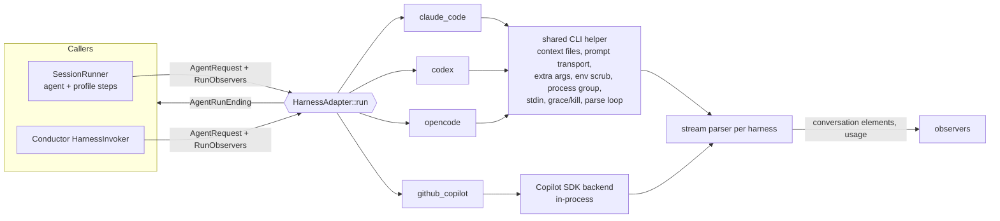

# refactor: Unified harness run and conductor context files

## Summary

Each harness gets one asynchronous `run(request, observers)` that owns
translation, start (CLI process or in-process SDK), prompt transport (argv,
stdin, attached file), context files and output parsing. A shared CLI helper
keeps the process mechanics in one place. The agent step, the profile step and
the conductor move to this interface, and the old request/invocation types and
the three `run_harness_*` entry points are removed in the same MR. On top of
it, the conductor's snapshot splits into a prompt core and uncut context files
in its per-invocation scratch directory.

---

## Problem Frame

NARSOR-1124-001 showed that callers know harness details (argv, stdin, which
runner to call), so a harness capability added in one caller is missed in the
other; the conductor dropped stdin and failed with E2BIG. The conductor prompt
also carries every snapshot section, cut by a budget, whatever the purpose.
Full context: see origin `docs/brainstorms/2026-11-24-unified-harness-request-and-conductor-context-files-requirements.md`.

---

## Requirements

Carried from origin (R-IDs match the origin document):

- R1. One self-contained request type is the only harness input.
- R2. One `run` call per harness; it returns a unified result.
- R3. Live output reaches the caller through observers in the unified form.
- R4. Model, effort and session id used come back from the harness; no caller reads argv.
- R5. Every harness accepts a prompt of any size.
- R6. Every harness makes context files readable, or inlines them into the prompt.
- R7. Agent step and conductor use only this interface; all five harnesses move in the same change; old types removed.
- R8. Process mechanics stay shared as a helper for CLI harnesses.
- R9. Conductor prompt holds only the core (plus the last agent answer for purposes that analyse it).
- R10. Core sections have no size limit.
- R11. Every other snapshot section goes to a context file, uncut.
- R12. The prompt lists the context files and tells the conductor when to read them.
- R13. Context files of one invocation live in the scratch area; each invocation replaces them.

**Origin actors:** A1 (caller), A2 (harness), A3 (conductor agent)
**Origin acceptance examples:** AE1 (R5, R7), AE2 (R6), AE3 (R9, R11), AE4 (R13), AE5 (R1, R2, R4)

---

## Scope Boundaries

Carried from origin:

- Conductor session continuation and chat threads (NARSOR-1124-001, decision 1).
- Conductor cost in the task cost (NARSOR-1124-001, decision 2); the usage
  observer keeps today's behaviour (no reading without an episode).
- Moving prompt texts out of code into configuration (prompts stay in code, outside harness code).
- Context files for agent steps declared in workflow YAML (the request
  supports them; the schema does not expose them).
- The future script generator.
- History of conductor snapshots.

Plan-local:

- No change to workflow YAML, wire protocol or persisted types.
- No change to stream parsers' classification rules; they move behind `run`
  unchanged.

### Deferred to Follow-Up Work

- `github_copilot` read-only enforcement (today the sandbox setting is
  computed and dropped, and the SDK approves all permissions). This plan keeps
  the behaviour, makes it explicit in code and docs, and leaves the fix to a
  separate change with a security review (see `docs/follow-ups/2026-11-15-narsor-engine-split-follow-ups.md`).
- Live check that effort passed with resume takes effect
  (`docs/follow-ups/2026-11-11-effort-w-sesji-przy-braku-postepu.md`).

---

## Context & Research

### Relevant Code and Patterns

- Adapters: `crates/narsor-exec/src/engine/actions/harness/{claude_code,codex,opencode,github_copilot,copilot_sdk}.rs`; trait, `HarnessRequest`, `HarnessInvocation`, `apply_extra_args`, `HarnessRegistry` in `crates/narsor-exec/src/engine/actions/harness/mod.rs`.
- Runners: `run_harness_process`, `run_harness_invocation`, `run_harness_invocation_with_sdk`, `spawn_and_wait`, `GroupGuard`, `FINAL_ANSWER_GRACE`, `PARSE_LINE_LIMIT` in `crates/narsor-exec/src/engine/actions/session/process.rs`.
- Callers: `SessionRunner::run` in `crates/narsor-exec/src/engine/actions/session.rs` (used by `actions/agent.rs` and `actions/profile.rs`); `HarnessInvoker::try_invoke` in `crates/narsor-exec/src/conductor/invoke.rs`.
- Conductor snapshot and prompt: `crates/narsor-exec/src/conductor/snapshot.rs` (`SnapshotInput::collect`, `render`, `render_whole`, `render_shortened`), `crates/narsor-exec/src/conductor/prompt.rs` (`conductor_prompt_for`).
- Async trait objects without `async-trait`: `CopilotSdkBackend::run` returns `BoxFuture` (`harness/copilot_sdk.rs`) — the pattern for the new `run`.
- Other users of the registry: `crates/narsor-runner/src/runner/conductor.rs` (`program()` for PATH check), `crates/narsor-engine/src/launch.rs`, `crates/narsor-server/src/runtime.rs` (`check_model_tiers`).
- Fake harness: `tests/fixtures/harness/fake_harness.sh` (records `args.<n>`, `stdin.<n>`, `cwd.<n>`, `action_id.<n>`).

### Institutional Learnings

- `docs/solutions/runtime-errors/long-agent-prompt-must-go-on-stdin-not-argv-2026-11-24.md` — prompt transport per harness; extra args anchored at the prompt break when the prompt leaves argv.
- `docs/solutions/runtime-errors/agent-step-hangs-on-orphaned-background-process-2026-10-26.md` — one process-group owner, grace → SIGTERM → SIGKILL → drain on every exit path; the conductor must keep it too.
- `docs/solutions/architecture-patterns/auto-resume-policy-for-lost-workloads-2026-10-11.md` §7 — the harness process must stay in the tagged process tree.
- `docs/solutions/integration-issues/claude-code-json-schema-rejects-top-level-anyof-2026-10-17.md` — text contract stays in the prompt for every harness; record real CLI output as fixtures before designing against new CLI behaviour.
- `docs/solutions/design-patterns/output-contract-once-per-session-runtime-marker-2026-11-12.md` — `skip_output_contract` stays a step-side runtime marker; the harness gets the final prompt.
- `docs/solutions/design-patterns/show-only-what-harness-reports-count-without-tokens-record-fixture-2026-11-13.md` — usage observer reports only what the harness reports.
- `docs/solutions/architecture-patterns/step-profile-tiers-decide-once-validate-at-load-2026-11-11.md` — tier mapping and startup validation stay on the harness.
- `docs/solutions/integration-issues/runner-private-home-hides-harness-login-2026-10-10.md`, `docs/solutions/security-issues/untrusted-control-plane-reaches-user-git-and-harness-logins-2026-10-25.md` — environment scrubbing must apply on the single spawn point and to the SDK start.
- `docs/solutions/conventions/single-integration-test-crate-and-lean-target-2026-11-01.md` — integration tests in `tests/integration/main.rs`, concurrent, no `set_var`; run with `ORCHESTRATOR_ACTION_ID` unset.
- `docs/solutions/security-issues/untrusted-agent-text-unclosed-brace-scan-quadratic-2026-10-18.md` — parsers stay bounded; context files are untrusted agent text.

### External References

- Local CLI help (installed binaries): `codex exec --help` (prompt from stdin when absent or `-`), `opencode run --help` (`--file` attach; stdin undocumented), `copilot --help` (`-p`, piped stdin, `--add-dir`). Not yet verified by recorded fixtures.

---

## Key Technical Decisions

- **`run` returns a `BoxFuture`** on the object-safe `HarnessAdapter` trait, following `CopilotSdkBackend`; no new `async-trait` dependency.
- **Request is owned and harness-neutral** (`AgentRequest`): prompt, context files (name, description, content), context directory, model tier, effort, resume session, working dir, workspace access, writable and read-only dirs, extra read-only paths, permission grants, harness parameters (`max_turns`, `append_system_prompt`, agent, …), answer schema, answer shape, timeout, final-answer grace, action execution id, extra args. The conductor no longer fakes a `HarnessStepConfig`; the agent step maps its `HarnessStepConfig` into the request.
- **Observers** (`RunObservers`): conversation sink, usage relay, reading tap, and a `started` callback that receives the resolved model and effort before the process starts. `AgentSessionStarted` is emitted from it, replacing `flag_value`.
- **Result** (`AgentRunEnding`): `Finished(FinishedRun)` with the parsed run (text, structured output, session id, denials, failure), exit code, stderr, terminated group — or `TimedOut`. Same information callers use today, without argv.
- **Shared CLI helper** (`harness/cli.rs`): takes a built command line plus a prompt-transport choice, writes context files, applies extra args at a known prompt index (not by searching argv for the prompt text), spawns with scrubbed env, process group, stdin write-then-close, grace/kill, parse loop. `spawn_and_wait` moves here.
- **Prompt transport per harness:** claude — argv up to 96 KiB, else stdin (unchanged); codex — argv up to 96 KiB, else `-` and stdin; opencode — argv up to 96 KiB, else prompt written to a file in the context directory and passed with `--file` plus a short message (stdin undocumented); copilot — SDK API, no argv limit.
- **Context files:** the caller supplies the files and a directory; the helper replaces the directory's content and writes them. The harness grants read access (claude `--add-dir`; codex read-only sandbox reads outside cwd — to verify; opencode/copilot isolated cwd contains the directory) and appends a standard "Context files" block listing absolute paths, descriptions and sizes. A harness that cannot grant access inlines the files' content into that block instead (R6). The decision is per harness, static.
- **Copilot is one harness**: `github_copilot` runs the SDK backend in-process from `run`; the `copilot-sdk` pseudo-program, base64 argv and program-name routing in the runner are removed. The backend is injected (default runtime, or the test mock). Real read-only paths replace the placeholder text.
- **Conductor scratch:** one directory per execution, emptied per invocation (invocations are serialized by the conductor actor). Context files go to a `context/` subdirectory for both access modes; the isolated working directory is the scratch directory itself.
- **Context file layout:** one file per section — `workflow.yaml`, `variables.json`, `events.md`, `chat.md`, `artifacts/<name>` (isolated only), and one file per agent attempt under `conversations/` named by state and attempt — so the conductor can read selectively.
- **One MR, ordered commits:** each unit compiles and passes tests; the old API is removed in U7. Between U2 and U7 the old `invocation` path still exists but has no new callers.

---

## Open Questions

### Resolved During Planning

- Where context files live for read-only workspace harnesses: in the conductor scratch area, outside the workspace, made readable per harness (see Key Technical Decisions).
- How extra args work when the prompt is not in argv: the helper inserts them at the index where the prompt argument is or would be; for stdin/file transport they go at the end of the flags.
- Where the conversation file and usage relay attach: observers passed to `run`; the caller still opens the conversation before `run`, so a harness that fails to start leaves a conversation entry.
- Exact core per conductor purpose: core sections from origin R9; the last agent answer is added for `ChooseOutput`, `ChooseOutputAfterReprompt`, `AnswerAgentQuestion` and `DiagnoseFailure`.

### Deferred to Implementation

- Whether `codex`'s read-only sandbox lets the agent read the scratch `context/` directory outside cwd; if not, codex inlines context files (R6 fallback) or gets `--add-dir` read access — decided after the fixture recording in U2.
- Whether `opencode run --file` with a short message makes the model follow the attached prompt reliably; fallback is stdin if the recording shows it works.
- Exact type and helper names, and how `SnapshotBudget` shrinks (core needs no budget; conversation reading becomes uncut).
- The `warn` log for large prompts (proposed in NARSOR-1124-001): its fields.

---

## High-Level Technical Design

> *This illustrates the intended approach and is directional guidance for review, not implementation specification. The implementing agent should treat it as context, not code to reproduce.*

---

## Implementation Units

### U1. Request, observers, result and shared CLI helper

**Goal:** Introduce the harness-neutral request, observers and result types, and move process mechanics into a shared CLI helper, without changing callers yet.

**Requirements:** R1, R2, R3, R5, R6, R8

**Dependencies:** None

**Files:**
- Create: `crates/narsor-exec/src/engine/actions/harness/request.rs`
- Create: `crates/narsor-exec/src/engine/actions/harness/cli.rs`
- Modify: `crates/narsor-exec/src/engine/actions/harness/mod.rs` (add `run` to the trait with a temporary default that bridges to `invocation` + helper, re-exports)
- Modify: `crates/narsor-exec/src/engine/actions/session/process.rs` (move `spawn_and_wait`, `GroupGuard`, grace constants into the helper; keep thin wrappers until U7)
- Test: unit tests in `harness/cli.rs`

**Approach:**
- Request carries everything listed in Key Technical Decisions; context file = name, one-line description, content.
- Helper: replace and write context files; build the "Context files" prompt block (paths or inline content); choose transport (argv / stdin / file) by size threshold given by the harness; apply extra args at a known prompt index; spawn and drive exactly as `spawn_and_wait` does today.
- Add a `warn` trace when a prompt goes off argv, with harness name and size.

**Patterns to follow:** `spawn_and_wait` and `GroupGuard` (move, not rewrite); `BoxFuture` signature from `CopilotSdkBackend`.

**Test scenarios:**
- Happy path: two context files with readable access → both written in the directory, prompt block lists absolute paths, descriptions and sizes.
- Edge case: directory holds files from a previous call → only the new files remain.
- Edge case: harness declares inline access → no files written, block contains each file's content under its name.
- Happy path: extra args `--foo bar` with prompt in argv → inserted before the prompt; with stdin transport → appended after the flags, and no argv entry equals the prompt.
- Edge case: prompt of 200 KiB with argv threshold 96 KiB → no argv entry ≥ 96 KiB, stdin carries the prompt.

**Verification:** Existing agent and conductor tests pass unchanged; the helper is covered by its own unit tests.

---

### U2. CLI harnesses implement `run` (claude_code, codex, opencode)

**Goal:** Each CLI harness translates `AgentRequest` itself and runs through the helper, including large prompts and context files.

**Requirements:** R2, R4, R5, R6

**Dependencies:** U1

**Files:**
- Modify: `crates/narsor-exec/src/engine/actions/harness/claude_code.rs`
- Modify: `crates/narsor-exec/src/engine/actions/harness/codex.rs`
- Modify: `crates/narsor-exec/src/engine/actions/harness/opencode.rs`
- Create: `tests/fixtures/codex/` and `tests/fixtures/opencode/` recordings (stdin / `--file` runs)
- Test: `tests/integration/actions_agent.rs` (argv tests rewritten against `run`), unit tests in each adapter

**Execution note:** First record real CLI behaviour for `codex exec -` with a piped prompt, `opencode run --file` with a short message, and codex read-only sandbox reading a file outside cwd; store the output as fixtures and settle the two deferred questions before writing the adapters.

**Approach:**
- Each harness: build its command line from the request (current `invocation` logic), report resolved model/effort through the `started` observer, pick transport and context-file access, call the helper.
- claude: `--add-dir` for the context directory.
- codex: `-` plus stdin above the threshold; context access per the recording.
- opencode: `--file` above the threshold; isolated cwd holds the context directory.
- The helper's extra-args index replaces the prompt-text search, fixing the codex/opencode case where `read_only_paths` changed the prompt.

**Patterns to follow:** `LONGEST_PROMPT_ARGUMENT` in `claude_code.rs`; existing argv tests in `tests/integration/actions_agent.rs`.

**Test scenarios:**
- Covers AE1. codex (fake harness) with a 200 KiB prompt → process starts, prompt read from stdin, no argv entry ≥ 128 KiB.
- opencode (fake harness) with a 200 KiB prompt → prompt is in the attached file, argv holds only the short message.
- Happy path: claude with context files → `--add-dir <context dir>` present; prompt lists the files.
- Happy path: started observer gets the real model name and effort for claude and codex (codex effort from `-c model_reasoning_effort`).
- Edge case: codex with `read_only_paths` and extra args → extra args land before the prompt argument.

**Verification:** All harness argv tests pass against `run`; recorded fixtures exist for the new CLI modes.

---

### U3. Copilot harness runs the SDK in-process

**Goal:** `github_copilot` implements `run` by calling the SDK backend directly; the pseudo-program path disappears.

**Requirements:** R2, R4, R5, R6

**Dependencies:** U1

**Files:**
- Modify: `crates/narsor-exec/src/engine/actions/harness/github_copilot.rs`
- Modify: `crates/narsor-exec/src/engine/actions/harness/copilot_sdk.rs` (feed loop becomes the harness's run body; backend injected into the harness)
- Modify: `crates/narsor-exec/src/engine/actions/harness/mod.rs` (registry builds copilot with the default backend)
- Test: unit tests in `copilot_sdk.rs` and `github_copilot.rs` (`MockCopilotSdk`)

**Approach:**
- The harness builds `CopilotSdkRequest` from `AgentRequest` (prompt with context files block, model, session, working dir, action id, timeout) and feeds events through the existing record/parse loop.
- Real read-only paths in the prompt instead of the placeholder.
- Keep the sandbox behaviour as today but explicit: a comment and a timeline note that copilot does not enforce workspace access (deferred fix).
- `program()` for the PATH check stays meaningful (the CLI the SDK starts).
- Environment for the SDK-started CLI gets the same scrubbing as the CLI helper.

**Test scenarios:**
- Happy path: mock backend emits events → unified result with text, session id, usage; conversation sink receives the elements.
- Edge case: backend times out → `TimedOut`.
- Edge case: request with read-only dirs → prompt lists the real paths.
- Happy path: started observer gets the resolved model name (not the tier name).

**Verification:** Copilot no longer depends on the runner's program-name check; copilot tests pass with the mock backend.

---

### U4. Agent and profile steps use `run`

**Goal:** `SessionRunner` builds an `AgentRequest` and calls `run`; no argv knowledge remains in the step path.

**Requirements:** R1, R3, R4, R7

**Dependencies:** U2, U3

**Files:**
- Modify: `crates/narsor-exec/src/engine/actions/session.rs` (request mapping, observers, `AgentSessionStarted` from the started callback, remove `flag_value`)
- Modify: `crates/narsor-exec/src/engine/actions/agent.rs`, `crates/narsor-exec/src/engine/actions/profile.rs` (only if the runner's signature changes)
- Test: `tests/integration/actions_agent.rs`, `tests/integration/profile_step_flow.rs`, `tests/integration/engine_recovery.rs`

**Approach:**
- Conversation is opened before `run` (unchanged); outcomes (did not start, timeout, nonzero exit, terminated group) are appended from the result.
- `skip_output_contract` and prompt assembly stay in the step; the harness receives the final prompt and no context files.
- Effort warning for harnesses without effort support stays in the step.

**Test scenarios:**
- Happy path: agent step on the fake harness completes with a choice; conversation file holds prompt and outcome.
- Integration: `AgentSessionStarted` carries model and effort reported by the harness for codex (previously missing effort).
- Error path: harness fails to start → conversation records "harness did not start", step fails as today.
- Integration: resumed session passes the session id and the `RESUME_SESSION_REJECTED` handling still triggers.

**Verification:** All agent, profile and recovery integration tests pass with no reference to `HarnessRequest` or `run_harness_invocation` in the step path.

---

### U5. Conductor uses `run`

**Goal:** The conductor builds an `AgentRequest` and calls `run`; the fake step config and the direct runner call go away.

**Requirements:** R1, R7

**Dependencies:** U2, U3

**Files:**
- Modify: `crates/narsor-exec/src/conductor/invoke.rs` (remove `conductor_config` fake, `run_harness_process` call; observers with reading tap; scratch handling)
- Test: `tests/integration/conductor_invoke.rs`, `tests/integration/conductor_failure.rs`

**Approach:**
- Model and effort from the conductor profile go straight into the request; answer schema and shape `Choice` as today.
- Group killing and grace now apply to the conductor via the helper (today `run_harness_process` already uses `FINAL_ANSWER_GRACE`; keep).
- Keep `ConductorAccess` decisions; fix the module comment that names only opencode as isolated.

**Test scenarios:**
- Happy path: conductor on claude (fake) answers a gate summary; prompt reaches the harness.
- Regression: `a_prompt_too_long_for_one_argument_reaches_claude_on_stdin` still passes.
- Integration: read-only workspace test (`claude_runs_read_only_in_the_workspace_without_an_action_attempt`) passes with `ORCHESTRATOR_ACTION_ID` cleared in the test's harness environment.
- Error path: harness times out → conductor records the timeout failure as today.

**Verification:** `conductor_invoke` and `conductor_failure` suites pass.

---

### U6. Conductor snapshot: prompt core plus context files

**Goal:** The snapshot produces a core for the prompt and uncut context files; the prompt lists them and tells the conductor when to read them.

**Requirements:** R9, R10, R11, R12, R13

**Dependencies:** U5

**Files:**
- Modify: `crates/narsor-exec/src/conductor/snapshot.rs` (collect uncut conversations and events; render core + files; drop budget halving for file sections)
- Modify: `crates/narsor-exec/src/conductor/prompt.rs` (core-only snapshot, reading rule, access paragraphs)
- Modify: `crates/narsor-exec/src/conductor/invoke.rs` (scratch `context/` directory for both access modes, emptied per invocation)
- Modify: `tests/fixtures/conductor/prompt_choose_output.txt`, `tests/fixtures/conductor/prompt_diagnose_failure_isolated.txt` (regenerated)
- Test: `tests/integration/conductor_invoke.rs`, `tests/integration/conductor_decision.rs`, `tests/integration/conductor_title.rs`

**Approach:**
- Core: status, current state with its definition and outputs, request with payload, operator message, pending input, annotations, step locals, and for analysing purposes the last agent answer of the current state's latest attempt.
- Files: full workflow YAML, variables, all events with full payloads, every attempt's conversation, chat, artifacts (isolated only), each with a one-line description.
- Prompt rule: read a file when the core does not settle the decision; escalate when the files do not either.
- Existing budget tests for "whole sections over budget" are replaced by tests on the new split.

**Test scenarios:**
- Covers AE3. Execution with several states and long conversations, gate summary → prompt has no `## Agent conversations` section; `conversations/` holds one file per attempt with the full text.
- Covers AE4. Two invocations in a row → after the second, the context directory holds only the second invocation's files.
- Happy path: `ChooseOutput` prompt contains the last agent answer; `SummarizeGate` prompt does not.
- Edge case: execution with no events and no conversations → no empty files are listed in the prompt.
- Golden files: regenerated prompts for choose-output and isolated diagnose-failure match.

**Verification:** Conductor suites pass; golden prompt fixtures show core + context file list.

---

### U7. Remove the old harness API and update docs

**Goal:** Remove `HarnessRequest`, public `invocation`, `HarnessInvocation` as an API and the `run_harness_*` entry points; update documentation.

**Requirements:** R7, R8

**Dependencies:** U4, U5, U6

**Files:**
- Modify: `crates/narsor-exec/src/engine/actions/harness/mod.rs`, `crates/narsor-exec/src/engine/actions/session/process.rs`
- Modify: re-exports in `crates/narsor-engine` used by tests
- Modify: `docs/dev/building-and-testing.md` ("How each harness is invoked"), `docs/dev/architecture.md` (D17, D51, D55, D60, D69, D75), `docs/user/conductor.md`, `docs/solutions/runtime-errors/long-agent-prompt-must-go-on-stdin-not-argv-2026-11-24.md` ("Still open"), module docs in `harness/mod.rs`, `conductor/invoke.rs`, `conductor/snapshot.rs`
- Test: `tests/integration/actions_agent.rs` (direct `HarnessRequest` tests replaced)

**Approach:**
- Command building becomes private to each harness; tests assert through `run` with the fake harness.
- Docs: unified interface, prompt transport per harness, context files, copilot read-only gap stated explicitly.

**Test scenarios:**
- Covers AE5. A test caller runs each of the three CLI-backed harnesses (claude_code, codex, opencode) (fake binary) and copilot (mock backend) with only `AgentRequest` and `run`.
- Test expectation for docs: none — documentation only.

**Verification:** No reference to the removed types in the workspace; `cargo test --workspace` passes.

---

## System-Wide Impact

- **Interaction graph:** agent step, profile step, conductor; daemon startup (`check_model_tiers`), runner PATH check (`program()`), local backend orphan-group kill.
- **Error propagation:** harness start errors stay `ActionError` for steps and become the conductor's failure string as today.
- **State lifecycle risks:** conductor scratch directory is emptied per invocation; serialized by the actor, so no race.
- **API surface parity:** no wire or persisted type changes; TUI/web show the same conversation and events (now with correct model/effort for codex and copilot).
- **Integration coverage:** fake-harness tests for prompt transport and context files; recorded fixtures for the real CLI modes.
- **Unchanged invariants:** stream parser classification, output contract rules, model tier mapping and validation, environment scrubbing, `ORCHESTRATOR_ACTION_ID` for harness processes, copilot read-only behaviour (explicitly unchanged).

---

## Risks & Dependencies

| Risk | Mitigation |
|------|------------|
| Real CLIs behave differently from the fake harness for stdin / `--file` | U2 starts by recording real CLI output as fixtures |
| codex sandbox cannot read the context directory | Inline fallback (R6) for codex, decided after recording |
| Conductor reads files less than needed and decides on the core only | Prompt rule to escalate when unsure; core holds the decision inputs |
| Large refactor in one MR breaks agent steps | Ordered units, each compiling and green; old path kept until U7 |
| Context files are untrusted agent text (prompt injection) | Conductor stays read-only with structured answers; no new privileges |

---

## Documentation / Operational Notes

- Docs listed in U7. No configuration or deployment change.
- Operators may see larger scratch directories under `tasks/<id>/conductor/scratch/` during an invocation.

---

## Sources & References

- **Origin document:** [docs/brainstorms/2026-11-24-unified-harness-request-and-conductor-context-files-requirements.md](../brainstorms/2026-11-24-unified-harness-request-and-conductor-context-files-requirements.md)
- Bug: `docs/bugs/NARSOR-1124-001.md`; PR #143
- Related code: `crates/narsor-exec/src/engine/actions/harness/`, `crates/narsor-exec/src/engine/actions/session/process.rs`, `crates/narsor-exec/src/conductor/`
