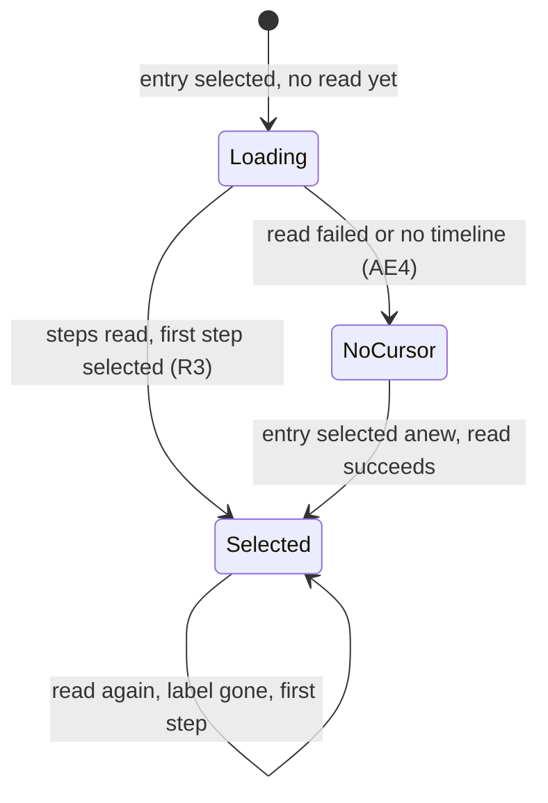

# History View - Step Cursor and Reduced Tabs - Plan

## Goal Capsule

- **Objective:** An operator who reads an archived task in the history sees only tabs that can hold content, and can move along every step of the archived run and read each step, however long the run and whatever the terminal height.
- **Means:** A history-only tab list, a step cursor on the history axis that reuses the live axis model without follow and without step conversations, and a closed-run mode for the right side of *Przebieg* (KTD1-KTD4).
- **Product authority:** This plan covers the TUI history (`H`) and the matching check of the Web UI history and `narsor-cli`. The live task details are not active scope. On product behavior the Requirements (R-IDs) win; on mechanism the KTDs win.
- **Open blockers:** None. Q3 is answered: the history also drops *Stan* (history tabs: *Przebieg*, *Info*).
- **Execution profile:** One pull request. All changes are in the `narsor` TUI crate (`src/tui/`), its integration tests and `docs/user/tui.md`. No server, protocol, Web UI or CLI change.
- **Stop conditions:** Stop and ask if the implementation needs a change to the protocol, the archive snapshot, the live details, the Web UI or the CLI.
- **Who finishes:** The implementer runs `cargo test --workspace` and hands the branch for review; commit and push only when asked (AGENTS.md).

---

## Product Contract

Product Contract preservation: Product Contract changed by the answer to Q3 (option 1): *Stan* is removed from the history tabs in Summary, R1, A1, AE5 and R12.

### Summary

The TUI history drops the *Rozmowa*, *Zdarzenia*, *Dyrygent* and *Stan* tabs, because archiving deletes the conversations, the events, the conductor data and the state. It keeps only *Przebieg* and *Info*.
*Przebieg* in the history gets a step cursor: `j`/`k`, arrows, `g`/`G` move it, the axis scrolls to keep it in view in both the one-row and the full (`v`) layout, and the right side shows the facts of the selected step.
The Web UI and the CLI are checked for the same two points and change only where they show the same gap.

### Problem Frame

An archived task keeps only the step header rows of its run (see `docs/plans/2026-11-20-002-feat-archive-task-run-snapshot-plan.md`).
The conversation, the events and the conductor go away with the storage.
The TUI history still shows the *Rozmowa*, *Zdarzenia* and *Dyrygent* tabs, and each can only say "storage deleted".
The earlier plan also made *Przebieg* in the history a list without a cursor ("Step rows render without a selection cursor").
The axis draws from the first step down and has nothing to scroll by.
When the run has more steps than the tab has rows, the operator cannot see the later steps.
The full layout (`v`) uses two rows per step, so the problem shows sooner there.

### Key Decisions

- **The history keeps the cursor model of the live *Przebieg*, without the parts that need a live run.** No follow (`f`), no step conversation, no `Enter`/`→` into a step. Governs R3, R4, R6.
- **The history drops *Rozmowa*, *Zdarzenia* and *Dyrygent*.** Decision Q1: the person chose to remove all three, because each shows only "storage deleted". Governs R1.
- **The CLI does not change.** `narsor-cli task show` and `task conversation` for an archived task print one availability line ("the task is archived"), not a conversation view. Governs R11.

### Requirements

**TUI: tabs in the history**

- R1. The tab strip of the history details does not show *Rozmowa*, *Zdarzenia*, *Dyrygent* or *Stan*, and `[` / `]` skip them.
- R2. The tabs of the live task details do not change.

**TUI: the step cursor on *Przebieg* in the history**

- R3. When the archived timeline has steps, one step is selected; when the history entry first shows its timeline, the selection is on the first step.
- R4. While the keys are on the axis, `j` / `↓` and `k` / `↑` move the selection one step, and `g` / `G` move it to the first / last step; the selection stops at the ends.
- R5. The axis scrolls so that the selected step is always in view, in the one-row layout and in the full (`v`) layout, and when the operator switches the layout or the terminal changes size.
- R6. The selected step uses the same bracket as on the live axis: in the focus role while the keys are on the axis, in the background role when the focus is on the history list.
- R7. The right side of the tab shows the facts of the selected step that the live *Przebieg* shows above the conversation (name, decision by, duration, error, notes, the gate's scripts for the gate step), and below them one fixed line that the conversation was deleted at archiving. It never starts a conversation read.
- R8. Each history entry remembers its own selection and scroll position while the history is open, so going to another entry and back keeps them.
- R9. The key help and the footer of the history axis list the new keys.

**Web UI and CLI**

- R10. The Web UI history keeps its current form (a dialog without a *Rozmowa* tab, with all step rows and their facts in a page that the browser scrolls); it does not change (decision Q2: the person chose no step selection in the Web UI).
- R11. The CLI does not change (per Key Decisions).

**Documentation**

- R12. The user documentation of the history (`docs/user/tui.md`) says which tabs the history has and how to move along the steps.

### Acceptance Examples

- AE1. **Covers R3, R4, R5.** **Given** an archived run with 30 steps and a tab 12 rows high in the full layout, **when** the operator presses `G`, **then** the last step is selected and in view; **when** the operator then presses `g`, **then** the first step is selected and in view.
- AE2. **Covers R5.** **Given** the selected step is the 10th in the one-row layout and in view, **when** the operator presses `v`, **then** the 10th step stays selected and is still in view.
- AE3. **Covers R7.** **Given** a selected step that failed, **when** the right side draws, **then** it shows the error line and the "conversation deleted at archiving" line, and no conversation read starts.
- AE4. **Covers R3.** **Given** the read of the archived timeline failed or returned no timeline, **when** *Przebieg* draws, **then** it shows the existing error or "storage deleted" text and there is no cursor.
- AE5. **Covers R1.** **Given** the history details are on *Przebieg*, **when** the operator presses `[` repeatedly, **then** the tabs go round *Info*, *Przebieg*, and never show *Rozmowa*, *Zdarzenia*, *Dyrygent* or *Stan*.

### Scope Boundaries

- Not in scope: a change to what the archive keeps (the snapshot stays step header rows only).
- Not in scope: keyboard selection of steps in the Web UI history (decision Q2).
- Not in scope: any change to the live task details or the live *Przebieg*.
- Considered and not built: a separate "loading" state for the right side of a history step. The archive has no conversation to load, so a fixed line is enough (R7). Evidence that would change this: an archive format that keeps step conversations.

### Założenia do potwierdzenia

- A1. *Rozmowa*, *Zdarzenia*, *Dyrygent* and *Stan* are removed from the TUI history. They all show only the "storage deleted" text (decisions Q1 and Q3).
- A2. The Web UI history already has no *Rozmowa* tab: it is a dialog with the *Przebieg* step list, the header and *Info* (`crates/narsor-web/ui/js/ui/settings.js`, `ArchivedTask`). Its step rows already show all step facts, and the browser scrolls the dialog. So the Web UI needs no change for this request.
- A3. The CLI has no *Rozmowa* equivalent for archived tasks. `task show` prints the step lines and one conversation availability line; `task conversation` reports "the task is archived". These lines tell the truth and stay.
- A4. The first step is the initial selection, because a closed run has no running step to follow.
- A5. The right side of a selected step shows only facts that the archive kept; it does not try to read the conversation, because the storage is gone.
- A6. The step keys are the same as on the live axis (`j`/`k`, arrows, `g`/`G`), so the operator does not learn new keys.

### Pytania otwarte dla użytkownika

- Q3 (answered: option 1). The history also drops *Stan*, because it shows only `storage usunięty przy archiwizacji` for an archived task. The history has *Przebieg* and *Info*.

### Outstanding Questions

**Resolve Before Planning**

- None.

**Deferred to Planning**

- How the history keeps the selection when the archived timeline is read again. Resolved by KTD2.
- Whether the existing `Context::HistoryAxis` key layer gets the move keys, or the history reuses the bindings of `Context::Axis` without `f` and `Enter`. Resolved by KTD3.

### Sources / Research

- `src/tui/task_app/history.rs` — the history view; `on_history_timeline` calls `progress.drop_selection()`, so the axis has no cursor. `on_history_key` already sends every action it does not handle itself to `TaskDetail::on_action(tab, StepFocus::Axis, …)`, which moves the step on `Down`/`Up`/`Top`/`Bottom`.
- `src/tui/task_app/tabs/progress.rs` — `Progress::apply`, `drop_selection`, `step`/`first`/`last`, `AxisRows` (`v`), `render` and `render_step`. The axis is drawn with `render_bracketed_list_plain`.
- `src/tui/selection.rs` — `keep_in_view` moves `top` so that the selected item and its rules are in view at every draw, with the real item heights. This already gives R5 once a step is selected.
- `src/tui/keymap.rs` — `Context::HistoryAxis` binds only `Esc` and `v`; `Stack::LAYERED` lists the layer stacks; `check_consistency` checks the table.
- `src/tui/task_app/mod.rs` — `DetailTab::ALL`, `shifted` and `detail_keys`, shared by the live details and the history.
- `src/tui/task_app/detail.rs` — `tab_bar` (draws `DetailTab::ALL`), `render_view` (its `closed_run` option, `ensure_step_built`, `closed_run_message`), `start_detail_reads` (the history starts only its timeline read).
- `crates/narsor-web/ui/js/ui/settings.js` (`ArchivedTask`) and `crates/narsor-web/ui/js/ui/tabs/progress.js` (`readOnly`) — the Web UI history.
- `src/cli/task_text.rs` (`unavailable_reason`) and `src/cli/remote.rs` — the CLI for archived tasks.
- `docs/plans/2026-11-20-002-feat-archive-task-run-snapshot-plan.md` — the earlier decision that history steps have no cursor; this plan reverses that part.
- `docs/solutions/design-patterns/tui-step-axis-decoration-variant-and-one-priority-column-table-2026-11-12.md` — why the axis uses the plain bracket variant.

---

## Planning Contract

### Key Technical Decisions

- KTD1. **The history uses its own tab list.** Add a history tab list (*Przebieg*, *Info*, in the order of `DetailTab::ALL`) next to `DetailTab::ALL`, and a shift that takes the tab list. `History::shift_tab` and the history tab strip use it; the live details keep `DetailTab::ALL` (R1, R2). `tab_bar` gets the tab list as an input, and `render_view` picks it from its `closed_run` option, which only the history sets. Rationale: one list owns the history tabs, so the strip and `[`/`]` cannot drift apart.
- KTD2. **A closed run keeps its selection by label across reads.** Replace `Progress::drop_selection` with one `Progress` operation for a closed run's read: it turns follow off, applies the read, then keeps the selected step when its label is still in the timeline, and else selects the first step. A failed read keeps what was shown, including the selection (R3, R8). `on_history_timeline` calls it instead of `apply` + `drop_selection`. Rationale: `Progress::apply` alone moves a lost selection to the timeline's default position, not to the first step, so the history needs its own rule. The scroll position (`top`) already lives in the entry's `Progress`, so R8 needs no new state.
- KTD3. **`Context::HistoryAxis` gets its own move bindings.** Add `j`, `↓`, `k`, `↑`, `g`, `G` rows to `Context::HistoryAxis` with the same actions, hint and descriptions as `Context::Axis`. `Enter`, `→` and `f` stay unbound. Rationale: the key map has no inheritance between layers, rows are per context, and the bar and help read the same rows (R9). `on_history_key` needs no change, because it already routes these actions to the axis.
- KTD4. **The right side of a closed-run step is facts plus one fixed line.** `progress::render` gets the closed-run flag. In that mode `render_step` draws `step_lines` and the gate lines as now, then the fixed line `rozmowa usunięta przy archiwizacji` in the `Done` role directly below them, and never looks up or builds a step view. When the facts do not fit, they are clipped so that the fixed line keeps the last row of the right side. `render_view` does not call `ensure_step_built` for a closed run (R7). Rationale: no code path in the history can then build or read a step conversation.
- KTD5. **Remove the unreachable `AgentConversation` over `HistoryDetails` stack from `Stack::LAYERED`.** After KTD1 the history cannot show *Rozmowa*, so that stack lists keys for a state that does not exist. Keep `Reading` over `HistoryDetails`: *Info* uses it.

### High-Level Technical Design

The history entry's *Przebieg* state after this change:

### Assumptions

- The archived timeline has unique step labels, as the live timeline has. KTD2 keeps the selection by label, like `Progress` does now.
- The new fixed line uses Polish, like the other TUI texts, and the same form as `storage usunięty przy archiwizacji`.

---

## Implementation Units

### U1. History tab list

- **Goal:** The history details show and cycle only *Przebieg* and *Info*.
- **Requirements:** R1, R2, AE5.
- **Dependencies:** None.
- **Files:** `src/tui/task_app/mod.rs`, `src/tui/task_app/detail.rs`, `src/tui/task_app/history.rs`, `src/tui/keymap.rs`, `tests/integration/tui_state.rs`, `tests/integration/tui_render.rs`.
- **Approach:**
  1. Add the history tab list and the shift over a given list in `mod.rs` (KTD1). `DetailTab::shifted` stays the live behavior.
  2. `History::shift_tab` uses the history list.
  3. `tab_bar` takes the tab list; `render_view` passes the history list when `closed_run` is set.
  4. Remove the unreachable stack from `Stack::LAYERED` (KTD5) and drop it from the loop in `the_history_has_the_same_layers_without_the_tasks_actions_or_following`.
  5. Update the test `an_archived_task_shows_its_kept_run_and_says_the_rest_of_its_storage_is_gone`, which now walks to *Rozmowa* and *Zdarzenia*: it checks *Przebieg* and *Info* instead.
  6. Rewrite `brackets_switch_the_tabs_from_the_history_list_and_its_details` in `tests/integration/tui_state.rs`: it now expects `]` from *Przebieg* to reach *Zdarzenia* and *Dyrygent*; it must expect *Info*, then *Przebieg* again, and `[` back to *Info*.
  7. Remove `an_archived_task_says_its_storage_went_with_the_archiving` from the conductor tests in `tests/integration/tui_state.rs`. Its `]` loop waits for *Dyrygent*, which the history no longer has, so the test would hang `cargo test` instead of failing.
- **Patterns to follow:** `DetailTab::ALL` and `shifted` in `src/tui/task_app/mod.rs`.
- **Test scenarios:**
  - Covers AE5. History details on *Przebieg*, press `[` three times: the tab goes *Info*, *Przebieg*, *Info*; press `]` from *Info*: *Przebieg*. Never *Rozmowa*, *Zdarzenia*, *Dyrygent* or *Stan*.
  - Render the history details at 130x30: the tab strip contains `Przebieg`, `Info` and not `Rozmowa`, `Zdarzenia`, `Dyrygent`, `Stan`.
  - Live details (R2): `]` from *Przebieg* still reaches *Zdarzenia*, and the live tab strip still shows all six names.
- **Test seam:** `tests/integration/tui_state.rs` drives keys through `TaskApp` and catches a wrong cycle; `tui_render.rs` catches a strip that draws a tab the keys skip. Neither checks colours.
- **Verification:** The new and updated history tests pass, no test walks the history tabs toward *Rozmowa*, *Zdarzenia*, *Dyrygent* or *Stan*, and the existing live-tab tests pass unchanged.

### U2. Step cursor on the history axis

- **Goal:** A history entry with steps always has one selected step, the operator moves it with the live axis keys, and each entry keeps its own selection.
- **Requirements:** R3, R4, R6, R8, R9, AE1, AE4.
- **Dependencies:** None (independent of U1).
- **Files:** `src/tui/task_app/tabs/progress.rs`, `src/tui/task_app/history.rs`, `src/tui/keymap.rs`, `tests/integration/tui_state.rs`.
- **Approach:**
  1. Add the closed-run read operation to `Progress` and remove `drop_selection` (KTD2). Update the doc comments of `Progress` and of `history.rs` that say the steps cannot be picked.
  2. `on_history_timeline` calls the new operation.
  3. Add the six `Context::HistoryAxis` rows (KTD3) after its `Esc` row, so `Esc` stays first in a shortened bar. Update the keymap comment above them.
  4. Update `enter_on_a_step_of_an_archived_run_opens_nothing`: `Enter` and `→` still open nothing (no step view, focus stays on the axis), and `j` now moves the selection. Update the `lookup` check in `the_history_has_the_same_layers_without_the_tasks_actions_or_following`: `j` is bound, `Enter`, `→` and `f` are not.
- **Patterns to follow:** the `Context::Axis` rows in `src/tui/keymap.rs`; `Progress::step`/`first`/`last`.
- **Test scenarios:**
  - Covers AE1 (state part). A run of 30 archived steps: after the read the first step is selected; `G` selects the 30th; `j` at the last step keeps the 30th; `g` selects the first; `k` at the first keeps the first.
  - The history entry was read, the operator selects step 3; the history is reloaded (`open_history` with the same entries, then a new `on_history_timeline` with the same steps): step 3 stays selected.
  - Covers R8. Select step 3 in entry A, move the list to entry B (its first step is selected), move back to A: step 3 is still selected.
  - Covers AE4. A failed first read, and a read with no timeline: no step is selected and `j` changes nothing.
  - Covers R9. The help entries of `Stack::layered(Context::HistoryAxis, Context::HistoryDetails)` list `j`, `k`, `g`, `G` and no `f`; `check_consistency` passes over `BINDINGS`.
- **Test seam:** `tui_state.rs` drives `TaskApp` with real `Progress` state and fixture timelines (`archived_timeline`, `archived_step`); it catches lost or reset selections, but not scrolling, which U3 covers.
- **Verification:** All scenarios pass; the existing keymap consistency test passes.

### U3. Closed-run right side and scrolling in view

- **Goal:** The right side of *Przebieg* in the history shows the facts of the selected step and the fixed archive line, and the selected step is always in view.
- **Requirements:** R5, R6, R7, AE1, AE2, AE3.
- **Dependencies:** U2 (a step must be selected to draw it).
- **Files:** `src/tui/task_app/tabs/progress.rs`, `src/tui/task_app/detail.rs`, `tests/integration/tui_render.rs`.
- **Approach:**
  1. Pass the closed-run flag from `render_view` into `progress::render` and on to `render_step` (KTD4).
  2. In closed-run mode, `render_step` draws the facts, the gate lines and the fixed line below them (KTD4 owns the clipping rule for a short tab), and returns before the conversation match.
  3. `render_view` skips `ensure_step_built` when `closed_run` is set.
  4. No change to `render_bracketed_list_plain`: with a selected index, `keep_in_view` already keeps it in view across `v` and resize (R5). The bracket role already follows `KeysAt::Content(StepFocus::Axis)` versus `KeysAt::Elsewhere` in `history::render_details` (R6).
- **Patterns to follow:** `render_step` and `step_lines` in `progress.rs`; the existing history render tests in `tests/integration/tui_render.rs` (`keys(&mut app, "H")`, `draw_app`).
- **Test scenarios:**
  - Covers AE1 (screen part). 30 archived steps with distinct names, full layout (`v`), a screen that gives the tab about 12 rows: after `G` the 30th step's name is on screen; after `g` the first step's name is on screen and the 30th is not.
  - Covers AE2. One-row layout, the 10th step selected and on screen; press `v`: the 10th step is still selected and its name is on screen.
  - Resize: with the 30th step selected, draw at 130x40 and then at 130x20 (`MIN_HEIGHT` in `src/tui/task_app/layout.rs`; below it the TUI draws only the too-small message): the 30th step's name is on screen both times.
  - Covers AE3. A selected archived step with an error (set the error on an `archived_step` fixture): the screen shows the error line and `rozmowa usunięta przy archiwizacji`, and not `wczytuję rozmowę kroku`; the entry's `Progress` has no step view and no attempt read was started.
  - Short tab: at 130x20, a selected failed gate step with notes: `rozmowa usunięta przy archiwizacji` is on screen, and so is the error line when it fits above it.
  - Covers R6. Focus on the history details: the selected step's bracket is in the focus role; after `Tab` to the list: in the background role (compare with how the live axis test checks the bracket role).
- **Test seam:** `tui_render.rs` draws the real frame to a buffer and catches scrolling and text regressions; it does not prove that no network call happens, so the AE3 test also checks the background jobs or the step view state.
- **Verification:** All scenarios pass; the live *Przebieg* render tests pass unchanged.

### U4. User documentation

- **Goal:** `docs/user/tui.md` describes the history tabs and the step keys.
- **Requirements:** R12.
- **Dependencies:** U1, U2, U3.
- **Files:** `docs/user/tui.md`.
- **Approach:**
  1. The paragraph "The history's details" (`H`): the history has *Przebieg* and *Info*; the steps can be picked with `j`/`k`, arrows, `g`/`G`, not opened or followed; the right side shows the step's facts and that its conversation was deleted at archiving.
  2. The keys table row "*Przebieg* in the history": add `j` / `k` (`↓` / `↑`), `g` / `G`, and drop "cannot be picked".
  3. Remove the sentence that says the history *Stan* tab shows "storage deleted" (Q3).
- **Test expectation:** none -- documentation only.
- **Verification:** The doc matches the behavior of U1-U3 and names no removed tab as present in the history.

---

## Verification Contract

| Gate | Command or check | Proves |
|---|---|---|
| Workspace tests | `cargo test --workspace` | U1-U3 scenarios, keymap consistency, unchanged live details (R2) |
| Build | `cargo build --workspace --bins` | the binaries build |
| Lints | `cargo clippy --workspace --all-targets` | no new warnings in the touched files |
| No Web UI or CLI diff | `git diff --stat` shows no file under `crates/narsor-web/` or `src/cli/` | R10, R11 |
| Manual smoke (optional) | open `H` on an archived task with many steps, use `j`/`k`/`g`/`G` and `v` | R4, R5 on a real terminal |

No `#[ignore]`d tests are needed: the change has no process lifecycle, `claude` or Kubernetes part.

---

## Definition of Done

- R1-R9 hold, as the U1-U3 test scenarios show; R12 holds, as the U4 verification shows; R10 and R11 hold by an empty diff in their areas.
- `cargo test --workspace` passes.
- `drop_selection` is gone, and no comment in `history.rs`, `progress.rs` or `keymap.rs` still says that history steps cannot be picked.
- No dead code or experiment code from abandoned approaches stays in the diff.
- Q3 (drop *Stan*) is applied in R1, A1, AE5, R12, KTD1 and U1.
