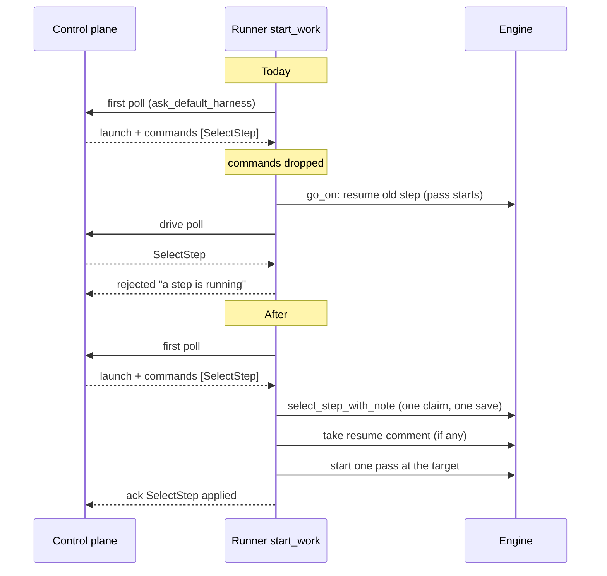

# Select Step - The Comment Reaches the Prompt of the Chosen Step - Plan

## Goal Capsule

- **Objective:** When the owner stops a task, chooses a step (*Wybierz krok*) and types a comment for the agent, the agent of that step gets the comment in its prompt. This is true in every frontend (TUI, Web UI, CLI) and on every path the server and the runner take.
- **Means:** Reproduce the owner's path in a runner test, apply queued step-moving commands before the first pass (KTD1, KTD2), store the step move and a step-bound note in one engine save (KTD3, KTD4), refuse notes for non-agent targets on the server (KTD5), and add `narsor-cli task select-step` (KTD6).
- **Product authority:** This plan covers the `SelectStep` operator command from the server offer to the agent prompt. On product behavior the Requirements (R-IDs) win; on mechanism the KTDs win.
- **Open blockers:** None. The questions in *Pytania otwarte dla użytkownika* have a recommended default that this plan uses until the person changes it.
- **Execution profile:** One pull request, units U1–U7 in order. Changes: `crates/narsor-exec`, `crates/narsor-runner`, `crates/narsor-engine` (server check), `src/cli`, tests, `docs/user/*`, `docs/sources/narsor-owner-api-wire-reference.md`. No wire-format change; the server adds one refusal (R6).
- **Stop conditions:** Stop and ask if the fix needs a breaking change of the wire format of `OperatorCommand::SelectStep`, or if the comment must stay for more than one run of the step. Stop and report if the U1 AE1 test (stop between steps, execution `Paused`) passes on the current code: the H1 fix would then target the wrong path.
- **Who finishes:** The implementer runs `cargo test --workspace` and hands the branch for review. Commit and push only when asked (AGENTS.md).

---

## Product Contract

### Summary

The comment that the owner types for an agent step in *Wybierz krok* must appear in the prompt of the first agent attempt of that step. If the system cannot deliver the comment, it must not start the step silently without it: it refuses the command with a reason that the owner sees. The fix is in the server and the runner, so the TUI and the Web UI get it without their own change. The CLI gets a way to choose a step with a comment.

### Problem Frame

The owner reports (TUI): Stop → `.` → choose a step manually → step → fill in the extra prompt field → the text does not reach the prompt of that step.

What the code does today (static trace, not yet reproduced by a test):

1. The server builds the *Wybierz krok* submenu (`step_menu`, `crates/narsor-engine/src/controller_protocol/service/tasks/actions.rs:274`). For an agent or profile step it adds the optional field `komentarz` and sends `OperatorCommand::SelectStep { target, note: "{{komentarz}}" }`. The action is offered only when `runner_state == Stopped`.
2. The TUI (`src/tui/task_app/actions.rs:941`) and the Web UI (`crates/narsor-web/ui/js/ui/actions.js`) fill the placeholder through `TaskActionSend::resolve` and post the command to `/control/v1/tasks/:id/operator-commands`.
3. The server queues the command for the next launch generation and resumes the task (`crates/narsor-engine/src/controller_protocol/service/operator/commands.rs:26`).
4. The new runner starts (`start_work`, `crates/narsor-runner/src/runner/mod.rs:1140`). For a cleanly closed session it calls `go_on()` **before** it reads the queued operator commands. If the execution is `Paused` or `Running`, `go_on()` starts a pass of the **old** current step at once (`resume_pass`).
5. Then the runner reads `SelectStep` (`crates/narsor-runner/src/runner/commands.rs:201`). If a pass is active, it refuses the command ("a step is running; interrupt it first"). If no pass is active, it moves the execution to the target step, writes the note with `leave_operator_note`, and starts a pass. If the note cannot be written, the runner only logs a warning and starts the step without it.
6. The first agent attempt takes the note from `metadata.engine.operator_recovery_note` and appends it to the prompt (`prepare_harness_attempt`, `crates/narsor-exec/src/engine/runner/step/harness_attempt.rs:87`).

Probable causes of the loss (to confirm with the reproducing test):

- **H1 (most probable): the old step starts before the command.** A Stop that lands at a safe point between steps leaves the execution `Paused`. At the relaunch, `go_on()` runs the old step before `SelectStep` arrives, and `SelectStep` is then refused. If the owner chose the same step, the step runs again with its normal prompt and without the comment. The 2026-11-11 plan required the opposite ("Runner stosuje komendę przed ruszeniem przebiegu, żeby nie ruszył stary krok", `docs/plans/2026-11-11-001-feat-akcje-taska-pauza-stop-panel-plan.md:216`), and no test covers Stop → relaunch → `SelectStep`.
- **H2: a silent drop when the note is not written** (`commands.rs:215-221`).
- **H3: the note is overwritten** by another note written for the same execution between the write and the attempt (for example a resume comment), or the note is consumed by a different agent step (a note sent for a non-agent target stays in metadata and goes to the next agent step).
- **H4: a display gap.** The note is in the prompt sent to the harness, but the TUI conversation view does not show it, so the owner thinks it is lost. To check.

Existing test `a_chosen_step_reopens_a_finished_workflow_and_carries_the_note` (`crates/narsor-runner/.../session_tests.rs:2040`) covers only a live runner, not the owner's path.

### Key Decisions

- **The fix is in the runner, the engine and the server, not in the frontends.** The TUI and the Web UI already send the comment correctly. All frontends get the fix at once. Governs R1–R6.
- **A queued operator command that changes the step is applied before the runner starts any pass.** This restores the rule of the 2026-11-11 plan. Governs R2.
- **No silent loss.** When the comment cannot be delivered, the command is refused and the step does not move. Governs R3.
- **The step move and the note are stored as one unit.** Today the runner moves the step first and writes the note second (`select_step` in `crates/narsor-runner/src/runner/commands.rs`), with a comment that says this order is on purpose. That order cannot give R3: after the move, a failed note write cannot bring the step back. The change must make both succeed together or leave the execution untouched, with no note left on the old step (which would break R4 and R5). The implementer chooses the mechanism (for example one engine operation that does both under one save) and updates the old comment. Governs R3, R4, R5.
- **The comment stays one-shot.** It goes to the first agent attempt of the chosen step only and does not stay for later runs (Z10 of the 2026-11-11 plan). Governs R5.

### Requirements

**Delivery of the comment**

- R1. After `SelectStep { target, note }` with a non-blank note for an agent or profile step, the prompt of the first agent attempt of `target` contains the note. This is true for each start state of the stopped task: execution `Paused`, `Unknown`, `Failed`, `Completed`, `InputNeeded`, and a finished workflow.
- R2. When the runner starts with a queued `SelectStep` (or another queued operator command that moves the step), it applies the command before it starts a pass. The old current step does not start. If the runner cannot read the queued commands before its start-up wait ends (control plane unreachable), it goes on as today, and a step-moving command that arrives while a pass runs is refused with a reason that says the task already went on and the owner must stop it and choose the step again (see Q1).
- R3. When the note cannot be written or kept for the target step, the runner refuses the command with a reason, and the execution stays at its old step. The owner sees the refusal in the frontend (the existing command verdict path).
- R4. The note goes only to the target step. No other agent step gets it, and another note written before the attempt does not replace it silently. If two texts meet (for example a resume comment and the select-step note), the agent gets both.
- R5. The note is consumed by the first attempt of the target step. A later run of the same step does not get it again.

**Validation**

- R6. The server refuses `SelectStep` with a non-blank note when the target step is not an agent or profile step, with a reason. This keeps the note from leaking into a later agent step.

**Frontends**

- R7. TUI and Web UI: no change in the form. They must show the refusal reason of R3 and R6 the same way as other refused commands.
- R8. CLI: `narsor-cli` gets a command (or option) to choose a step of a stopped task with an optional comment, which sends `SelectStep { target, note }`. It prints the refusal reason when the server refuses.
- R9. The conversation view (TUI *Rozmowa*, Web UI) shows the prompt that the agent got, including the note, so the owner can check the delivery. (Only if H4 is confirmed as a gap.)

**Documentation**

- R10. `docs/user/tui.md`, `docs/user/web.md` and the CLI help say where the comment goes (the prompt of the first attempt of the chosen agent step) and that it does not stay for later runs.

### Acceptance Examples

- AE1. (R1, R2) A task runs step `implement`. The owner presses Stop; the pause lands at a safe point before step `review`. The owner chooses step `implement` with the comment "use the new API". The runner starts; step `implement` runs once, and its prompt ends with the comment. Step `review` does not start before it.
- AE2. (R1) A task is stopped in the middle of an agent step (execution `Unknown`). The owner chooses another agent step with a comment. That step's prompt contains the comment.
- AE3. (R3) Writing the note fails. The command is refused with a reason; the task stays at its old step; no pass starts without the note.
- AE4. (R6) A client sends `SelectStep` with a note for a script step. The server refuses it with a reason.
- AE5. (R5) After AE1, the workflow comes back to `implement` by a normal transition. The prompt does not contain the comment.
- AE6. (R8) `narsor-cli task select-step <task> implement --note "use the new API"` gives the same result as AE1.

### Scope Boundaries

- In scope: `SelectStep` delivery in the runner and engine, server validation, a CLI command, tests, user docs, and the conversation view only if H4 is a real gap.
- Out of scope: the override transition (*Przejście ręczne → Override: dowolny stan*). Its `powód` field stays audit only.
- Out of scope: new fields in the TUI or Web UI forms.
- Out of scope: a persistent comment for all later runs of the step.

### Założenia do potwierdzenia

- A1. The owner used *Wybierz krok* (the only step choice offered after Stop), not *Przejście ręczne → Override*. The override needs a live runner and is not offered after Stop. Its reason field stays audit only, as the documentation says.
- A2. The comment goes at the end of the step prompt under the existing heading "Operator recovery note:". A new heading or position is not necessary.
- A3. "Global" means: the fix is in the server and the runner (so TUI and Web UI get it), and the CLI gets the same capability (R8). The local daemon API (`TransitionRequest` in `crates/narsor-protocol/src/api.rs`) does not get a note field in this change.
- A4. A refusal (R3, R6) is safer than a step that starts without the comment, because the owner can send the command again.
- A5. The comment stays one-shot (Z10 of the 2026-11-11 plan).
- A6. H1 is the most probable cause, but the plan does not depend on it: the reproducing test decides, and R1–R5 must hold for all causes.
- A7. The CLI command name is `task select-step <task> <step> [--note <text>]`, next to `task transition` and `task restart-step --note`. The name can change in planning.

### Pytania otwarte dla użytkownika

None of these blocks implementation. The plan uses the recommended option (first in each list) until the person decides otherwise.

- Q1. (Requirements, R2) The runner cannot read the queued commands at start-up because the control plane does not answer within `clean_launch_wait`. What happens to the old paused step?
  - a) **Recommended.** Keep the short wait. The old step starts, and the `SelectStep` that arrives later is refused with a clear reason ("the task already went on from step X; stop it and choose the step again"). This keeps the rule that a runner starts offline.
  - b) After a clean Stop, the runner waits for the first successful poll without a time limit before it starts any pass. No refusal, but a runner cannot go on while the control plane is away.
- Q2. (Requirements, R4) A resume comment (written on the pause) and the select-step note both reach the same first attempt. In which order does the agent see them?
  - a) **Recommended.** The select-step note first, then the resume comment, both under the existing "Operator recovery note:" heading, separated by a blank line.
  - b) The resume comment first, then the select-step note.
- Q3. (Requirements, R3 and R7) The TUI and Web UI show the verdict of a queued command only if a later list refresh carries it. If U7 finds that a runner refusal that arrives after the submit answer is not visible to the owner, what is done? R3 promises that the owner sees the refusal, and A4 (a refusal is safer) depends on it; R7 asks only for parity with other refused commands.
  - a) **Recommended.** Add the display of late runner refusals of queued commands to this PR (U7) for both frontends, for all command kinds, because R3 cannot hold without it.
  - b) Keep this PR in scope and record the display as follow-up work. Until then, a runner refusal (KTD2 refused branch, KTD7) can reach the owner only as a task that is stopped again without its comment.

### Outstanding Questions

- Narrowed in planning: the static trace points to H1 for a Stop that lands between steps (execution `Paused`). The start-up poll in `ask_default_harness` drops `response.commands` (comment: "drive picks it up there"), and `go_on()` starts the old step before `drive()` delivers `SelectStep`. U1 must confirm it with a failing test. For a Stop in the middle of an agent step (execution `Unknown`), `go_on()` starts no pass, so H1 probably does not explain that case; U1 checks it on the current code and, if the note arrives there, runs the H4 check before the fix. H2 is confirmed by reading `select_step`. H3 is real: the note key is not bound to a step, and `leave_resume_message` overwrites it.
- Resolved in planning: R9 is conditional; U7 decides it from H4 (see U7).

### Sources / Research

- `crates/narsor-engine/src/controller_protocol/service/tasks/actions.rs:243-308` (`transition_menu`, `step_menu`), `:412` (`select_step_reason`).
- `crates/narsor-protocol/src/controller/task/input.rs:100-118` (`Transition`, `SelectStep`), `crates/narsor-protocol/src/controller/task/actions.rs:301-370` (`placeholder`, `resolve`).
- `crates/narsor-runner/src/runner/mod.rs:1140-1200` (`start_work`), `:1470-1566` (`recover`, `go_on`, `resume_pass`).
- `crates/narsor-runner/src/runner/commands.rs:100-223` (command dispatch, `select_step`).
- `crates/narsor-exec/src/engine/runner/human_input/operations.rs:240-301` (`leave_operator_note`, `leave_resume_message`), `:392-580` (`take_operator_transition`, `apply_manual_transition`).
- `crates/narsor-exec/src/engine/runner/step/harness_attempt.rs:56-95`, `:309-329` (note into the prompt).
- `src/tui/task_app/actions.rs:913-990`, `src/tui/stepped.rs`, `crates/narsor-web/ui/js/ui/actions.js`, `src/cli/remote.rs:372-401`.
- `docs/plans/2026-11-11-001-feat-akcje-taska-pauza-stop-panel-plan.md:108-111`, `:212-236`.
- `docs/user/tui.md:260-275`, `docs/user/web.md:112`, `docs/sources/narsor-owner-api-wire-reference.md:441-464`.

### Product Contract Preservation

Changed R2 only. The 2026-11-24 review asked what happens when the start-up poll is slow or fails. R2 now states the chosen outcome; Q1 keeps the other option open for the person. All other R/AE IDs and meanings are unchanged.

---

## Planning Contract

### Key Technical Decisions

- KTD1. **The start-up poll keeps the queued operator commands in a session field.** Today `ask_default_harness` and `await_launch` in `crates/narsor-runner/src/runner/mod.rs` keep only the launch header and drop `response.commands`. The first successful poll stores its commands in a new `Session` field (for example `startup_commands`) that `start_work` reads. Tests fill the field directly, the same way `resumed()` sets `link.launch`, because the session-test fixtures have no control-plane client. Commands that are not step-moving stay with `drive()`, which gets them again on its next poll because they are not acknowledged. Governs R2.
- KTD2. **Step-moving commands run before `go_on()` and before `recover()` starts a pass.** In `start_work`, for the `Clean` and `Recover` continuations, the runner settles each stored `SelectStep` and `Transition` through `settle_command` (once per storage, verdict recorded), in queue order, before it starts any pass. It does not acknowledge them there: `drive()`'s next poll redelivers them, and `settle_command` answers from the recorded verdict. Then:
  1. Applied: the resume comment, if one waits, is joined into the bound select-step note (note first, then comment, per Q2) in the same save that records its key as taken. It is not put into a stored agent session, so the chosen step starts fresh. The runner then starts exactly one pass.
  2. Refused: the runner starts no pass and closes the session at the safe point, so the task is `Stopped` again with the refusal recorded and the owner can choose the step again (R3, A4).
  In `Recover`, reconciliation runs first, then the step move replaces the recovery pass; the recovery decision is still logged as today. A `Fresh` start keeps today's behavior: there is no execution to move. Governs R2, R3, R4.
- KTD3. **One engine operation moves the step and stores the note under one claim and one save.** A new `Engine` method in `crates/narsor-exec/src/engine/runner/human_input/operations.rs` does what `take_operator_transition` does for `select: true` and, before the single `save_execution` in `apply_manual_transition`, writes the bound note. It makes every check that can refuse (unknown state, non-blank note for a target that does not run a harness, which is `Agent` or `Profile` as in KTD5) before its first store write. On a failed save, the execution record (state, status, metadata) is unchanged. The events and pending-input clearing written before the save are not rolled back, as for every manual transition today. The runner's `select_step` calls it and loses its "move first, note second" comment and the warn-and-continue branch. Governs R3, R6.
- KTD4. **The select-step note is bound to its target step.** It is stored under a new engine metadata entry that holds the target state id and the text, next to the existing `operator_recovery_note`. `prepare_harness_attempt` takes it only when the attempt's state is the bound state, and joins it with any untargeted operator note (Q2 order). `apply_manual_transition` drops a bound note whose state is not the new target, so the note can never reach another step. The existing untargeted key and its writers (`leave_operator_note`, `leave_resume_message`, recovery) stay unchanged. Chosen over appending to the untargeted key: that key is consumed by whichever agent step comes next, which is the H3 leak. The metadata is a JSON map, so an older storage without the entry reads as "no note". Governs R4, R5.
- KTD5. **The server refuses a note for a step that runs no agent.** `check_operator_command` in `crates/narsor-engine/src/controller_protocol/service/operator/commands.rs` extends the `SelectStep` check: a non-blank note and a target whose action is not `Agent` or `Profile` give `bad_request("note_not_allowed", …)`. The step kind comes from the same `ActionConfig` match as `crates/narsor-engine/src/controller_protocol/service/tasks/view.rs`; extract that match into one helper so the offer and the check cannot drift. A missing definition (bookkeeping-only spec) is not refused; the runner check of KTD3 still holds. Governs R6.
- KTD6. **The CLI command is `narsor-cli task select-step <TASK_ID> <STEP> [--note TEXT]`.** It is a new `TaskCommand::SelectStep` variant in `src/cli/remote.rs` with `OperatorCommandArgs` flattened, sent through the existing `operator_command` helper, which already waits for the verdict and prints a refusal. Governs R8.
- KTD7. **The late refusal of R2 names the cause.** When `select_step` or `transition` finds an active pass, the reason changes from "a step is running; interrupt it first" to one that names the running step and tells the owner to stop the task and choose the step again. The existing test `a_step_cannot_be_chosen_while_a_pass_is_active` keeps its meaning with the new text. Governs R2, R3.

### High-Level Technical Design

Start-up order after a Stop, before and after the change:

The bound note follows the execution as follows: written with the move (KTD3) → dropped by any later manual transition to another state (KTD4) → taken and removed by the first harness attempt of the bound state (R5).

### Assumptions

- H1 is the cause for a Stop between steps; the U1 AE1 test must fail before the fix (see Stop conditions). The other U1 scenarios are regression guards and may pass on the current code.
- A `Transition` queued for the next launch is treated like `SelectStep` at start-up (KTD2). It carries no note, so only R2 applies to it.
- The resume comment is still delivered after a step move at start-up. It goes to the step the owner chose, inside the bound note (KTD2).
- No new operator command and no new wire field are needed. The server and runner protocol stay compatible with older clients.

### Sequencing

U1 first (failing tests). U2 before U3, because the runner calls the new engine operation. U4 and U5 are independent of U2–U3. U6 and U7 last.

---

## Implementation Units

### U1. Reproduce the owner's path in runner tests

- **Goal:** Show the loss of the comment on the owner's path before any fix.
- **Requirements:** R1, R2; AE1, AE2.
- **Dependencies:** none.
- **Files:** `crates/narsor-runner/src/runner/mod.rs` (only the `startup_commands` field of KTD1, so the tests compile), `crates/narsor-runner/src/runner/session_tests.rs`.
- **Approach:** Use the existing fixtures `paused_between_steps` and `resumed`, and fill the KTD1 field with a queued `SelectStep` the same way `resumed()` sets `link.launch`. The fixtures have no control-plane client, so do not try to extend one. This seam catches the start-up ordering in `start_work` and the prompt the fake agent receives. It misses the HTTP layer and the TUI form.
- **Execution note:** Write these tests first. The AE1 test must fail on the current code for the reason H1 describes. If the AE2 test passes on the current code, record it, and do the H4 check of U7 before U3.
- **Test scenarios:**
  - Covers AE1. Execution `Paused` between steps, queued `SelectStep { target: first agent step, note: "use the new API" }`: the runner starts, the agent is called once for the target, the prompt ends with the note, and the step after it was not called before.
  - Covers AE2 (regression guard). Execution `Unknown` after a stop in the middle of an agent step, queued `SelectStep` to another agent step with a note: that step's prompt contains the note.
  - Regression guard. Execution `Completed` (finished workflow) after a relaunch, queued `SelectStep` with a note: the workflow reopens and the prompt contains the note.
- **Verification:** The AE1 test fails on `main`; all U1 tests pass after U2–U3.

### U2. Engine: move the step and bind the note in one save

- **Goal:** One engine operation that moves the execution to the chosen step and stores a note bound to it, or leaves the execution record unchanged (KTD3).
- **Requirements:** R3, R4, R5, R6 (runner side).
- **Dependencies:** none.
- **Files:** `crates/narsor-exec/src/engine/runner/human_input/operations.rs`, `crates/narsor-exec/src/engine/runner/step/harness_attempt.rs`, `crates/narsor-exec/src/engine/runner/metadata/keys.rs`, tests next to the existing ones for `take_operator_transition` and `prepare_harness_attempt` in `crates/narsor-exec`.
- **Approach:**
  1. Add the bound-note metadata key and the combined operation (KTD3, KTD4).
  2. In `apply_manual_transition`, drop a bound note whose state is not the new target.
  3. In `prepare_harness_attempt`, take the bound note only for its state and join it with the untargeted note in the Q2 order.
- **Patterns to follow:** `leave_operator_note` (claim, load, metadata insert, save); `take_operator_recovery_note` (remove and save on consume).
- **Test scenarios:**
  - Covers AE5. Select step `implement` with a note, run its first attempt: the prompt contains the note; a later normal entry into `implement` does not.
  - A select-step note and a resume comment written for the same step both appear in the first prompt, in the Q2 order.
  - A bound note for `implement` and a manual transition to `review` before any attempt: `review`'s prompt has no note.
  - Covers AE3. The save fails (store fake that refuses the write): the call returns an error, and the current state, status and note metadata are unchanged.
  - A target with a completed agent session plus a resume comment joined at start-up (KTD2): one fresh prompt, not a continued session, holds both texts in Q2 order.
  - Non-blank note and a script target: refused, nothing written.
- **Verification:** The engine tests pass; no existing `take_operator_transition` test changes behavior.

### U3. Runner: apply queued step moves before the first pass

- **Goal:** The runner applies a queued `SelectStep` or `Transition` before it starts any pass, and uses the U2 operation.
- **Requirements:** R1, R2, R3, R4.
- **Dependencies:** U1, U2.
- **Files:** `crates/narsor-runner/src/runner/mod.rs`, `crates/narsor-runner/src/runner/commands.rs`, `crates/narsor-runner/src/runner/session_tests.rs`.
- **Approach:**
  1. Store `commands` from the first successful poll in the KTD1 field.
  2. In `start_work`, for `Clean` and `Recover`, settle the stored step-moving commands through `settle_command` before `go_on()` or the recovery pass, and follow the applied and refused branches of KTD2 instead of calling `go_on()`.
  3. Change `select_step` to call the U2 operation and to start the pass only when it is not called from start-up (one pass in total).
  4. Change the refusal text for an active pass (KTD7).
- **Patterns to follow:** `settle_command` and `carry_out` for once-only delivery; `the_comment_on_a_pause_reaches_the_next_step_once` for the start-up fixture.
- **Test scenarios:**
  - The U1 tests pass.
  - A queued `Transition` at start-up moves the execution before any pass; the old step is not called.
  - The same `SelectStep` delivered again by the next `drive()` poll is answered from the recorded verdict and does not move the step twice.
  - Covers AE3. Execution `Paused`, stored `SelectStep` that the engine refuses: no agent call, the refusal is recorded, and the session closes so the task ends stopped.
  - First poll fails until `clean_launch_wait` ends: the old step starts, and the later `SelectStep` is refused with the KTD7 reason (Q1 default).
- **Verification:** `crates/narsor-runner` tests pass, including `a_chosen_step_reopens_a_finished_workflow_and_carries_the_note` and `a_step_cannot_be_chosen_while_a_pass_is_active`.

### U4. Server: refuse a note for a non-agent step

- **Goal:** The control plane refuses `SelectStep` with a non-blank note for a step that runs no agent.
- **Requirements:** R6; AE4.
- **Dependencies:** none.
- **Files:** `crates/narsor-engine/src/controller_protocol/service/operator/commands.rs`, `crates/narsor-engine/src/controller_protocol/service/tasks/view.rs`, the integration suite in `tests/integration/` that already asserts `operator_command_refused` for operator commands.
- **Approach:** Extract the step-kind match from `view.rs` into a helper and use it in the `SelectStep` check (KTD5).
- **Test scenarios:**
  - Covers AE4. `SelectStep` with note "x" to a script step: refused with `note_not_allowed`, nothing queued, the task stays stopped.
  - `SelectStep` with a blank note to a script step: accepted.
  - `SelectStep` with a note to a profile step: accepted.
- **Verification:** The refusal reaches the HTTP answer as a 400 with the reason.

### U5. CLI: `task select-step`

- **Goal:** The owner can choose a step with an optional comment from `narsor-cli`.
- **Requirements:** R8; AE6.
- **Dependencies:** none (U4 for the refusal text in the docs).
- **Files:** `src/cli/remote.rs`, `src/cli/mod.rs` (parse tests), `src/cli/task_text.rs` if the command description needs the note.
- **Approach:** Add the variant and dispatch per KTD6, next to `RestartStep`.
- **Patterns to follow:** `TaskCommand::RestartStep` and its `--note`.
- **Test scenarios:**
  - `task select-step T implement --note "use the new API"` parses to `SelectStep { target: "implement", note: Some(..) }` for task `T`.
  - Without `--note` the note is `None`.
- **Verification:** `narsor-cli task select-step --help` shows the command; the parse tests pass. AE6 is covered by the parse test together with the U1 AE1 runner test: the CLI sends the same `SelectStep` through the shared `operator_command` path that the TUI and Web UI commands reach.

### U6. User documentation

- **Goal:** The docs say where the comment goes and that it is one-shot.
- **Requirements:** R10.
- **Dependencies:** U3, U5.
- **Files:** `docs/user/tui.md`, `docs/user/web.md`, `docs/user/remote.md`, `docs/user/cli.md`, `docs/sources/narsor-owner-api-wire-reference.md`.
- **Approach:** One or two sentences per page: the comment goes to the end of the prompt of the first attempt of the chosen agent step, under "Operator recovery note:", and does not stay for later runs. Add `task select-step` to the CLI lists. In the wire reference, add the new `note_not_allowed` refusal of `SelectStep` (R6).
- **Test expectation:** none -- documentation only.
- **Verification:** The pages name the CLI command and the one-shot rule.

### U7. Frontend checks: refusal display and prompt display

- **Goal:** Confirm that the owner sees a refusal (R7) and can see the delivered note (R9, only if H4 is a gap).
- **Requirements:** R7, R9.
- **Dependencies:** U3, U4.
- **Files:** `src/tui/task_app/actions.rs`, `src/tui/task_app/tabs/` (conversation view), `crates/narsor-web/ui/js/ui/actions.js`; tests only if a change is made.
- **Approach:**
  1. R7: check that an immediate server refusal (U4) and a runner refusal of a queued command reach the owner. The immediate refusal already shows through `refusal_notice`. For a late runner refusal, apply Q3 (default: add the display in both frontends, with one test per frontend that a rejected queued command shows its reason).
  2. R9: check whether the conversation view shows the prompt sent to the agent. If it does, R9 needs no change. If it does not, show the prompt's "Operator recovery note" part in the conversation view, following the existing conversation entry pattern.
- **Test scenarios:**
  - Only if R9 needs a change: a conversation that holds an attempt with a note shows the note text.
- **Verification:** The findings for R7 and H4 are written in the PR description.

---

## Scope Boundaries (planning)

- Not built: a wait without limit for the first poll after a Stop (Q1 option b). It would stop the runner from starting offline. Revisit if owners still see the KTD7 refusal often.
- Not built: a general rework of the untargeted `operator_recovery_note`. Only the select-step note gets a bound state (KTD4).

### Deferred to Follow-Up Work

- If Q3 is answered with option b: show late runner refusals of queued commands in the TUI and Web UI for all command kinds.

---

## Risks

| Risk | Mitigation |
|---|---|
| A step-moving command applied at start-up and then delivered again by `drive()` moves the step twice. | `settle_command` records the verdict before the ack; U3 test for redelivery. |
| Starting two passes at start-up (one from `select_step`, one from `go_on()`). | U3 step 3: exactly one pass start after start-up; test asserts one agent call. |
| A storage written by an older runner holds only the untargeted note. | KTD4 keeps the untargeted key and its readers unchanged. |

---

## Verification Contract

| Check | When |
|---|---|
| `cargo test --workspace` | Before the work is reported as done (AGENTS.md). |
| `cargo test -p narsor-runner` and `cargo test -p narsor-exec` | While working on U1–U3. |
| `cargo build --workspace --bins` | After U5, so the CLI binary is built next to the others. |
| `#[ignore]`d tests | Not needed: no real harness or cluster behavior changes. |

---

## Definition of Done

- The U1 AE1 test failed before the fix, and all U1 tests pass after it; AE1–AE6 each have a passing test or check named in its unit.
- `select_step` no longer logs and continues when the note cannot be stored.
- The server refuses a note for a non-agent step.
- `narsor-cli task select-step` exists and is documented.
- The PR description states the result of the H4 and R7 checks from U7.
- `cargo test --workspace` passes.
- No dead code from abandoned approaches is left in the diff.
