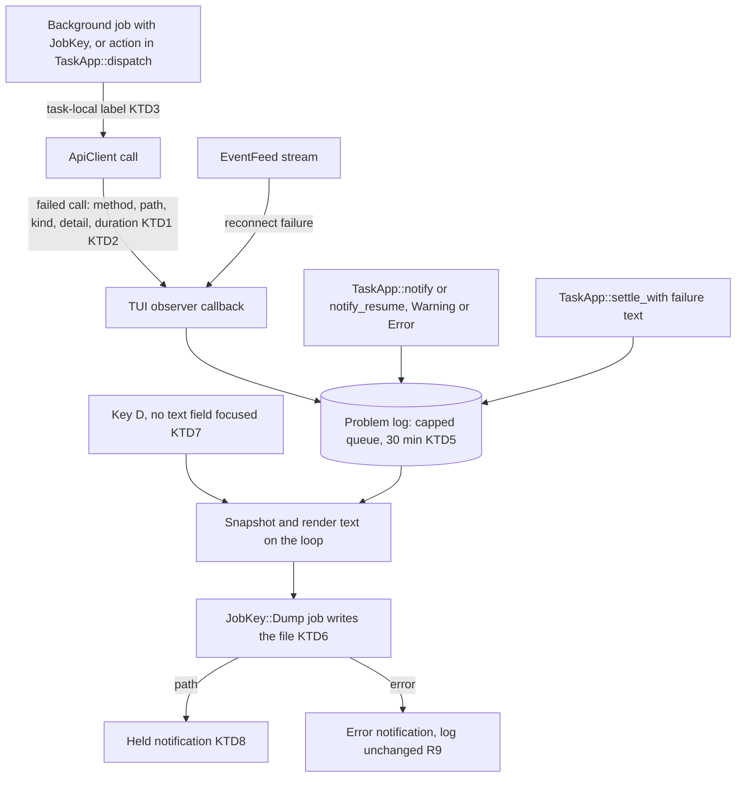

# TUI Problem Log and Diagnostic Dump - Plan

## Goal Capsule

- **Objective:** When the TUI shows a server problem (for example `nie udało się wczytać przebiegu: brak połączenia z serwerem` on *Przebieg*), the operator can save, with one key, a file that tells what actually failed in the last 30 minutes, so the cause can be found instead of guessed.
- **Means:** An in-memory problem log inside the TUI process, fed by a failure observer on the API client and by the errors the TUI shows (KTD1, KTD4), with entries older than 30 minutes dropped automatically, and a global key `D` that writes the current log to a temporary file (KTD6, KTD7).
- **Product authority:** This plan covers the `narsor` TUI only. The server, the protocol, the Web UI and `narsor-cli` are not active scope. A fix of the root cause of the failed reads is not active scope (Q1 settled this: evidence only). The `narsor-api-client` crate gets one additive, opt-in hook (KTD1); no other consumer of the crate changes behavior.
- **Authority order:** Product Contract R-IDs win on behavior; KTDs win on mechanism within those R-IDs; units override neither.
- **Execution profile:** One pull request, units U1 to U5 in order. Standard depth.
- **Stop conditions:** Stop and ask the person if the work would need to change the text of a visible message (R10), the client's timeouts or retries, or the `ClientError` type that `narsor-cli` and the Web UI also use.
- **Who finishes:** An implementing agent (`ce-work`) builds and verifies; a person reviews the pull request.
- **Open blockers:** None. Q1 (does this work also change the visible message, or only collect evidence) is resolved: evidence only.

---

## Product Contract

### Summary

The TUI records every problem it meets while it runs (failed server calls and errors it shows to the operator) in memory, with full technical detail, and forgets entries after 30 minutes. A global key `D` writes the current log to a new temporary file and shows its path. The visible messages do not change.

### Problem Frame

Operators see `nie udało się wczytać przebiegu: brak połączenia z serwerem` on the *Przebieg* tab fairly often, also in local mode with the TUI and the server on the same host. Nobody can tell the cause from the screen.

The message hides the detail that the code has. Every transport failure of the client (connection refused, connection reset, request timeout, and others) becomes `ClientError::Unavailable(detail)` (`crates/narsor-api-client/src/api/client.rs:1078`, `:1086`). The TUI turns all of them into the same words and drops `detail` (`src/tui/task_app/mod.rs:1714`). A local client has a request timeout of 800 ms (`crates/narsor-api-client/src/api/client.rs:101`), so a slow answer from a server that is up also shows as "no connection". This is a hypothesis about the cause, not a verified fact; the log in this plan is how to confirm or reject it.

The TUI already has a trace log (`narsor.log` in the TUI state directory, `src/tui/paths.rs:31`), but it is written only when a log level is configured (`src/bin/narsor.rs:83`). It is off when the problem happens, and switching it on after the fact does not help with a problem that is intermittent.

### Key Decisions

- **Always on, in memory, not on disk.** The log costs nothing on disk and needs no configuration; the operator writes it out only when they need it. Governs R1, R4. (session-settled: user-directed — chosen over a file log: the request asks for memory with a dump on demand)
- **30 minutes by age.** Entries older than 30 minutes are dropped. Governs R4. (session-settled: user-directed — the request names 30 minutes)
- **Global key `D` writes to a temporary file.** Any temporary location is acceptable. Governs R6, R7. (session-settled: user-directed — the request names `D` and a temporary file)
- **Diagnosis first, visible messages unchanged.** This work collects evidence; it does not change what the screens say or how the client retries or times out. Governs R10. (user-confirmed — Q1, option 1)
- **Separate from the existing `narsor.log`.** The problem log does not depend on the configured log level and does not replace the trace log. Governs R1.

### Requirements

**Recording problems**

- R1. The TUI records a problem entry in memory for every failed call to the server and for every error message it shows to the operator, from start to exit, with no configuration needed.
- R2. Each entry holds: local time, the screen or tab and the operation (for example "read Przebieg of task X"), the kind of error, the full technical detail the client had (for example the text inside `ClientError::Unavailable`), and how long the call took before it failed.
- R3. Entries never contain the bearer token or other credentials.
- R4. The TUI drops entries older than 30 minutes, and the memory the log uses stays bounded also when a call fails on every refresh.

**Context of the session**

- R5. The written file starts with a short header: Narsor version, the connection (local or a server URL, never a token), the request timeout in use, the time of the dump and the time span the entries cover.

**Writing the dump**

- R6. Pressing `D` on any screen writes the current log to a new file in the system temporary directory and shows the full path of the file in a notification. The operator must be able to read the whole path: on a narrow terminal the TUI may shorten the directory part but never the file name, and a later notification does not replace the path within the normal notification lifetime.
- R7. `D` does not act while a text field has focus (filter, forms, dialogs with text input); there `D` types the letter as before.
- R8. When the log is empty, `D` still writes a file with the header and a line that says no problem was recorded, so the operator knows the key worked.
- R9. When the file cannot be written, the TUI shows a notification with the reason and keeps the log in memory unchanged.

**Boundaries of behavior**

- R10. The messages the operator sees today stay as they are; the TUI does not get slower, and the key-handling loop does not wait for the file to be written longer than for an ordinary key.
- R11. The key hints of the TUI and `docs/user/tui.md` list `D`.

### Acceptance Examples

- AE1. **Covers R1, R2.** **Given** the TUI runs in local mode and the read of *Przebieg* fails with a request timeout, **when** the tab shows `brak połączenia z serwerem`, **then** the log holds an entry with the tab, the task, the kind "unavailable", the client detail that names a timeout, and a duration near 800 ms.
- AE2. **Covers R4.** **Given** an entry recorded 31 minutes ago and one recorded 5 minutes ago, **when** the operator presses `D`, **then** the file holds only the 5-minute entry.
- AE3. **Covers R6, R8.** **Given** no problem happened, **when** the operator presses `D` on the task list, **then** a file with the header and "no problems recorded" is written and its path is shown.
- AE4. **Covers R7.** **Given** the list filter `/` is open, **when** the operator types `D`, **then** the filter text gets `D` and no file is written.
- AE5. **Covers R3, R5.** **Given** a remote connection with a token, **when** the dump is written, **then** the header names the server URL and the file contains no token text.

### Scope Boundaries

- Not in this work: a fix of why the reads fail (timeout length, retry, server speed). That is a follow-up plan, based on the evidence from the dump.
- Not in this work: sending the dump anywhere, or a viewer of the log inside the TUI.
- Not in this work: the same log in the Web UI or `narsor-cli`.
- Not in this work: recording successful calls; only failures and shown errors.

### Założenia do potwierdzenia

- The work only collects evidence; the visible messages stay the same (confirmed by the user in Q1).
- "Every problem" means every failed server call (also refusals such as 404 or 409, not only transport failures) and every error message the TUI shows. Successful calls are not recorded.
- "Any temporary file" means a new file with a unique name in the system temporary directory (`$TMPDIR`, else `/tmp`), readable only by the owner, because it can contain task names and repository URLs. Each `D` writes a new file; old files are not removed by the TUI.
- `D` is global except while a text field has focus (R7). Today `D` has no other meaning in the TUI (no binding for `Char('D')` found in `src/tui`).
- The 30-minute limit counts from the time each entry was recorded. The memory bound in R4 (for example a maximum number of entries) is a planning choice.
- The problem log is independent of the existing `narsor.log`. The problem log writes nothing to disk except the file that `D` creates; problem entries do not go to `narsor.log`.
- The dump is plain text, readable by a person and attachable to a ticket.

### Pytania otwarte dla użytkownika

- Q1. **Resolved: option 1 (evidence only), confirmed by the user on the pull request.** Does this work only collect evidence, or does it also change what the operator sees when a server call fails?
  1. (recommended) Evidence only: add the log and `D`, keep the messages; decide on a fix after the first dumps show the cause.
  2. Also show the kind of failure in the message, for example `brak połączenia z serwerem (przekroczono czas 800 ms)` vs `(połączenie odrzucone)`.
  3. Also change the cause now: give the *Przebieg* read a longer timeout in local mode, in addition to option 2.

### Outstanding Questions

**Resolved during planning**

- Where entries are recorded: one observer on the API client for failed calls, plus the two TUI seams where errors become visible words. See KTD1, KTD3, KTD4.
- The memory bound of R4: a cap on the number of entries, no collapsing of repeats. See KTD5.
- The file name pattern and the text layout of the dump. See KTD6 and the dump layout in High-Level Technical Design.

**Deferred to implementation**

- The exact list of request helpers and stream-connect points in `crates/narsor-api-client/src/api/client.rs` that call the observer. The rule (every path that returns a `ClientError` to a caller reports it once) is fixed by KTD1; the list comes from reading the file.
- The exact words of each operation label per `JobKey` variant (KTD3). They must name the screen or tab and, where the key has one, the task.

### Sources / Research

- `src/tui/task_app/mod.rs:1696` — `is_transport` and `failure_reason`: `ClientError::Unavailable(_)` becomes `brak połączenia z serwerem` and the detail is dropped.
- `src/tui/task_app/tabs/progress.rs:812` — the *Przebieg* failure line; `:327` stores the failure text.
- `crates/narsor-api-client/src/api/client.rs:17` — why the local timeout is short; `:101` `REQUEST_TIMEOUT` = 800 ms; `:106` remote timeout 10 s; `:1078` and `:1086` map every send error to `Unavailable`.
- `crates/narsor-api-client/src/api/discovery.rs:275` — local mode builds the client with `ApiClient::new` (the 800 ms timeout).
- `src/bin/narsor.rs:83` and `src/tui/paths.rs:31` — the existing `narsor.log`, written only when a log level is configured.
- `docs/user/tui.md` — the list of TUI keys to update (R11).

---

## Planning Contract

Product Contract preservation: Product Contract unchanged. Only the former "Deferred to Planning" list under Outstanding Questions was resolved in place; it is now the "Resolved during planning" and "Deferred to implementation" lists.

### Key Technical Decisions

- KTD1. **Failed calls are recorded by an opt-in failure observer on `ApiClient`, not at each screen.** About 20 call sites in `src/tui/task_app/` turn a `ClientError` into words (`failure_reason`, `settle`, `settle_with`), and some failures (usage reads, the event stream) never reach a screen. One observer in the client sees every failed call once, with its duration, so R1 holds for all screens without duplicates. The observer is a shared callback stored in the client and copied with every clone. A client with no observer behaves exactly as today, so `narsor-cli` and the Web UI do not change. The observer receives the HTTP method, the path without query, the `ClientError` kind, the detail (KTD2) and the elapsed time. It never receives headers, so it cannot see the bearer token (R3). Governs R1, R2, R3.
- KTD2. **The observer's detail is built from the full source chain of the transport error; `ClientError` stays as it is.** Today `ClientError::Unavailable` holds `error.to_string()` of the `reqwest` error (`crates/narsor-api-client/src/api/client.rs:1078`, `:1086`). As far as we know, `reqwest` puts only the error kind and the URL in that text (for example "error sending request for url (...)") and keeps the cause, such as "operation timed out" or "Connection refused", in the source chain. This is not verified in this repository; U1's test proves it either way. The observer detail joins the source chain and adds the classification `reqwest` gives (`is_timeout`, `is_connect`). AE1 needs the word "timeout" in the detail. Changing the `Unavailable` text instead was rejected: `narsor-cli` prints it, and the CLI is out of scope.
- KTD3. **The operation label comes from a tokio task-local value, set in two places.** Reads run as keyed jobs (`src/tui/task_app/background.rs`, see `docs/solutions/design-patterns/tui-reads-as-keyed-background-jobs-with-loading-marker-2026-10-22.md`). `Background::start` sets the label from the `JobKey`, which names the screen and the task, for example `JobKey::Detail(task, DetailJob::…)`. Operator actions (move, answer, send a new task and its automatic resend, repositories, limit, harness) do not run as jobs: `TaskApp::dispatch` and `retry_outgoing_if_due` await them on the loop task. These two methods wrap their awaited call in the same task-local scope, with a label per `Request` variant, for example "move task NAR-12". The TUI's observer callback runs inside that task, reads the label and stores it with the entry. A call outside both (the event stream, a test's direct call) gets the label "outside a screen" and keeps method and path. The api-client crate knows nothing about the label. Governs R2.
- KTD4. **Shown errors are recorded at three seams on the event loop: `TaskApp::notify` and `TaskApp::notify_resume` for `Warning` and `Error` severities, and `TaskApp::settle_with` when it returns a failure text to a tab.** Every direct `failure_reason` caller in `src/tui/task_app/` ends in `notify` or in `settle_with`. `notify_resume` pushes auto-resume notices straight to the `Notifier`, so it needs its own record call. Together these seams cover what the operator sees. `Success` notifications are not recorded. A failed tab read therefore produces two entries, the call (KTD1) and the words shown (this KTD). That is intended: the first says what failed, the second says what the operator saw. Governs R1, R10.
- KTD5. **The log is a bounded in-memory queue: at most 2000 entries, details cut at 4 KiB, no collapsing of repeats.** Entries are pruned by age (30 minutes from the time each was recorded) on every record and on every snapshot. When the cap drops an entry that is still younger than 30 minutes, a counter grows and the dump header reports it. With the refresh backoff the TUI already has, a server that fails on every refresh makes far fewer than 2000 entries in 30 minutes, so the cap only matters in a fault. Collapsing repeats was rejected: it hides the time pattern of failures, which is the evidence this work exists to collect. The log sits behind a `std::sync::Mutex`, held only to push or to copy. The caller passes the current `Instant`, as `Notifier` does, so tests control time. Governs R4.
- KTD6. **`D` takes a snapshot on the loop and writes the file in a background job.** The loop renders the snapshot to text, which is fast for 2000 entries. A new `JobKey::Dump` job writes the file and returns an `Outcome` that raises the notification (R6) or the error notification (R9). The file goes to `std::env::temp_dir()`, named `narsor-problems-<YYYYMMDD-HHMMSS>-<pid>.txt` in local time. It is created with create-new semantics and mode `0600` on Unix; a name collision retries with `-2`, `-3`, and so on. A second `D` while a dump job runs does nothing, as with every other keyed job. Governs R6, R8, R9, R10.
- KTD7. **`D` is checked at the top of `TaskApp::on_key`, before view routing, unless a text field has focus.** `on_key` returns early for many views (`src/tui/task_app/mod.rs:840`), so a binding looked up at the end would not work "on any screen". A new predicate, `accepts_text()`, joins the existing typing checks: list filter, overlay text input, new-task and repositories forms with focus on details, panel typing, conductor typing. The key is also added to `src/tui/keymap.rs` under `Context::Global` so help and the key bar list it (R11). `Context::Form` and `Context::FormConfirm` do not inherit `Global`, which matches R7. Governs R6, R7, R11.
- KTD8. **The path notification is held for the normal notification lifetime and shortens the directory, never the file name.** `Notifier` has one slot, and `push` replaces it (`src/tui/task_app/notify.rs`). A held notification is not replaced by a later `push` or `push_counted` until `LIFETIME` (6 s) has passed. The one exception is the outcome of a later dump: its path, or its write error (R9), replaces the held notification at once, so the result of the last `D` is always on the bar. `bar_right` in `src/tui/task_app/layout.rs` cuts text at the end with `…`. For a path, it removes characters from the start of the directory part instead. Cost: an unrelated error raised in those 6 seconds is not shown on the bar. It is still recorded in the problem log (KTD4). Governs R6.

### High-Level Technical Design

How entries flow into the log and out to the file:



The dump layout (shape, not exact text):

```text
Narsor problem log
version:      <narsor_protocol::VERSION>
connection:   local (http://127.0.0.1:<port>)  |  remote https://host/path
timeout:      800 ms
written at:   2026-11-26 19:42:10 +01:00
covers:       19:12:10 – 19:42:10 (30 min); <n> entries; <m> dropped by the cap

19:40:01.234  call failed   Przebieg — task NAR-12   GET /api/tasks/NAR-12/timeline
              kind: unavailable   after: 801 ms
              detail: error sending request for url (...): operation timed out [timeout]
19:40:01.236  shown         Przebieg — task NAR-12
              text: nie udało się wczytać przebiegu: brak połączenia z serwerem
```

An empty log prints the header and the line `no problems recorded in the last 30 minutes` (R8).

### Assumptions

- The `reqwest` source chain names the cause of a transport failure ("timed out", "Connection refused"). U1's test checks this with a stub that never answers.
- `Warning` notifications count as "error messages shown". They tell the operator that something was not done, so they are useful evidence. They are cheap to record.
- The dump's connection line removes any user-info and query from the server URL. No other connection setting can hold a credential.
- All direct `failure_reason` callers end in `notify` or `settle_with`. If the implementer finds one that shows text another way, they add a record call at that point. This does not need a new decision.
- R6's "a later notification does not replace the path" applies to notifications not caused by `D`. The outcome of a newer dump, its failure included (R9), is the notification the operator asked for, so it replaces the held path (KTD8). Without this reading, R6 and R9 conflict when a second `D` fails within 6 seconds.
- The TUI is built for Unix-like systems. On other targets the file is created without an explicit mode.

### Scope Boundaries (planning)

Considered and not built:

- Scrubbing the token text out of every entry. The observer never sees headers (KTD1), and the URLs have no token, so no entry can contain it. The AE5 test proves this. Revisit if the server ever echoes request headers in an error message.
- Removing old dump files. R6 asks for a new file each time; the system cleans its temporary directory.
- Collapsing repeated failures (KTD5).

---

## Implementation Units

### U1. Failure observer on the API client

- **Goal:** `ApiClient` can carry an optional observer that is called once for every failed call, with method, path, error kind, detail with the full cause, and elapsed time.
- **Requirements:** R1, R2, R3 (KTD1, KTD2).
- **Dependencies:** none.
- **Files:**
  - `crates/narsor-api-client/src/api/client.rs` (observer type, builder method, calls in the request helpers and the stream connect points, accessor for the default request timeout used by R5)
  - `crates/narsor-api-client/src/api/mod.rs` or the crate's re-export point, if the observer type needs to be public
  - `tests/integration/api_client_failures.rs` (new) and `tests/integration/main.rs` (register the module)
- **Approach:**
  1. Add a failure record type with plain data: method, path without query, kind (a short stable name per `ClientError` variant), detail, elapsed `Duration`.
  2. Add a builder-style method that returns a client with the observer. Store it in an `Option<Arc<…>>` so clones share it.
  3. Capture the detail where the `reqwest` error still exists. `send` returns a crate-private error that holds the `ClientError` and the observer detail: the source chain joined with `: `, plus `[timeout]` or `[connect]` from `is_timeout` and `is_connect`. The other points that map a `reqwest` error straight to `Unavailable` (the forward helper, the material body read, the event-stream connect and body errors) do the same. Other kinds use the `ClientError` text.
  4. Time each call from before `send` to the final `Result`. Each request helper (`get_json`, `post_json` and their siblings) reports once on `Err`, with that detail, and then returns only the `ClientError` to its caller. The event streams report where they fail to connect. A `401` that the token refresh retries successfully is not a failure.
  5. Leave `ClientError` and its `Display` unchanged.
- **Patterns to follow:** the stub-server style of `tests/integration/tui_background.rs`. The existing `send` helper is the single place that maps transport errors.
- **Test scenarios:**
  - A local client whose stub server accepts but never answers: the observer gets one record with kind `unavailable`, a detail that contains a timeout cause, and an elapsed time of at least 800 ms. This proves KTD2's assumption about `reqwest`.
  - A client pointed at a port where nothing listens: one record whose detail names the refused connection.
  - A `404` answer: one record with kind `not_found` and the path without query.
  - A remote client with a token: no record field contains the token text.
  - A client with no observer: calls fail with the same `ClientError` value and text as before.
- **Verification:** the scenarios pass, and `narsor-cli` tests still pass with no change in their expected text.

### U2. Problem log store

- **Goal:** a TUI-side store that records entries, prunes by age, keeps a hard cap, and gives a snapshot for the dump.
- **Requirements:** R2, R4 (KTD5).
- **Dependencies:** none (can land before or with U1).
- **Files:**
  - `src/tui/task_app/problems.rs` (new; unit tests in the same file, as in `src/tui/task_app/limit.rs`)
  - `src/tui/task_app/mod.rs` (module declaration)
- **Approach:**
  1. An entry holds the local wall time, the `Instant`, a source (`call failed` or `shown`), the operation label, the kind, the detail cut to 4 KiB on a char boundary, and the duration when there is one.
  2. `record(entry, now)` prunes, pushes, and drops the oldest entry above 2000, increasing the overflow counter.
  3. `snapshot(now)` prunes and returns copies of the entries plus the overflow count.
  4. A shareable handle (`Arc<Mutex<…>>`) is used by the observer callback and by `TaskApp`.
- **Patterns to follow:** `Notifier` takes `now` from the caller (`src/tui/task_app/notify.rs`).
- **Test scenarios:**
  - Covers AE2. An entry recorded at `t` and one at `t + 26 min`, snapshot at `t + 31 min`: only the second remains. Use times after a base `Instant::now()`, never before it.
  - 2001 entries recorded within one minute: the snapshot holds 2000, the newest is present, and the overflow count is 1.
  - A detail of 10 KiB with multi-byte characters is cut to at most 4 KiB without a panic.
- **Verification:** the unit tests pass.

### U3. Recording in the TUI

- **Goal:** every failed call and every shown error goes into the log, with a label that names the screen and task.
- **Requirements:** R1, R2, R10 (KTD3, KTD4).
- **Dependencies:** U1, U2.
- **Files:**
  - `src/tui/task_app/background.rs` (task-local label around each job; label text per `JobKey`; new `JobKey::Dump` variant is added in U4)
  - `src/tui/task_app/mod.rs` (`TaskApp` owns the log handle; records in `notify` and `notify_resume`; label scope in `dispatch`; `TaskApp::new` installs the observer on its client)
  - `src/tui/task_app/detail.rs` (records in `settle_with`)
  - `src/tui/task_app/new_task/mod.rs` (label scope in `retry_outgoing_if_due`)
  - `src/tui/mod.rs` (`run` builds `EventFeed` from the client that carries the observer)
  - `tests/integration/tui_problems.rs` (new) and `tests/integration/main.rs`
- **Approach:**
  1. `TaskApp::new` creates the log, wraps the client it receives with the observer, and exposes the observed client so `run` hands the same one to `EventFeed`. Tests that build `TaskApp` directly get recording with no extra setup.
  2. The observer callback reads the task-local label (or uses "outside a screen") and records with `Instant::now()`.
  3. `Background::start` wraps the job future in the task-local scope with the label for its `JobKey`. `dispatch` and `retry_outgoing_if_due` wrap their awaited call with a label for the `Request` (KTD3).
  4. `notify` and `notify_resume` record `Warning` and `Error` texts. `settle_with` records the failure text it returns, labeled with the tab and the task the read belongs to (the task id its callers already hold), not the selected task.
  5. Recording never changes a message, a schedule or the connection state (R10).
- **Patterns to follow:** keyed jobs and `Outcome` closures (`docs/solutions/design-patterns/tui-reads-as-keyed-background-jobs-with-loading-marker-2026-10-22.md`). Tests use `drain_jobs()`.
- **Test scenarios:**
  - Covers AE1. A `TaskApp` over a local client whose stub never answers the timeline read: after the read fails, the log has one `call failed` entry labeled with *Przebieg* and the task, kind `unavailable`, a timeout in the detail, and a duration of about 800 ms. It also has one `shown` entry with `brak połączenia z serwerem`.
  - A failed action that raises an `Error` notification: one `call failed` entry labeled with the action and its task (not "outside a screen"), and one `shown` entry with the notification text. A `Success` notification adds nothing.
  - An auto-resume that fails raises its `Error` notice: one `shown` entry with that text.
  - The visible failure text of the *Przebieg* tab is the same string as before this change (R10).
- **Verification:** the scenarios pass, and the existing `tui_*` integration tests pass without edits to their expectations.

### U4. Key `D`, the dump file and the path notification

- **Goal:** pressing `D` outside a text field writes the dump to a new temporary file and shows the full path; a failure shows the reason.
- **Requirements:** R5, R6, R7, R8, R9, R10 (KTD6, KTD7, KTD8).
- **Dependencies:** U2, U3.
- **Files:**
  - `src/tui/task_app/problems.rs` (render the snapshot as text, including the header of R5 and the empty-log line of R8; the file write function)
  - `src/tui/task_app/mod.rs` (top-of-`on_key` check, `accepts_text()`, start of the dump job)
  - `src/tui/task_app/background.rs` (`JobKey::Dump`)
  - `src/tui/task_app/notify.rs` (held notification)
  - `src/tui/task_app/layout.rs` (`bar_right` shortens a held path from the directory side)
  - `src/tui/keymap.rs` (new action under `Context::Global`, with a Polish description in the style of the other rows)
  - `tests/integration/tui_problems.rs`
- **Approach:**
  1. The header takes the version from `narsor_protocol::VERSION`, the connection from the client's base URL with user-info and query removed, and the timeout from U1's accessor.
  2. The write function takes the target directory as a parameter, so tests write into their own temporary directory instead of the system one.
  3. The job's `Outcome` pushes the held notification with the path, or an `Error` notification with the I/O reason. Neither changes the log.
  4. `accepts_text()` returns true for every state where a typed `D` is text today. When it is true, `on_key` goes on as before.
- **Patterns to follow:** keyed background jobs; `Notifier::push_counted` for a second kind of push; the keymap's test that every `Global` row has a description.
- **Test scenarios:**
  - Covers AE3. Empty log, task list focused, `D`, then `drain_jobs()`: one file exists in the test directory with the header and the "no problems recorded" line. The notification text ends with the file name.
  - Covers AE4. List filter open, `D`: the filter text ends with `D`, and no file is written.
  - Covers AE5. A remote client with a token and one recorded failure: the file names the server URL and does not contain the token text.
  - The target directory does not exist: an `Error` notification with the reason, and a later successful dump still has the earlier entries (R9).
  - A held path notification followed within 6 s by an unrelated `Error` notification: the bar still shows the path. After 6 s, a new notification shows normally.
  - A successful dump, then within 6 s a second `D` whose write fails: the bar shows the write error, not the old path (R9, KTD8).
  - Render at a width where the path does not fit: the shown text keeps the full file name and starts with `…`.
- **Verification:** the scenarios pass. Starting `narsor` by hand and pressing `D` on the list writes a readable file, and the path on the bar opens.

### U5. Documentation

- **Goal:** operators can find `D` and know what the file contains.
- **Requirements:** R11.
- **Dependencies:** U4.
- **Files:** `docs/user/tui.md` (the "Everywhere" key row and a short paragraph near the existing `narsor.log` text, covering what the dump holds, the 30-minute window, the file location, and that it may contain task names and repository URLs).
- **Approach:** follow the tone and table shape of the existing key tables.
- **Test expectation:** none — documentation only. The help and key bar are covered by U4 and by the keymap test.
- **Verification:** the key tables list `D`, and the paragraph matches the behavior of U4.

---

## Verification Contract

| Gate | Command or check | Proves |
|---|---|---|
| Workspace tests | `cargo test --locked --workspace` (what CI runs) | U1 to U4 scenarios, unchanged `narsor-cli` and `tui_*` expectations |
| Build | `cargo build --workspace --bins` | the TUI and CLI binaries still build together |
| Manual smoke | start `narsor` in local mode, stop the server, wait for the *Przebieg* failure, press `D` | AE1 end to end on a real terminal, and the path is readable on the bar |

No `#[ignore]`d test is needed. The tests use stub servers and temporary directories, never the real `/tmp` dump location.

---

## Definition of Done

- All R1 to R11 hold, and each of AE1 to AE5 has a passing test (U2, U3, U4).
- `cargo test --locked --workspace` passes.
- No visible message text changed (R10). `ClientError` and its `Display` are unchanged (KTD2).
- `docs/user/tui.md` lists `D` (U5).
- No experimental or dead code from abandoned approaches remains in the diff.
