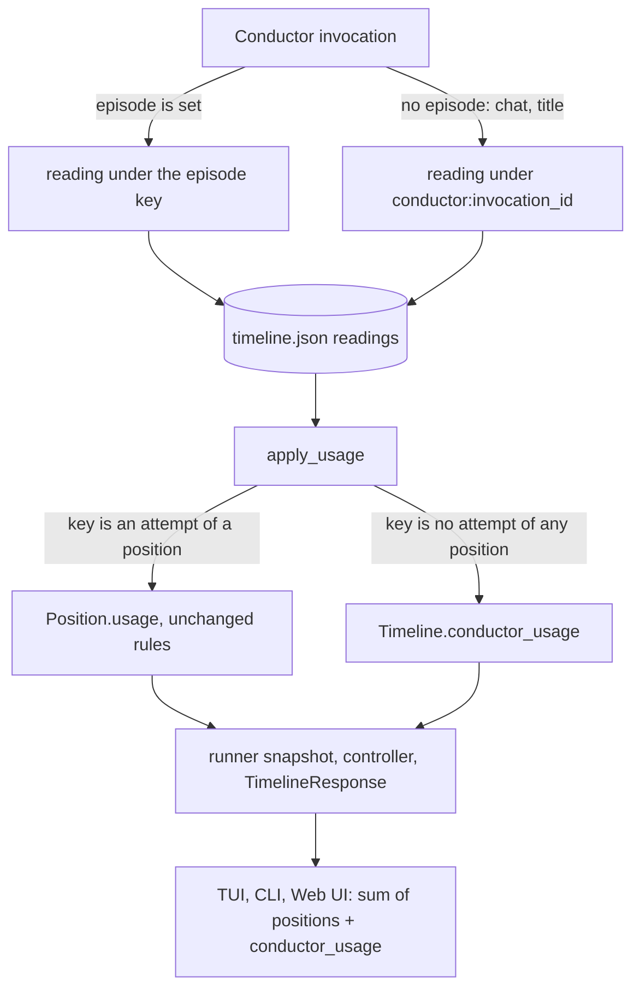

# Conductor Chat Cost in the Task Cost - Plan

## Goal Capsule

- **Objective:** The cost and tokens that the conductor uses to answer the operator's chat messages are part of the task cost that every frontend shows, so the operator sees what a task really cost.
- **Means:** A task-level conductor bucket on the timeline, filled from the readings in `timeline.json` that belong to no timeline position, and added to the task total by every frontend (KTD1, KTD2, KTD3).
- **Product authority:** This plan covers only area 2 of `docs/bugs/NARSOR-1124-001.md` ("Koszt czatu z dyrygentem w koszcie taska"). Area 1 (multi-thread conductor chat) is not active scope; see How This Work Fits Together. The E2BIG fix in the same bug document is already done and is not part of this plan. The Product Contract wins on behavior; the KTDs win on mechanism.
- **Open blockers:** None. Q1 (subagents of gate and failure runs) is decided: option b. Q2 (line format) is decided: option a.
- **Execution profile:** One pull request, units U1-U6 in order. Rust 2021 workspace plus the plain-JS Web UI.
- **Stop conditions:** Stop and report when a reading of a run without a position cannot reach `timeline.json` (for example, the conductor runs where no `ExecutionStore` of the task exists), or when the controller drops unknown `Timeline` fields on the way to a frontend.
- **Who finishes:** The implementer runs the Verification Contract and hands the branch back. No commit or push unless the person asks (`AGENTS.md`).

---

## Product Contract

### Summary

Every conductor invocation that has no timeline position (today: each reply to a chat message and each generation of the task title) records its cost and tokens in a task-level conductor bucket. The task cost line in the TUI, the Web UI and the CLI includes this bucket in the conductor part and in the combined total. Per-position usage does not change.

### Problem Frame

The operator can talk to the conductor of a task (the *Dyrygent* tab). Each reply is a real harness run that costs money. Today that cost disappears:

- A chat request has no episode (`crates/narsor-exec/src/conductor/store.rs`, `ConductorRequest::for_chat`). The title request (`crates/narsor-exec/src/conductor/title.rs`) has no episode either, so its cost is dropped the same way.
- The reading tap returns nothing for a request without an episode (`crates/narsor-exec/src/conductor/invoke.rs`, `reading_tap`), so the tokens and the cost of the run are dropped.
- `apply_usage` (`crates/narsor-exec/src/engine/timeline_file.rs`) only counts readings keyed by an attempt of a timeline position, so there is nowhere to put a reading that belongs to the task and not to a position.

The task cost line (`src/client/task_usage_text.rs`) adds up positions only. A task where the operator talked a lot with the conductor shows a cost that is too low, with no sign that something is missing.

### Key Decisions

- **Task-level bucket, not attribution to a position.** Chosen over adding the chat cost to the current or last timeline position (option B in the bug document): option B loses the cost when no position exists, for example after the task ends, and it puts operator-driven cost on an agent step that did not cause it. Governs R1, R3.
- **The conductor's chat cost stays apart from the agents' cost.** The existing rule "conductor use is reported apart from agent use" (`src/client/task_usage_text.rs`, module doc) holds for the new bucket. Governs R4.
- **Conductor subagents follow the same rules as the subagents of agents that process task steps.** The harness cost of the conductor already includes the cost of its subagents. The subagent count and subagent tokens only show which part of that cost the subagents used. They do not add money. Decided by the person on the review of this plan. Governs R8.

### Requirements

**Recording**

- R1. Every completed conductor harness run that has no timeline position adds its tokens and its cost to a task-level conductor bucket of that task.
- R2. A failed or cancelled conductor run adds what the harness reported before it stopped, and adds nothing when the harness reported nothing.
- R3. The task-level bucket survives the end of the task and a server restart, the same as per-position usage.

**Showing**

- R4. The task cost that the TUI, the Web UI and `narsor-cli` show includes the task-level bucket in the conductor part (`⚡`) and in the combined total (`razem`).
- R5. Per-position usage (the usage of each timeline position) does not include the task-level bucket and does not change.
- R6. A task whose conductor made no run without a timeline position shows the same text as today. A run that generates the task title is such a run, so it adds its cost to the bucket (R1).

- R8. The subagents of every conductor run (chat, title, gate decision and failure handling) add to the task subagent count and subagent tokens, marked as the conductor's. They follow the same rules as the subagents of agents that process task steps. They add no money to the cost, because the conductor's cost already includes them.

**Compatibility**

- R7. A task whose usage data was written before this change reads without error and shows the same cost as today.

### Acceptance Examples

- AE1. **Covers R1, R4.** Given a task where the agents cost $1.00 and the conductor decided at gates for $0.10, when the operator sends one chat message and the conductor's reply costs $0.05, then the task line shows `razem $1.15` and the conductor part shows $0.15.
- AE2. **Covers R3.** Given a finished task, when the operator sends a chat message and the reply costs $0.05, then the task total grows by $0.05, and it is still there after a server restart.
- AE3. **Covers R5.** Given the same task as AE1, the usage of each timeline position is the same before and after the chat message.
- AE4. **Covers R2.** Given a chat reply that fails before the harness reports any usage, the task cost does not change.
- AE5. **Covers R6, R7.** Given a task saved before this change with no chat, the task line text is the same as before.

### Scope Boundaries

- Multi-thread conductor chat and `--resume` of conductor sessions are out of scope (area 1).
- No per-message or per-thread cost display in the chat itself. Deferred.
- Gate decisions and failure handling of the conductor keep their position-keyed readings and cost. Only their subagents also count in the task subagent figure (R8, U6).
- No budget limits or alerts on conductor cost. Deferred.

<!-- ce-section: work-relationships -->
### How This Work Fits Together

This plan covers area 2 of `docs/bugs/NARSOR-1124-001.md`: conductor chat cost in the task cost. The breakdown below is the current understanding, not a committed roadmap.

- Area 1: multi-thread conductor chat (a list of chats at the top of the *Dyrygent* tab, the leftmost option starts a new chat, a chat continues an earlier harness session).
  - Can proceed independently of this plan.
  - Shares the conductor's chat request path; if area 1 resumes harness sessions, its readings may become session totals instead of single-run deltas. Still to decide in area 1's own brainstorm.
  - Still to decide: whether cost is also shown per thread.

### Założenia do potwierdzenia

1. **This brainstorm covers area 2 (cost) and not area 1 (multi-thread chat).** The bug document holds two independent features. Cost is the smaller one and it fixes lost data, so it goes first. Area 1 needs its own brainstorm.
2. **Option A (task-level bucket) is chosen.** The bug document recommends it; option B loses cost when no position exists.
3. **Conductor subagents are added to the task subagent counter, marked as the conductor's.** The person decided this. The conductor's cost from the harness already includes its subagents' cost, so subagents show their part of the cost and do not add to the money total. The same rules apply to agents and subagents that process task steps.
4. **The bucket is for every conductor run without a position, not only chat.** Today chat replies and title generation have no episode; both are counted, and a future trigger without an episode is counted too, instead of being lost again.
5. **Readings of a chat reply are single-run totals,** because each chat invocation starts a new harness session (`resume_session: None`).

### Pytania otwarte dla użytkownika

- Q1 (decided: option b, answered on the merge request). **Do the subagents of the conductor's gate and failure runs also count in the task subagent figure?** (Section: Requirements, R8, and Scope Boundaries.) Today R8 counts the subagents of conductor runs without a timeline position only. Gate and failure runs keep their position-keyed readings, so their subagents would be missing from the figure with no sign that it is partial.
  - **b (recommended):** Yes. Every conductor run counts its subagents the same way, so the figure is complete and matches "the same rules as the subagents of agents". The plan already keeps the subagent stats of every conductor run (KTD4), so this adds only U6. R8 and the Scope Boundaries line about gate decisions change to say so.
  - **a:** No. R8 stays as written, and R8 and the Key Decision say that the conductor subagent figure covers chat and title runs only. U6 is not built.
- Q2 (decided: option a, answered on the merge request). **Where does the line show the conductor's subagents?** (Section: Requirements, R8; Planning Contract, KTD5.) R8 says "add to the task subagent count ... marked as the conductor's".
  - **a (recommended):** In a subagent block of its own inside the conductor group: `⚡ $0.15 ↑2k ↓400 (👥 1 ↕3k)`. The agents' `👥` block does not change. This keeps the Key Decision "the conductor's chat cost stays apart from the agents' cost".
  - **b:** Added into the agents' `👥` count and tokens, with a conductor mark next to the number (for example `👥 3 (⚡1)`). One combined counter, but the agents' figures then include conductor use.

### Outstanding Questions

**Resolved in planning**

- Subagent count and tokens of the bucket: KTD4 and KTD5.
- Where the bucket lives and how it reaches frontends: KTD1, KTD2, KTD3.
- A conductor request whose episode matches no timeline position: today its reading is written under the episode key and no position reads it, so it is lost. This happens when the episode is a pending input's `episode` key that is not an attempt id, or `execution.current_state` (`execution_episode` in `crates/narsor-exec/src/engine/runner/human_input/operations.rs`). R1 covers it ("no timeline position"), and KTD2 puts its conductor part in the bucket.

### Sources

- `docs/bugs/NARSOR-1124-001.md` — "Decyzje do podjęcia", item 2.
- `crates/narsor-exec/src/conductor/store.rs` — `QueuedRequest::for_chat` (`episode: None`), `QueuedRequest::new` used by the title request.
- `crates/narsor-exec/src/conductor/invoke.rs` — `ConductorReadings`, `reading_tap`.
- `crates/narsor-exec/src/conductor/actor.rs` — `Invocation::invocation_id`.
- `crates/narsor-exec/src/engine/timeline_file.rs` — `UsageReading::of_conductor`, `absorb`, `record_reading`, `current_timeline`, `apply_usage`.
- `crates/narsor-protocol/src/api/timeline.rs` — `Timeline`, `PositionUsage`, `SubagentStats`.
- `src/client/task_usage_text.rs` — `TaskUsage`, `sum`, `line`.
- `crates/narsor-web/ui/js/text.js` — `sumUsage`, `usageLine`, `archivedRun`.

---

## Planning Contract

Product Contract preservation: Product Contract unchanged. The three "Deferred to Planning" questions are resolved in place; the review item on R8 moved to "Pytania otwarte dla użytkownika" as Q1, and Q2 was added.

### Key Technical Decisions

- KTD1. **A run without a position writes its reading under a reserved key in the existing `readings` map of `timeline.json`.** The key is `conductor:<invocation_id>`. Attempt ids are UUIDs, so the colon prefix cannot match one. Chosen over a new top-level field in `TimelineFile` with a new `ReadingSink` method: the reserved key keeps the sink trait, `ReadingTap`, the file lock and the atomic write as they are, and an older binary that reads the file ignores the extra keys. One key per invocation keeps each run's reading apart, so `absorb` never merges two runs. Governs R1, R2, R3.
- KTD2. **The bucket is computed, not stored: `apply_usage` adds the conductor part of every reading whose key is not an attempt of any position.** This one rule covers chat, title, a future trigger without an episode, and an episode that matches no position (Outstanding Questions). `apply_usage` stays pure, and `record_reading` and `current_timeline` already call it, so the bucket is current on both paths. The agent part of such a reading is ignored, as today. A reading of an attempt the cached timeline does not show yet counts in the bucket until the timeline is rebuilt, then moves to its position; the task total does not change. Governs R1, R5, R7.
- KTD3. **The protocol carries the bucket as an optional field on `Timeline`: `conductor_usage`, of a new type `ConductorUsage` (tokens, cost, subagent stats).** It uses `#[serde(default, skip_serializing_if = "Option::is_none")]`. `Timeline` already travels from the runner snapshot (`crates/narsor-runner/src/runner/snapshot.rs`) through the controller (`RunnerSnapshot`, `TimelineResponse`, the archived task record) to the TUI, the CLI and the Web UI, so no new endpoint is needed. A timeline without the field reads as `None`. Chosen over reusing `PositionUsage`, whose subagent fields mean the agent's subagents. Governs R3, R4, R7.
- KTD4. **`UsageReading::of_conductor` keeps the run's `subagent_stats` in a new field `conductor_subagent_stats`, for every conductor run.** `absorb` adds the field (each conductor run is its own harness process and reports one `RunResult`), and `is_empty` counts it. The field is stored for gate and failure runs too, because stored readings cannot be filled in later. U3 reads it only for the bucket, as R8 says. Q1 "b" adds U6, which also reads it on positions. Governs R8.
- KTD5. **Frontends sum the whole timeline, not only its positions.** `task_usage_text::sum` and the JS `sumUsage` take the timeline and add `conductor_usage` to the conductor part (`⚡`) and to `razem`. The conductor's subagents get their own block in the conductor group (Q2 "a"). The block shows the subagent count (`spawned`) and the tokens (`↕`), and never a cost: the harness cost already includes them (Key Decisions). Governs R4, R6, R8.

### High-Level Technical Design

### Assumptions

- The runner that runs the task's conductor also writes the task's `timeline.json` and still sends snapshots after the execution ended, because `Engine::reading_sink` notifies `readings_changed`. U3 checks the "after the end" part (AE2).
- The title request is answered by the same `HarnessInvoker` as chat (`crates/narsor-runner/src/runner/conductor.rs`, `with_reading_sink`), so it records under KTD1 without other changes.
- Claude reports `subagent_stats` once per run, in its `RunResult`. A harness that reports none leaves `conductor_subagent_stats` empty, and the line shows no conductor subagent block.

### Risks

- **A frontend that rebuilds the timeline would drop the bucket.** Research found none: the controller serves the runner's `Timeline` as it is. U2 adds a round-trip test through `TimelineResponse` so a later change that drops the field fails a test.
- **Many chat messages add many keys to `readings`.** One small entry per conductor run without a position. Not bounded; acceptable for the expected chat volume. Considered and not built: a compaction of old keys (it would change stored data for no user benefit today).

---

## Implementation Units

### U1. Record runs without a position under a reserved key

- **Goal:** Every conductor run without an episode writes its reading to `timeline.json`, and every conductor reading keeps its subagent stats.
- **Requirements:** R1, R2, R8; KTD1, KTD4.
- **Dependencies:** None.
- **Files:**
  - `crates/narsor-exec/src/conductor/invoke.rs`
  - `crates/narsor-exec/src/engine/timeline_file.rs`
  - `tests/integration/conductor_invoke.rs`
- **Approach:**
  1. In `reading_tap`, use the episode when it is set, else `conductor:<invocation_id>`. Put the prefix in one named constant next to `TIMELINE_FILE`, with a helper that tells whether a key is a task-level key.
  2. Add `conductor_subagent_stats` to `UsageReading` with the same serde attributes as the other optional fields. Fill it in `of_conductor`, add it in `absorb` before the early return for conductor-only readings, and count it in `is_empty`.
  3. Update the doc comments of `with_reading_sink` and `reading_tap`: a request without an episode now counts on the task.
- **Patterns to follow:** `RecordedReadings` and the existing reading test near line 1157 of `tests/integration/conductor_invoke.rs`; the `a_conductor_reading_*` unit tests in `timeline_file.rs`.
- **Test scenarios:**
  - Covers AE1 (recording part). A chat invocation (`ConductorTrigger::Chat`, no episode) whose fake Claude reports $0.05 records one reading under `conductor:<invocation_id>` with `conductor_cost_usd = 0.05` and no agent use.
  - A title invocation records under its own `conductor:` key, apart from a chat invocation's key.
  - Covers AE4. A chat invocation whose harness fails before it prints a `RunResult` records nothing.
  - `of_conductor` on a reading with `subagent_stats` keeps them in `conductor_subagent_stats`, and two such readings absorbed into one key add up.
- **Test seam:** the integration test catches the invoker-to-sink wiring with a fake harness; it does not catch the file write, which U3 covers.
- **Verification:** The scenarios pass, and no reading of a gate or failure run changes its key.

### U2. Carry the bucket on the protocol timeline

- **Goal:** `Timeline` has an optional `conductor_usage` that old data reads as `None`.
- **Requirements:** R3, R7; KTD3.
- **Dependencies:** None.
- **Files:**
  - `crates/narsor-protocol/src/api/timeline.rs`
  - `crates/narsor-protocol/src/api.rs` (existing timeline tests)
  - Struct literals of `Timeline` in `crates/narsor-exec/src/engine/timeline.rs` and the tests of `crates/narsor-exec/src/engine/timeline_file.rs`
- **Approach:** Add `ConductorUsage` (`total`, `cost_usd`, `subagent_stats`, all optional) and the field on `Timeline`. Give `ConductorUsage` a `plus`-style helper only if U3 or U4 needs it. Fix every `Timeline { .. }` literal the compiler reports.
- **Patterns to follow:** the `conductor_total` and `conductor_cost_usd` fields of `PositionUsage` and the test `a_position_usage_without_conductor_fields_reads_back` in `src/client/task_usage_text.rs`.
- **Test scenarios:**
  - Covers AE5 (data part). A timeline JSON written before this change, without `conductor_usage`, deserializes with `conductor_usage: None`, and serializing it again does not add the field.
  - A `TimelineResponse` with a `conductor_usage` survives a JSON round trip unchanged.
- **Verification:** The workspace builds, and both scenarios pass.

### U3. Compute the bucket from readings without a position

- **Goal:** `apply_usage` fills `Timeline.conductor_usage` from the readings that belong to no position, and leaves position usage as it is.
- **Requirements:** R1, R3, R5, R6, R7, R8; KTD2, KTD4.
- **Dependencies:** U1, U2.
- **Files:**
  - `crates/narsor-exec/src/engine/timeline_file.rs`
  - `tests/integration/timeline.rs`
  - `crates/narsor-runner/src/runner/session_tests.rs` (only for the after-the-end scenario, if the runner seam is the cheapest place for it)
- **Approach:**
  1. Collect the attempt ids of all positions, then add the conductor part (`conductor_total`, `conductor_cost_usd`, `conductor_subagent_stats`) of every other reading into one `ConductorUsage`.
  2. Set `timeline.conductor_usage` to `None` when nothing was added, so R6 holds.
  3. Do not read `conductor_subagent_stats` on positions (that is U6).
- **Patterns to follow:** `the_conductors_use_lands_on_the_decision_step_it_decided` and its `conductor_use` helper in `tests/integration/timeline.rs`.
- **Test scenarios:**
  - Covers AE1, AE3. A timeline with an agent position ($1.00) and a gate reading ($0.10) on decision step `d1`, plus a reading under `conductor:i1` ($0.05): `conductor_usage.cost_usd` is $0.05, and both positions have the same usage as without the chat reading.
  - Covers AE2. After the execution status is `Completed`, recording a `conductor:` reading changes `conductor_usage` of the timeline that `current_timeline` returns, and reading the file again (a new `current_timeline` call on the same store, as after a restart) gives the same value.
  - A reading under an episode key that no position has (a state id) counts in `conductor_usage`.
  - Covers R8. Two `conductor:` readings with `conductor_subagent_stats` of 1 and 2 spawned give `subagent_stats.spawned = 3` in the bucket, and no position gets them.
  - Covers AE5. A file without any `conductor:` key and without orphan readings gives `conductor_usage: None`.
- **Test seam:** these tests use the real file and `current_timeline`, so they catch the cache path and the rebuild path. They do not prove that the runner sends a new snapshot after the end; check `readings_changed` in the runner tests if the implementer finds that path untested.
- **Verification:** All scenarios pass; existing timeline tests pass unchanged.

### U4. Show the bucket in the TUI and the CLI

- **Goal:** The task line in the TUI and in `narsor-cli` adds the bucket to `⚡` and `razem`, and shows the conductor's subagents in the conductor group.
- **Requirements:** R4, R6, R8; KTD5.
- **Dependencies:** U2.
- **Files:**
  - `src/client/task_usage_text.rs`
  - `src/tui/task_app/detail.rs` (caller near line 1334)
  - `src/cli/task_text.rs` (caller near line 877)
- **Approach:**
  1. Change `sum` to take the `Timeline`. Add the bucket's tokens and cost to `conductor_total` and `conductor_cost_usd`.
  2. Add `conductor_subagent_count` and `conductor_subagent_tokens` to `TaskUsage`, filled from the bucket's `subagent_stats` with the same "above zero" rules as `subagent_count_of` and the agents' `subagent_tokens`.
  3. In `line`, when `with_subagents`, put a `👥` block with count and `↕` tokens after the conductor group's parts, in brackets, as the agents' group does.
  4. Update the module doc and the `line` doc example.
- **Patterns to follow:** `subagents_block` and the tests `conductor_use_is_summed_apart_and_combined_with_the_agents` and `the_line_names_the_conductor_and_the_total_only_when_it_reported`.
- **Test scenarios:**
  - Covers AE1. Positions with agent cost $1.00 and conductor cost $0.10, plus a bucket of $0.05: the line starts `razem $1.15` and its conductor group starts `⚡ $0.15`.
  - A timeline whose positions report nothing but whose bucket has $0.05 gives a line `razem $0.05 · ⚡ $0.05`.
  - Covers R8. A bucket with `subagent_stats { spawned: 2, tokens: 3000 }` gives `(👥 2 ↕3k)` in the conductor group, and the agents' `👥` block does not change. With `with_subagents = false` the block is left out.
  - Covers AE5. A timeline without `conductor_usage` gives exactly the line the existing tests expect today.
- **Verification:** Scenarios pass; the TUI and CLI callers compile with the new signature and show the line for the live and the archived task.

### U5. Show the bucket in the Web UI

- **Goal:** The Web UI task line adds the bucket the same way as U4.
- **Requirements:** R4, R6, R8; KTD5.
- **Dependencies:** U2.
- **Files:**
  - `crates/narsor-web/ui/js/text.js` (`sumUsage`, `usageLine`, `archivedRun`)
  - `crates/narsor-web/ui/js/ui/details.js` (caller near line 110)
  - `crates/narsor-web/ui-tests/text.test.mjs`
- **Approach:** `sumUsage` takes the timeline and adds `timeline.conductor_usage` to `conductor` and `conductorCost`. It also keeps the conductor's subagent count and tokens. `usageLine` puts `(◈ n ↕tokens)` after the `⚡` parts, in the Web UI's own subagent icon. A sum that has only a bucket is not `null`.
- **Patterns to follow:** the existing `sumUsage`/`usageLine` tests in `text.test.mjs`.
- **Test scenarios:**
  - Covers AE1. The same numbers as U4 give `razem $1.15` and `⚡ $0.15`.
  - A timeline with no position usage and a bucket of $0.05 gives `razem $0.05 · ⚡ $0.05`.
  - Covers AE5. A timeline without `conductor_usage` gives the same string as before.
- **Verification:** `node --test crates/narsor-web/ui-tests/*.mjs` passes.

### U6. Count the subagents of position-keyed conductor runs

- **Goal:** The conductor's subagents of gate and failure runs count too, on their position and in the task figure.
- **Requirements:** R8 (Q1 decided "b").
- **Dependencies:** U3, U4, U5.
- **Files:**
  - `crates/narsor-protocol/src/api/timeline.rs` (`PositionUsage.conductor_subagent_stats`)
  - `crates/narsor-exec/src/engine/timeline_file.rs`
  - `src/client/task_usage_text.rs`, `crates/narsor-web/ui/js/text.js` and their tests
  - `tests/integration/timeline.rs`
- **Approach:** `apply_usage` adds `conductor_subagent_stats` of a position's readings to a new optional `PositionUsage.conductor_subagent_stats`. `sum` and `sumUsage` add it to the conductor's subagent figures.
- **Test scenarios:**
  - A gate reading on `d1` with 1 spawned subagent and a chat reading with 2 give a conductor subagent count of 3 in the task line.
  - The agent's `subagent_count` of `d1` does not change.
- **Verification:** Scenarios pass; a position without the new field reads back as before.

---

## Verification Contract

| Gate | Command | Proves |
|---|---|---|
| Rust tests | `cargo test --workspace` (CI adds `--locked`) | U1-U4, U6: recording, bucket, protocol compatibility, TUI and CLI line |
| Web UI tests | `node --test crates/narsor-web/ui-tests/*.mjs` | U5, and U6 for the Web UI |
| Build | `cargo build --workspace --bins` | Every `Timeline` literal and `sum` caller is updated |

`#[ignore]`d tests (real `claude`, real processes, Kubernetes) are not needed: the fake harness in `tests/integration/conductor_invoke.rs` covers the invoker path.

## Definition of Done

- U1-U6 are done and their test scenarios pass (U6 is required: Q1 decided "b").
- AE1-AE5 each have a passing test that names them.
- A task without any conductor run without a position shows the same text in all three frontends as before (R6, R7).
- Doc comments of `reading_tap`, `with_reading_sink`, `apply_usage`, `TaskUsage` and the `line` example describe the new bucket.
- No dead-end or experimental code is left in the diff.
- The Verification Contract gates pass.
