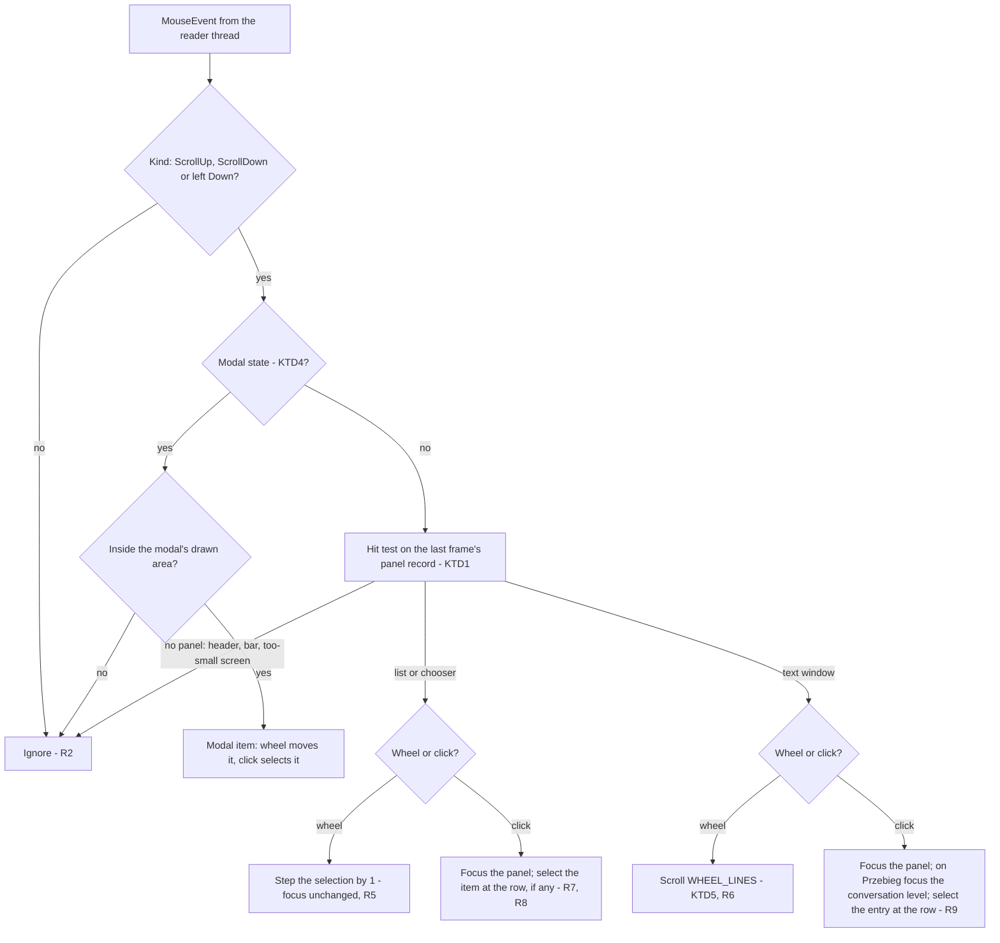

# TUI Mouse Wheel and Click Selection - Plan

## Goal Capsule

- **Objective:** An operator who holds a mouse can move through the lists and the conversations of the `narsor` TUI with the wheel, and can put the focus on a panel and a list item with one click, without first learning the keys.
- **Means:** Mouse reporting in the terminal (crossterm), routed to the panel under the pointer through the geometry each panel drew (KTD1), and applied through the existing selection and focus transitions (KTD3). The keyboard stays the primary input and keeps all its behavior.
- **Product authority:** This plan covers the `narsor` TUI only (`src/tui/`). The Web UI, `narsor-cli`, the server and the protocol are not active scope. Drag, double-click, right-click, hover and clicks on tabs, links and form fields are not active scope (see Scope Boundaries).
- **Open blockers:** None. Q1 (mouse capture vs. native text selection) is decided: mouse on by default, a key toggles it, `docs/user/tui.md` describes `Shift`+drag.
- **Authority:** The Requirements (R-IDs) win on product behavior; the Key Technical Decisions (KTD-IDs) win on mechanism; a unit overrides neither.
- **Execution profile:** One pull request, units U1–U7, following the dependency order in Sequencing. Rust only, in `src/tui/`, plus `docs/user/tui.md` and tests under `tests/integration/`.
- **Stop conditions:** Stop and report if a requirement can only be met by synthesizing key events (KTD3 forbids it), or if a key in R11 changes its behavior.
- **Who finishes:** The implementer runs the Verification Contract, then a person does the manual smoke check in a real terminal before merge.
- **Product Contract preservation:** Product Contract unchanged. The three "Deferred to Planning" questions now point to the KTDs that answer them.

---

## Product Contract

### Summary

The wheel moves the selection in lists and scrolls conversations, in the panel under the pointer. A left click on a panel gives it the focus; a left click on a list item also selects that item, as `j`/`k` would. All keys work as before.

### Problem Frame

The TUI is keyboard-only today: `src/tui/mod.rs` says "nothing depends on a mouse", and the loop in `run` handles only key and paste events. An operator who comes from a mouse-driven terminal tool reaches for the wheel first. Today the wheel does nothing in the alternate screen, or the terminal turns it into arrow keys, which moves the wrong thing. The focus model (panel focus, `Focus::List` / `Focus::Details`, *Przebieg* two levels, a bracketed or barred selected item, see `src/tui/selection.rs`) is already explicit, so a click can map onto it.

### Key Decisions

- **The pointer picks the target, not the focus.** The wheel acts on the panel under the pointer, so the operator can scroll a panel that does not have the keys. Governs R3, R5.
- **The wheel over a list moves the selection; it does not scroll a viewport past the selection.** This matches "jump through list options" and keeps one cursor per list. Governs R3.
- **A click reuses the existing selection and focus transitions.** A click does what the equivalent keys would do (focus change, select item), so side effects (details load, follow mode, timeline freeze) stay the same. Governs R6, R7, R8.
- **The keyboard stays complete.** No action becomes mouse-only. Governs R11.

### Requirements

**Mouse reporting**

- R1. The TUI turns on terminal mouse reporting when it takes the screen, and turns it off on every exit path, including the panic path, together with the other terminal modes (`restore_terminal`).
- R1a. A key toggles mouse reporting while the TUI runs, so the operator can select text with a plain drag. Mouse reporting is on at start. The TUI shows the current state (on or off) in the shortcut bar or the help. The key is chosen in planning and must not clash with an existing key.
- R2. The TUI ignores mouse events that this plan does not use (move, drag, right and middle button, release) without any visible effect.

**Wheel**

- R3. Over a list (the task list, the history list, the step axis on *Przebieg*, the chooser lists: the menu, the answer panel, the new task, the repositories, the queues), one wheel notch moves the selection by one item, up or down, and stops at the first and the last item.
- R4. Over a conversation or another read-only content window (*Rozmowa*, the conversation of a step on *Przebieg*, *Zdarzenia*, *Dyrygent*, *Stan*, *Info*, the event detail), one wheel notch scrolls the content by a fixed small number of lines and stops at the top and the bottom, with the same limits as the line keys of that window.
- R5. The wheel changes the panel under the pointer. It does not move the keyboard focus to that panel.
- R6. Wheel scrolling up in a conversation that follows the newest entry stops the follow, as scrolling up with the keys does; scrolling back to the bottom behaves as the keys do there.

**Click**

- R7. A left click inside a panel gives that panel the keyboard focus (for example the task list or the details), with the same visible focus frame as a key change.
- R8. A left click on an item of a list also selects that item: it gets the selection bracket or bar, and every effect of a key selection follows (for example the details of the clicked task open).
- R9. A left click on a step on *Przebieg* puts the focus on the step axis and selects that step; a left click in the conversation of the selected step puts the focus in that conversation (the second focus level). A click on an entry in a conversation selects that entry where the keys `j`/`k` can select entries.
- R10. A click on empty space in a panel, on a frame, on the header or on the shortcut bar changes only the panel focus, or nothing where there is no panel. It never runs an action.

**Compatibility**

- R11. All keys keep their current behavior; the mouse adds input and removes none.
- R12. In the narrow layout (`Screen::Full`, under 100 columns) the mouse acts only on the one panel on screen. On the "terminal too small" screen the mouse does nothing.
- R13. While a modal form or chooser covers part of the screen, a click or a wheel notch outside it does not reach the panels under it.
- R14. `docs/user/tui.md` describes the mouse behavior, the toggle key and `Shift`+drag text selection, and the module comment in `src/tui/mod.rs` no longer says that nothing uses the mouse.

### Acceptance Examples

- AE1. **Covers R3, R5.** Given the focus is in the details and the pointer is over the task list, when the operator turns the wheel down two notches, then the selection on the list moves two tasks down, the details show the newly selected task, and the focus frame stays on the details.
- AE2. **Covers R4, R6.** Given *Rozmowa* follows the newest entry, when the operator turns the wheel up over it, then the content scrolls up and the follow stops; new entries do not pull the view down.
- AE3. **Covers R7, R8.** Given the focus is on the list, when the operator clicks the second line of the third task, then the third task is selected and the focus stays on the list.
- AE4. **Covers R9.** Given *Przebieg* is open with the focus on the list, when the operator clicks the step `review_api`, then the focus moves to the details, the step axis has the keys, and `review_api` is selected.
- AE5. **Covers R13.** Given the actions menu (`.`) is open, when the operator clicks a task on the list behind it, then nothing changes behind the menu.
- AE6. **Covers R3.** Given the first task is selected, when the operator turns the wheel up over the list, then the selection stays on the first task.

### Scope Boundaries

Deferred for later:

- Clicks on tab names (`Przebieg`, `Rozmowa`, …) to switch tabs.
- Double-click as `Enter` (open, confirm).
- Clicks on links (`PR !482 ↗`) and on form fields, buttons in forms.
- Drag to select or to move tasks in the queue; drag of the panel border.
- Right-click menus, hover highlight, middle-click paste.
- A setting in the configuration file that turns the mouse on or off. The key of R1a is the only switch.

### Założenia do potwierdzenia

- Z1. (Confirmed by the person, Q1 option 1.) Mouse capture is on by default every time the TUI starts, and a key toggles it (R1a). Most terminals still allow native text selection with `Shift`+drag (or `Option`/`Fn` on macOS) while capture is on; `docs/user/tui.md` says so.
- Z2. "Jump through list options" means the wheel moves the selected item, not only the visible window (R3). Where a list has no selection (read-only content), the wheel scrolls the content (R4).
- Z3. The "active element" is the pair the TUI already tracks: the focused panel and the selected item in it. A click sets both (R7, R8); it does not run the item's action.
- Z4. The wheel acts on the panel under the pointer and does not move the focus (R5), as in most terminal tools with panels (for example `lazygit`).
- Z5. One wheel notch moves one list item (R3). For content windows the step is a small fixed number of lines (about 3), chosen in planning.
- Z6. The first release covers every list and content window that has a selection or scroll today. A panel that is hard to hit-test may come later, but the task list, *Przebieg* (steps and conversation) and *Rozmowa* are required.

### Outstanding Questions

Resolve Before Planning:

- None. Q1 is answered (see Z1).

Deferred to Planning (answered in the Planning Contract):

- How each panel exposes the screen area of its items for hit-testing, and where the router lives: KTD1, KTD2.
- The exact line step of R4 and whether fast wheel bursts need coalescing: KTD5, KTD7.
- How to test mouse routing without a terminal: the Verification Contract and U2.

### Pytania otwarte dla użytkownika

None. Q1 was answered: option 1 (mouse on by default, a key toggles it, `Shift`+drag documented).

### Sources / Research

- `src/tui/mod.rs` — the event loop (`run`) handles `Key` and `Paste` only; terminal modes are set in `TerminalGuard::take_over` and undone in `restore_terminal`.
- `src/tui/selection.rs` — bracketed and barred selection, which changes the rows an item takes.
- `src/tui/scroll.rs` — `ScrollState`, the shared scroll of read-only windows.
- `src/tui/task_app/layout.rs` — screen geometry (`areas`, split and full layouts), the base for hit-testing.
- `src/tui/task_app/mod.rs` — `Focus`, `StepFocus`, `View`.
- `docs/user/tui.md` — the user reference that R14 updates.
- Dependencies: `crossterm 0.29`, `ratatui 0.30` (Cargo.toml) already support mouse events.

---

## Planning Contract

### Key Technical Decisions

- KTD1. **The renderers record what they drew; the router reads that record.** `layout::render` already decides every panel rectangle, and `selection::render_list` already decides which rows each item takes (rules and multi-row items included). The router reuses those results from the last frame. Rejected: a router that computes geometry again, because it would copy the row math of the bracketed selection and drift from it. Mouse coordinates from crossterm and ratatui `Rect`s share one origin (column 0, row 0 of the screen), so no translation is needed.
- KTD2. **Each list owner keeps the rows of its last drawn items next to the `top` it already keeps.** The private `render_list` in `src/tui/selection.rs` is the one producer: it returns, per drawn item, its index and its row span, and the public wrappers (`render_barred_list`, `render_bracketed_list`, `render_bracketed_list_plain`) pass that result through unchanged. `Chooser` has a second draw path: `chooser::render_footer` (the answer panel in `src/tui/task_app/panel/state.rs` and the stepped forms in `src/tui/stepped.rs`) draws one row per item in a `Paragraph` scrolled by `top`. That path records one row per visible item (row = area top + index - `top`) in the same per-chooser record. `TaskList`, `History`, the step axis in `tabs/progress.rs` and `Chooser` store the record and answer "which item is at this row". The app keeps a small per-frame record of panel rectangles only: list, details, step axis, step conversation, conversation windows, answer panel and the open overlay. A point outside all of them hits nothing, which covers the header, the bar and the too-small screen. Each frame clears and refills the record, so a panel that was not drawn cannot be hit (R12).
- KTD3. **The mouse calls the same state transitions as the keys; it does not synthesize key events.** A key goes to the panel that has the focus, but the wheel must reach the panel under the pointer (R5). So the router calls the functions the keys reach: `change_list(|l| l.step(±1))` and `change_list(|l| l.select(id))` for the task list, `progress.step` and the `enter_step` / `back_to_axis` pair for *Przebieg*, `focus_panel` for the answer panel, and `Chooser::select` for choosers. Side effects stay where they are today (Key Decision 3).
- KTD4. **A modal state is decided from application state, not from drawing order.** When one of these is true, only events inside the modal's own drawn area act, and all other events are dropped (R13): an `Overlay` is open, `quit_confirm` is set, `help_open` is set, `form_confirming()` is true, or a form view (`NewTask`, a `Repositories` form) holds the keys. Two more states drop every mouse event, because they have no drawn area of their own: the list filter is being typed, or the list is in move mode. A stray notch must not reorder the queue or leave the filter half typed. Help and the quit confirmation have no clickable items, so every event is dropped while they are open.
- KTD5. **One wheel notch moves one item in a list and `WHEEL_LINES = 3` lines in a text window.** The per-window mapping:

  | Window | Wheel notch | Mechanism |
  |---|---|---|
  | Task list, history list, step axis, chooser lists | 1 item | The same step function as `j` / `k` |
  | *Rozmowa*, step conversation, *Dyrygent* chat | 3 lines | New `TranscriptState` scroll by lines, modeled on `page_down` / `page_up`: it moves the offset, stops end-following, and keeps the cursor on a visible entry (`select_at_scroll`) |
  | *Zdarzenia* (one event per row), *Stan*, *Info* | 3 lines | The window's own `Down` / `Up` action, 3 times, so the limits are those of its line keys (R4) |
  | Event detail on *Zdarzenia* | 3 lines | `detail_scroll` by 3. The detail has no line keys of its own, so it uses the clamp of its page keys |

  Transcripts move the entry cursor on `j` / `k` (`TranscriptState::line_down`), so one entry per notch would jump a long entry in one step. A scroll by lines satisfies R4 literally and stops the follow as R6 requires.
- KTD6. **The toggle key is `P` (*przechwytywanie myszy*), a `Context::Global` binding handled at the top of `on_key`, as `D` is.** `P` is not bound in any context today. The key works wherever the operator is not typing text (`!accepts_text()`). The terminal bytes for switching the capture on or off go through the `Screen` writer queue, so they cannot interleave with a frame and cannot block the loop (`src/tui/screen.rs` explains the reason). These control bytes are kept apart from frame bytes: the `MAX_PENDING` overflow clear in `Screen::draw` drops frames, never a pending mode change. The help row for `P` names the current state (on or off), and the shortcut bar shows a marker while capture is off (for example `mysz wył. [P]`). Each toggle also shows a notification with the new state (R1a).
- KTD7. **Turn on only button and wheel reporting with SGR encoding (`?1000h` and `?1006h`); do not use crossterm's `EnableMouseCapture`.** `EnableMouseCapture` also asks for drag (`?1002`) and all motion (`?1003`), so every pointer move becomes an event and a redraw, and the plan uses neither (R2). The restore path sends crossterm's `DisableMouseCapture`, which switches off all those modes. That is safe whichever mode was on. There is no wheel coalescing: each notch is one state change and one redraw, and the screen writer already merges pending frames. Revisit only if a smoke test shows lag.
- KTD8. **The router handles three event kinds: `ScrollUp`, `ScrollDown` and `Down(MouseButton::Left)`.** It ignores every other kind without a state change (R2), and it also ignores horizontal scroll.

### High-Level Technical Design

The routing of one mouse event:

Mouse capture lifecycle: `take_screen` turns it on and sets `MOUSE_ARMED`, which means "capture was armed in this session". `P` queues the off or on bytes on the screen writer and does not clear the flag. `restore_terminal_to` sends `DisableMouseCapture` whenever the flag is set, and does so on every exit path, the panic hook included (R1). So a mode change that the writer had not yet flushed when the process ended cannot leave capture on.

### Assumptions

- A1. R13 "modal form or chooser" includes the new-task form and the repository form while they hold the keys, and also list filter typing and move mode (KTD4). Each of them has a key-driven exit that a stray click would bypass.
- A2. While the operator types into a field, `P` is text, so the toggle is not available. `docs/user/tui.md` says so.
- A3. A wheel notch over the step conversation on *Przebieg* scrolls it without entering the step (R5). When the axis follows a running step, the follow may replace the step under the pointer. That is the same as what the operator sees today without the mouse.
- A4. A click on the step-chip strip of *Rozmowa*, on the tab names or on a frame title counts as a click on the panel (R10 and the deferred tab clicks). It only changes the focus.
- A5. A click on a rule row of a bracketed list, or below the last item, is empty space (R10). It only changes the focus.

### Sequencing

U1 first: without capture there are no events. U2 builds the router and the geometry record that U3 to U6 fill. U3, U4 and U6 depend only on U2 and can land in any order. U5 also depends on U4 (transcript scroll by lines and the entry lookup). U7 is last, so the documentation describes the behavior that was built.

---

## Implementation Units

### U1. Mouse capture lifecycle and the toggle key

- **Goal:** The terminal reports buttons and the wheel while the TUI runs. `P` switches the reporting on and off, and every exit path switches it off.
- **Requirements:** R1, R1a, R11.
- **Dependencies:** None.
- **Files:** `src/tui/mod.rs`, `src/tui/screen.rs`, `src/tui/keymap.rs`, `src/tui/task_app/mod.rs`, `src/tui/task_app/layout.rs` (bar marker), `tests/integration/tui_terminal_restore.rs`, `tests/integration/tui_mouse.rs` (new), `tests/integration/main.rs`.
- **Approach:**
  1. Add a `MOUSE_ARMED` flag and an `arm_mouse_capture(out)` seam in `src/tui/mod.rs`, modeled on `PASTE_ARMED` / `arm_bracketed_paste`. Call it from `take_screen`. `restore_terminal_to` sends `DisableMouseCapture` when the flag is set and then clears it (KTD7, High-Level Technical Design lifecycle).
  2. Add a way to queue control bytes on the `Screen` writer that the `MAX_PENDING` overflow clear does not drop (KTD6).
  3. Add `Action::ToggleMouse` bound to `P` in `Context::Global` with a help description. Handle it at the top of `TaskApp::on_key` next to `DumpProblems`.
  4. `TaskApp` holds the wanted capture state. The `run` loop compares it with the armed state after each event and queues the change.
  5. `render_bar` shows the off marker, the help row for `P` names the current state, and the toggle pushes a notification.
- **Patterns to follow:** `arm_bracketed_paste` and its restore test, and the `DumpProblems` early check in `on_key`.
- **Test scenarios:**
  - Extend the existing restore test in `tests/integration/tui_terminal_restore.rs` (one test function, not a second one: it shares the process-wide flags with `tui_state` in the same test binary): after bracketed paste and mouse capture were both armed, restore writes both off sequences once, and a second restore writes neither.
  - After `P` turned capture off, restore still writes the mouse-off sequence (the flag means "armed in this session").
  - `P` on the list turns the capture state off, and the drawn bar shows the off marker. A second `P` turns it on and the marker disappears.
  - `P` while the answer panel or a form field is being typed into is text: the field gets `P` and the capture state does not change.
  - The keymap test that rejects clashing bindings still passes with `P` added.
- **Verification:** The restore test and the state tests pass. In a real terminal the wheel produces no arrow-key movement, and after `P` a plain drag selects text.

### U2. Mouse router, geometry record and modal gate

- **Goal:** Each mouse event reaches the panel under the pointer or is dropped. Nothing happens on the header, the bar, the too-small screen or outside a modal.
- **Requirements:** R2, R5, R10, R12, R13.
- **Dependencies:** U1.
- **Files:** `src/tui/mod.rs` (forward `TerminalEvent::Mouse`), `src/tui/task_app/mod.rs` (`on_mouse`), a new `src/tui/task_app/mouse.rs` for the router and the per-frame panel record, `src/tui/task_app/layout.rs` (record the panel rectangles and the overlay rectangle), `src/tui/selection.rs` (return the drawn item rows, KTD2), `tests/integration/tui_mouse.rs`.
- **Approach:**
  1. `render_list` returns the drawn rows per item. All current callers compile unchanged by ignoring the result until U3 and U6 use it.
  2. `layout::render` clears the panel record and fills it with the panel and overlay rectangles of this frame (KTD2). The too-small path records nothing.
  3. `TaskApp::on_mouse(MouseEvent) -> Request` applies KTD8, then KTD4, then the hit test. It returns `Request::None` in this unit. The loop dispatches the result as it does for keys.
  4. A click on a panel with no item under the pointer gives that panel the focus with the same fields a key change sets (`focus`, `panel_focus`, `back_to_axis` when it leaves the details).
- **Patterns to follow:** The `TestBackend` draw followed by state assertions in `tests/integration/tui_state.rs`. The test seam is a frame drawn by `layout::render_at`, then `on_mouse` with a crossterm `MouseEvent` at a cell of that frame.
- **Test scenarios:**
  - Covers AE5. With the action menu open, a click on a task behind it changes neither the selection nor the focus, and the menu stays open.
  - A click on the header row, on the bar row, or anywhere on the too-small screen changes nothing.
  - In the narrow layout (90 columns) with the list shown, a click at a column where the details would be in the split layout acts on the list, not on hidden details.
  - Move, drag, right-click, middle-click and release events leave the selection, the focus and the scroll positions unchanged.
  - While the list filter is being typed, and while the list is in move mode, a wheel notch and a click over the task list change neither the selection, the filter text nor the queue order (KTD4).
  - With the focus on the list, a click on empty space in the details moves the focus to the details and the selected task stays the same.
- **Verification:** The routing tests pass, and the existing `tui_state` and `tui_render` suites still pass unchanged.

### U3. Task list and history: wheel and click

- **Goal:** The wheel steps the selection of the list under the pointer, and a click selects the task at the pointer and focuses the list.
- **Requirements:** R3, R5, R7, R8, R11.
- **Dependencies:** U2.
- **Files:** `src/tui/task_app/list.rs`, `src/tui/task_app/history.rs`, `src/tui/task_app/mouse.rs`, `tests/integration/tui_mouse.rs`.
- **Approach:** Store the drawn-rows record (KTD2) on `TaskList` and `History`. Wheel and click go through `change_list` and the history equivalent, so detail reads and `back_to_axis` follow as for `j` / `k` (KTD3). A pending row (a task not yet sent) is selectable exactly as with keys.
- **Test scenarios:**
  - Covers AE1. Focus in the details, two wheel-down notches over the list: the selection moves two tasks down, the details show the new task, and the focus stays on the details.
  - Covers AE3. Focus on the list, a click on the second row of the third task: the third task is selected and the focus stays on the list.
  - Covers AE6. First task selected, wheel up over the list: the selection stays on the first task. The mirror case holds at the last task.
  - Focus in the details, a click on a task: the task is selected and the focus moves to the list.
  - With the history open, a click on an archived entry selects it, and its read-only details follow.
- **Verification:** The tests pass, and every existing list key test still passes.

### U4. Detail text windows: wheel and click focus

- **Goal:** The wheel scrolls the text window under the pointer by KTD5, and a click focuses the details.
- **Requirements:** R4, R5, R6, R7, R9 (entry click in *Rozmowa* and *Dyrygent*).
- **Dependencies:** U2.
- **Files:** `src/tui/transcript/state.rs` (scroll by lines, entry at a visible row), `src/tui/task_app/tabs/conversation.rs` (keep the last drawn window rectangle), `src/tui/task_app/tabs/events.rs`, `src/tui/task_app/tabs/state.rs`, `src/tui/task_app/tabs/info.rs`, `src/tui/task_app/tabs/conductor.rs`, `src/tui/task_app/detail.rs` (an `on_wheel` next to `on_action`), `src/tui/task_app/mouse.rs`, `tests/integration/tui_mouse.rs`, `src/tui/transcript/tests.rs`.
- **Approach:**
  1. Add the transcript scroll by lines (KTD5). The wheel uses it, and no key changes.
  2. Add a lookup from a visible row to its entry, using the same `wrap_visible_lines` slice the renderer draws. A click selects that entry through the existing selection path, which also stops end-following as `j` / `k` do.
  3. `DetailView` gets a wheel entry point that maps each tab to the KTD5 mechanism. It acts on the selected task's view whether or not the details hold the focus (R5).
- **Test scenarios:**
  - Covers AE2. *Rozmowa* follows the newest entry, one wheel-up notch over it: the offset drops by 3 lines and end-following is off. Appending new entries does not move the view.
  - Wheel down at the bottom of *Rozmowa* leaves the offset at the bottom, with the same limits as `PageDown`.
  - Focus on the list, wheel over *Info*: *Info* scrolls and the focus stays on the list.
  - A click on the second visible entry of *Rozmowa* selects that entry and focuses the details.
  - Wheel down over *Zdarzenia* moves the event cursor by three events, and stops at the last event.
- **Verification:** The tests pass, and the transcript unit tests in `src/tui/transcript/tests.rs` cover the scroll by lines at the top and bottom edges.

### U5. *Przebieg*: step axis and step conversation

- **Goal:** The wheel steps the axis or scrolls the step conversation under the pointer. A click on a step focuses the axis level and selects it, and a click in the conversation enters the step.
- **Requirements:** R3, R4, R9.
- **Dependencies:** U2, U4 (transcript scroll by lines and the entry lookup).
- **Files:** `src/tui/task_app/tabs/progress.rs` (store the drawn axis rows and the conversation rectangle, select a step by index), `src/tui/task_app/mod.rs` (`enter_step` / `back_to_axis` reuse), `src/tui/task_app/mouse.rs`, `tests/integration/tui_mouse.rs`.
- **Approach:**
  1. The axis draws through the selection renderer, so it stores the KTD2 drawn-rows record.
  2. A click on a step sets `focus = Details`, calls `back_to_axis`, then selects the step through the same function as `j` / `k`.
  3. A click in the step conversation calls the same path as `Enter` on the axis (`enter_step`). It then selects the entry at the row with the U4 lookup. When `enter_step` refuses (no conversation yet), the click only focuses the axis.
  4. A wheel notch over the axis while that task's details are at the conversation level first runs `back_to_axis` (the path `Esc` and a step click use), then steps the axis. Otherwise the keys would read a different step's conversation, which may not be built. The panel focus does not move (R5).
- **Test scenarios:**
  - Covers AE4. *Przebieg* open, focus on the list, a click on step `review_api`: the focus is in the details at the axis level and `review_api` is selected.
  - A click in the conversation of the selected step: the focus is at the conversation level, and the axis holds the step (`is_paused`).
  - A click in the conversation of a step that has no conversation yet: the focus stays on the axis and nothing fails.
  - Wheel over the axis with the focus on the list: the step moves by one and the focus stays on the list.
  - Focus in the step conversation, one wheel-down notch over the axis: the level is back on the axis, the next step is selected, and the focus stays in the details.
- **Verification:** The tests pass, and the existing *Przebieg* key tests still pass.

### U6. Choosers and overlays: wheel and click select

- **Goal:** The wheel and a click move the selection in the action menu, the answer panel, the new-task form, the repositories and the queues. A click never runs the item.
- **Requirements:** R3, R8, R13 (inside the modal), Z3.
- **Dependencies:** U2.
- **Files:** `src/tui/chooser.rs` (store the drawn rows, select by row), `src/tui/task_app/actions.rs` (overlay area in the panel record), `src/tui/task_app/panel/state.rs` (answer panel area and focus), `src/tui/task_app/new_task/mod.rs`, `src/tui/task_app/repositories.rs`, `src/tui/queues/list.rs`, `src/tui/task_app/mouse.rs`, `tests/integration/tui_mouse.rs`.
- **Approach:** `Chooser` stores the KTD2 drawn-rows record on both its draw paths: the bracketed path (menus, overlays, forms) and the footer path (`render_footer`, used by the answer panel and the stepped forms). The router sends events inside a modal to that modal's chooser (KTD4). A click on the answer panel calls `focus_panel`. The queues view uses its own list: check it in `src/tui/queues/list.rs`. If it does not draw through `selection`, give it the same drawn-rows record.
- **Test scenarios:**
  - With the action menu open, a click on its third action selects it, and no `Request::Act` is returned.
  - With the action menu open, a wheel-down notch inside it moves the selection by one, and a notch outside it changes nothing.
  - With the focus on the list, a click on an option of the answer panel focuses the panel and selects the option without sending an answer. This exercises the footer path.
  - In the new-task form, a wheel notch over a chooser field moves its option, and a click on the task list behind the form changes nothing (A1).
- **Verification:** The tests pass, and the existing chooser and form tests in `tui_form` and `tui_panel` still pass.

### U7. Documentation

- **Goal:** The operator can learn the mouse behavior, `P` and `Shift`+drag from the user documentation and from help.
- **Requirements:** R14, R1a.
- **Dependencies:** U1–U6.
- **Files:** `docs/user/tui.md`, `src/tui/mod.rs` (module comment).
- **Approach:** Add a "Mysz" section to `docs/user/tui.md` that covers the wheel, clicks, the modal rule, `P`, A2, and native selection with `Shift`+drag (`Option` / `Fn` on macOS). Replace "nothing depends on a mouse" in the module comment with a sentence that the mouse adds input and the keys stay complete. Add "mouse reporting" to the list of restored terminal modes.
- **Test expectation:** none -- documentation only. The existing `docs_links` test checks the links.
- **Verification:** The documentation describes only behavior the tests prove.

---

## Verification Contract

| Gate | Command or check | Proves |
|---|---|---|
| Workspace tests | `cargo test --workspace --locked` | U1–U6 scenarios, all existing TUI suites unchanged (R11) |
| Build | `cargo build --workspace --bins` | The `narsor` binary links with the new event arm |
| Lints | `cargo clippy --workspace --all-targets` | No new warnings in `src/tui/` |
| Manual smoke, real terminal | Run `narsor` against a local daemon. Use the wheel over the list and *Rozmowa*, click a task and a step, press `P` and drag-select text, then quit and check that the shell gets no mouse escape codes | R1, R1a, the KTD7 mode choice, and terminal restore on exit |

The `#[ignore]`d tests are not needed: no process lifecycle, harness or cluster behavior changes.

---

## Definition of Done

- Every unit's test scenarios exist and pass under `cargo test --workspace --locked`.
- AE1–AE6 each have a passing test that names them.
- No existing key test was changed to make it pass (R11).
- After the TUI quits, normally or by panic, the terminal does not send mouse escape codes to the shell.
- `docs/user/tui.md` and the `src/tui/mod.rs` module comment match the shipped behavior.
- No unused experimental code, debug output or dead helpers are left in the diff.

---

## Risks

- Some terminals (older `tmux`, some web consoles) do not report SGR mouse events, or need their own mouse option. Mitigation: the keys stay complete (R11), and `docs/user/tui.md` names the `tmux` `set -g mouse on` setting.
- Too many owners of drawn rows could drift from the drawing. Mitigation: KTD2 limits the producers to the two draw paths (`selection::render_list` and the chooser footer path), and every owner stores their output unchanged.
- The `run` loop redraws after every event, ignored events included. KTD7 keeps motion events out, so this is bounded by clicks and wheel notches.
