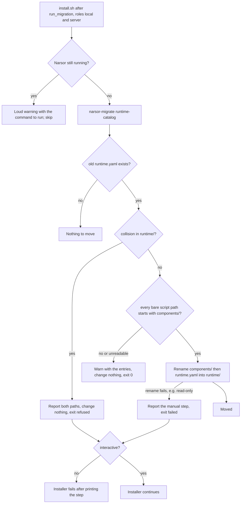

# Move the runtime catalogue and its component scripts into one runtime/ directory - Plan

## Goal Capsule

- **Objective:** An operator finds everything that defines the Docker task image (the runtime catalogue and the component scripts it installs) in one directory of the catalogue, and an existing installation keeps working after the update.
- **Means:** move `{catalog}/runtime.yaml` to `{catalog}/runtime/runtime.yaml` and the component scripts from `{catalog}/components/` to `{catalog}/runtime/components/`; script paths resolve relative to the directory of `runtime.yaml` (KTD2); the installer moves an old layout through `narsor-migrate` (KTD6).
- **Product authority:** the user's request of 2026-11-26 and their answers on the merge request: Q1 option (a); Q2 migration as part of the install script; the install script reads the work mode from the existing configuration. Where this plan and the Product Contract disagree, the Product Contract wins on behavior; the Planning Contract wins on mechanism.
- **Execution profile:** one pull request, units U1 to U7 in dependency order. Merging waits on the answers to Q3 to Q5 (see "Pytania otwarte dla użytkownika"); the plan implements the recommended option of each, so work can start now.
- **Stop conditions:** stop and ask when an implementation step would make the server move or rewrite operator files, change the `runtime.yaml` schema, or change a sealed `TaskImage` for unchanged script text.
- **Who finishes:** the implementing agent runs U1 to U7 and the Verification Contract; a person answers Q3 to Q5 before merge.
- **Open blockers:** none for implementation.

---

## Product Contract

Product Contract preservation: restructured, no scope change. Q1 and Q2 answers moved from the questions list into Key Decisions. A8 updated with the research finding. The 2026-11-26 review items were resolved into KTD6, KTD7 and Q3 to Q4. Q5 is new and comes from R14. R1 to R14 and AE1 to AE5 unchanged; AE6 added (covers R13).

### Summary

The catalogue gets a `runtime/` directory that holds `runtime.yaml` and the `components/` scripts it names. Script paths in `runtime.yaml` resolve relative to the directory of `runtime.yaml`, so the existing `components/...` entries stay valid after the move. The install script moves the files of an old layout. Until then, an old layout keeps working with a warning.

### Problem Frame

Today the definition of the Docker task image is split between two places at the catalogue root: `runtime.yaml` and the `components/` directory. The root also holds `backends/`, `profiles/`, `workflows/`, `automations/` and `queues/`, so `components/` reads as one more top-level catalogue kind, which it is not: only `runtime.yaml` uses it. Automations already follow the "one directory per concern" pattern (`automations/{name}/automation.yaml` plus its scripts).

The current script-path rule is also tied to the catalogue root (`crates/narsor-engine/src/environment/profile.rs`, `ScriptSource::text` and `seal`), so moving `runtime.yaml` alone would break every `components/...` entry.

### Key Decisions

- **Script paths resolve relative to the directory of `runtime.yaml`, not the catalogue root** (Q1, answered: option (a)). With the file at the catalogue root this is the same rule as today, so one rule serves both layouts. Governs R3, R4.
- **The old layout stays readable for a transition period. The install script migrates it; the server and `narsor-cli init` do not** (Q2, answered). The server does not move operator files; a mounted catalogue can be read-only. Governs R5, R6, R7, R13.
- **Sealed task images do not change.** A sealed `TaskImage` holds script text, not paths (`crates/narsor-model/src/domain/environment.rs`, `TaskImageComponent`), so the move changes no `environment_identity` when the script text stays the same. Governs R9.

### Requirements

**Layout**

- R1. The runtime catalogue is read from `{catalog}/runtime/runtime.yaml` (`.yml` accepted as for other catalogue entries).
- R2. The example catalogue in the repository (`examples/catalog/`) uses the new layout: `examples/catalog/runtime/runtime.yaml` and `examples/catalog/runtime/components/`.

**Script paths**

- R3. A bare-string `install` or `version` script path in `runtime.yaml` resolves relative to the directory that holds the `runtime.yaml` in use.
- R4. A script path must stay inside that directory after symlinks are resolved; a path outside it is refused with the same kind of error as today ("lies outside the catalogue directory", reworded to name the runtime directory).

**Old layout (transition)**

- R5. When `{catalog}/runtime/runtime.yaml` does not exist and `{catalog}/runtime.yaml` does, the old file is used, its script paths resolve per R3 (that is, relative to the catalogue root), and the server logs one warning that names both paths and the move to make.
- R6. When both files exist, resolving a task environment fails with an error that names both paths; neither file wins silently.
- R7. A write of the runtime catalogue through the API (`EnvironmentCatalog` write path in `crates/narsor-engine/src/environment/catalog.rs`) writes to the file in use; with no file present, it writes the new location.

**Tools that create or ship the catalogue**

- R8. `narsor-cli init` (`src/cli/init.rs`) creates `runtime/runtime.yaml` and `runtime/components/...` for a new catalogue. It still never changes an existing runtime catalogue, in either location.
- R9. Existing tasks keep their sealed task image and environment identity; an environment refresh after the move gives the same identity when the script text did not change.
- R10. The ConfigMap import of the catalogue (`docs/operations/remote-backends.md`, "The catalogue in a ConfigMap") places the `runtime.yaml` key at `runtime/runtime.yaml`.

**Install script**

- R13. `dist/install.sh` moves an old layout during install or update: `{catalog}/runtime.yaml` to `{catalog}/runtime/runtime.yaml` and `{catalog}/components/` to `{catalog}/runtime/components/`. It does not overwrite files. When both layouts exist, it stops with an error that names both paths and changes nothing.
- R14. `dist/install.sh` reads the work mode of local tasks (`process` or `docker`) from the existing configuration and offers it as the default answer of the work-mode question. `--local-mode` still overrides it. With no existing configuration, the default stays as today.

**Documentation**

- R11. Operator, user and developer documents that name `{catalog}/runtime.yaml` or `components/` describe the new layout and the transition rule (at least `docs/user/local-docker.md`, `docs/operations/installation.md`, `docs/operations/remote-backends.md`, `docs/operations/updates.md`, `docs/dev/workflow-schema.md`, and the module docs in `crates/narsor-engine/src/environment/{catalog,profile,mod}.rs` and `crates/narsor-store/src/paths.rs`).
- R12. User-facing messages that say "runtime.yaml" stay understandable; a message that tells the operator to edit the file names its path in the new layout.

### Acceptance Examples

- AE1. **Covers R1, R3.** Given `{catalog}/runtime/runtime.yaml` with `install: components/glab/install.sh` and the script at `{catalog}/runtime/components/glab/install.sh`, a Docker-mode task resolves and seals the script text.
- AE2. **Covers R5, R3.** Given only `{catalog}/runtime.yaml` with `install: components/glab/install.sh` and the script at `{catalog}/components/glab/install.sh`, the task resolves as before and the log has one warning about the old location.
- AE3. **Covers R6.** Given both `{catalog}/runtime.yaml` and `{catalog}/runtime/runtime.yaml`, task creation and environment refresh fail with an error that names both files.
- AE4. **Covers R4.** Given the new layout and `install: ../components/x.sh`, sealing is refused because the path leaves the runtime directory.
- AE5. **Covers R9.** Given a task created on the old layout, after the operator moves both parts to `runtime/` without changing script text, `narsor-cli task refresh-env` reports no change.
- AE6. **Covers R13.** Given an old layout whose `runtime.yaml` names `install: tools/x.sh` (outside `components/`), the installer leaves the old layout unchanged, prints a warning that names the entry, and the update finishes (Q3, recommended option).

### Scope Boundaries

- No automatic move of the operator's files by the server or by `narsor-cli init`; only the install script moves them (R13).
- No change to the `runtime.yaml` schema (`bundle`, `tools`, `task_image`) or to how the controller builds images.
- No change to other catalogue kinds (`backends/`, `profiles/`, `workflows/`, `automations/`, `queues/`).
- Considered and not built: moving a lone `{catalog}/components/` when `runtime.yaml` is already in `runtime/`. Only an operator who moved half the layout by hand reaches this state, and the seal error names the missing script. Evidence that operators do this would change the call.
- Considered and not built: a backup before the catalogue move. The move only renames, never deletes or overwrites (KTD7), so the old files stay intact. A move that copied or rewrote files would change the call.

#### Deferred to Follow-Up Work

- Shipping component scripts through the Kubernetes ConfigMap (today a key cannot name a file below the catalogue root other than the listed kinds).
- A user-facing CLI command that moves an old layout.
- Removing the old-layout fallback in a later release; it needs a release note in `docs/operations/updates.md`.

### Dependencies / Assumptions

- The catalogue path is configurable (`server.catalog`); "`/catalog/`" in the request means that root, and `examples/catalog/` in the repository.

### Założenia do potwierdzenia

- A1. "`/catalog/`" in the request means the catalogue root (`server.catalog`) and its copy in the repository, `examples/catalog/`; the target names are `runtime/` (singular, as in the proposed tree), `runtime/runtime.yaml` and `runtime/components/`.
- A2. Script paths in `runtime.yaml` become relative to the directory of `runtime.yaml` (Q1, answered), so the entries `components/...` do not change.
- A3. A script must stay inside the runtime directory (R4). A script stored elsewhere in the catalogue must move into `runtime/` or become `{ inline: … }`.
- A4. Old installations keep working with a warning until the install script moves them (Q2, answered); both files present is an error, not a silent choice.
- A5. The server does not move files itself; the install script does (the catalogue can be mounted read-only).
- A6. The ConfigMap key `runtime.yaml` maps to `runtime/runtime.yaml`; shipping component scripts through the ConfigMap stays out of scope.
- A7. Sealed task images and environment identities do not change, because they hold script text, not paths.
- A8. The work mode is the setting `controller.local.mode` in the configuration file, which an environment variable can override. `narsor-cli init` asks the work-mode question, and `dist/install.sh` runs it for that question, so the default comes from there (KTD8).

### Pytania otwarte dla użytkownika

- Q3. **R13, R4, AE6: what does the installer do with an old layout whose `runtime.yaml` names a script outside `components/` (for example `tools/x.sh`), or that it cannot read?** After the move, R4 refuses such a path, so every Docker-mode task launch would fail.
  - (a) Recommended: leave the old layout unchanged, print a warning that names the entries and says to move those scripts into `runtime/` or make them inline, and let the update finish. R5 keeps the old layout working.
  - (b) Stop the installer with an error. An unattended update then fails.
  - (c) Move anyway and let the operator fix the paths after the first failed launch.
- Q4. **R13: when the move cannot run (both layouts exist, Narsor still runs, the catalogue is read-only), does a non-interactive update fail?**
  - (a) Recommended: do the same as the existing data migration step. While Narsor still runs, print a loud warning with the command to run, change nothing, and continue, also in non-interactive mode. When both layouts exist or the catalogue is read-only, print both paths or the manual step and change nothing. Then fail in non-interactive mode and continue in interactive mode.
  - (b) Always continue with a loud warning, also in non-interactive mode.
  - (c) Always fail, also in interactive mode.
- Q5. **R14: with `--non-interactive` and no `--local-mode`, does init use the work mode of the existing configuration?** Today it writes `process`. For a docker installation this writes `config.yaml.new` with `process` and does not check the task image.
  - (a) Recommended: yes, the existing mode is the default in both modes; `--local-mode` still overrides it.
  - (b) No, only the interactive question uses it; non-interactive stays `process`.

### Sources / Research

- `crates/narsor-store/src/paths.rs` — `RUNTIME_FILE`, `CatalogPaths::runtime_file`.
- `crates/narsor-engine/src/environment/catalog.rs` — `EnvironmentCatalog::runtime`, `save_runtime`, `read_entry`, `EXTENSIONS`.
- `crates/narsor-engine/src/environment/profile.rs` — `TaskImageConfig::seal(catalog_root)`, `ScriptSource::text`, `ScriptSource::problem`.
- `crates/narsor-engine/src/launch.rs` — `fn runtime`, `seal(&self.catalog_root)`, error labels that name `runtime.yaml`.
- `crates/narsor-controller/src/local/container/mod.rs` — `preflight` messages that tell the operator to define `task_image` in `runtime.yaml`.
- `dist/install.sh` — `install`, `run_migration`, `handle_running_processes`, `warn_loudly`, `binaries_for_role`.
- `crates/narsor-migrate/src/{main,lib}.rs` — the installer's migration tool: config resolution as `narsor-server`, `--dry-run`, `--yes`, exit codes, `refusal` lock checks.
- `src/cli/init.rs` — `select_local_mode`, `write_task_image`, `TASK_IMAGE_SCRIPTS`, `EXAMPLE_RUNTIME`; `src/cli/prompt.rs` — `select` (no default index today).
- `tests/integration/refresh_environment.rs` — writes an old-layout `runtime.yaml` and drives `refresh-env`; base for AE5.
- `docs/dev/architecture.md` D81 (KTD8: "a bare string script is a path inside the catalogue"), D83 (environment refresh).
- `docs/operations/remote-backends.md` names `deploy/kind/server.yaml` as the ConfigMap init script; that file is not in the repository.

---

## Planning Contract

### Key Technical Decisions

- KTD1. **`CatalogPaths` owns both locations.** Add a `runtime` directory constant and `runtime_dir()`; `runtime_file()` returns `{root}/runtime/runtime.yaml`; a separate `legacy_runtime_file()` returns `{root}/runtime.yaml`. The paths module stays the one place that spells the layout, as its module doc promises.
- KTD2. **One locate step returns the catalogue together with its directory.** `EnvironmentCatalog::runtime()` returns the parsed catalogue, the directory its scripts resolve from, and whether it is the old location. `TaskImageConfig::seal` takes that directory instead of the catalogue root, so `launch.rs` stops passing `catalog_root` for scripts. This keeps R3 in one place; a caller cannot pair the new file with the old root.
- KTD3. **Location rules** (the table in High-Level Technical Design is the full rule set). The new location is looked up as `runtime.yaml` then `runtime.yml` (the `EXTENSIONS` order of `read_entry`); the old location is `runtime.yaml` only, as today. A file in both locations is a new `CatalogError` variant that names both paths (R6). It reaches task creation and refresh as `LaunchError` through the existing `From<CatalogError>` conversion.
- KTD4. **The old-location warning is logged once per process.** The catalogue is read on every task creation and refresh, so a warning per read would flood the log. Use a process-wide once-guard in `catalog.rs`; the warning names both paths and the move to make (R5).
- KTD5. **Writes follow the read.** `save_runtime` writes the old file when only the old file exists, else the new file (creating `runtime/`), and refuses with the KTD3 error when both exist (R7).
- KTD6. **The move is a `narsor-migrate` subcommand that `dist/install.sh` runs.** `narsor-migrate` already resolves the configuration as `narsor-server` does, is installed for the local and server roles, and is what the installer runs at that point. The move needs `server.catalog` from the configuration cascade and must read `runtime.yaml` for the Q3 check; neither fits in bash. It is a separate subcommand (working name `runtime-catalog`), not part of the default run, because the default run stops early once the per-binary marker exists. Rejected: bash with `narsor-cli config show --format json`, which needs `jq` and still cannot read `runtime.yaml`; a `narsor-cli` command, which the Scope Boundaries defer.
- KTD7. **Move procedure.** Rename only, never copy, delete or overwrite.
  1. Nothing to do when `{catalog}/runtime.yaml` does not exist.
  2. Collision (Q4): `runtime/runtime.yaml` or `runtime/runtime.yml` exists, or `runtime/components` exists while `{catalog}/components` also exists. Report both paths and change nothing.
  3. Q3 check: parse the old file as YAML; every bare-string `install` and `version` under `task_image.components` must start with `components/`. Otherwise report the entries and change nothing.
  4. Create `runtime/`, rename `components/` to `runtime/components/` when it exists, then rename `runtime.yaml` to `runtime/runtime.yaml`.
  Check each target for absence right before its rename, because a file rename on Linux replaces the target. A rerun after a crash between the two renames finds the old file, no old `components/` and an existing `runtime/components/`. Step 2 does not count that as a collision, so step 4 finishes the move.
- KTD8. **The work-mode default is read by `narsor-cli init`.** `install.sh` passes the question to `narsor-cli init`, so the default (R14) lives in `select_local_mode`. It reads `controller.local.mode` from the environment, else from the existing configuration file `init` would keep. `prompt::select` gets a starting index so the existing mode is preselected. With Q5 (a), the existing mode is also the non-interactive default. The same behavior applies to a direct `narsor-cli init` run, which asks the same question.
- KTD9. **R10 is a documentation change.** The ConfigMap init script that the docs name (`deploy/kind/server.yaml`) is not in the repository, so there is no code to change. The table row changes, and `docs/operations/updates.md` tells operators with their own copy of the script to map the `runtime.yaml` key to `runtime/runtime.yaml`. Their script must also remove `{catalog}/runtime.yaml` before the copy, as it already empties `automations/` and `queues/`. On a catalogue that persists between Pod starts, the old file would otherwise stay, and the R6 both-files error would stop every task. Until they change the mapping, R5 keeps their catalogue working.

### High-Level Technical Design

Runtime catalogue location (KTD2, KTD3, KTD5):

| `runtime/runtime.y{a}ml` | `{catalog}/runtime.yaml` | Read | Scripts resolve from | Write |
| --- | --- | --- | --- | --- |
| absent | absent | none | — | `runtime/runtime.yaml` |
| present | absent | new file | `{catalog}/runtime/` | new file |
| absent | present | old file, one warning per process | `{catalog}/` | old file |
| present | present | error naming both paths | — | error naming both paths |

Installer catalogue step (KTD6, KTD7, Q3, Q4):

### Assumptions

- The recommended options of Q3, Q4 and Q5 hold until the user answers; U5, U6 and U4 implement them.
- The subcommand name `runtime-catalog` and its exit-code mapping are working choices; they reuse the existing `EXIT_*` constants of `narsor-migrate`.

### Sequencing

U1 → U2 → U3 → U4, and U5 → U6 after U1; U7 last. U4 and U5 do not depend on each other.

---

## Implementation Units

### U1. Runtime catalogue location and the transition rule

- **Goal:** Read and write the runtime catalogue at the new location, fall back to the old one with one warning, and refuse both.
- **Requirements:** R1, R5, R6, R7; AE2, AE3.
- **Dependencies:** none.
- **Files:**
  - `crates/narsor-store/src/paths.rs`
  - `crates/narsor-engine/src/environment/catalog.rs`
  - `crates/narsor-engine/src/environment/resolver.rs` (the `LaunchError` text for the new `CatalogError` variant, if it does not pass through as is)
  - Tests: `crates/narsor-engine/src/environment/catalog.rs` (unit tests on a temp directory). This seam catches location and write rules; it misses the launch path, which U2 covers.
- **Approach:**
  1. Paths per KTD1, module doc tree updated.
  2. Locate step per KTD2 and KTD3, returning catalogue, directory and old-location flag.
  3. Once-guarded warning per KTD4.
  4. `save_runtime` per KTD5.
- **Patterns to follow:** `read_entry` / `read_file` / `write_entry` in `catalog.rs`; `CatalogError` variants with a `path` field.
- **Test scenarios:**
  - Only `runtime/runtime.yaml` exists: the catalogue is read and its directory is `{catalog}/runtime`.
  - Only `runtime/runtime.yml` exists: it is read (R1).
  - Only `{catalog}/runtime.yaml` exists: it is read, the directory is `{catalog}`, and the old-location flag is set.
  - Covers AE3. Both `{catalog}/runtime.yaml` and `runtime/runtime.yaml` exist: read and save both fail with an error whose text names both paths.
  - Save with no file: writes `runtime/runtime.yaml`, creating `runtime/`. Save with only the old file: rewrites the old file and creates no `runtime/`.
- **Verification:** the catalogue unit tests pass; no caller outside `catalog.rs` builds a runtime path by hand.

### U2. Scripts resolve from the runtime directory

- **Goal:** Seal scripts relative to the directory of the `runtime.yaml` in use, and name the runtime file correctly in messages.
- **Requirements:** R3, R4, R9, R12; AE1, AE2, AE4, AE5.
- **Dependencies:** U1.
- **Files:**
  - `crates/narsor-engine/src/environment/profile.rs`
  - `crates/narsor-engine/src/launch.rs`
  - `crates/narsor-controller/src/local/container/mod.rs` (the `preflight` message that says to define `task_image` in `runtime.yaml`)
  - Tests: `crates/narsor-engine/src/environment/profile.rs` (seal unit tests), `tests/integration/environment.rs` (AE1 to AE3 through the launch resolver), `tests/integration/refresh_environment.rs` (AE5)
  - Test fixtures: `tests/integration/environment_support/mod.rs` (`seed_catalog`), and the `write_task_image` helpers in `tests/integration/environment.rs` and `tests/integration/refresh_environment.rs`
- **Approach:**
  1. `seal` and `ScriptSource::text` take the script directory from KTD2. The outside-path error names the runtime directory; the `problem` text says "relative to the directory of runtime.yaml" (R4).
  2. `launch.rs` seals with the located directory and keeps reading through its `runtime()` wrapper.
  3. Messages that tell the operator to edit the file say `runtime/runtime.yaml` in the catalogue (R12). Field labels such as `runtime.yaml task_image.base` stay.
  4. Move the test fixtures to the new layout. After U1, `seed_catalog` saves the runtime through `save_runtime` into `runtime/runtime.yaml`, while both `write_task_image` helpers write `{root}/runtime.yaml` by hand. That leaves both files and trips the R6 error in every existing task-image and refresh test. The helpers write `runtime/runtime.yaml` (scripts under `runtime/components/`). The old-layout scenarios (AE2, AE5) remove the seeded new-layout file before they write `{root}/runtime.yaml`.
- **Patterns to follow:** existing `seal` tests in `profile.rs` (temp catalogue with scripts); `environment_support` helpers for integration fixtures.
- **Test scenarios:**
  - Covers AE1. New layout with `install: components/glab/install.sh` and the script under `runtime/components/`: a local task seals the script text.
  - Covers AE2. Old layout only, same entry, script under `{catalog}/components/`: the task seals the same text as before.
  - Covers AE4. New layout with a symlink `runtime/components/x.sh` that points to `{catalog}/outside.sh`: sealing is refused with a message that names the runtime directory. (`../` paths are already refused by `problem`; the symlink case proves the containment check moved to the runtime directory.)
  - Covers AE3. Both files present: task creation fails with the error that names both paths.
  - Covers AE5. A task created on the old layout, then both parts moved into `runtime/` with the same script text: `refresh-env` reports no change and the environment identity is equal.
- **Verification:** the AE1 to AE5 tests pass; `grep` finds no `seal(&self.catalog_root)`.

### U3. Example catalogue and `narsor-cli init` use the new layout

- **Goal:** Ship the example in the new layout, and make `init` create it without touching a runtime catalogue in either location.
- **Requirements:** R2, R8.
- **Dependencies:** U1.
- **Files:**
  - `examples/catalog/runtime.yaml` → `examples/catalog/runtime/runtime.yaml`
  - `examples/catalog/components/` → `examples/catalog/runtime/components/`
  - `src/cli/init.rs` (`EXAMPLE_RUNTIME`, `TASK_IMAGE_SCRIPTS`, `initial_runtime` header text, `write_task_image`, `print_docker_steps`)
  - Tests: `src/cli/init.rs` (existing `Installation` test helper), `tests/integration/observers_examples.rs` (reads the example runtime; must keep passing)
- **Approach:**
  1. Move the example files with history; keep script paths inside `runtime.yaml` unchanged (`components/...`).
  2. `write_task_image` treats either an old or a new runtime file as existing and then writes nothing. Otherwise it writes the scripts under `runtime/components/` and the file at `runtime/runtime.yaml`. On an update, `install.sh` runs `init` before the move, so writing beside an old layout would create the R6 error.
  3. `print_docker_steps` names the file in use.
- **Patterns to follow:** `rerun_keeps_the_configuration_and_an_existing_task_image` in `init.rs`.
- **Test scenarios:**
  - A new docker-mode catalogue: `runtime/runtime.yaml` and `runtime/components/claude-code/install.sh` exist, no `{catalog}/runtime.yaml`, and the written file parses with a task image.
  - An existing old-layout `{catalog}/runtime.yaml`: init leaves it byte-for-byte unchanged and creates no `runtime/` directory.
  - An existing `runtime/runtime.yaml`: init leaves it unchanged.
- **Verification:** `init` tests and `observers_examples` pass; `examples/catalog/` has no `runtime.yaml` or `components/` at its root.

### U4. Work-mode default from the existing configuration

- **Goal:** The work-mode question of `init` (run by the installer) defaults to the mode the existing configuration sets.
- **Requirements:** R14.
- **Dependencies:** none (ordered after U3 because both edit `src/cli/init.rs`).
- **Files:**
  - `src/cli/init.rs` (`select_local_mode` and its caller in `run`)
  - `src/cli/prompt.rs` (`select` with a starting index)
  - Tests: `src/cli/init.rs`
- **Approach:**
  1. Per KTD8, read `controller.local.mode` (environment first, then the existing file at `config_path` when `keep_existing`).
  2. An explicit `--local-mode` wins. Otherwise the existing mode is preselected in the prompt and, per Q5 (a), used without a prompt.
  3. An unreadable or invalid existing value is ignored, and the default stays `process`. `init` already refuses to validate the old file at this point, so it must not start failing on it now.
  4. The frontend and server role rules in `select_local_mode` stay as they are.
  5. When the configuration file exists, `write_task_image` and `print_docker_steps` take the catalogue from that existing file (its `server.catalog`, else its `global.root`), the same file step 1 reads. Today `run` builds the catalogue path from a fresh configuration with the default data directory. With the docker mode now chosen on every update, an installation with a non-default root would otherwise get a stray task image in an unused default catalogue, and U3's existing-file check would look in the wrong place.
- **Patterns to follow:** `effective_setting`, `setting_in`, the `Installation` test helper with `written_mode`.
- **Test scenarios:**
  - Existing configuration with `controller.local.mode: docker`, non-interactive, no `--local-mode`, Docker ready: `config.yaml.new` has `docker`.
  - The same with `--local-mode process`: `config.yaml.new` has no docker mode.
  - No existing configuration, no `--local-mode`: the mode stays `process` (unchanged behavior).
  - Existing docker configuration whose `server.catalog` is not the default and holds an old-layout `runtime.yaml`, non-interactive: nothing is written to the default catalogue, and the configured catalogue is left unchanged.
- **Verification:** `init` tests pass; the interactive prompt opens on the existing mode (checked by hand once).

### U5. `narsor-migrate` moves an old runtime layout

- **Goal:** A subcommand that moves `{catalog}/runtime.yaml` and `{catalog}/components/` into `{catalog}/runtime/` under the rules of KTD7.
- **Requirements:** R13; AE6.
- **Dependencies:** U1 (uses `CatalogPaths` for both locations).
- **Files:**
  - `crates/narsor-migrate/src/main.rs` (subcommand, `--dry-run`, `--config`, `--root`)
  - `crates/narsor-migrate/src/runtime_catalog.rs` (new: plan and move)
  - `crates/narsor-migrate/src/lib.rs` (module export)
  - `crates/narsor-migrate/Cargo.toml` (`serde_yaml` from the workspace, for the Q3 check)
  - Tests: `tests/integration/runtime_catalog_migration.rs` (new, registered in `tests/integration/main.rs`). It catches the real filesystem renames on temp catalogues; it misses `install.sh` wiring, which U6 checks by smoke.
- **Approach:**
  1. Resolve the configuration as the default run does and take `server.catalog`.
  2. Apply KTD7 steps 1 to 4. Print what moved, or why nothing moved, with the paths.
  3. Refuse before any change while a `narsor-server` instance lock is held. Reuse the `refusal::Lock` check, because a hand-run move under a running old server hides the task image until restart.
  4. `--dry-run` prints the plan and changes nothing. No confirmation prompt: the move only renames.
  5. Exit codes reuse `EXIT_OK` (moved, nothing to move, or left in place with a warning), `EXIT_REFUSED` (collision, lock held), `EXIT_FAILED` (a rename failed), and `EXIT_USAGE` (bad configuration).
- **Patterns to follow:** `Target::plan` / `run` split and `Failure::exit_code` in `lib.rs`; fixtures in `tests/integration/layout_migration.rs`.
- **Test scenarios:**
  - Old layout with `components/glab/install.sh`: after the run, `runtime/runtime.yaml` and `runtime/components/glab/install.sh` hold the same bytes, and nothing is left at the root.
  - Old `runtime.yaml` with inline scripts only and no `components/`: only the file moves.
  - Covers AE6. Old `runtime.yaml` names `tools/x.sh`: nothing moves, the output names the entry, and the exit is `EXIT_OK`.
  - Collision: old `runtime.yaml` and an existing `runtime/runtime.yaml`: nothing changes, the output names both paths, and the exit is `EXIT_REFUSED`.
  - Rerun after a crash: old `runtime.yaml`, no old `components/`, existing `runtime/components/`: the file moves and the layout is complete.
  - `--dry-run` on an old layout: the plan is printed and the tree is unchanged.
- **Verification:** the new integration tests pass; the default `narsor-migrate` run and `layout_migration` tests are unchanged.

### U6. The installer runs the catalogue move

- **Goal:** `dist/install.sh` runs the U5 subcommand on install and update for the local and server roles.
- **Requirements:** R13.
- **Dependencies:** U5.
- **Files:**
  - `dist/install.sh` (new step after `run_migration`, header comment, `usage`)
- **Approach:**
  1. Run only for the `local` and `server` roles, when `narsor-migrate` is installed, after `run_migration`.
  2. Pass the same `--config` the data migration gets (`migrate_scope_args`).
  3. When `narsor_running` is set, skip with `warn_loudly` and the exact command to run.
  4. On `EXIT_REFUSED` or `EXIT_FAILED`, print the step with `warn_loudly`, then fail in non-interactive mode and continue in interactive mode (Q4 (a)).
  5. On `EXIT_OK`, print the subcommand's output.
- **Execution note:** mostly shell wiring with no shell tests in the repository; prove it with a smoke run of the installer on a temp catalogue rather than new test infrastructure.
- **Patterns to follow:** `run_migration` in `dist/install.sh`.
- **Test expectation:** none -- shell wiring with no test harness for `install.sh`; behavior is covered by U5 tests plus the smoke check under Verification.
- **Verification:** `bash -n dist/install.sh` passes, and `shellcheck` passes when it is available. A local smoke run of the new step on a temp old-layout catalogue moves it. With a running-process stub, the step prints the command and changes nothing.

### U7. Documentation and module docs

- **Goal:** Every document that names the runtime catalogue or `components/` describes the new layout, the transition rule and the installer step.
- **Requirements:** R10, R11, R12.
- **Dependencies:** U1 to U6.
- **Files:**
  - `docs/user/local-docker.md`
  - `docs/operations/installation.md`
  - `docs/operations/remote-backends.md` (paths table and the ConfigMap table, KTD9)
  - `docs/operations/updates.md` (new update section: what moves, the installer step, the hand-run command, the both-files error, the ConfigMap note with the removal of the old `runtime.yaml` per KTD9, and that a later release removes the fallback)
  - `docs/dev/workflow-schema.md`
  - `docs/dev/architecture.md` (D81 KTD8 wording: a bare-string script is a path inside the runtime directory)
  - module docs in `crates/narsor-engine/src/environment/{catalog,profile,mod}.rs` and `crates/narsor-store/src/paths.rs`
- **Approach:** update paths and examples in place. Write new text in English; do not translate existing Polish text (AGENTS.md).
- **Test expectation:** none -- documentation only; `tests/integration/docs_links.rs` guards links.
- **Verification:** `git grep -n "{catalog}/runtime.yaml\|{catalog}/components"` finds only text that describes the old layout as the transition case; `docs_links` passes.

---

## Verification Contract

| Gate | Command or check | Proves |
| --- | --- | --- |
| Build | `cargo build --workspace --bins` | binaries sit next to each other for integration tests |
| Tests | `cargo test --workspace` (CI adds `--locked`) | U1 to U5 scenarios, `layout_migration`, `observers_examples`, `docs_links` |
| Shell syntax | `bash -n dist/install.sh`; `shellcheck dist/install.sh` when installed | U6 |
| Installer smoke | run the new installer step against a temp old-layout catalogue | U6 wiring, R13 |
| Packaging | `bash dist/package-linux.sh` (CI runs it) | the moved example files and `include_str!` paths still package |

Ignored tests (real processes, real `claude`, Kubernetes) are not needed for this change.

## Definition of Done

- R1 to R14 and AE1 to AE6 are met as the units above state.
- `cargo test --workspace` passes.
- The example catalogue and `narsor-cli init` produce only the new layout; an old layout still runs tasks with one warning per process.
- The installer moves an old layout, or leaves it with a clear warning, and never overwrites a file.
- Q3 to Q5 have answers before merge; if an answer differs from the recommended option, the affected unit (U5/U6 for Q3 and Q4, U4 for Q5) is changed to match.
- No abandoned experimental code, dead helpers or leftover debug output remain in the diff.
