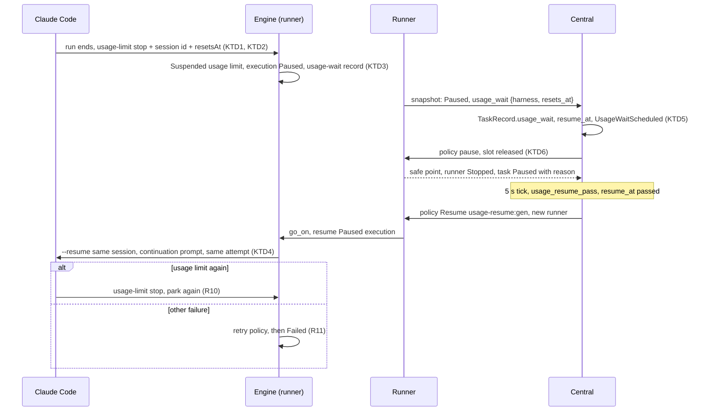
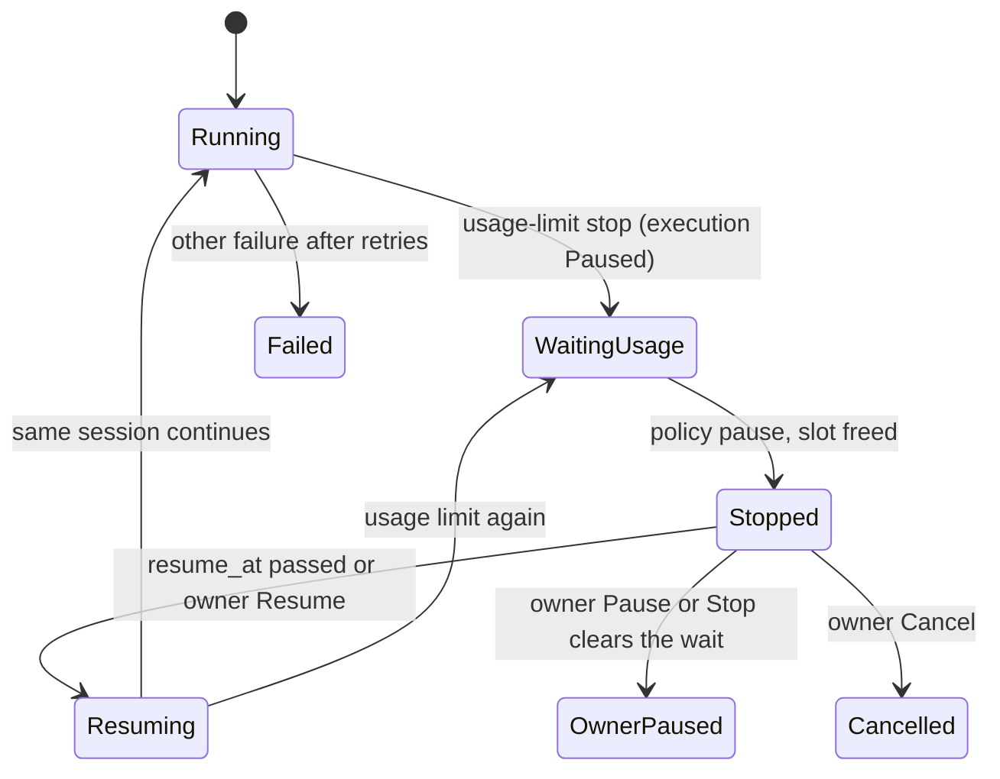

# Pause on Subscription Usage Limit and Resume the Same Session - Plan

## Goal Capsule

- **Objective:** When an agent step stops because the harness subscription has no tokens left, the task waits until the next usage window and then continues the same agent conversation, without a failed attempt in the history and without operator action.
- **Means:** The harness run reports a usage-limit stop as its own outcome (KTD1, KTD2). The engine parks the execution as `Paused` with a durable usage-wait record (KTD3). The control plane frees the slot, shows `Paused` with a reason, and resumes the task at the planned time from a persisted deadline (KTD5, KTD6). The new runner continues the same session as the same attempt (KTD4).
- **Product authority:** The Product Contract below (R1–R12, AE1–AE4, decisions Q1–Q3). Claude Code is the required harness for v1. Other harnesses are context only.
- **Execution profile:** One pull request. Units U1–U8 in dependency order.
- **Merge gate:** No recording gate. Nobody records logs from a real account (Q5, decided). The fixture is built from the stream-json shape found in public reports (External research) and is marked as not recorded. CI (`cargo build`, `cargo test --workspace`) is the only gate. The manual check is not blocking; it runs when a real limit is available.
- **Stop conditions:** Stop and report if the public reports and the official docs give no signal that tells a usage-limit stop apart from other errors (R2).
- **Who finishes:** The implementer builds U1–U8. No developer recording is needed.

---

## Product Contract

Product Contract preservation: Product Contract unchanged. "Outstanding Questions → Deferred to Planning" is resolved in place (KTD1, KTD3, KTD5). The review item about text-only reset parsing (A1) became question Q4. Q4 and Q5 are decided and kept in "Open Questions for the User" as a record. R1 and the Key Decision on detection follow Q5 (no real recording).

### Summary

Narsor detects that a harness run ended because the subscription usage limit is exhausted. It does not count this as a failed attempt. It puts the step in a waiting state until the reset time that the harness reports (or retries at an interval when no reset time is known). Then it resumes the same harness session and the step continues.

### Problem Frame

Today a usage-limit stop is an ordinary harness failure. `ClaudeCodeStreamParser::finish` sets a free-text `failure`, the action error is `harness_failed`, and the retry policy starts a new attempt. Each retry gets a new `action_execution_id` and starts a new session, so the agent loses its context and the new attempt fails at once for the same reason. When the attempts run out, the execution goes to `Failed`, the task goes to `Error`, and an operator must restart the step after the window resets. The history keeps a chain of failed attempts that were not real failures.

A second problem: when the stopped step was itself a resumed session, the failure is classified as `resume_session_rejected`. The runner then asks the operator for a new session, or starts a new one at once when `restart_if_refused` is set. Both paths throw away the session that should continue.

The repo already parses `rate_limit_event` lines into usage limits (window, utilization, `resetsAt`, status `allowed` / `allowed_warning` / `rejected`) and shows them in the TUI and in `narsor usage`. Nothing uses this data to control execution.

### Key Decisions

- **A usage-limit stop is a separate outcome, not a failure.** It does not use an attempt of the retry policy and it does not go through the conductor's failure diagnosis. Governs R4, R5, R10.
- **Continue the existing harness session; never start a new one because of a usage limit.** This is the core of the request: the work done before the stop must not be lost. Governs R5, R8, R9.
- **The reset time from the harness is preferred; periodic retry is the fallback.** The request names this order. Governs R6.
- **The interrupted session is the only source of the stop.** A usage-limit stop is detected only from what the harness returned in that run (stream, `result` line, message). The monitored usage state (`harness_usage.rs`, `narsor usage`) never decides that a step stopped. It may only help to compute the next retry time, and the reset time from the run itself has priority over it. Governs R2, R3, R6.
- **Detection is per harness and based on the harness output shape that is reported publicly** (Q5: no real recording in v1). Claude Code is required in v1. A harness without detection keeps today's behaviour. Governs R1, R2, R3.

### Requirements

**Detection**

- R1. The repo contains a Claude Code stream-json fixture of a run that stops on an exhausted subscription limit, built from the line shape reported publicly (External research). The README marks it as not recorded from a real run and names the lines that signal the stop. The fixture contains no customer data or secrets.
- R2. The Claude Code parser classifies a run as "usage limit reached" only from the signals of the R1 fixture (for example a `rate_limit_event` with status `rejected`, an error marker on the `result` or `assistant` line). An ordinary error, an API error or a `max_turns` stop is not classified as a usage limit.
- R3. When the classification is "usage limit reached", the run carries the harness session id and, when the harness reports it, the reset time of the exhausted window.

**Waiting**

- R4. A usage-limit stop does not use an attempt of the step's retry policy and does not create a failed attempt in the execution history.
- R5. A usage-limit stop on a resumed session is not classified as `resume_session_rejected` and does not ask the operator for a new session.
- R6. The step waits until the reported reset time (plus a short safety margin). When no reset time is known, Narsor tries to resume at a fixed interval until the run no longer stops on the usage limit.
- R7. While it waits, the task shows a state that says the work waits for the usage limit, with the harness and the expected resume time when known. Execution and task status do not show `Failed` / `Error`.
- R8. The wait survives a restart of the runner or the server: after a restart, the waiting step still resumes the same session at the planned time.

**Continuation**

- R9. When the wait ends, Narsor resumes the same harness session (same session id, same working directory) with a short continuation prompt, and the step continues as the same attempt.
- R10. If the resumed session stops on the usage limit again, the step goes back to waiting (R6); this does not count as a failure.
- R11. If the resume fails for a reason that is not the usage limit, the step follows today's failure path (retry policy, then `Failed`).
- R12. The operator can cancel or stop a waiting step with the existing controls; a manual resume during the wait tries the same session at once.

### Key Flows

- F1. Limit reached during a step
  - **Trigger:** A Claude Code run of an agent step stops because the subscription has no tokens.
  - **Steps:** The parser classifies the run as usage limit (R2, R3); the runner records no failed attempt (R4) and puts the step in waiting (R6, R7); at the reset time it resumes the same session (R9); the step ends normally.
  - **Covered by:** R2–R4, R6, R7, R9
- F2. No reset time known
  - **Trigger:** As F1, but no reset time is available.
  - **Steps:** The step waits one retry interval; the resume stops on the limit again (R10) and the step waits again; a later resume succeeds.
  - **Covered by:** R6, R10

### Acceptance Examples

- AE1. **Covers R2, R11.** Given a run that ends with `terminal_reason: api_error` and `API Error: 400`, when it is classified, then it is a normal failure and the retry policy applies.
- AE2. **Covers R4, R6, R9.** Given a step with `max_attempts: 3` and a run that stops on the usage limit with a reset in 2 hours, when the limit resets, then the same session id is resumed, the history shows one attempt, and no attempt is marked failed.
- AE3. **Covers R5.** Given a step that already runs with `resume_session` and stops on the usage limit, when it is classified, then no "start a new session" request goes to the operator and `restart_if_refused` does not start a new session.
- AE4. **Covers R8.** Given a step that waits for a reset at 15:00, when the runner restarts at 14:00, then at 15:00 the same session is resumed.

### Scope Boundaries

- Deferred: detection for codex, opencode and github-copilot (Copilot already reports `has_quota: false` as `Rejected`; it can follow later with its own recording).
- Deferred: holding back new steps or new tasks before they start when the limit is known to be exhausted (proactive scheduling from the usage data).
- Deferred: alarms or notifications about a waiting task outside the existing task state.
- Not included: overage / paid extra usage settings, and switching to another account or harness when the limit is reached.

### Dependencies / Assumptions

- The usage data flow from the earlier work (`docs/brainstorms/2026-10-31-limity-abonamentu-harnessow-requirements.md`) stays as is; this work can read it but does not change its display scope.
- Claude Code accepts `--resume <id>` on a session that stopped on the usage limit, and the conversation before the stop is kept. This is not confirmed (one old public report says the context was lost). The manual check confirms it.
- Session continuation reuses D85 (`docs/dev/architecture.md`): the harness session id is kept in `timeline.json` as soon as the harness reports it, and `resumable_agent_session` finds it. D85 also lets the step failure record keep the session of a failed attempt, but a usage-limit stop is not a failed attempt (R4), so the wait must not depend on a failure record: the session id comes from the attempt's entry in `timeline.json`. Today only an owner comment uses this path; this work makes the usage-limit wait use it without a comment.
- No document in `docs/` (brainstorms, plans, follow-ups, residual review findings, solutions, sources) records what Claude Code sends when the limit is exhausted, and no recording exists. The earlier usage-limit work excluded "alarms and blocking of new tasks at high usage" from its scope, so this work is new.

### Assumptions to Confirm

- A1. Claude Code gives a reset time in the stream (`rate_limit_event.resetsAt` with status `rejected`, or the "resets …" text in the limit message). If only the text exists, a time without a date and with a local timezone is interpreted as the next such time in that timezone.
- A2. The fallback retry interval is 15 minutes, and the safety margin after a reported reset is 1 minute. Both are settings with these defaults.
- A3. The wait has no maximum length; a 7-day window can make a task wait for days. The operator can cancel it (R12).
- A4. Only the step that hit the limit waits. Other steps that hit the limit wait on their own; Narsor does not block steps that did not hit it (decided in Q1).
- A5. The waiting state uses the existing `Paused` task state with a reason, not a new task state (decided in Q2). Today `Paused` is derived only from the runner state, means the owner's decision (D62), and has no reason field in the task summary. So this choice needs a reason field and a change to the task-state derivation. The planner must also decide how a wait of days interacts with the slot-release policy (D62) and with the timed resume that R8 requires; `auto_resume.rs` today resumes only interrupted tasks.
- A6. The continuation prompt is a short fixed text that tells the agent to continue the interrupted work; it is not the step's original prompt.
- A7. No real recording is made (Q5). The fixture is built from public reports. If a real run later differs, the fixture and the parser signals are corrected in a follow-up change.
- A8. A usage-limit stop in a conductor chat or other non-step conversation is out of scope for v1 and keeps today's behaviour.

### Decisions (answered by the project owner on the PR)

- Q1 — **Decided: (a).** (Requirements → Waiting, A4) When one step hits the limit, what happens to other steps and tasks on the same harness subscription?
  - Options: (a, recommended) Only the step that hit the limit waits; the others continue and wait on their own when they hit it. (b) All new agent steps on that harness wait until the reset, so they do not start and stop at once.
- Q2 — **Decided: (a).** (Requirements → Waiting, R7, A5) How should a waiting task look to the operator?
  - Options: (a, recommended) The existing `Paused` state with a reason "usage limit — resumes at HH:MM". (b) A new task state, for example `WaitingForUsage`, in the TUI, CLI and web. (c) The `Running` state with a note.
- Q3 — **Decided: (a).** (Requirements → Waiting, A3) Is there a maximum wait after which the task goes to the operator instead?
  - Options: (a, recommended) No maximum; the step waits until the reset and the operator can cancel it. (b) A maximum (for example 24 hours), then `HumanNeeded`.

### Open Questions for the User

- Q4 — **Decided: (a).** (Assumptions to Confirm, A1; Requirements → Waiting, R6) The step uses only the machine-readable `resetsAt` of the interrupted run. A text-only reset time is not parsed. When `resetsAt` is missing, the fixed retry interval of R6 applies (KTD2).
- Q5 — **Decided: no developer recording.** (Requirements → Detection, R1, A7) The developer does not record logs. The fixture is built from the signals found in public reports (External research) and is marked as not recorded. The PR does not wait for recordings.
- No question is open. Q4 and Q5 stay here as a record of the decisions.

### Outstanding Questions

**Resolve Before Planning**

- None. Q1–Q3 are answered above.

**Deferred to Planning** (resolved in the Planning Contract)

- The exact detection signals for Claude Code: taken from the public reports in U1 (KTD1); corrected later if a real run differs.
- Where the wait lives: in the control-plane task record, with a periodic resume pass next to `auto_resume_pass` (KTD5).
- How the waiting attempt is stored: the execution is `Paused` with a usage-wait record that keeps the attempt's `action_execution_id` (KTD3).

### Sources / Research

- `crates/narsor-exec/src/engine/actions/harness/claude_code.rs` — `rate_limit_event` handling and `finish` failure rules.
- `crates/narsor-exec/src/engine/actions/harness/claude_code/usage.rs` — parsing of `rate_limit_info` (`resetsAt`, status).
- `crates/narsor-exec/src/engine/actions/session/process.rs` — `harness_failed` / `resume_session_rejected`.
- `crates/narsor-exec/src/engine/runner/step/action.rs`, `crates/narsor-exec/src/engine/runner/step/attempt.rs`, `crates/narsor-exec/src/engine/retry.rs` — retry loop, new session per attempt, refused-resume handling.
- `crates/narsor-engine/src/controller_protocol/service/scheduling/harness_usage.rs`, `auto_resume.rs` — in-memory usage state; auto-resume of lost workloads.
- `crates/narsor-engine/src/orchestration/model.rs` — execution status to task state mapping.
- `docs/dev/architecture.md` D70 (harness subscription limits: in-memory state, expiry on access) and D85 (continue the agent session after a lost workload or a failed step).
- `docs/plans/2026-11-22-2125-feat-continue-agent-session-after-loss-or-error-plan.md` — how the session id is kept and found again (`resumable_agent_session`).
- `docs/plans/2026-10-31-001-feat-limity-abonamentu-harnessow-plan.md` — mapping of `rate_limit_info` and the `Rejected` status.
- `docs/solutions/design-patterns/show-only-what-harness-reports-count-without-tokens-record-fixture-2026-11-13.md` — the convention to record a real fixture before the parser relies on a harness field. Q5 makes an exception for this work: the fixture is built from public reports, and the README says so (R1, A7).
- `tests/fixtures/claude-code/README.md` — existing recordings; none shows an exhausted limit.
- `docs/brainstorms/2026-10-31-limity-abonamentu-harnessow-requirements.md` — earlier usage-display work and its scope boundaries.

---

## Planning Contract

### Key Technical Decisions

- KTD1. **The harness run carries a usage-limit stop as data, not as free text.** `HarnessRun` gets an optional usage-limit stop with the harness session id and the reset time when known. The Claude Code parser keeps the last `rate_limit_event` limits it saw (today `take_usage` hands them to the relay and forgets them) and, in `finish`, sets the stop only when a failed run also shows the signals of the R1 fixture. The expected signals, from public reports (External research), are: a `rate_limit_event` with `status: rejected`, a subscription window in `rateLimitType` (`five_hour`, `seven_day`) and `isUsingOverage: false`, and a `result` with `is_error: true` and `api_error: usage_limit_reached`. A `rejected` status with `isUsingOverage: true` is not an exhausted limit, because extra usage covers the run. `terminal_reason: api_error` alone is not a signal, because AE1 has the same value. A real run may later correct this list. The other adapters leave the field empty, so they keep today's behaviour. Reason: `HarnessRun.failure` is free text and `ActionError.error_type` is a string code. A typed field is the only place the session layer can branch on without parsing messages. Governs R2, R3.
- KTD2. **The reset time is the `resetsAt` of the rejected window; text is not parsed in v1.** When more than one window is rejected, the latest `resetsAt` wins, because the run cannot continue before all rejected windows reset. When no rejected window has `resetsAt`, the stop has no reset time and R6's retry interval applies. This is option (a) of Q4; option (b) adds a text parser in U2 and changes nothing else. Governs R6.
- KTD3. **A usage-limit stop suspends the action; it is not an error.** The session layer returns a new `SuspendedAction` variant for a usage-limit stop and does not emit `AgentSessionFailed`. This check comes before `harness_error`, so a resumed run never becomes `resume_session_rejected` (R5). The step runner maps it to a new `AttemptOutcome` variant. That variant parks the execution: status `Paused`, a `WorkflowPaused` event with reason `usage_limit`, and a usage-wait record in `metadata.engine`. The record holds the state id, the `action_execution_id`, the attempt number, the harness, the harness session id and the reset time. No `ActionAttemptFailed`, `ActionFailed` or step-memory failure is written. A new event marks the attempt as waiting for the usage limit, so the timeline shows the attempt as waiting, not failed. Reason: `Paused` is already "parked durably" for crash reconciliation (`engine/recovery.rs` examines only `Running`) and for the runner's `go_on`, so R8 needs no new execution status. `WaitingForEvent` was rejected: it means a `wait` step and maps to the `Running` task state. Governs R4, R5, R8.
- KTD4. **Continuation reuses the agent-input path with a usage-wait origin.** When the engine resumes a `Paused` execution that holds a usage-wait record, it restarts the same action with the same `action_execution_id` and attempt number (`AttemptsFrom`), emits a resume event instead of `ActionStarted`, and writes agent input for the stored harness and session with the fixed continuation prompt of A6. The input is marked as a usage continuation. For such an input, `attempt.rs` does not take the `RESUME_SESSION_REJECTED` branch (operator question or `restart_if_refused`). A failure that is not a usage limit goes the ordinary `AttemptFailure` way into the retry policy, then `Failed` (R11). A new usage-limit stop parks again with the same attempt (R10). Reason: `prepare_harness_attempt` already continues a session from `METADATA_AGENT_INPUT_KEY`, and D85 already resumes sessions from stored ids. Governs R9, R10, R11.
- KTD5. **The wait lives in the control-plane task record and ends through a policy resume.** The runner reports the parked wait in its snapshot (a new optional field with the harness and the reset time). The central stores a `usage_wait` field on `TaskRecord` with `#[serde(default)]`, with the reset time and the computed `resume_at`: reset time plus the safety margin, or the report time plus the retry interval when no reset time is known (R6, A2). A new `usage_resume_pass` runs on the 5-second tick next to `auto_resume_pass`. When `resume_at` has passed and the runner is `Stopped` or `Interrupted`, it sends a `Resume` with `CommandActor::Policy`, the reserved key prefix `usage-resume:<generation>` and `expected_generation`. The command goes through the scheduler's capacity-aware path (`orchestration/scheduler.rs`, the one that decides `queue_resume` under the schedule lock), not through `ControlPlane::auto_resume`, which skips the capacity check because an interrupted task still holds its slot. With a full backend the task goes to `Queued` and keeps its position (D84). `policy_may_act` in `ControlPlane::command_routed` today lets a policy `Resume` act only when `auto_resume_due` holds; it must also accept a task whose usage wait is due. The central stores a reported wait only while the runner state is `Running` or `PauseRequested` and no owner `Pause` or `Stop` cleared a wait in the same generation (KTD7), so a late snapshot cannot restore a wait the owner removed. Reason: the task record is the only state that survives a server restart (JSON per task), and the D58/D62 passes already use this pattern (`ResumeState.next_attempt_at`, `slot_release_due_at`). An in-runner timer (in-memory `tokio::sleep`, like the retry backoff) would hold a slot and a pod for days and would die with the runner. Governs R6, R8.
- KTD6. **A waiting task frees its slot at once and shows `Paused` with a reason.** The usage wait counts as a release class with no grace: `slot_release_pass` sends the existing policy pause, the runner stops at the safe point, and the task becomes `Stopped`. `derive_task_state` returns `Paused` for a task with a usage wait unless the execution is terminal or needs input. `TaskSummary` gets an optional `pause_reason` with a `UsageLimit { harness, resumes_at }` variant and `#[serde(other)] Unrecognized`. Clients render it and derive nothing (D62). Reason: A5 asks for `Paused` with a reason (Q2), and a wait of up to 7 days must not block the backend's slots. On resume, D84 keeps the task's queue position. This changes D62's sentence "`Paused` in `TaskState` means solely the owner's decision"; the new architecture decision records it (U8). Governs R7.
- KTD7. **Owner controls during the wait.** Cancel and archive work as today. An owner `Resume` resumes at once and clears the planned time (R12). An owner `Pause` or `Stop` on a waiting task removes the planned resume, so the task stays `Paused` as an owner pause with no reason. `auto_resume_pass` skips a task that has a usage wait, so a lost runner during the wait is resumed only by `usage_resume_pass` at `resume_at`. Governs R12, R8.
- KTD8. **The retry interval and the safety margin are backend settings.** `BackendLimits` gets `usage_wait_retry_secs` (default 900) and `usage_wait_margin_secs` (default 60), read fresh at every decision, with the range of the existing slot settings. Reason: A2 asks for settings, and `BackendLimits` is where the central already keeps the slot-policy times. Governs R6.

### High-Level Technical Design

### Assumptions

- The control plane receives the snapshot with the usage wait before the runner exits. If the runner is lost first, the task becomes `Interrupted` and the next runner's `go_on` reports the wait again from the execution record, because the record is on task storage.
- An owner `Resume` reaches the runner with an owner actor; a usage resume reaches it with the `usage-resume:` key. The engine continues the session in both cases. The runner does not need to tell them apart.
- `resumable_agent_session` (D85) already returns the in-flight session of a parked attempt. The usage-wait record stores the session id anyway, so the continuation does not depend on `timeline.json` being present.
- A conductor chat (A8) uses the same session layer. The conductor path turns the new suspended outcome back into today's harness error, so its behaviour does not change.

### Sequencing

U1 first. U3 needs U2. U4 needs U3. U5 needs U3. U6 needs U5. U7 needs U6. U8 last.

### Risks

| Risk | Mitigation |
|---|---|
| Real `--resume` after a limit stop may lose the conversation or be refused (one old public report), and the real signals may differ from the reports. | Accepted for v1. A refused resume is not a usage limit, so it takes the ordinary failure path of KTD4 (retry policy, then `Failed`). The manual check confirms it when a limit is available. |
| A new runner sends the snapshot field to an older central, which ignores it: the task shows `Running` with a parked execution and is never resumed. | Update order of D62: central first, then runners and clients. U8 adds it to `docs/operations/updates.md`. |
| A rejected-status `rate_limit_event` appears in a run that ends normally or ends on another error. | KTD1 requires a failed run plus the fixture signals. AE1 test and a test for a rejected event in a successful run. |
| A `rejected` status appears while extra usage covers the run (`isUsingOverage: true`). | KTD1 excludes it. U2 test. |
| Claude Code sometimes exits with code 1 on a weekly limit and writes no `rate_limit_event` and no `result` to stdout (reported for 2.1.303, issue anthropics/claude-code#103820, open). | Such a run is an ordinary failure, which is today's behaviour. Accepted for v1. If a real run shows this case, add it to the fixture README and handle it in a follow-up change (A7). |
| Many tasks on one subscription all resume at the same reset time and some stop again. | Accepted. Q1 chose per-step waits. Each repeated stop re-parks without a failure (R10). |

### External research

Web search on 2026-11-28 for Q5. All sources are user reports or third-party notes, not official Anthropic documentation. The official error page (`code.claude.com/docs/en/errors`) lists the messages "You've hit your session limit" and "You've hit your weekly limit", but the part that was read does not describe `-p` mode or `--resume` after a reset.

- anthropics/claude-code#103820 (open; Claude Code 2.1.303/2.1.304): the author says a normal usage-limit exit in print mode writes three lines and exits with code 1. The reported lines are shortened by the author:
  - `{"type":"rate_limit_event","rate_limit_info":{"status":"rejected","resetsAt":1792494000,"rateLimitType":"seven_day","overageStatus":"rejected","overageDisabledReason":"org_level_disabled","isUsingOverage":false},…}`
  - `{"type":"assistant","error":"rate_limit","api_error":"usage_limit_reached",… "You've hit your weekly limit · resets 11am (UTC)"}`
  - `{"type":"result","api_error":"usage_limit_reached","result":"You've hit your weekly limit · resets 11am (UTC)","terminal_reason":"api_error",…}`
  - The same issue reports a failure case with none of these lines on stdout (see Risks).
- anthropics/claude-code#104690 (open; 2.1.309): a session limit shows `rateLimitType: five_hour` and `isUsingOverage: false`. `overageDisabledReason` also appears on `allowed` events, so it is not a signal. The reporter's runner waits until `resetsAt` and then continues with `--resume`.
- Untether stream-json cheatsheet (2.1.283/2.1.289): `resetsAt` is in epoch seconds. `rejected` with `isUsingOverage: true` is not a throttle. `api_error` is an internal field and can change without notice.
- A Claude Code issue mirrored on claudeissues.com (#3138; the original was not opened) says that `--resume` lost the conversation after a usage limit in an older version. So R9 is not confirmed; the manual check covers it.

Consequence for the plan: KTD1 lists the expected signals, and U1 builds the fixture from them. There is no recording gate (Q5).

### System-Wide Impact

- **Persisted data:** `TaskRecord.usage_wait` and the execution's usage-wait metadata are optional with `#[serde(default)]`. Old records read as "no wait". No record version change is needed (`docs/solutions/conventions/removing-a-field-from-serde-wire-and-persisted-types-2026-11-18.md`).
- **Wire:** `RunnerSnapshotRequest`, `TaskSummary.pause_reason` and a new `TaskEventKind::UsageWaitScheduled` are additive. New enum variants end in `#[serde(other)] Unrecognized` (D58 pattern).
- **Slots:** a waiting task holds no slot. The `usage-resume:` key prefix is reserved like `slot-release:` and `auto-resume:`.
- **Clients:** CLI, TUI and web render the reason. They derive nothing.

---

## Implementation Units

### U1. Build the usage-limit fixture from public reports

- **Goal:** A fixture of a Claude Code run that stops on an exhausted subscription limit, built from the shape in External research. It is not recorded from a real run.
- **Requirements:** R1, A7, Q5.
- **Dependencies:** none.
- **Files:**
  - `tests/fixtures/claude-code/usage_limit_stop.ndjson` (new)
  - `tests/fixtures/claude-code/README.md` (scenario rows, the lines that signal the stop, CLI version, masking note)
- **Approach:**
  1. Write the lines (`rate_limit_event` rejected, `assistant` with `error: rate_limit`, `result` with `api_error: usage_limit_reached`) and a `system/init` line with a session id, in the shape of the other fixtures.
  2. In the README, mark the fixture as built from public reports and not recorded, and name the signal lines.
- **Patterns to follow:** `docs/solutions/design-patterns/show-only-what-harness-reports-count-without-tokens-record-fixture-2026-11-13.md`.
- **Test expectation:** none -- fixtures only; U2 tests read them.
- **Verification:** the file is in the repo and the README says it is not recorded.

### U2. Classify a usage-limit stop in the Claude Code parser

- **Goal:** `HarnessRun` reports a usage-limit stop with the session id and the reset time (KTD1, KTD2).
- **Requirements:** R2, R3, AE1.
- **Dependencies:** U1.
- **Files:**
  - `crates/narsor-exec/src/engine/actions/harness/mod.rs` (the new `HarnessRun` field and its type)
  - `crates/narsor-exec/src/engine/actions/harness/claude_code.rs` (keep the last limits, set the stop in `finish`)
  - `crates/narsor-exec/src/engine/actions/harness/claude_code/usage.rs` (reset time of the rejected windows)
  - the other adapters under `crates/narsor-exec/src/engine/actions/harness/` (field left empty)
  - Tests: `tests/integration/claude_code_classification.rs`
- **Approach:** Keep the limits after `take_usage` hands them to the relay; the relay still gets each event once. In `finish`, set the stop only when `failure` would be set and the R1 signals are present. The test seam is the parser over fixture lines: it catches classification errors, but not how the session layer uses the result (U3).
- **Patterns to follow:** existing rate-limit tests in `claude_code_classification.rs` (`recorded_rate_limit_event`, `usage_of`).
- **Test scenarios:**
  - The `usage_limit_stop` fixture gives a usage-limit stop with the session id of its `system/init` line and the `resetsAt` of the rejected window.
  - Covers AE1. A run that ends with `terminal_reason: api_error` and `API Error: 400` gives an ordinary failure and no usage-limit stop.
  - The `max_turns` fixture gives no usage-limit stop.
  - A rejected event without `resetsAt`, followed by the fixture's `result` stop signal, gives a stop with no reset time.
  - A run with a rejected event that ends with a successful `result` gives no failure and no stop.
  - A failed run with a rejected event and `isUsingOverage: true` gives an ordinary failure and no stop.
- **Verification:** the parser tests pass on the U1 fixture, and the usage relay still receives each `rate_limit_event`.

### U3. Park the execution on a usage-limit stop

- **Goal:** A usage-limit stop suspends the action and parks the execution as `Paused` with a usage-wait record, without a failed attempt (KTD3).
- **Requirements:** R4, R5, R8, AE3, A8.
- **Dependencies:** U2.
- **Files:**
  - `crates/narsor-exec/src/engine/actions/mod.rs` (new `SuspendedAction` variant)
  - `crates/narsor-exec/src/engine/actions/session.rs` and `actions/session/process.rs` (check the stop before `harness_error`, no `AgentSessionFailed`)
  - `crates/narsor-exec/src/engine/runner/step/outcome.rs`, `step/attempt.rs`, `step/action.rs` (new `AttemptOutcome` variant, park)
  - `crates/narsor-exec/src/engine/runner/metadata/` (new usage-wait module next to `pending_step.rs`)
  - `crates/narsor-model/src/` event data (new waiting event) and `crates/narsor-exec/src/engine/timeline.rs` (waiting position)
  - the conductor's use of the session layer (map back to today's error, A8)
  - Tests: `tests/integration/actions_agent.rs`, `tests/integration/engine_recovery.rs`, `tests/integration/timeline.rs`, `tests/integration/engine_support/mod.rs` (a new `AgentTurn` that stops on the usage limit)
- **Approach:**
  1. In the session layer, a run with a usage-limit stop ends as the new suspended outcome before the failure branch.
  2. The step runner writes the usage-wait record and calls `pause_execution` with reason `usage_limit`.
  3. The retry loop does not count the attempt and creates no new `action_execution_id`.
- **Patterns to follow:** `SuspendedAction::AwaitingAgentInput` and `suspend_for_agent_input`; `AttemptOutcome::SessionRefused` for an outcome outside the retry count.
- **Test scenarios:**
  - A step with `max_attempts: 3` whose agent stops on the usage limit ends with execution `Paused`, one `ActionStarted`, no `ActionAttemptFailed` and no `ActionFailed`, and a usage-wait record with that attempt's id and session.
  - Covers AE3. A step resumed with `resume_session` that stops on the usage limit parks the same way: no operator request for a new session, and `restart_if_refused` starts no new session.
  - The timeline shows the attempt as waiting, not failed.
  - Crash reconciliation after the park leaves the execution `Paused`, not `Unknown`.
  - A conductor chat run that stops on the usage limit gives today's harness error.
- **Verification:** no usage-limit test path writes a failure event or a step-memory failure.

### U4. Continue the same session after the wait

- **Goal:** Resuming a parked execution continues the stored session as the same attempt (KTD4).
- **Requirements:** R9, R10, R11, A6, AE2.
- **Dependencies:** U3.
- **Files:**
  - `crates/narsor-exec/src/engine/runner/lifecycle/resume.rs` (detect the usage-wait record)
  - `crates/narsor-exec/src/engine/runner/step/action.rs` (`run_attempts` from the stored attempt)
  - `crates/narsor-exec/src/engine/runner/step/harness_attempt.rs` and `human_input/agent_input.rs` (usage-continuation input)
  - `crates/narsor-exec/src/engine/runner/step/attempt.rs` (skip the refused-session branch for this input)
  - Tests: `tests/integration/actions_agent.rs`, `tests/integration/engine_recovery.rs`
- **Approach:** On resume, take the usage-wait record, write the agent input with the stored harness, session and the A6 prompt, and run the action from the stored `AttemptsFrom`. Remove the record when the attempt runs, so a second resume does not repeat it.
- **Patterns to follow:** `prepare_recover` with `resumable_agent_session` (D85); `take_agent_input`.
- **Test scenarios:**
  - Covers AE2. After a park, a resume runs the agent with the same session id (`resumed_sessions()`) and the continuation prompt. The step completes, the history has one attempt, and no attempt is failed.
  - Covers F2. A continuation that stops on the usage limit again parks again with the same `action_execution_id`.
  - A continuation that fails with another error uses the retry policy: with `max_attempts: 2`, the next attempt starts a new session, and after it fails the execution is `Failed`.
  - A continuation whose resume is refused does not ask the operator for a new session; it goes into the retry policy.
- **Verification:** the scenario tests pass, and no usage-wait record is left after a completed step.

### U5. Report the wait from the runner

- **Goal:** The runner's snapshot tells the central that the execution waits for the usage limit, also after a runner restart.
- **Requirements:** R7, R8.
- **Dependencies:** U3.
- **Files:**
  - `crates/narsor-protocol/src/controller/runner/snapshot.rs` (optional `usage_wait` field with harness and reset time)
  - `crates/narsor-runner/src/runner/snapshot.rs` (fill it from the execution record)
  - `crates/narsor-runner/src/runner/mod.rs` (`go_on` keeps the record for the engine resume)
  - Tests: `tests/integration/orchestration.rs` or the runner's existing snapshot tests
- **Approach:** The field is derived from the execution record, not from memory, so a new runner reports the same wait.
- **Test scenarios:**
  - A snapshot of a parked execution carries the harness and the reset time.
  - A snapshot after the continuation has started carries no wait.
  - A snapshot body without the field still decodes.
- **Verification:** the snapshot tests pass.

### U6. Store the wait, free the slot, and resume on time

- **Goal:** The central keeps the wait in the task record, frees the slot, and resumes the task at `resume_at` (KTD5, KTD6, KTD7, KTD8).
- **Requirements:** R6, R7, R8, R12, AE4, A2, A3, A4.
- **Dependencies:** U5.
- **Files:**
  - `crates/narsor-engine/src/orchestration/model.rs` (`TaskRecord.usage_wait`, `derive_task_state`, `SlotReleaseClass`, `auto_resume_due`)
  - `crates/narsor-engine/src/controller_protocol/service/` snapshot handling (store and clear the wait, `UsageWaitScheduled` event)
  - `crates/narsor-engine/src/controller_protocol/service/scheduling/usage_resume.rs` (new pass) and `scheduling/slot_release.rs`
  - `crates/narsor-engine/src/orchestration/control_plane.rs` (`policy_may_act` accepts a due usage wait, reserved `usage-resume:` prefix, owner Pause or Stop clears the wait) and `crates/narsor-engine/src/orchestration/scheduler.rs` (the pass resumes through the capacity-aware command path)
  - `crates/narsor-server/src/runtime.rs` (`run_periodic_pass` calls the new pass)
  - `crates/narsor-engine/src/environment/backend.rs` (KTD8 settings)
  - `crates/narsor-protocol/src/controller/task/events.rs` (`UsageWaitScheduled`)
  - Tests: `tests/integration/orchestration.rs`, `tests/integration/backend_contract.rs`
- **Approach:** Compute `resume_at` when the snapshot first reports the wait, under the storing rule of KTD5. A later snapshot without the wait clears it. The pass checks the backend controller is online, as `auto_resume_pass` does, resumes through the scheduler path of KTD5, and treats `StaleGeneration` and `IllegalCommand` as "someone was first".
- **Patterns to follow:** `scheduling/auto_resume.rs`, `slot_release_due_at`, `docs/solutions/architecture-patterns/auto-resume-policy-for-lost-workloads-2026-10-11.md`.
- **Test scenarios:**
  - A snapshot with a reset at 15:00 gives `resume_at` 15:01 and an immediate slot release; the task state is `Paused`.
  - A snapshot without a reset time gives `resume_at` 15 minutes after the report.
  - Covers AE4. A task waiting for 15:00 whose central restarts at 14:00 (reload the record from disk) gets a policy resume with the `usage-resume:` key at the first pass after 15:01, not before.
  - A runner lost during the wait is not resumed by `auto_resume_pass`; it is resumed at `resume_at`.
  - With the backend at its limit at `resume_at`, the policy resume puts the task in `Queued` at its own position, not in `Provisioning`.
  - A snapshot that still reports the wait after an owner `Pause` cleared it does not restore the planned resume.
  - An owner `Resume` during the wait resumes at once; an owner `Pause` clears the wait, and the pass does not resume the task.
  - An owner key with the `usage-resume:` prefix is refused as a reserved key.
- **Verification:** the scenario tests pass; a waiting task never holds a slot after its release.

### U7. Show the reason to the operator

- **Goal:** CLI, TUI and web show "usage limit — resumes at HH:MM" for a waiting task (KTD6).
- **Requirements:** R7.
- **Dependencies:** U6.
- **Files:**
  - `crates/narsor-protocol/src/controller/task/summary.rs` (`pause_reason`)
  - `crates/narsor-engine/src/controller_protocol/service/tasks/summary.rs` (fill it)
  - `src/cli/task_text.rs` (`state_hint`)
  - `src/tui/task_app/list.rs`, `src/tui/task_app/detail.rs`, `src/tui/task_app/tabs/info.rs`
  - `crates/narsor-web/ui/js/model.js`, `crates/narsor-web/ui/js/ui/tabs/info.js`
  - Tests: `tests/integration/cli_task_text.rs`, `tests/integration/tui_render.rs`
- **Approach:** Show the harness and the local time of `resume_at`. Without a known reset time, show the planned retry time. The TUI keeps the `Paused` icon.
- **Test scenarios:**
  - The CLI text of a waiting task names the usage limit, the harness and the resume time.
  - The TUI list and detail show the same reason.
  - A summary with an unknown `pause_reason` variant renders as a plain `Paused`.
- **Verification:** the render tests pass; the web view shows the reason in the info tab.

### U8. Documentation

- **Goal:** Record the decision and the operator notes.
- **Requirements:** R1, R7, R8.
- **Dependencies:** U1–U7.
- **Files:**
  - `docs/dev/architecture.md` (new decision D88: usage-limit wait, its change to D62's `Paused` meaning, the reserved key, update order)
  - `docs/operations/updates.md` (update order: central first)
  - `docs/user/` page on task states (the new reason)
  - `tests/fixtures/claude-code/README.md` (done in U1)
- **Test expectation:** none -- documentation only; `tests/integration/docs_links.rs` checks the links.
- **Verification:** the decision text names KTD5–KTD7, and the docs link test passes.

---

## Verification Contract

| Gate | Command or check | Applies to |
|---|---|---|
| Build | `cargo build --workspace --bins` | all units |
| Tests | `cargo test --workspace` (CI runs it with `--locked`) | all units |
| Parser on the fixture | `claude_code_classification` tests read `usage_limit_stop.ndjson` (built from public reports, not recorded) | U1, U2 |
| Manual check (not blocking) | With an exhausted real limit, run one agent step: the task shows `Paused` with the reason, frees the slot, and after the reset the same session continues | when a real limit is available, before or after merge; a difference goes to a follow-up change (A7) |

No `#[ignore]`d test is needed: the fake agent in `engine_support` covers the engine flow.

---

## Definition of Done

- R2–R12 and AE1–AE4 each have a passing test; R1 is the U1 fixture that the U2 tests read.
- The README states that the fixture is built from public reports and is not recorded.
- `cargo test --workspace` passes.
- Q4 and Q5 are decided; U2 has no text parser.
- No dead code from abandoned approaches is left in the diff.
- Per unit: the unit's Verification line holds.
