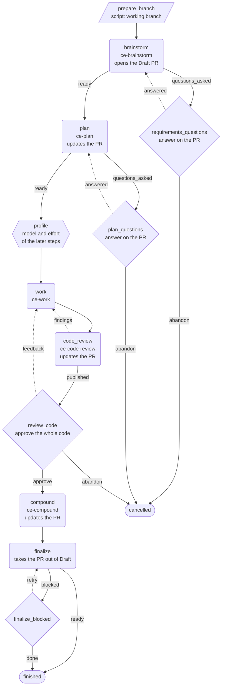

# compound-engineering-change: the flow

This is the flow of [`compound-engineering-change.yaml`](compound-engineering-change.yaml).
Rounded boxes are agent steps, the hexagon is the `profile` step, the
parallelogram is the script step and the diamonds are human gates. A dashed
line is a loop back to an earlier step.

## The pull request

| Step | What happens to the pull request |
|---|---|
| `brainstorm` | Opens it as a Draft with the requirements document. Asks its questions in open threads. |
| `plan` | Pushes the plan and updates the description. Asks its questions in open threads. |
| `code_review` | Pushes the reviewed code and updates the description. Asks the questions of the review in open threads. |
| `compound` | Pushes the learning and updates the description. |
| `finalize` | Takes it out of Draft. It does not approve or merge it. |

## When the person is asked

| Gate | When it opens | What the person does |
|---|---|---|
| `requirements_questions` | Only when `brainstorm` asked something. | Answers in the threads, then chooses `answered`. |
| `plan_questions` | Only when `plan` asked something. | Answers in the threads, then chooses `answered`. |
| `review_code` | Always, after a clean code review. | Chooses `approve` for the whole code, or writes questions and notes in threads and chooses `feedback`. |
| `finalize_blocked` | Only when `finalize` could not take the pull request out of Draft. | Fixes the cause and chooses `retry`, or takes it out of Draft and chooses `done`. |

Every question and every answer is in an open thread of the pull request. An
agent question starts with `✨ [NARSOR] [Q<n>]`. The agent resolves a thread only
after the person answered it, and it leaves the threads of the person's own
questions open.

## The loops

- `requirements_questions` → `brainstorm` and `plan_questions` → `plan`: the
  agent reads the answers in the threads and revises its document.
- `code_review` → `work` (`findings`): the review found something an agent can
  fix without the person. Nothing is pushed until the review is clean.
  `code_review` runs at most 6 times.
- `review_code` → `work` (`feedback`): the agent answers the questions of the
  person, makes the changes they asked for, and the code goes through the code
  review again.
